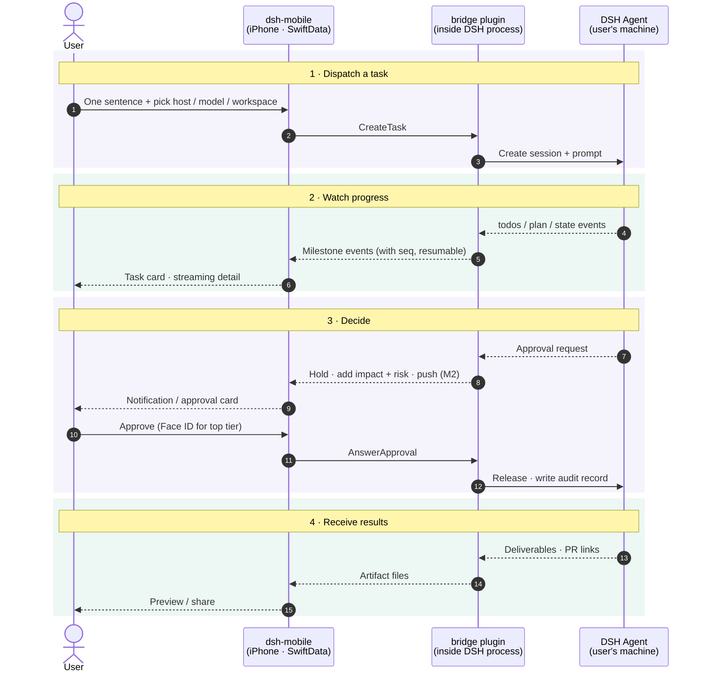

# ARCHITECTURE

Technical design for dsh-mobile. Product intent lives in [STORY.md](STORY.md); this file records **how** we build it and **why**. Decisions here were made on 2026-11-04 against upstream DSH `v0.2.2-rc.1` (developer preview, breaking changes expected).

## 1. Upstream reality (what DSH gives us today)

| STORY.md needs | Upstream DSH today | Consequence |
|---|---|---|
| Reach hosts behind NAT / LAN | Binds one concrete IP (default `127.0.0.1:3080`); no relay/tunnel (Liveshare is experimental, off) | We provide our own listener |
| QR pairing, per-device revoke | One launch token per process → cookie; revoke = revoke everything | We own pairing + device registry |
| Push notifications | None | We own push |
| Approvals belong to the account, pause until answered | No answerer composed ⇒ `unavailable` (fail closed). Chain asks one answerer at a time; no timeout. *Verified by X1 (2026-11-05), confirmed by the user:* under `dsh web` the gateway's Remote forwarder is itself an answerer and holds a request even with no browser tab open, delivering it when a tab connects; subagents never ask (pinned to policy `never`) | We hold approvals in-process, first in the chain, and fan a copy out to the web (D17) |
| Approvals describe impact + risk | Request carries only `toolName`, `callId`, `reason` | We join with the streamed tool call and classify risk |
| Milestone-level progress | Typed projections exist: `todos`, `plan`, `state`, `deliverables/presented`, errors | Map, don't summarize |
| Model list / switch mid-task | `session/modelCatalog`, `session/selectModel` (mid-session OK) | Pass through as-is (principle 8) |
| Add context mid-task: follow-up message, attachment, answer to an agent question (principles 4, 7) | *Verified by X4 (2026-11-05), confirmed by the user:* `sessionController.prompt` accepts messages and file/image parts into a running session; `mode: steer` injects at the next step of the current turn, `mode: queue` waits for the next turn. Agent questions (`ask_user_question`) use their own `user-questions/request` waterfall, held like approvals | Pass through as `SendMessage` + hold questions like approvals (D18) |
| Stable, typed wire API | Undocumented TS-only protocol: `POST /api/<ns>/<method>` + one WebSocket mux `/api/remote.mux`; no schema, no versioning | Never let the app speak it |

## 2. System shape

```
 ┌─ iPhone ────────────┐                               ┌─ user's machine (×N) ──────────────────┐
 │ ① dsh-mobile (iOS)   │  E2E-encrypted frames over    │ DSH host process                        │
 │   SwiftUI            │◄────── one WebSocket ────────►│  └ ② bridge plugin (TypeScript, Cordis) │
 │   SwiftData cache    │  LAN / Tailscale (v1)         │     • facade API (protobuf)             │
 └──────────▲───────────┘  relay (v2, sees ciphertext)  │     • pairing + device registry         │
            │                                           │     • approval holder + risk classifier │
            │ APNs (M2+)                                │     • milestone mapper                  │
            └────────────── Apple APNs ◄────────────────┤     • PushSender → APNs direct          │
                                                        └─────────────────────────────────────────┘
```

Three deliverables, one monorepo:

```
ios/        ① SwiftUI app (+ extensions later)
bridge/     ② DSH companion plugin, TypeScript, installed by the user into their own DSH
protocol/   .proto schema + codegen scripts (Swift + TS); the only contract between ① and ②
gateway/    (deferred) shared push gateway, only if builds are ever distributed to others
```

The Xcode project lives in `ios/dsh-mobile.xcodeproj`.

### Round trip: user → executor → user

The four phases are the phone's four jobs from STORY.md. Every app ⇄ bridge hop is E2E-encrypted.



Solid arrows are the outbound path (user → executor), dashed arrows the return path (executor → user). Not drawn:
- **Push before M2.** In M1 the app receives over the foreground WebSocket only. From M2 the bridge calls APNs directly.
- **Interrupt and mid-task model switch.** Both follow the same outbound shape as "Approve" in phase 3.

## 3. Key decisions

| # | Decision | Rationale |
|---|---|---|
| D1 | **Native SwiftUI** for every M1–M4 screen, including streaming detail (Markdown, code, diffs, terminal) | Core UX; offline from cache; immune to web-UI churn. No WebView in M1. |
| D2 | **iOS 26 minimum, Swift 6 language mode**, complete concurrency checking, `MainActor` default isolation | New app, developer-preview upstream; compile-time race safety for the streaming layer. |
| D3 | **Companion plugin ("bridge")** fills every upstream gap | Fits DSH's everything-is-a-plugin model; user installs it into the DSH they already run (STORY: we don't install/host DSH). Upstream PRs only where a plugin can't reach. |
| D4 | **App talks only to the bridge facade**, never to DSH's native protocol | Upstream breaks often; App builds update slowly. Breakage is absorbed in the bridge. |
| D5 | **Protobuf** schema in `protocol/` → swift-protobuf + protobuf-es | Message-level types inside an encrypted envelope; `oneof` for events; explicit evolution rules. |
| D6 | **App-layer E2E encryption** (Noise-style handshake, host static key delivered by QR). *Provisional — pending user review* (X2, `spikes/x2-noise/README.md`): pairing `Noise_IKpsk1_25519_ChaChaPoly_SHA256` with psk = the QR's 32-byte one-time secret; reconnect `Noise_IK_25519_ChaChaPoly_SHA256`; the pair/reconnect mode and protocol version are bound into the prologue; own Noise state machine on CryptoKit (Swift) and `@noble/*` (TS). | Every transport is untrusted: plain LAN HTTP, Tailscale, future relay. Relay later needs no crypto redesign. IK because the QR already delivers the host key; psk1 rather than psk2 so the host rejects a wrong pairing secret at message 1. CryptoKit has no BLAKE2, hence SHA256. |
| D7 | **Reachability: direct in v1, relay in v2** behind a `Transport` abstraction | v1 user provides reachability (same Wi-Fi, Tailscale/VPN, own domain). |
| D8 | **Push: bridge → APNs directly** with the builder's own `.p8` key, behind a `PushSender` interface | Open-source, self-built debug app: the builder owns both the signing team and the hosts, so no server is needed. A shared gateway is a future `PushSender`. |
| D9 | **SwiftData** local cache; host is source of truth | Offline viewing; nothing lost across disconnects. |
| D10 | **`@Observable` stores + protocol services via `Environment`**, Swift Testing; Apple-first, few vetted SPM deps | Plain, testable, minimal supply chain. Candidates: swift-protobuf, a Markdown renderer. |
| D11 | **Milestones = deterministic mapping of DSH projections** (`todos`, `plan`, `state`, deliverables, errors) | Free, real-time, no hidden model calls. Quality depends on agents using todos. |
| D12 | **Workspace: per-host default + recent-workspace picker** | DSH sessions need a cwd. Prompt-based inference later. |
| D13 | **1 task = 1 DSH session**; "quick answers" are short sessions rendered inline | One entry point (principle 3) without a second concept. |
| D14 | **Strings in a String Catalog, zh-Hans + en; MIT license** | Matches upstream license. |
| D15 | *Provisional, pending user confirmation (T0, 2026-11-05).* **Toolchain**: (a) codegen = `buf` + `protoc-gen-es` (pinned npm devDeps of `bridge/`) and `protoc-gen-swift` built by SwiftPM from the swift-protobuf version `ios/DSHKit` pins; one entry point, `scripts/codegen`. (b) Generated code **is committed**; `scripts/codegen --check` fails if regenerating changes anything. On merge conflicts in generated files, rerun codegen. (c) Bridge uses **pnpm**, pinned by `packageManager` (Node ≥ 24.9, as DSH requires); tests use the built-in `node:test`. (d) Swift: one local package **`ios/DSHKit`** with targets `DSHProtocol` (generated), `DSHCore` (connection, channels, store), `DSHTestSupport` (`FakeBridge`, debug-only); the app target holds views only. `swift test` runs `[auto]` items on the Mac without the shared Simulator. | Everything pinned in the repo, nothing installed globally. Xcode opens and builds without a codegen toolchain, and protocol changes show up in review. pnpm matches how DSH profiles install plugins. |
| D16 | *Provisional, pending user confirmation (T0, 2026-11-05).* **Testability entry points, Debug builds only**: launch arguments `-DSHMFakeBridge YES` (in-process `FakeBridge` instead of the loopback bridge), `-DSHMPresetPrompt <text>` (pre-filled composer), `-DSHMBridgePort <port>` (loopback port, default 47801 in this worktree); accessibility identifiers `composer.prompt`, `composer.send`, `task.status`, `transcript.text`; URL scheme `dshm://pair?…` routed to a pairing stub (S1 replaces it). The scheme is declared only in the Debug Info.plist, the code is behind `#if DEBUG`, and `scripts/check-release-clean` proves a Release build has none of them. | Lets agents and XCUITest drive every slice in the Simulator without a camera or a real DSH, without shipping test hooks. |
| D17 | *Confirmed by the user (X1, 2026-11-05).* **Approval holder ordering: prepend + fan-out.** The bridge registers its `approval/request` answerer with `prepend: true`, parks each request, and re-dispatches a copy down the rest of the chain (the web/desktop forwarder) with its own abort signal. The first answer wins (phone or browser); the other copy is withdrawn. A downstream `unavailable` means "nobody else" and the bridge keeps holding. The bridge's own timeout settles `rejected`, never allow. Alternatives considered: (a) append, i.e. plain `ctx.on`: the web forwarder holds everything first, so the bridge never sees a request; (b) prepend only: the phone owns approvals, but the desktop browser shows a running task with no "input required"; (c) remove the web forwarder via a profile patch: breaks the web UI. | X1 measured all four (`spikes/x1-approval/README.md`). Fan-out keeps the account-wide pause (principle 5) without hiding the request from a user sitting at the computer. Upstream calls sibling order "not a policy-priority mechanism", so S12 pins this behavior with a test. |
| D18 | *Confirmed by the user (X4, 2026-11-05).* **Mid-task context.** The facade exposes `SendMessage { task_id, mode: STEER \| QUEUE, parts }`, mapped 1:1 onto `sessionController.prompt` (files staged through `ctx.fileUploads` first). The app defaults to `STEER`. Agent questions are held by the same bridge holder as approvals (prepend + fan-out on `user-questions/request`), with their own `QuestionPending` / `AnswerQuestion` messages, not folded into approvals. Alternatives considered: default `QUEUE` (the follow-up waits for the whole turn, often minutes); interrupt + re-prompt (loses the running step); presenting questions as approvals (wrong shape: options, multi-select, free text). | X4 measured steer vs queue, attachments and the question seam (`spikes/x4-midtask/README.md`). A follow-up written while the agent works is meant for this task now (principles 4, 7). |
| D19 | *Provisional, pending user confirmation (S3, 2026-11-05).* **Milestones**: (a) **Source** = the raw durable events on `sessionController.follow` (not the projection views): `turn/start` → STARTED (first turn only); `todo/write` → PLANNED when the items (by content, in order) change, then TODO_DONE / TODO_STARTED per status change, done before started; `plan/mode` → PLAN_MODE_ENTERED / LEFT when `active` flips; `llm/retry` → RETRYING with DSH's failure message (the "errors" input, besides a failed turn); `turn/end` → FINISHED, or FAILED with DSH's reason for any other kind. Unknown events and malformed payloads are ignored. Code: `bridge/src/milestones/mapper.ts`. (b) **Wire** = `MilestoneAdded { task_id, seq, kind, text, todos[], time_ms }` (`protocol/milestones.proto`, Event field 60, capability `milestones.v1`): a kind enum plus DSH's own words, and the **whole todo list** on every milestone, so the card never has to fold history and a resumed client (S2) needs only the latest one. `seq` is per task, separate from `AssistantChunk.seq`. The app labels kinds itself (`Features/Milestones/MilestoneLabels.swift`); no text is generated. (c) **UI**: a task card above the transcript leads with the todo in progress, shows `n of m` and the checklist, and opens a timeline (todos + every milestone with its DSH time). The card appears only once milestones arrive, so a bridge without `milestones.v1` gets T0's screen. S2's unified list is expected to reuse `MilestoneCard`. (d) **Testability** (extends D16): `-DSHMFakeMilestones YES` scripts a three-todo task in `FakeBridge`; identifiers `milestone.card` (label = headline, value = `done/total`), `milestone.timeline`, `milestone.row.<seq>` (value = kind), `milestone.todo.<i>` (value = status). (e) **Local acceptance** (`scripts/demo/s3-host.mjs`): DSH's mock LLM can return only one fixed tool call per server, so the script runs one mock instance per agent step (`tool_call_success` with that step's `todo_write` arguments) behind a small proxy that picks the instance by counting `tool_result` blocks, and renames the mock's fixed call id per step. | Deterministic, free, real-time (D11). Raw events rather than projection updates because they carry the transition (which todo just finished) and the DSH timestamp; the projection only says what the list is now. Alternatives considered: (1) forward the `todos` / `plan` projection views as-is and diff in the app: puts DSH semantics in the app, against D4; (2) one milestone per `todo/write` with no kinds: the card couldn't say "finished X"; (3) send only deltas: smaller, but every consumer must fold, and resume (S2) gets harder; (4) for the demo, a hand-written fake Messages server instead of DSH's mock: more code to maintain, and it drifts from the upstream mock. |
| D20 | *Provisional, pending user confirmation (S2, 2026-11-05).* **Durable list + resume.** (a) **Bridge**: tasks belong to the host's `TaskHub` (`bridge/src/s2/`), not to the connection that created them; closing the socket no longer aborts the task. Every event the bridge forwards is appended to one per-host `HostLog` with a monotonic `Event.host_seq` and named by a random `log_id` per bridge process. The log is **in memory** (last 50,000 events). (b) **Protocol** (`protocol/s2.proto`, capability `resume.v1`): `Resume { log_id, after_seq }` replays exactly the logged events after `after_seq`, then answers `Resumed`, and the connection gets every live event from then on. Replay and subscribe happen in one synchronous step, so nothing falls between them. If the cursor doesn't apply (another `log_id`, i.e. the bridge restarted, or trimmed events) the bridge sends `LogReset` first and replays everything it kept. `ListTasks` returns every task with its state. `TaskUpserted` carries state changes; `TaskEnded` stays a task's last event. A client that never sends `Resume` (T0's) still gets only its own tasks' events. (c) **App**: SwiftData cache (`CachedHost` with the cursor `(log_id, last_seq)`, `CachedTask` with the transcript and per-task `last_chunk_seq`), saved within ~150 ms of each event. Events at or below the cursor, and chunks at or below a task's chunk seq, are skipped, so replays are idempotent. After a reset the app calls `ListTasks`; cached tasks still `running` in a log that's gone are marked failed ("the bridge restarted"). (d) **Reconnect**: one sync loop per host in `TaskListStore`: connect, Hello, Resume; on drop, exponential backoff 0.5 s → 30 s. `background()` closes the socket; `foreground()` reconnects at once and resumes. A host that can't be reached is shown as "*name* is offline" with the last connection time; sending to it fails at once with the same words (STORY principle 3). (e) **Testability** (Debug only, like D16): launch arguments `-DSHMFakeBridge offline` (the FakeBridge host is unreachable), `-DSHMResetStore YES` (empty cache), `-DSHMConnectDelay <seconds>` (show the cache before the first connection); accessibility identifiers `host.status`, `tasklist.row`, `tasklist.running` / `.waiting` / `.done`, `composer.error`. `FakeHost` (`DSHTestSupport`) is the fake bridge process whose tasks and log outlive connections. | DSH has no server-side resume cursor, so the bridge keeps one. In-memory is enough for "kill the app, reopen": the bridge keeps running. Alternatives: **persist the log** in `DSH_HOME` (survives bridge restarts, but needs a file format and pruning; revisit if restarts lose real work, together with S4's held approvals); **re-read DSH's own session logs** on resume (no second log, but couples the app's cursor to DSH internals, against D4); **per-task cursors instead of one host seq** (no global order for the list, more state on the phone); **Core Data / GRDB / files instead of SwiftData** (D9 already chose SwiftData). |
| D23 | *Provisional, pending user confirmation (batch 1 integration, 2026-11-05).* **S2 × S3 seam: cached milestones.** (a) **Bridge**: `MilestoneAdded` is a host-log event like any other (`TaskHub` numbers it with `host_seq`), so `Resume` replays missed milestones exactly once. (b) **App**: `CachedTask.milestonesData` holds the task's whole `MilestoneTimeline` as JSON (`MilestoneTimeline` is `Codable`); `TaskListStore` adds each milestone through `MilestoneTimeline.add`, which drops stale or repeated seqs, so replays are idempotent. `TaskRow.milestones` feeds the `MilestoneCard` in the list row (no chevron there; `maxTodos` 3) and in the task detail, which opens the timeline. (c) **Test support**: `FakeHost` task ids carry a per-instance random prefix, like DSH session ids, so a task cached by an earlier launch never collides with a new one. Alternatives considered: cache only the latest milestone (enough for the card, since each one carries the whole todo list, but the detail timeline would then be empty after a reopen); a SwiftData `CachedMilestone` model per milestone (queryable, but more schema and a relationship for data only ever read whole); a `latest_milestone` field on `TaskSummary` for `ListTasks` (helps after a bridge restart, but the in-memory log is gone then anyway, D20). | Milestone timelines are short (tens of entries) and always read whole. The card and the timeline stay in the cache across kill/reopen and with the host offline (STORY principle 4). |

## 4. iOS app (`ios/`)

### Layers

```
Features (SwiftUI views + @Observable stores)
   TaskList · TaskDetail · Composer · Approvals · Hosts/Pairing · Settings
Domain (pure Swift value types)
   Host · Task · Milestone · ApprovalRequest · Artifact · ModelChoice
Services (protocols; real + fake implementations)
   HostRegistry · SessionSync · ApprovalService · ArtifactService · CredentialStore
Transport
   SecureChannel (Noise over WebSocket) · RPC + event-stream mux · Reconnect/backoff
Persistence
   SwiftData models (per-host task/milestone/approval cache, sync cursors)
Generated
   protocol/ → Swift (swift-protobuf)
```

- **One `HostConnection` actor per paired host.** It owns its WebSocket, handshake, reconnect, and resume cursor, and emits domain events into SwiftData. Views observe SwiftData / stores, never the socket.
- **Unified task list** (principle 4) is a SwiftData query across hosts; a host is a task attribute. Offline hosts are named explicitly (principle 3).
- **Resync on reconnect**: the bridge keeps a per-host monotonic event seq (DSH has no server-side resume cursor), so the app sends `resume(after: seq)` and receives the gap, including still-pending approvals. Built in S2: see D20 (`TaskListStore`, `bridge/src/s2/`).
- **Background**: iOS cannot keep sockets alive. M1 refreshes on foreground. M2 uses push to wake the user; M4 Live Activities.
- **Keys**: device identity key in Secure Enclave (P-256, signing); Noise static key (X25519) in Keychain, `ThisDeviceOnly`. Secure Enclave doesn't support X25519, which is why there are two keys.

### Free Personal Team constraints (current signing setup)

Builds expire after 7 days; **no push**, so M2 requires a paid account. App Groups (needed for the Share Extension in M3) must be verified on the free team before M3. M1 depends on neither.

## 5. Bridge plugin (`bridge/`)

A Cordis plugin installed into the user's DSH profile. Responsibilities:

1. **Listener**: its own WebSocket port (DSH's webserver binds loopback only). All payloads are E2E-encrypted, so a plain-HTTP LAN bind is acceptable.
2. **Pairing**: shows a QR (in DSH UI or terminal) containing host address(es), host static public key, and a one-time pairing secret. The device registry supports list/revoke (principle 9).
3. **Facade**: translates DSH sessions, projections, models, and files into the protobuf API. It's the only code that knows DSH internals.
4. **Approval holder**: registers an in-process answerer on DSH's `approval/request` waterfall (a supported seam per upstream `docs/subsystems/approval.md`). It parks requests until a paired device answers, so they never hit `unavailable` just because the phone is asleep. *D17:* it registers first in the chain and fans a copy out to the web/desktop forwarder; the first answer wins. It joins the request with the streamed tool call via `callId` to describe impact, assigns a risk tier, and writes the audit trail (who, when, which device, what). It auto-cancels after a configurable timeout and notifies (principle 5: never default-allow).
5. **Milestone mapper**: DSH session events (`todo/write`, `plan/mode`, `llm/retry`, turn start/end) → `MilestoneAdded` events (D19).
6. **PushSender** (M2): APNs HTTP/2 with token auth (`.p8`), sandbox environment for debug builds. Payloads are minimal or encrypted to the device key.

## 6. Protocol (`protocol/`)

- **Envelope**: WebSocket binary frames → Noise transport messages → protobuf `Frame { oneof { Request, Response, Event, … } }`.
- **RPC**: request/response correlated by id. Examples: `ListTasks`, `CreateTask`, `Prompt`, `Interrupt`, `AnswerApproval`, `ModelCatalog`, `SelectModel`, `ListWorkspaces`, `GetArtifact`.
- **Events**: server push with a per-host `seq`. Examples: `TaskUpserted`, `MilestoneAdded`, `AssistantChunk`, `ApprovalPending`, `ApprovalResolved`, `ArtifactPresented`, `HostStatus`.
- **Versioning**: `Hello { protocol_version, capabilities[] }` on connect. Protobuf additive-only rules. The bridge supports N and N-1.

## 7. Milestones

| Milestone | Scope |
|---|---|
| **M1** | Pairing (QR + E2E), unified task list, composer (text, host, workspace, model + effort), milestone progress + native streaming detail, interrupt, mid-task model switch, **in-app approvals** held by the bridge (basic impact view). Foreground only. |
| **M2** | Push via bridge → APNs (needs paid account), risk tiers, Face ID for top tier (no lock-screen approval), plan alignment + pre-authorization, pause timeout + re-confirm. Mid-task context: follow-up messages and answers to agent questions (attachments with M3), pending §8.6. |
| **M3** | Artifacts: Quick Look preview, share sheet out; Share Extension + attachment upload (share-in); photos as context. |
| **M4** | Live Activities / Dynamic Island, voice task entry. Relay transport (v2 reachability). |

## 8. Open risks / spikes before M1 coding

1. **Approval answerer ownership**: upstream treats a "non-owning" answerer as `unavailable`. Verify that a plugin answerer can own approvals for all agents, and decide ordering versus the web/desktop UI answerers (who asks first, and does the web UI still see them). *Answered by X1 (2026-11-05), confirmed by the user:* yes for every root agent; subagents never ask. Ordering is registration order, so the bridge prepends and fans out (D17); see `spikes/x1-approval/README.md`. The desktop app is unverified.
2. **Plugin listener**: confirm a Cordis plugin can open its own port, and see how the user installs and enables a bundle or plugin in their profile. *Answered by T0 (2026-11-05):* yes. The bridge opens its own `ws` listener from `apply()`, and `dsh plugin --profile <p> add <dir>` installs it (needs `pnpm` on PATH); see `bridge/README.md`. In-process `ctx.sessionController` / `ctx.workspaceController` calls run as the owner, so no Peer is needed (`bridge/src/dsh.ts`).
3. **Noise implementation**: a CryptoKit-based Swift implementation plus TS (`@noble/*`) must interoperate. Validate both against the official Noise test vectors before trusting either.
4. **Upstream churn**: pin the supported DSH version range in the bridge; add a CI job against DSH `main`.
5. **Streaming Markdown renderer**: choose an SPM package or build on `swift-markdown`, and benchmark incremental rendering of long transcripts.
6. **Mid-task context** (before M2, not blocking M1):
   - Can the bridge add a message or attachment to a session that is still running? Is it queued for the next turn or injected immediately?
   - How does an agent's open question to the user surface, as distinct from an approval request? It needs the same hold-and-notify treatment as approvals (principle 4).
   - *Answered by X4 (2026-11-05), confirmed by the user:* yes, and the caller picks `steer` (next step of this turn) or `queue` (next turn). Files and images work mid-task. Questions use `user-questions/request` and can be held like approvals (D18); see `spikes/x4-midtask/README.md`.
