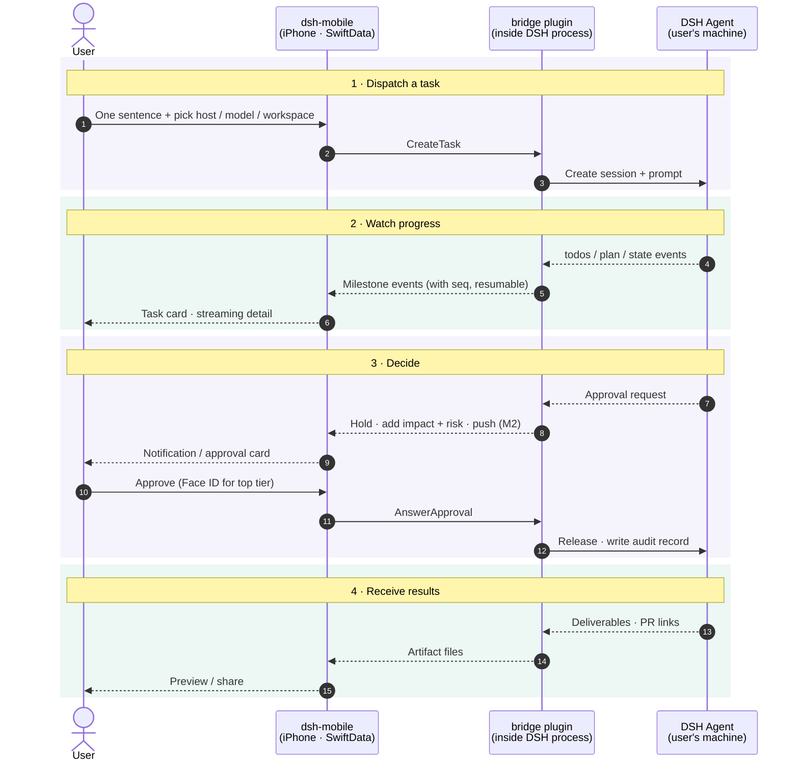

# ARCHITECTURE

Technical design for dsh-mobile. Product intent lives in [STORY.md](STORY.md); this file records **how** we build it and **why**. Decisions here were made on 2026-11-04 against upstream DSH `v0.2.2-rc.1` (developer preview, breaking changes expected).

## 1. Upstream reality (what DSH gives us today)

| STORY.md needs | Upstream DSH today | Consequence |
|---|---|---|
| Reach hosts behind NAT / LAN | Binds one concrete IP (default `127.0.0.1:3080`); no relay/tunnel (Liveshare is experimental, off) | We provide our own listener |
| QR pairing, per-device revoke | One launch token per process → cookie; revoke = revoke everything | We own pairing + device registry |
| Push notifications | None | We own push |
| Approvals belong to the account, pause until answered | No answerer composed ⇒ `unavailable` (fail closed). Chain asks one answerer at a time; no timeout. *Verified by X1 (2026-11-05), confirmed by the user:* under `dsh web` the gateway's Remote forwarder is itself an answerer and holds a request even with no browser tab open, delivering it when a tab connects; subagents never ask (pinned to policy `never`) | We hold approvals in-process, first in the chain, and fan a copy out to the web (D17) |
| Approvals describe impact + risk | Request carries only `toolName`, `callId`, `reason` | We join with the streamed tool call and classify risk |
| Milestone-level progress | Typed projections exist: `todos`, `plan`, `state`, `deliverables/presented`, errors | Map, don't summarize |
| Model list / switch mid-task | `session/modelCatalog`, `session/selectModel` (mid-session OK) | Pass through as-is (principle 8) |
| Add context mid-task: follow-up message, attachment, answer to an agent question (principles 4, 7) | *Verified by X4 (2026-11-05), confirmed by the user:* `sessionController.prompt` accepts messages and file/image parts into a running session; `mode: steer` injects at the next step of the current turn, `mode: queue` waits for the next turn. Agent questions (`ask_user_question`) use their own `user-questions/request` waterfall, held like approvals | Pass through as `SendMessage` + hold questions like approvals (D18) |
| Stable, typed wire API | Undocumented TS-only protocol: `POST /api/<ns>/<method>` + one WebSocket mux `/api/remote.mux`; no schema, no versioning | Never let the app speak it |

## 2. System shape

```
 ┌─ iPhone ────────────┐                               ┌─ user's machine (×N) ──────────────────┐
 │ ① dsh-mobile (iOS)   │  E2E-encrypted frames over    │ DSH host process                        │
 │   SwiftUI            │◄────── one WebSocket ────────►│  └ ② bridge plugin (TypeScript, Cordis) │
 │   SwiftData cache    │  LAN / Tailscale (v1)         │     • facade API (protobuf)             │
 └──────────▲───────────┘  relay (v2, sees ciphertext)  │     • pairing + device registry         │
            │                                           │     • approval holder + risk classifier │
            │ APNs (M2+)                                │     • milestone mapper                  │
            └────────────── Apple APNs ◄────────────────┤     • PushSender → APNs direct          │
                                                        └─────────────────────────────────────────┘
```

Three deliverables, one monorepo:

```
ios/        ① SwiftUI app (+ extensions later)
bridge/     ② DSH companion plugin, TypeScript, installed by the user into their own DSH
protocol/   .proto schema + codegen scripts (Swift + TS); the only contract between ① and ②
gateway/    (deferred) shared push gateway, only if builds are ever distributed to others
```

The Xcode project lives in `ios/dsh-mobile.xcodeproj`.

### Round trip: user → executor → user

The four phases are the phone's four jobs from STORY.md. Every app ⇄ bridge hop is E2E-encrypted.



Solid arrows are the outbound path (user → executor), dashed arrows the return path (executor → user). Not drawn:
- **Push before M2.** In M1 the app receives over the foreground WebSocket only. From M2 the bridge calls APNs directly.
- **Interrupt and mid-task model switch.** Both follow the same outbound shape as "Approve" in phase 3.

## 3. Key decisions

| # | Decision | Rationale |
|---|---|---|
| D1 | **Native SwiftUI** for every M1–M4 screen, including streaming detail (Markdown, code, diffs, terminal) | Core UX; offline from cache; immune to web-UI churn. No WebView in M1. |
| D2 | **iOS 26 minimum, Swift 6 language mode**, complete concurrency checking, `MainActor` default isolation | New app, developer-preview upstream; compile-time race safety for the streaming layer. |
| D3 | **Companion plugin ("bridge")** fills every upstream gap | Fits DSH's everything-is-a-plugin model; user installs it into the DSH they already run (STORY: we don't install/host DSH). Upstream PRs only where a plugin can't reach. |
| D4 | **App talks only to the bridge facade**, never to DSH's native protocol | Upstream breaks often; App builds update slowly. Breakage is absorbed in the bridge. |
| D5 | **Protobuf** schema in `protocol/` → swift-protobuf + protobuf-es | Message-level types inside an encrypted envelope; `oneof` for events; explicit evolution rules. |
| D6 | **App-layer E2E encryption** (Noise-style handshake, host static key delivered by QR). *Provisional — pending user review* (X2, `spikes/x2-noise/README.md`): pairing `Noise_IKpsk1_25519_ChaChaPoly_SHA256` with psk = the QR's 32-byte one-time secret; reconnect `Noise_IK_25519_ChaChaPoly_SHA256`; the pair/reconnect mode and protocol version are bound into the prologue; own Noise state machine on CryptoKit (Swift) and `@noble/*` (TS). | Every transport is untrusted: plain LAN HTTP, Tailscale, future relay. Relay later needs no crypto redesign. IK because the QR already delivers the host key; psk1 rather than psk2 so the host rejects a wrong pairing secret at message 1. CryptoKit has no BLAKE2, hence SHA256. |
| D7 | **Reachability: direct in v1, relay in v2** behind a `Transport` abstraction | v1 user provides reachability (same Wi-Fi, Tailscale/VPN, own domain). |
| D8 | **Push: bridge → APNs directly** with the builder's own `.p8` key, behind a `PushSender` interface | Open-source, self-built debug app: the builder owns both the signing team and the hosts, so no server is needed. A shared gateway is a future `PushSender`. |
| D9 | **SwiftData** local cache; host is source of truth | Offline viewing; nothing lost across disconnects. |
| D10 | **`@Observable` stores + protocol services via `Environment`**, Swift Testing; Apple-first, few vetted SPM deps | Plain, testable, minimal supply chain. **Streaming detail (X3, provisional pending user confirmation):** render completed Markdown blocks once; reparse only the unfinished tail as chunks arrive. Use Foundation attributed Markdown for prose and native verbatim rows for fenced code, diffs and terminal output. Compared with reparsing the full prefix, the retained-block path reduced simulator p95 update time from 12.80–15.06 ms to 1.14–2.06 ms on 5,000 lines. Real-device timing remains open; see `spikes/x3-markdown/README.md`. |
| D11 | **Milestones = deterministic mapping of DSH projections** (`todos`, `plan`, `state`, deliverables, errors) | Free, real-time, no hidden model calls. Quality depends on agents using todos. |
| D12 | **Workspace: per-host default + recent-workspace picker** | DSH sessions need a cwd. Prompt-based inference later. |
| D13 | **1 task = 1 DSH session**; "quick answers" are short sessions rendered inline | One entry point (principle 3) without a second concept. |
| D14 | **Strings in a String Catalog, zh-Hans + en; MIT license** | Matches upstream license. |
| D15 | *Provisional, pending user confirmation (T0, 2026-11-05).* **Toolchain**: (a) codegen = `buf` + `protoc-gen-es` (pinned npm devDeps of `bridge/`) and `protoc-gen-swift` built by SwiftPM from the swift-protobuf version `ios/DSHKit` pins; one entry point, `scripts/codegen`. (b) Generated code **is committed**; `scripts/codegen --check` fails if regenerating changes anything. On merge conflicts in generated files, rerun codegen. (c) Bridge uses **pnpm**, pinned by `packageManager` (Node ≥ 24.9, as DSH requires); tests use the built-in `node:test`. (d) Swift: one local package **`ios/DSHKit`** with targets `DSHProtocol` (generated), `DSHCore` (connection, channels, store), `DSHTestSupport` (`FakeBridge`, debug-only); the app target holds views only. `swift test` runs `[auto]` items on the Mac without the shared Simulator. DSHKit targets macOS 15 for these host tests: a test bundle built for macOS 26 cannot load on a macOS 15 development machine with Xcode 26. The app targets iOS 26 (D2). | Everything pinned in the repo, nothing installed globally. Xcode opens and builds without a codegen toolchain, and protocol changes show up in review. pnpm matches how DSH profiles install plugins. |
| D16 | *Provisional, pending user confirmation (T0, 2026-11-05).* **Testability entry points, Debug builds only**: launch arguments `-DSHMFakeBridge YES` (in-process `FakeBridge` instead of the loopback bridge), `-DSHMPresetPrompt <text>` (pre-filled composer), `-DSHMBridgePort <port>` (loopback port, default 47801 in this worktree); accessibility identifiers `composer.prompt`, `composer.send`, `task.status`, `transcript.text`; URL scheme `dshm://pair?…` routed to a pairing stub (S1 replaces it). The scheme is declared only in the Debug Info.plist, the code is behind `#if DEBUG`, and `scripts/check-release-clean` proves a Release build has none of them. | Lets agents and XCUITest drive every slice in the Simulator without a camera or a real DSH, without shipping test hooks. |
| D17 | *Confirmed by the user (X1, 2026-11-05).* **Approval holder ordering: prepend + fan-out.** The bridge registers its `approval/request` answerer with `prepend: true`, parks each request, and re-dispatches a copy down the rest of the chain (the web/desktop forwarder) with its own abort signal. The first answer wins (phone or browser); the other copy is withdrawn. A downstream `unavailable` means "nobody else" and the bridge keeps holding. The bridge's own timeout settles `rejected`, never allow. Alternatives considered: (a) append, i.e. plain `ctx.on`: the web forwarder holds everything first, so the bridge never sees a request; (b) prepend only: the phone owns approvals, but the desktop browser shows a running task with no "input required"; (c) remove the web forwarder via a profile patch: breaks the web UI. | X1 measured all four (`spikes/x1-approval/README.md`). Fan-out keeps the account-wide pause (principle 5) without hiding the request from a user sitting at the computer. Upstream calls sibling order "not a policy-priority mechanism", so S12 pins this behavior with a test. |
| D18 | *Confirmed by the user (X4, 2026-11-05).* **Mid-task context.** The facade exposes `SendMessage { task_id, mode: STEER \| QUEUE, parts }`, mapped 1:1 onto `sessionController.prompt` (files staged through `ctx.fileUploads` first). The app defaults to `STEER`. Agent questions are held by the same bridge holder as approvals (prepend + fan-out on `user-questions/request`), with their own `QuestionPending` / `AnswerQuestion` messages, not folded into approvals. Alternatives considered: default `QUEUE` (the follow-up waits for the whole turn, often minutes); interrupt + re-prompt (loses the running step); presenting questions as approvals (wrong shape: options, multi-select, free text). | X4 measured steer vs queue, attachments and the question seam (`spikes/x4-midtask/README.md`). A follow-up written while the agent works is meant for this task now (principles 4, 7). |
| D19 | *Provisional, pending user confirmation (S3, 2026-11-05).* **Milestones**: (a) **Source** = the raw durable events on `sessionController.follow` (not the projection views): `turn/start` → STARTED (first turn only); `todo/write` → PLANNED when the items (by content, in order) change, then TODO_DONE / TODO_STARTED per status change, done before started; `plan/mode` → PLAN_MODE_ENTERED / LEFT when `active` flips; `llm/retry` → RETRYING with DSH's failure message (the "errors" input, besides a failed turn); `turn/end` → FINISHED, or FAILED with DSH's reason for any other kind. Unknown events and malformed payloads are ignored. Code: `bridge/src/milestones/mapper.ts`. (b) **Wire** = `MilestoneAdded { task_id, seq, kind, text, todos[], time_ms }` (`protocol/milestones.proto`, Event field 60, capability `milestones.v1`): a kind enum plus DSH's own words, and the **whole todo list** on every milestone, so the card never has to fold history and a resumed client (S2) needs only the latest one. `seq` is per task, separate from `AssistantChunk.seq`. The app labels kinds itself (`Features/Milestones/MilestoneLabels.swift`); no text is generated. (c) **UI**: a task card above the transcript leads with the todo in progress, shows `n of m` and the checklist, and opens a timeline (todos + every milestone with its DSH time). The card appears only once milestones arrive, so a bridge without `milestones.v1` gets T0's screen. S2's unified list is expected to reuse `MilestoneCard`. (d) **Testability** (extends D16): `-DSHMFakeMilestones YES` scripts a three-todo task in `FakeBridge`; identifiers `milestone.card` (label = headline, value = `done/total`), `milestone.timeline`, `milestone.row.<seq>` (value = kind), `milestone.todo.<i>` (value = status). (e) **Local acceptance** (`scripts/demo/s3-host.mjs`): DSH's mock LLM can return only one fixed tool call per server, so the script runs one mock instance per agent step (`tool_call_success` with that step's `todo_write` arguments) behind a small proxy that picks the instance by counting `tool_result` blocks, and renames the mock's fixed call id per step. | Deterministic, free, real-time (D11). Raw events rather than projection updates because they carry the transition (which todo just finished) and the DSH timestamp; the projection only says what the list is now. Alternatives considered: (1) forward the `todos` / `plan` projection views as-is and diff in the app: puts DSH semantics in the app, against D4; (2) one milestone per `todo/write` with no kinds: the card couldn't say "finished X"; (3) send only deltas: smaller, but every consumer must fold, and resume (S2) gets harder; (4) for the demo, a hand-written fake Messages server instead of DSH's mock: more code to maintain, and it drifts from the upstream mock. |
| D20 | *Provisional, pending user confirmation (S2, 2026-11-05).* **Durable list + resume.** (a) **Bridge**: tasks belong to the host's `TaskHub` (`bridge/src/s2/`), not to the connection that created them; closing the socket no longer aborts the task. Every event the bridge forwards is appended to one per-host `HostLog` with a monotonic `Event.host_seq` and named by a random `log_id` per bridge process. The log is **in memory** (last 50,000 events). (b) **Protocol** (`protocol/s2.proto`, capability `resume.v1`): `Resume { log_id, after_seq }` replays exactly the logged events after `after_seq`, then answers `Resumed`, and the connection gets every live event from then on. Replay and subscribe happen in one synchronous step, so nothing falls between them. If the cursor doesn't apply (another `log_id`, i.e. the bridge restarted, or trimmed events) the bridge sends `LogReset` first and replays everything it kept. `ListTasks` returns every task with its state. `TaskUpserted` carries state changes; `TaskEnded` stays a task's last event. A client that never sends `Resume` (T0's) still gets only its own tasks' events. (c) **App**: SwiftData cache (`CachedHost` with the cursor `(log_id, last_seq)`, `CachedTask` with the transcript and per-task `last_chunk_seq`), saved within ~150 ms of each event. Events at or below the cursor, and chunks at or below a task's chunk seq, are skipped, so replays are idempotent. After a reset the app calls `ListTasks`; cached tasks still `running` in a log that's gone are marked failed ("the bridge restarted"). (d) **Reconnect**: one sync loop per host in `TaskListStore`: connect, Hello, Resume; on drop, exponential backoff 0.5 s → 30 s. `background()` closes the socket; `foreground()` reconnects at once and resumes. A host that can't be reached is shown as "*name* is offline" with the last connection time; sending to it fails at once with the same words (STORY principle 3). (e) **Testability** (Debug only, like D16): launch arguments `-DSHMFakeBridge offline` (the FakeBridge host is unreachable), `-DSHMResetStore YES` (empty cache), `-DSHMConnectDelay <seconds>` (show the cache before the first connection); accessibility identifiers `host.status`, `tasklist.row`, `tasklist.running` / `.waiting` / `.done`, `composer.error`. `FakeHost` (`DSHTestSupport`) is the fake bridge process whose tasks and log outlive connections. | DSH has no server-side resume cursor, so the bridge keeps one. In-memory is enough for "kill the app, reopen": the bridge keeps running. Alternatives: **persist the log** in `DSH_HOME` (survives bridge restarts, but needs a file format and pruning; revisit if restarts lose real work, together with S4's held approvals); **re-read DSH's own session logs** on resume (no second log, but couples the app's cursor to DSH internals, against D4); **per-task cursors instead of one host seq** (no global order for the list, more state on the phone); **Core Data / GRDB / files instead of SwiftData** (D9 already chose SwiftData). |
| D21 | *Provisional, pending user confirmation (S1, 2026-11-05).* **Pairing and the encrypted wire** (implements D6). (a) **Offer** = the URL `dshm://pair?v=1&n=<host name>&a=<host:port,…>&k=<host key>&i=<offer id>&s=<secret>&x=<expiry>` (k/i/s unpadded base64url, 32/16/32 bytes; x Unix seconds), shown by the bridge as a terminal QR (`uqr`) at startup when no device is paired and on demand with `node bridge/lib/scripts/pair.js`; the same URL is D16's Debug deep link. Offers are **single use** (burnt on the first valid Noise message 1, before the host answers) and expire after **10 minutes**; the app also refuses an expired offer before connecting. (b) **Wire**: the app's first WebSocket message is `[1, mode, offer id if pairing] ‖ Noise message 1`; the header is bound into the prologue (`"dshm/1" ‖ header`); handshake payloads are empty; then one WebSocket binary message = one Noise transport message = one protobuf `Frame`. Refusals are WebSocket close codes 4000 bad hello / 4001 pairing rejected (unknown, expired, used, wrong secret) / 4002 handshake failed / 4003 device unknown. (c) **Bridge state** in `$DSH_HOME/dsh-mobile-bridge/` (dir 0700, files 0600, atomic writes): host X25519 key, offers, device registry (store only; list/revoke UI is S10). A device is registered only after its first valid transport message. (d) **Listener**: default `0.0.0.0:47801`, Noise on every path. The plaintext channel exists only with `devPlaintext: true`, only on `/plaintext`, and only on a loopback listener; in the app `PlaintextChannel` is compiled into Debug builds only (`scripts/check-release-clean`). `scripts/dsh-up.mjs` (the dev host) turns `devPlaintext` on and binds loopback so T0's demo keeps working. (e) **App**: tries the offer's addresses in order; saves the host (name, addresses with the working one first, host key) as JSON in Application Support; reconnects with IK to the first address. (f) Golden transcripts (`protocol/fixtures/noise/transcripts.json`, fixed keys) are checked by both the TS and the Swift tests. Known limits: Noise caps a message at 65535 bytes (fine for M1's frames; large artifacts in M3 need chunking); one address at a time on reconnect. | Alternatives: a JSON or protobuf offer inside the QR instead of a URL (a URL doubles as the Debug deep link and a pasteable link next to the QR); multi-use or longer-lived offers (single use + short expiry limits a leaked screenshot); registering the device right after message 1 (waiting for the first transport message means only a phone that finished the handshake is recorded); a separate plaintext port (a path on the same port keeps one listener and one firewall rule). |
| D22 | *Provisional, pending user confirmation (S1, 2026-11-05).* **No Secure Enclave identity key in M1.** The phone's only key is its Noise static key (X25519, 32 bytes) in the Keychain (`kSecAttrAccessibleAfterFirstUnlockThisDeviceOnly`, never synced or backed up), one per device and shared by every paired host. The bridge's device registry is keyed by it, and IK authenticates it on every connection. A Secure Enclave P-256 signing key comes back when something needs a signature that the transport can't give: Face ID-gated approvals for the top risk tier and a non-repudiable audit trail (M2). | The X2 open question. The SE key would add nothing to M1: Noise can't use P-256 (CryptoKit's SE supports P-256 only, Noise here is X25519), so it would be a second, unused identity to register and keep in sync. Alternatives: SE P-256 key now, signing a registration blob (more code and state, no M1 consumer); per-host Noise keys (unlinkable across hosts, but more Keychain state; revisit with S9 multi-host). |
| D23 | *Provisional, pending user confirmation (batch 1 integration, 2026-11-05).* **S2 × S3 seam: cached milestones.** (a) **Bridge**: `MilestoneAdded` is a host-log event like any other (`TaskHub` numbers it with `host_seq`), so `Resume` replays missed milestones exactly once. (b) **App**: `CachedTask.milestonesData` holds the task's whole `MilestoneTimeline` as JSON (`MilestoneTimeline` is `Codable`); `TaskListStore` adds each milestone through `MilestoneTimeline.add`, which drops stale or repeated seqs, so replays are idempotent. `TaskRow.milestones` feeds the `MilestoneCard` in the list row (no chevron there; `maxTodos` 3) and in the task detail, which opens the timeline. (c) **Test support**: `FakeHost` task ids carry a per-instance random prefix, like DSH session ids, so a task cached by an earlier launch never collides with a new one. Alternatives considered: cache only the latest milestone (enough for the card, since each one carries the whole todo list, but the detail timeline would then be empty after a reopen); a SwiftData `CachedMilestone` model per milestone (queryable, but more schema and a relationship for data only ever read whole); a `latest_milestone` field on `TaskSummary` for `ListTasks` (helps after a bridge restart, but the in-memory log is gone then anyway, D20). | Milestone timelines are short (tens of entries) and always read whole. The card and the timeline stay in the cache across kill/reopen and with the host offline (STORY principle 4). |
| D24 | *Provisional, pending user confirmation (batch 1 integration, 2026-11-05).* **S1 × S2 seam: the durable list over Noise.** (a) **App composition** (`ios/dsh-mobile/AppComposition.swift`): S1's `AppModel` owns one SwiftData container and one `TaskListStore` for the one host it talks to: the paired host over `NoiseChannel` (cache key `noise:<PairedHost.id>`), else in Debug the loopback dev bridge over `PlaintextChannel` (`bridge:<host:port>`) or `FakeHost` (`fake:<host:port>`). Pairing a host backgrounds the old store and starts a new one at once (the scene is already active). (b) **Reconnect** = `HostConnection.connect()` again: every connection runs a fresh handshake (IK for a paired host), then `TaskListStore` sends `Resume` from the cached cursor; the cipher, outbox and receive loop belong to one connection generation, so a stale loop never tears down a newer connection. (c) **UI**: the list's host section shows the channel (`host.channel`, value `noise` / `plaintext`) under the host status; the pairing button (`pairing.scan`) is in the list's toolbar. (d) **Local demos**: `scripts/demo/s2-host.mjs` and `s3-host.mjs` set the bridge to `host: 127.0.0.1, devPlaintext: true` in their `cordis.patch.yml`, since S1 made Noise-only on 0.0.0.0 the default and those demos drive the unpaired Debug path. Alternatives considered: one store per pairing that keeps the old host's connection open (that is S9's multi-host); resuming the Noise session instead of a new IK handshake per reconnect (Noise has no session resumption; a new handshake costs one round trip). | Keeps S2's single-host store unchanged while S1 decides which host and channel it is; S9 turns the one host into every paired host. |
| D25 | *Provisional, pending user confirmation (S4, 2026-11-05).* **Held approvals.** Each DSH approval is addressed by a host-generated request UUID. The holder joins the call ID and tool name with the committed assistant message in the DSH session, preserving the original arguments. A phone can deny a request whose arguments are unavailable. It can grant one operation when details are present. D17 governs fan-out to other clients. An upstream session started outside the bridge appears only while it has pending approvals. Its last answer withdraws the card without changing the session's lifecycle. The first decision persists to `approvals.jsonl` under the protected bridge state directory before release. The host records the Noise device ID for mobile answers. The upstream waterfall exposes only the outcome of a web/desktop answer, so those entries identify the owner and DSH client collectively. `approvalTimeoutMs` defaults to 24 hours and expires to rejection. | A fresh request ID prevents an old button from answering a later call. S2 summaries include every pending request and the last model selection reported by DSH, so a reset can restore both after events are trimmed. Interrupting a bridge task cancels held requests before the interrupt acknowledgement; an upstream approval-only row accepts only an approval decision. Alternatives considered: use the tool call ID as the approval ID (it can repeat), or rely only on event replay (a trimmed log can lose a pending card). |
| D28 | *Provisional, pending user confirmation (S5, 2026-11-05).* **Interrupt.** The bridge calls DSH `sessionController.cancel({ sessionId })`. Its response acknowledges the request. Only the durable `turn/end` with `reason.kind = aborted` and nested cause `user` produces an interrupted task and milestone; other failure causes keep their existing mapping. | The host decides which result wins when completion races a stop. Marking the task stopped on tap or on acceptance could contradict the session log on resume. DSH's separate `interrupted` end reason records crash recovery. |
| D31 | *Provisional, pending user confirmation (S6, 2026-11-05).* **Model choice**: Each connection with `models.v1` supplies DSH's ordered provider groups, model and reasoning-effort IDs, display names and defaults. An explicit composer choice travels with `CreateTask`; the bridge selects it on the new session before sending its first prompt. Active tasks use the same upstream `selectModel`. DSH also saves that selection as its host default. Its durable `model/selection` events go into the S2 host log and the cached transcript. | Selecting after prompting would let the first step use another model. Recording only a phone-side acknowledgement would miss changes while disconnected or from another client. |
| D34 | **Superseded by D51 (T1, 2026-11-05).** *Provisional, pending user confirmation (S8, 2026-11-05).* **Inline answers.** After dispatch, give the task two seconds to finish on the list. Show a completed reply inline when it fits in 280 characters and three nonempty lines, with no code fence or milestone beyond start/finish. Otherwise open the new task’s live detail. The user can tap any row to inspect the session. Detail renders cached Markdown with D10’s retained blocks. | Use the observed reply and host events, independent of prompt language. Always opening the detail interrupts simple requests; classifying the prompt would misroute slow translations or quick summaries. |
| D37 | *Provisional, pending user confirmation (S7, 2026-11-05).* **Workspace selection.** With `workspaces.v1`, the bridge lists its configured default and DSH's registered paths, ordered by the registry's last-update time. The composer can also select an absolute host path for first use. DSH validates and registers that directory before the bridge creates the session there. Omitting a workspace uses the bridge default. | The registry includes workspaces used by other DSH clients and survives bridge restarts. The alternative, storing a separate recent list on the phone, could drift from the host. |
| D40 | *Provisional, pending user confirmation (S10, 2026-11-05).* **Device control and audit.** A paired Noise client can manage that host. The authenticated static-key fingerprint identifies the acting device. Revocation atomically removes the target key and records the action, then closes all of its open sockets, including incomplete reconnects. Device IDs and timestamps from S1 registries remain valid. The audit view combines pairing and revocation history with S4's durable approval answers, retaining the original actor, device and arguments. It retrieves 50 entries per page. | Keeping authorization and pairing history in one atomic registry write avoids a revoked key without a record. A connection-only blacklist would forget revocations after restart. Reading S4's journal avoids a second approval record that could disagree with the tool decision. |
| D43 | *Provisional, pending user confirmation (S9, 2026-11-05).* **Multi-host dispatch (extends D24).** The phone syncs all paired hosts and keeps the selected composer host’s key in UserDefaults. The initial fallback is the most recently paired host. Pairing a second host keeps the current selection and the other hosts’ connections. Each request uses the selected host’s own workspace and model choices. Each row action uses the task’s host key. | Choosing a different machine automatically when the selected one goes offline could run a command in a different workspace. Keep the target visible and let the user switch it. |
| D46 | *Provisional, pending user confirmation (S12, 2026-11-05).* **Upstream guard.** Support the verified DSH release `0.2.2-rc.1` (an exact range). Resolve the running launcher's own app-boot manifest, as DSH does. The plugin's loader range is broad so that a mismatched or unidentified host can still pair and answer Hello. In this mode the plugin injects no DSH services, registers no approval hook and refuses all other requests. The phone retains cached tasks and shows the installed and supported versions. | A broad task API range would claim compatibility with untested developer previews. An exact loader restriction would prevent the phone from learning why the host needs an update. CI runs the same bridge suite and live two-client approval check on the pinned runtime and on a freshly built upstream default branch, whose job is non-blocking. |
| D49 | *Provisional, pending user confirmation (S11, 2026-11-05).* **First run.** With no paired computer the Release app explains the phone's role and guides scanning or pasting the bridge's code. If saved pairings cannot open, it offers retry and pairing recovery. After the first pairing or on an empty task list, a suggestion fills an empty composer even when the host already has tasks from other clients. The user can edit it and sends it explicitly. | Pairing state and task history already determine when to show these steps. A separate onboarding-complete flag could skip guidance after a reinstall; dispatching a suggestion on tap would remove the chance to edit it. |
| D50 | *Provisional, pending user confirmation (S13, 2026-11-05).* **Cross-client sessions.** The bridge reads the visible DSH session list on resume and observes committed session events. Each host uses one task row per DSH session ID. With `sessions.v1`, the open detail reads message-aligned journal pages at one fixed DSH cursor and caches the user messages and assistant replies. Newer journal revisions refresh that detail and can move a completed task into a later running turn. | The host replay log carries lightweight changes. Fetching all transcripts in the list would copy long conversations to every connected phone. Watching only phone-created jobs would miss both cold sessions and later turns started on another client. |
| D51 | *Provisional, pending user confirmation (T1, 2026-11-05).* **First-message routing in the shell.** The app opens on a blank new session (`ShellPage.newSession`) with the default host and workspace, also when the cache has tasks; it never reopens the last place. When the first message is sent and the host accepts it, the same page becomes that session’s page (`ShellPage.session(key)`) at once, whatever the reply turns out to be: no grace period, no reply classification, no return to a list. The reply streams in on that page. D34’s inline rule (completed, at most 280 characters and three nonempty lines, no code fence, no milestone beyond start/finish) now applies only to rows in 所有任务 (`TaskRowView`). If the send fails (host offline, bridge too old), the page stays a new session with the prompt kept and `composer.error` set. Navigation is one `ShellModel` (page, sheet, drawer): no `NavigationStack`; details are `SheetRoute` sheets; the drawer pushes the page and settles by position plus 0.15 s of release velocity. Alternatives considered: keep D34’s two-second wait and stay on the new session for short replies (the reply would appear nowhere on the page the user is looking at, because the list is no longer the home screen); classify the prompt or the reply to choose a page (misroutes, as D34 found); open the session only once the first token arrives (an empty page waits with no feedback). | STORY §3: one entry, and a quick answer is just a short task. The user sees the reply where they asked. DESIGN.md “Navigation”: the first message creates the session. |
| D54 | *Provisional, pending user confirmation (S14, 2026-11-06).* **Drawer: host › workspace › session, marks, and read state.** With `drawer.v1` the bridge sends each session's workspace in `TaskSummary.workspace` (field 280): the `cwd` that DSH lists for the session (Web, desktop and phone sessions alike), or, until DSH lists it, the directory of the phone's `CreateTask`; DSH's value wins. The app caches it (`CachedTask.workspace`) and `DrawerTree` groups a host's sessions by that path: workspaces ordered by their newest session, sessions newest first; a session without a workspace stays directly under the host. Without `drawer.v1` the drawer shows host › session (T1). An offline host has no capabilities, so its cached workspaces decide. Marks: amber dot = waiting on you, spinner = running, blue dot = finished and not read (red when it failed or was interrupted), otherwise the time of the last change. Read state is local to the phone: `CachedTask.readThrough` stores the host `updatedAt` that the user saw on the session page; a finished session with a newer `updatedAt` is unread. The shell marks the current session read when it shows and when it changes while it shows. The badge on the drawer button is the number of items in 等我处理 (`sections.waitingOnMe`). The top of the drawer shows online / paired hosts; settings sit beside pairing at the bottom. Alternatives considered: group by DSH workspace ID (the phone has no workspace list for other clients' sessions, and paths are what the desktop sidebar shows); store the read state on the host (needs upstream DSH; read state is per device in the desktop app as well); compare read time with the phone clock (host and phone clocks differ); mark every session that was already finished at first sync as read (hides Web results the user has not seen; the cost is many blue dots on a fresh install). | STORY §4: sessions from other clients in one place, status at a glance, and a call back when something is done. DESIGN.md screen 02. |
| D55 | *Provisional, pending user confirmation (S15, 2026-11-06).* **所有任务 (screen 03).** A drawer page (`ShellPage.allTasks`) in the DSH style: a `ScrollView` with sections 等我处理 / 正在跑 / 已完成 and their counts, across hosts, from the cache. One line at the top for each offline host (name, last connection). A task with pending approvals shows as one card per approval (`AllTasksApprovalCard`): tool tag, host, the task title (opens the session), the command in SF Mono, else the path, else the raw arguments; the reason; the full tool arguments behind 工具参数 ›; 拒绝 / 允许一次. When the host is not online, both buttons are grey and one line says why: the answer can only reach the task through its host, the task stays paused, and nothing is allowed by default (STORY §5). Other tasks are one-line rows: state, title, what it does now · host, `done/total` todos; completed rows show the host and the D51 inline answer. Its strings are in its own catalog (`Features/TaskList/AllTasks.xcstrings`), so parallel UI slices do not edit the same catalog. The FakeBridge gets approvals (`FakeHost(approvals:)`, `-DSHMFakeBridge approvals` and `approvals-office-offline`; seeded task ids stay the same across launches, like a DSH session). Alternatives considered: keep the M1 `List` with the bordered `ApprovalCard` (does not match the board, and gives no reason for grey buttons); open the tool arguments in a `SheetRoute` sheet (one more registration in the shell for a short JSON); hide approvals of offline hosts (the user would not know a task waits; STORY §4 says decisions bring the user back). | STORY §4 (one place for all hosts), §5 (an approval says what it does, and is never allowed by default); DESIGN.md screen 03. |

## 4. iOS app (`ios/`)

### Layers

```
Features (SwiftUI views + @Observable stores)
   Shell (ShellModel: page · SheetRoute · drawer; D51) · Drawer (host › workspace › session, marks; D54) · Session page + Composer · All tasks · Approvals · Hosts/Pairing · Settings
Theme
   DSHTheme (DESIGN.md tokens; frozen, slices add Theme+<Slice>.swift)
Domain (pure Swift value types)
   Host · Task · Milestone · ApprovalRequest · Artifact · ModelChoice
Services (protocols; real + fake implementations)
   HostRegistry · SessionSync · ApprovalService · ArtifactService · CredentialStore
Transport
   SecureChannel (Noise over WebSocket) · RPC + event-stream mux · Reconnect/backoff
Persistence
   SwiftData models (per-host task/milestone/approval cache, sync cursors)
Generated
   protocol/ → Swift (swift-protobuf)
```

- **One `HostConnection` actor per paired host.** It owns its WebSocket, handshake, reconnect, and resume cursor, and emits domain events into SwiftData. Views observe SwiftData / stores, never the socket.
- **Unified task list** (principle 4) is a SwiftData query across hosts; a host is a task attribute. Offline hosts are named explicitly (principle 3).
- **Resync on reconnect**: the bridge keeps a per-host monotonic event seq (DSH has no server-side resume cursor), so the app sends `resume(after: seq)` and receives the gap, including still-pending approvals. Built in S2: see D20 (`TaskListStore`, `bridge/src/s2/`).
- **Background**: iOS cannot keep sockets alive. M1 refreshes on foreground. M2 uses push to wake the user; M4 Live Activities.
- **Keys**: Noise static key (X25519) in Keychain, `ThisDeviceOnly` (`KeychainDeviceKeyStore`). M1 has no Secure Enclave key (D22): Secure Enclave doesn't support X25519, and nothing in M1 needs a P-256 signature. A Secure Enclave signing key returns with Face ID approvals (M2).

### Free Personal Team constraints (current signing setup)

Builds expire after 7 days; **no push**, so M2 requires a paid account. App Groups (needed for the Share Extension in M3) must be verified on the free team before M3. M1 depends on neither.

## 5. Bridge plugin (`bridge/`)

A Cordis plugin installed into the user's DSH profile. Responsibilities:

1. **Listener**: its own WebSocket port (DSH's webserver binds loopback only). All payloads are E2E-encrypted, so a plain-HTTP LAN bind is acceptable.
2. **Pairing**: shows a QR (terminal first; DSH UI later) containing host address(es), host static public key, and a one-time pairing secret (D21, `bridge/src/pairing/`). The device registry supports list/revoke (principle 9; the S10 management UI uses devices.v1 over Noise, D40).
3. **Facade**: translates DSH sessions, projections, models, and files into the protobuf API. It's the only code that knows DSH internals.
4. **Approval holder**: registers an in-process answerer on DSH's `approval/request` waterfall (a supported seam per upstream `docs/subsystems/approval.md`). It parks requests until a paired device answers, so they never hit `unavailable` just because the phone is asleep. *D17:* it registers first in the chain and fans a copy out to the web/desktop forwarder; the first answer wins. It joins the request with the streamed tool call via `callId` to describe impact, assigns a risk tier, and writes the audit trail (who, when, which device, what). It auto-cancels after a configurable timeout and notifies (principle 5: never default-allow).
5. **Milestone mapper**: DSH session events (`todo/write`, `plan/mode`, `llm/retry`, turn start/end) → `MilestoneAdded` events (D19).
6. **PushSender** (M2): APNs HTTP/2 with token auth (`.p8`), sandbox environment for debug builds. Payloads are minimal or encrypted to the device key.

## 6. Protocol (`protocol/`)

- **Envelope**: WebSocket binary frames → Noise transport messages → protobuf `Frame { oneof { Request, Response, Event, … } }`.
- **RPC**: request/response correlated by id. Examples: `ListTasks`, `CreateTask`, `Prompt`, `Interrupt`, `AnswerApproval`, `ModelCatalog`, `SelectModel`, `ListWorkspaces`, `GetArtifact`.
- **Events**: server push with a per-host `seq`. Examples: `TaskUpserted`, `MilestoneAdded`, `AssistantChunk`, `ApprovalPending`, `ApprovalResolved`, `ArtifactPresented`, `HostStatus`.
- **Versioning**: `Hello { protocol_version, capabilities[] }` on connect. Protobuf additive-only rules. The bridge supports N and N-1.

## 7. Milestones

| Milestone | Scope |
|---|---|
| **M1** | Pairing (QR + E2E), unified task list, composer (text, host, workspace, model + effort), milestone progress + native streaming detail, interrupt, mid-task model switch, **in-app approvals** held by the bridge (basic impact view). Foreground only. |
| **M2** | Push via bridge → APNs (needs paid account), risk tiers, Face ID for top tier (no lock-screen approval), plan alignment + pre-authorization, pause timeout + re-confirm. Mid-task context: follow-up messages and answers to agent questions (attachments with M3), pending §8.6. |
| **M3** | Artifacts: Quick Look preview, share sheet out; Share Extension + attachment upload (share-in); photos as context. |
| **M4** | Live Activities / Dynamic Island, voice task entry. Relay transport (v2 reachability). |

## 8. Open risks / spikes before M1 coding

1. **Approval answerer ownership**: upstream treats a "non-owning" answerer as `unavailable`. Verify that a plugin answerer can own approvals for all agents, and decide ordering versus the web/desktop UI answerers (who asks first, and does the web UI still see them). *Answered by X1 (2026-11-05), confirmed by the user:* yes for every root agent; subagents never ask. Ordering is registration order, so the bridge prepends and fans out (D17); see `spikes/x1-approval/README.md`. The desktop app is unverified.
2. **Plugin listener**: confirm a Cordis plugin can open its own port, and see how the user installs and enables a bundle or plugin in their profile. *Answered by T0 (2026-11-05):* yes. The bridge opens its own `ws` listener from `apply()`, and `dsh plugin --profile <p> add <dir>` installs it (needs `pnpm` on PATH); see `bridge/README.md`. In-process `ctx.sessionController` / `ctx.workspaceController` calls run as the owner, so no Peer is needed (`bridge/src/dsh.ts`).
3. **Noise implementation**: a CryptoKit-based Swift implementation plus TS (`@noble/*`) must interoperate. Validate both against the official Noise test vectors before trusting either. *Answered by X2 and S1 (2026-11-05):* both pass the official vectors and the shared golden transcripts (`protocol/fixtures/noise/`); production code in `ios/DSHKit/Sources/DSHCore/Noise/` and `bridge/src/pairing/noise.ts`. Still hand-rolled and unaudited.
4. **Upstream churn**: S12 reports the supported range in Hello and runs pinned and default-branch checks (D46, `scripts/ci/bridge-upstream`).
5. **Streaming Markdown renderer**: X3 measured full-prefix and retained-block native rendering on the simulator. Use the provisional D10 path for S8. Run `spikes/x3-markdown/run` on a real iPhone to complete the human benchmark.
6. **Mid-task context** (before M2, not blocking M1):
   - Can the bridge add a message or attachment to a session that is still running? Is it queued for the next turn or injected immediately?
   - How does an agent's open question to the user surface, as distinct from an approval request? It needs the same hold-and-notify treatment as approvals (principle 4).
   - *Answered by X4 (2026-11-05), confirmed by the user:* yes, and the caller picks `steer` (next step of this turn) or `queue` (next turn). Files and images work mid-task. Questions use `user-questions/request` and can be held like approvals (D18); see `spikes/x4-midtask/README.md`.
