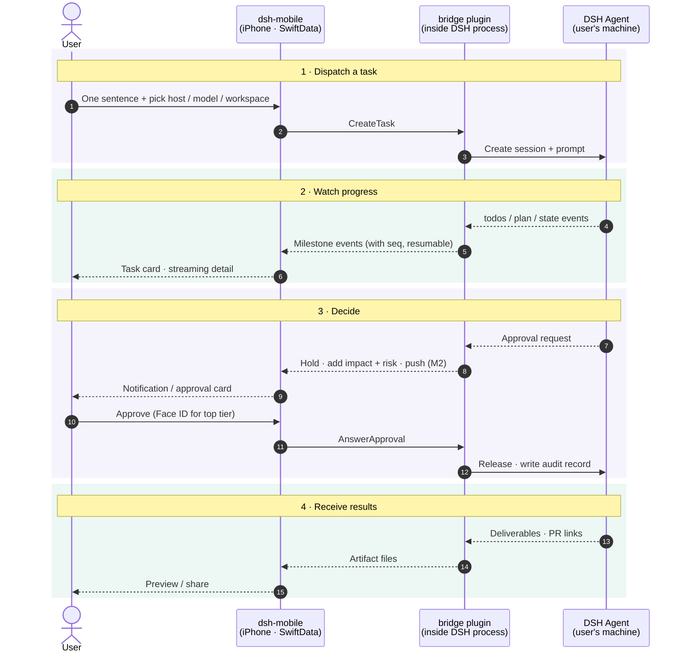

# ARCHITECTURE

Technical design for dsh-mobile. Product intent lives in [STORY.md](STORY.md); this file records **how** we build it and **why**. Decisions here were made on 2026-11-04 against upstream DSH `v0.2.2-rc.1` (developer preview, breaking changes expected).

## 1. Upstream reality (what DSH gives us today)

| STORY.md needs | Upstream DSH today | Consequence |
|---|---|---|
| Reach hosts behind NAT / LAN | Binds one concrete IP (default `127.0.0.1:3080`); no relay/tunnel (Liveshare is experimental, off) | We provide our own listener |
| QR pairing, per-device revoke | One launch token per process → cookie; revoke = revoke everything | We own pairing + device registry |
| Push notifications | None | We own push |
| Approvals belong to the account, pause until answered | No answerer composed ⇒ `unavailable` (fail closed). Chain asks one answerer at a time; no timeout. *Verified by X1 (2026-11-05), confirmed by the user:* under `dsh web` the gateway's Remote forwarder is itself an answerer and holds a request even with no browser tab open, delivering it when a tab connects; subagents never ask (pinned to policy `never`) | We hold approvals in-process, first in the chain, and fan a copy out to the web (D17) |
| Approvals describe impact + risk | Request carries only `toolName`, `callId`, `reason` | We join with the streamed tool call and classify risk |
| Milestone-level progress | Typed projections exist: `todos`, `plan`, `state`, `deliverables/presented`, errors | Map, don't summarize |
| Model list / switch mid-task | `session/modelCatalog`, `session/selectModel` (mid-session OK) | Pass through as-is (principle 8) |
| Add context mid-task: follow-up message, attachment, answer to an agent question (principles 4, 7) | *Verified by X4 (2026-11-05), confirmed by the user:* `sessionController.prompt` accepts messages and file/image parts into a running session; `mode: steer` injects at the next step of the current turn, `mode: queue` waits for the next turn. Agent questions (`ask_user_question`) use their own `user-questions/request` waterfall, held like approvals | Pass through as `SendMessage` + hold questions like approvals (D18) |
| Stable, typed wire API | Undocumented TS-only protocol: `POST /api/<ns>/<method>` + one WebSocket mux `/api/remote.mux`; no schema, no versioning | Never let the app speak it |

## 2. System shape

```
 ┌─ iPhone ────────────┐                               ┌─ user's machine (×N) ──────────────────┐
 │ ① dsh-mobile (iOS)   │  E2E-encrypted frames over    │ DSH host process                        │
 │   SwiftUI            │◄────── one WebSocket ────────►│  └ ② bridge plugin (TypeScript, Cordis) │
 │   SwiftData cache    │  LAN / Tailscale (v1)         │     • facade API (protobuf)             │
 └──────────▲───────────┘  relay (v2, sees ciphertext)  │     • pairing + device registry         │
            │                                           │     • approval holder + risk classifier │
            │ APNs (M2+)                                │     • milestone mapper                  │
            └────────────── Apple APNs ◄────────────────┤     • PushSender → APNs direct          │
                                                        └─────────────────────────────────────────┘
```

Three deliverables, one monorepo:

```
ios/        ① SwiftUI app (+ extensions later)
bridge/     ② DSH companion plugin, TypeScript, installed by the user into their own DSH
protocol/   .proto schema + codegen scripts (Swift + TS); the only contract between ① and ②
gateway/    (deferred) shared push gateway, only if builds are ever distributed to others
```

The Xcode project lives in `ios/dsh-mobile.xcodeproj`.

### Round trip: user → executor → user

The four phases are the phone's four jobs from STORY.md. Every app ⇄ bridge hop is E2E-encrypted.



Solid arrows are the outbound path (user → executor), dashed arrows the return path (executor → user). Not drawn:
- **Push before M2.** In M1 the app receives over the foreground WebSocket only. From M2 the bridge calls APNs directly.
- **Interrupt and mid-task model switch.** Both follow the same outbound shape as "Approve" in phase 3.

## 3. Key decisions

| # | Decision | Rationale |
|---|---|---|
| D1 | **Native SwiftUI** for every M1–M4 screen, including streaming detail (Markdown, code, diffs, terminal) | Core UX; offline from cache; immune to web-UI churn. No WebView in M1. |
| D2 | **iOS 26 minimum, Swift 6 language mode**, complete concurrency checking, `MainActor` default isolation | New app, developer-preview upstream; compile-time race safety for the streaming layer. |
| D3 | **Companion plugin ("bridge")** fills every upstream gap | Fits DSH's everything-is-a-plugin model; user installs it into the DSH they already run (STORY: we don't install/host DSH). Upstream PRs only where a plugin can't reach. |
| D4 | **App talks only to the bridge facade**, never to DSH's native protocol | Upstream breaks often; App builds update slowly. Breakage is absorbed in the bridge. |
| D5 | **Protobuf** schema in `protocol/` → swift-protobuf + protobuf-es | Message-level types inside an encrypted envelope; `oneof` for events; explicit evolution rules. |
| D6 | **App-layer E2E encryption** (Noise-style handshake, host static key delivered by QR). *Confirmed by the user (X2, 2026-11-07).* Details (`spikes/x2-noise/README.md`): pairing `Noise_IKpsk1_25519_ChaChaPoly_SHA256` with psk = the QR's 32-byte one-time secret; reconnect `Noise_IK_25519_ChaChaPoly_SHA256`; the pair/reconnect mode and protocol version are bound into the prologue; own Noise state machine on CryptoKit (Swift) and `@noble/*` (TS). | Every transport is untrusted: plain LAN HTTP, Tailscale, future relay. Relay later needs no crypto redesign. IK because the QR already delivers the host key; psk1 rather than psk2 so the host rejects a wrong pairing secret at message 1. CryptoKit has no BLAKE2, hence SHA256. |
| D7 | **Reachability: direct in v1, relay in v2** behind a `Transport` abstraction | v1 user provides reachability (same Wi-Fi, Tailscale/VPN, own domain). |
| D8 | **Push: bridge → APNs directly** with the builder's own `.p8` key, behind a `PushSender` interface | Open-source, self-built debug app: the builder owns both the signing team and the hosts, so no server is needed. A shared gateway is a future `PushSender`. |
| D9 | **SwiftData** local cache; host is source of truth | Offline viewing; nothing lost across disconnects. |
| D10 | **`@Observable` stores + protocol services via `Environment`**, Swift Testing; Apple-first, few vetted SPM deps | Plain, testable, minimal supply chain. **Streaming detail (X3, provisional pending user confirmation):** render completed Markdown blocks once; reparse only the unfinished tail as chunks arrive. Use Foundation attributed Markdown for prose and native verbatim rows for fenced code, diffs and terminal output. Compared with reparsing the full prefix, the retained-block path reduced simulator p95 update time from 12.80–15.06 ms to 1.14–2.06 ms on 5,000 lines. Real-device timing remains open; see `spikes/x3-markdown/README.md`. GFM tables: D79 (S28). Emphasis next to CJK text: D140 (S14). |
| D11 | **Milestones = deterministic mapping of DSH projections** (`todos`, `plan`, `state`, deliverables, errors) | Free, real-time, no hidden model calls. Quality depends on agents using todos. |
| D12 | **Workspace: per-host default + recent-workspace picker** | DSH sessions need a cwd. Prompt-based inference later. |
| D13 | **1 task = 1 DSH session**; "quick answers" are short sessions rendered inline | One entry point (principle 3) without a second concept. |
| D14 | **Strings in a String Catalog, zh-Hans + en; PolyForm Noncommercial 1.0.0 license** (changed from MIT by the user, 2026-11-06). Signing lives in `ios/Config/Signing.xcconfig`; each builder's team ID and bundle ID prefix go in the git-ignored `Signing.local.xcconfig`. | The user allows personal and other noncommercial use; commercial use needs the user's separate license. Keeping the team ID out of the project lets anyone build to their own iPhone without editing `project.pbxproj`. |
| D15 | *Confirmed by the user (T0, 2026-11-07).* **Toolchain**: (a) codegen = `buf` + `protoc-gen-es` (pinned npm devDeps of `bridge/`) and `protoc-gen-swift` built by SwiftPM from the swift-protobuf version `ios/DSHKit` pins; one entry point, `scripts/codegen`. (b) Generated code **is committed**; `scripts/codegen --check` fails if regenerating changes anything. On merge conflicts in generated files, rerun codegen. (c) Bridge uses **pnpm**, pinned by `packageManager` (Node ≥ 24.9, as DSH requires); tests use the built-in `node:test`. (d) Swift: one local package **`ios/DSHKit`** with targets `DSHProtocol` (generated), `DSHCore` (connection, channels, store), `DSHTestSupport` (`FakeBridge`, debug-only); the app target holds views only. `swift test` runs `[auto]` items on the Mac without the shared Simulator. DSHKit targets macOS 15 for these host tests: a test bundle built for macOS 26 cannot load on a macOS 15 development machine with Xcode 26. The app targets iOS 26 (D2). | Everything pinned in the repo, nothing installed globally. Xcode opens and builds without a codegen toolchain, and protocol changes show up in review. pnpm matches how DSH profiles install plugins. |
| D16 | *Confirmed by the user (T0, 2026-11-07).* **Testability entry points, Debug builds only**: launch arguments `-DSHMFakeBridge YES` (in-process `FakeBridge` instead of the loopback bridge), `-DSHMPresetPrompt <text>` (pre-filled composer), `-DSHMBridgePort <port>` (loopback port, default 47801 in this worktree); accessibility identifiers `composer.prompt`, `composer.send`, `task.status`, `transcript.text`; URL scheme `dshm://pair?…` routed to a pairing stub (S1 replaces it). The scheme is declared only in the Debug Info.plist, the code is behind `#if DEBUG`, and `scripts/check-release-clean` proves a Release build has none of them. | Lets agents and XCUITest drive every slice in the Simulator without a camera or a real DSH, without shipping test hooks. |
| D17 | *Confirmed by the user (X1, 2026-11-05).* **Approval holder ordering: prepend + fan-out.** The bridge registers its `approval/request` answerer with `prepend: true`, parks each request, and re-dispatches a copy down the rest of the chain (the web/desktop forwarder) with its own abort signal. The first answer wins (phone or browser); the other copy is withdrawn. A downstream `unavailable` means "nobody else" and the bridge keeps holding. The bridge's own timeout settles `rejected`, never allow. Alternatives considered: (a) append, i.e. plain `ctx.on`: the web forwarder holds everything first, so the bridge never sees a request; (b) prepend only: the phone owns approvals, but the desktop browser shows a running task with no "input required"; (c) remove the web forwarder via a profile patch: breaks the web UI. | X1 measured all four (`spikes/x1-approval/README.md`). Fan-out keeps the account-wide pause (principle 5) without hiding the request from a user sitting at the computer. Upstream calls sibling order "not a policy-priority mechanism", so S12 pins this behavior with a test. |
| D18 | *Confirmed by the user (X4, 2026-11-05).* **Mid-task context.** The facade exposes `SendMessage { task_id, mode: STEER \| QUEUE, parts }`, mapped 1:1 onto `sessionController.prompt` (files staged through `ctx.fileUploads` first). The app defaults to `STEER`. Agent questions are held by the same bridge holder as approvals (prepend + fan-out on `user-questions/request`), with their own `QuestionPending` / `AnswerQuestion` messages, not folded into approvals. *Amended 2026-11-08 (confirmed by the user, 2026-11-09):* `SendMessage { task_id, mode, text }` → `MessageAccepted` is in `protocol/conversation.proto` (capability `conversation.v1`); text parts only for now, file and image parts come with attachments (*amended 2026-11-09, D107: `SendMessage.upload_ids` carries them once the task is done*). The first use is a follow-up after the task completed (**D89**). *Amended 2026-11-09 (confirmed by the user, 2026-11-09):* the app's default for a message sent while the task runs is now **`QUEUE`**: it waits above the composer and runs as the next turn, and the user moves it into the running turn with "立即发送" (DSH's `updateQueue` steer, the same effect as `STEER`); details in **D101**. Reason: in the Codex and Claude apps a message typed while the agent works waits for the turn by default, and a steer the user did not choose can derail a step half done; send-now keeps the fast path one tap away. Alternatives considered: default `QUEUE` (the follow-up waits for the whole turn, often minutes); interrupt + re-prompt (loses the running step); presenting questions as approvals (wrong shape: options, multi-select, free text). | X4 measured steer vs queue, attachments and the question seam (`spikes/x4-midtask/README.md`). A follow-up written while the agent works is meant for this task now (principles 4, 7). |
| D19 | *Confirmed by the user (S3, 2026-11-07).* **Milestones**: (a) **Source** = the raw durable events on `sessionController.follow` (not the projection views): `turn/start` → STARTED (first turn only); `todo/write` → PLANNED when the items (by content, in order) change, then TODO_DONE / TODO_STARTED per status change, done before started; `plan/mode` → PLAN_MODE_ENTERED / LEFT when `active` flips; `llm/retry` → RETRYING with DSH's failure message (the "errors" input, besides a failed turn); `turn/end` → FINISHED, or FAILED with DSH's reason for any other kind. Unknown events and malformed payloads are ignored. Code: `bridge/src/milestones/mapper.ts`. (b) **Wire** = `MilestoneAdded { task_id, seq, kind, text, todos[], time_ms }` (`protocol/milestones.proto`, Event field 60, capability `milestones.v1`): a kind enum plus DSH's own words, and the **whole todo list** on every milestone, so the card never has to fold history and a resumed client (S2) needs only the latest one. `seq` is per task, separate from `AssistantChunk.seq`. The app labels kinds itself (`Features/Milestones/MilestoneLabels.swift`); no text is generated. (c) **UI**: a task card above the transcript leads with the todo in progress, shows `n of m` and the checklist, and opens a timeline (todos + every milestone with its DSH time). The card appears only once milestones arrive, so a bridge without `milestones.v1` gets T0's screen. S2's unified list is expected to reuse `MilestoneCard`. (d) **Testability** (extends D16): `-DSHMFakeMilestones YES` scripts a three-todo task in `FakeBridge`; identifiers `milestone.card` (label = headline, value = `done/total`), `milestone.timeline`, `milestone.row.<seq>` (value = kind), `milestone.todo.<i>` (value = status). (e) **Local acceptance** (`scripts/demo/s3-host.mjs`): DSH's mock LLM can return only one fixed tool call per server, so the script runs one mock instance per agent step (`tool_call_success` with that step's `todo_write` arguments) behind a small proxy that picks the instance by counting `tool_result` blocks, and renames the mock's fixed call id per step. | Deterministic, free, real-time (D11). Raw events rather than projection updates because they carry the transition (which todo just finished) and the DSH timestamp; the projection only says what the list is now. Alternatives considered: (1) forward the `todos` / `plan` projection views as-is and diff in the app: puts DSH semantics in the app, against D4; (2) one milestone per `todo/write` with no kinds: the card couldn't say "finished X"; (3) send only deltas: smaller, but every consumer must fold, and resume (S2) gets harder; (4) for the demo, a hand-written fake Messages server instead of DSH's mock: more code to maintain, and it drifts from the upstream mock. |
| D20 | *Confirmed by the user (S2, 2026-11-07).* **Durable list + resume.** (a) **Bridge**: tasks belong to the host's `TaskHub` (`bridge/src/s2/`), not to the connection that created them; closing the socket no longer aborts the task. Every event the bridge forwards is appended to one per-host `HostLog` with a monotonic `Event.host_seq` and named by a random `log_id` per bridge process. The log is **in memory** (last 50,000 events). (b) **Protocol** (`protocol/s2.proto`, capability `resume.v1`): `Resume { log_id, after_seq }` replays exactly the logged events after `after_seq`, then answers `Resumed`, and the connection gets every live event from then on. Replay and subscribe happen in one synchronous step, so nothing falls between them. If the cursor doesn't apply (another `log_id`, i.e. the bridge restarted, or trimmed events) the bridge sends `LogReset` first and replays everything it kept. `ListTasks` returns every task with its state. `TaskUpserted` carries state changes; `TaskEnded` stays a task's last event. A client that never sends `Resume` (T0's) still gets only its own tasks' events. (c) **App**: SwiftData cache (`CachedHost` with the cursor `(log_id, last_seq)`, `CachedTask` with the transcript and per-task `last_chunk_seq`), saved within ~150 ms of each event. Events at or below the cursor, and chunks at or below a task's chunk seq, are skipped, so replays are idempotent. After a reset the app calls `ListTasks`; cached tasks still `running` in a log that's gone are marked failed ("the bridge restarted"). (d) **Reconnect**: one sync loop per host in `TaskListStore`: connect, Hello, Resume; on drop, exponential backoff 0.5 s → 30 s. `background()` closes the socket; `foreground()` reconnects at once and resumes. A host that can't be reached is shown as "*name* is offline" with the last connection time; sending to it fails at once with the same words (STORY principle 3). (e) **Testability** (Debug only, like D16): launch arguments `-DSHMFakeBridge offline` (the FakeBridge host is unreachable), `-DSHMResetStore YES` (empty cache), `-DSHMConnectDelay <seconds>` (show the cache before the first connection); accessibility identifiers `host.status`, `tasklist.row`, `tasklist.running` / `.waiting` / `.done`, `composer.error`. `FakeHost` (`DSHTestSupport`) is the fake bridge process whose tasks and log outlive connections. | DSH has no server-side resume cursor, so the bridge keeps one. In-memory is enough for "kill the app, reopen": the bridge keeps running. Alternatives: **persist the log** in `DSH_HOME` (survives bridge restarts, but needs a file format and pruning; revisit if restarts lose real work, together with S4's held approvals); **re-read DSH's own session logs** on resume (no second log, but couples the app's cursor to DSH internals, against D4); **per-task cursors instead of one host seq** (no global order for the list, more state on the phone); **Core Data / GRDB / files instead of SwiftData** (D9 already chose SwiftData). |
| D21 | *Confirmed by the user (S1, 2026-11-07).* **Pairing and the encrypted wire** (implements D6). (a) **Offer** = the URL `dshm://pair?v=1&n=<host name>&a=<host:port,…>&k=<host key>&i=<offer id>&s=<secret>&x=<expiry>` (k/i/s unpadded base64url, 32/16/32 bytes; x Unix seconds), shown by the bridge as a terminal QR (`uqr`) at startup when no device is paired and on demand with `node bridge/lib/scripts/pair.js`; the same URL is D16's Debug deep link. Offers are **single use** (burnt on the first valid Noise message 1, before the host answers) and expire after **10 minutes**; the app also refuses an expired offer before connecting. (b) **Wire**: the app's first WebSocket message is `[1, mode, offer id if pairing] ‖ Noise message 1`; the header is bound into the prologue (`"dshm/1" ‖ header`); handshake payloads are empty; then one WebSocket binary message = one Noise transport message = one protobuf `Frame`. Refusals are WebSocket close codes 4000 bad hello / 4001 pairing rejected (unknown, expired, used, wrong secret) / 4002 handshake failed / 4003 device unknown. (c) **Bridge state** in `$DSH_HOME/dsh-mobile-bridge/` (dir 0700, files 0600, atomic writes): host X25519 key, offers, device registry (store only; list/revoke UI is S10). A device is registered only after its first valid transport message. (d) **Listener**: default `0.0.0.0:47801`, Noise on every path. The plaintext channel exists only with `devPlaintext: true`, only on `/plaintext`, and only on a loopback listener; in the app `PlaintextChannel` is compiled into Debug builds only (`scripts/check-release-clean`). `scripts/dsh-up.mjs` (the dev host) turns `devPlaintext` on and binds loopback so T0's demo keeps working. (e) **App**: tries the offer's addresses in order; saves the host (name, addresses with the working one first, host key) as JSON in Application Support; reconnects with IK, trying each saved address with the one that worked last first, and saves the working one first again (amended by D98, confirmed 2026-11-09). (f) Golden transcripts (`protocol/fixtures/noise/transcripts.json`, fixed keys) are checked by both the TS and the Swift tests. Known limits: Noise caps a message at 65535 bytes (fine for M1's frames; large artifacts in M3 need chunking). | Alternatives: a JSON or protobuf offer inside the QR instead of a URL (a URL doubles as the Debug deep link and a pasteable link next to the QR); multi-use or longer-lived offers (single use + short expiry limits a leaked screenshot); registering the device right after message 1 (waiting for the first transport message means only a phone that finished the handshake is recorded); a separate plaintext port (a path on the same port keeps one listener and one firewall rule). |
| D22 | *Confirmed by the user (S1, 2026-11-07). The user accepts that in M1 an approval is as safe as the phone's lock screen; Face ID comes in M2.* **No Secure Enclave identity key in M1.** The phone's only key is its Noise static key (X25519, 32 bytes) in the Keychain (`kSecAttrAccessibleAfterFirstUnlockThisDeviceOnly`, never synced or backed up), one per device and shared by every paired host. The bridge's device registry is keyed by it, and IK authenticates it on every connection. A Secure Enclave P-256 signing key comes back when something needs a signature that the transport can't give: Face ID-gated approvals for the top risk tier and a non-repudiable audit trail (M2). | The X2 open question. The SE key would add nothing to M1: Noise can't use P-256 (CryptoKit's SE supports P-256 only, Noise here is X25519), so it would be a second, unused identity to register and keep in sync. Alternatives: SE P-256 key now, signing a registration blob (more code and state, no M1 consumer); per-host Noise keys (unlinkable across hosts, but more Keychain state; revisit with S9 multi-host). |
| D23 | *Confirmed by the user (batch 1 integration, 2026-11-07).* **S2 × S3 seam: cached milestones.** (a) **Bridge**: `MilestoneAdded` is a host-log event like any other (`TaskHub` numbers it with `host_seq`), so `Resume` replays missed milestones exactly once. (b) **App**: `CachedTask.milestonesData` holds the task's whole `MilestoneTimeline` as JSON (`MilestoneTimeline` is `Codable`); `TaskListStore` adds each milestone through `MilestoneTimeline.add`, which drops stale or repeated seqs, so replays are idempotent. `TaskRow.milestones` feeds two views. *Updated by S16 (2026-11-06) for the new UI:* on the session page it is the `MilestoneBar` at the top (one line: the step being worked on, "done / total", a progress line; it sits above the scrolling transcript, so it stays in place while the transcript scrolls, and a tap opens the whole timeline as a sheet, `SheetRoute.milestones`); in 所有任务 it is a part of each row, the `MilestoneCard` (no chevron; `maxTodos` 3). Both keep the `milestone.card` identifier, with the headline as the label and "done/total" as the value. There is no task detail page any more (T1, D51). (c) **Test support**: `FakeHost` task ids carry a per-instance random prefix, like DSH session ids, so a task cached by an earlier launch never collides with a new one. Alternatives considered: cache only the latest milestone (enough for the card, since each one carries the whole todo list, but the detail timeline would then be empty after a reopen); a SwiftData `CachedMilestone` model per milestone (queryable, but more schema and a relationship for data only ever read whole); a `latest_milestone` field on `TaskSummary` for `ListTasks` (helps after a bridge restart, but the in-memory log is gone then anyway, D20). | Milestone timelines are short (tens of entries) and always read whole. The card and the timeline stay in the cache across kill/reopen and with the host offline (STORY principle 4). |
| D24 | *Confirmed by the user (batch 1 integration, 2026-11-07).* **S1 × S2 seam: the durable list over Noise.** (a) **App composition** (`ios/dsh-mobile/AppComposition.swift`): S1's `AppModel` owns one SwiftData container and one `TaskListStore` for the one host it talks to: the paired host over `NoiseChannel` (cache key `noise:<PairedHost.id>`), else in Debug the loopback dev bridge over `PlaintextChannel` (`bridge:<host:port>`) or `FakeHost` (`fake:<host:port>`). Pairing a host backgrounds the old store and starts a new one at once (the scene is already active). (b) **Reconnect** = `HostConnection.connect()` again: every connection runs a fresh handshake (IK for a paired host), then `TaskListStore` sends `Resume` from the cached cursor; the cipher, outbox and receive loop belong to one connection generation, so a stale loop never tears down a newer connection. (c) **UI**: the list's host section shows the channel (`host.channel`, value `noise` / `plaintext`) under the host status; the pairing button (`pairing.scan`) is in the list's toolbar. (d) **Local demos**: `scripts/demo/s2-host.mjs` and `s3-host.mjs` set the bridge to `host: 127.0.0.1, devPlaintext: true` in their `cordis.patch.yml`, since S1 made Noise-only on 0.0.0.0 the default and those demos drive the unpaired Debug path. Alternatives considered: one store per pairing that keeps the old host's connection open (that is S9's multi-host); resuming the Noise session instead of a new IK handshake per reconnect (Noise has no session resumption; a new handshake costs one round trip). | Keeps S2's single-host store unchanged while S1 decides which host and channel it is; S9 turns the one host into every paired host. |
| D25 | *Confirmed by the user (S4, 2026-11-07), with the 24-hour timeout.* **Held approvals.** Each DSH approval is addressed by a host-generated request UUID. The holder joins the call ID and tool name with the committed assistant message in the DSH session, preserving the original arguments. A phone can deny a request whose arguments are unavailable. It can grant one operation when details are present. D17 governs fan-out to other clients. An upstream session started outside the bridge appears only while it has pending approvals. Its last answer withdraws the card without changing the session's lifecycle. The first decision persists to `approvals.jsonl` under the protected bridge state directory before release. The host records the Noise device ID for mobile answers. The upstream waterfall exposes only the outcome of a web/desktop answer, so those entries identify the owner and DSH client collectively. `approvalTimeoutMs` defaults to 24 hours and expires to rejection. | A fresh request ID prevents an old button from answering a later call. S2 summaries include every pending request and the last model selection reported by DSH, so a reset can restore both after events are trimmed. Interrupting a bridge task cancels held requests before the interrupt acknowledgement; an upstream approval-only row accepts only an approval decision. Alternatives considered: use the tool call ID as the approval ID (it can repeat), or rely only on event replay (a trimmed log can lose a pending card). |
| D28 | *Confirmed by the user (S5, 2026-11-07).* **Interrupt.** The bridge calls DSH `sessionController.cancel({ sessionId })`. Its response acknowledges the request. Only the durable `turn/end` with `reason.kind = aborted` and nested cause `user` produces an interrupted task and milestone; other failure causes keep their existing mapping. | The host decides which result wins when completion races a stop. Marking the task stopped on tap or on acceptance could contradict the session log on resume. DSH's separate `interrupted` end reason records crash recovery. |
| D31 | *Confirmed by the user (S6, 2026-11-07). The user accepts that a choice on the phone also sets the DSH host default: the phone and the Web stay in sync.* **Model choice**: Each connection with `models.v1` supplies DSH's ordered provider groups, model and reasoning-effort IDs, display names and defaults. An explicit composer choice travels with `CreateTask`; the bridge selects it on the new session before sending its first prompt. Active tasks use the same upstream `selectModel`. DSH also saves that selection as its host default. Its durable `model/selection` events go into the S2 host log and the cached transcript. | Selecting after prompting would let the first step use another model. Recording only a phone-side acknowledgement would miss changes while disconnected or from another client. |
| D34 | **Superseded by D51 (T1, 2026-11-05), which the user confirmed (2026-11-07).** *(S8, 2026-11-05.)* **Inline answers.** After dispatch, give the task two seconds to finish on the list. Show a completed reply inline when it fits in 280 characters and three nonempty lines, with no code fence or milestone beyond start/finish. Otherwise open the new task’s live detail. The user can tap any row to inspect the session. Detail renders cached Markdown with D10’s retained blocks. | Use the observed reply and host events, independent of prompt language. Always opening the detail interrupts simple requests; classifying the prompt would misroute slow translations or quick summaries. |
| D37 | *Confirmed by the user (S7, 2026-11-07).* **Workspace selection.** With `workspaces.v1`, the bridge lists its configured default and DSH's registered paths, ordered by the registry's last-update time. The composer can also select an absolute host path for first use. DSH validates and registers that directory before the bridge creates the session there. Omitting a workspace uses the bridge default: the configured `cwd`, else DSH's own default Workspace (title `default-workspace`, which DSH Web labels 默认工作区), else the home directory. *Changed 2026-11-07 after the first real-iPhone run, at the user's request: the home-directory default put the phone's 默认工作区 tasks in another Workspace than the Web's.* | The registry includes workspaces used by other DSH clients and survives bridge restarts. The alternative, storing a separate recent list on the phone, could drift from the host. |
| D40 | *Confirmed by the user (S10, 2026-11-07). The user accepts that every paired device has the same rights in M1.* **Device control and audit.** A paired Noise client can manage that host. The authenticated static-key fingerprint identifies the acting device. Revocation atomically removes the target key and records the action, then closes all of its open sockets, including incomplete reconnects. Device IDs and timestamps from S1 registries remain valid. The audit view combines pairing and revocation history with S4's durable approval answers, retaining the original actor, device and arguments. It retrieves 50 entries per page. | Keeping authorization and pairing history in one atomic registry write avoids a revoked key without a record. A connection-only blacklist would forget revocations after restart. Reading S4's journal avoids a second approval record that could disagree with the tool decision. |
| D43 | *Confirmed by the user (S9, 2026-11-07).* **Multi-host dispatch (extends D24).** The phone syncs all paired hosts and keeps the selected composer host’s key in UserDefaults. The initial fallback is the most recently paired host. Pairing a second host keeps the current selection and the other hosts’ connections. Each request uses the selected host’s own workspace and model choices. Each row action uses the task’s host key. | Choosing a different machine automatically when the selected one goes offline could run a command in a different workspace. Keep the target visible and let the user switch it. |
| D46 | *Confirmed by the user (S12, 2026-11-07). The user accepts that a DSH update stops new tasks until the bridge supports it.* **Upstream guard.** Support the verified DSH release `0.2.2-rc.1` (an exact range). Resolve the running launcher's own app-boot manifest, as DSH does. The plugin's loader range is broad so that a mismatched or unidentified host can still pair and answer Hello. In this mode the plugin injects no DSH services, registers no approval hook and refuses all other requests. The phone retains cached tasks and shows the installed and supported versions. | A broad task API range would claim compatibility with untested developer previews. An exact loader restriction would prevent the phone from learning why the host needs an update. CI runs the same bridge suite and live two-client approval check on the pinned runtime and on a freshly built upstream default branch, whose job is non-blocking. |
| D49 | *Confirmed by the user (S11, 2026-11-07); D63 changes the first-pairing part.* **First run.** With no paired computer the Release app explains the phone's role and guides scanning or pasting the bridge's code. If saved pairings cannot open, it offers retry and pairing recovery. After the first pairing or on an empty task list, a suggestion fills an empty composer even when the host already has tasks from other clients. The user can edit it and sends it explicitly. | Pairing state and task history already determine when to show these steps. A separate onboarding-complete flag could skip guidance after a reinstall; dispatching a suggestion on tap would remove the chance to edit it. |
| D50 | *Confirmed by the user (S13, 2026-11-07).* **Cross-client sessions.** The bridge reads the visible DSH session list on resume and observes committed session events. Each host uses one task row per DSH session ID. With `sessions.v1`, the open detail reads message-aligned journal pages at one fixed DSH cursor and caches the user messages and assistant replies. Newer journal revisions refresh that detail and can move a completed task into a later running turn. **Title**: DSH's session title once it has one (a rename on any client, or the title DSH generates after the first turn, which Web shows), for phone tasks too; until then the first prompt. *Changed 2026-11-07 after the first real-iPhone run, at the user's request: before, only a user rename replaced the prompt, so the phone showed 你是谁 where Web showed AI身份询问.* | The host replay log carries lightweight changes. Fetching all transcripts in the list would copy long conversations to every connected phone. Watching only phone-created jobs would miss both cold sessions and later turns started on another client. |
| D51 | *Confirmed by the user (T1, 2026-11-07).* **First-message routing in the shell.** The app opens on a blank new session (`ShellPage.newSession`) with the default host and workspace, also when the cache has tasks; it never reopens the last place. When the first message is sent and the host accepts it, the same page becomes that session’s page (`ShellPage.session(key)`) at once, whatever the reply turns out to be: no grace period, no reply classification, no return to a list. The reply streams in on that page. D34’s inline rule (completed, at most 280 characters and three nonempty lines, no code fence, no milestone beyond start/finish) now applies only to rows in 所有任务 (`TaskRowView`). If the send fails (host offline, bridge too old), the page stays a new session with the prompt kept and `composer.error` set. Navigation is one `ShellModel` (page, sheet, drawer): no `NavigationStack`; details are `SheetRoute` sheets; the drawer pushes the page and settles by position plus 0.15 s of release velocity. Alternatives considered: keep D34’s two-second wait and stay on the new session for short replies (the reply would appear nowhere on the page the user is looking at, because the list is no longer the home screen); classify the prompt or the reply to choose a page (misroutes, as D34 found); open the session only once the first token arrives (an empty page waits with no feedback). | STORY §3: one entry, and a quick answer is just a short task. The user sees the reply where they asked. DESIGN.md “Navigation”: the first message creates the session. |
| D54 | *Confirmed by the user (S14, 2026-11-07).* **Drawer: host › workspace › session, marks, and read state.** With `drawer.v1` the bridge sends each session's workspace in `TaskSummary.workspace` (field 280): the `cwd` that DSH lists for the session (Web, desktop and phone sessions alike), or, until DSH lists it, the directory of the phone's `CreateTask`; DSH's value wins. The app caches it (`CachedTask.workspace`) and `DrawerTree` groups a host's sessions by that path: workspaces ordered by their newest session, sessions newest first; a session without a workspace stays directly under the host. Without `drawer.v1` the drawer shows host › session (T1). An offline host has no capabilities, so its cached workspaces decide. Marks: amber dot = waiting on you, spinner = running, blue dot = finished and not read (red when it failed or was interrupted), otherwise the time of the last change. Read state is local to the phone: `CachedTask.readThrough` stores the host `updatedAt` that the user saw on the session page; a finished session with a newer `updatedAt` is unread. The shell marks the current session read when it shows and when it changes while it shows. The badge on the drawer button is the number of items in 等我处理 (`sections.waitingOnMe`). The top of the drawer shows online / paired hosts; settings sit beside pairing at the bottom. Alternatives considered: group by DSH workspace ID (the phone has no workspace list for other clients' sessions, and paths are what the desktop sidebar shows); store the read state on the host (needs upstream DSH; read state is per device in the desktop app as well); compare read time with the phone clock (host and phone clocks differ); mark every session that was already finished at first sync as read (hides Web results the user has not seen; the cost is many blue dots on a fresh install). | STORY §4: sessions from other clients in one place, status at a glance, and a call back when something is done. DESIGN.md screen 02. |
| D55 | *Confirmed by the user (S15, 2026-11-07).* **所有任务 (screen 03).** A drawer page (`ShellPage.allTasks`) in the DSH style: a `ScrollView` with sections 等我处理 / 正在跑 / 已完成 and their counts, across hosts, from the cache. One line at the top for each offline host (name, last connection). A task with pending approvals shows as one card per approval (`AllTasksApprovalCard`): tool tag, host, the task title (opens the session), the command in SF Mono, else the path, else the raw arguments; the reason; the full tool arguments behind 工具参数 ›; 拒绝 / 允许一次. When the host is not online, both buttons are grey and one line says why: the answer can only reach the task through its host, the task stays paused, and nothing is allowed by default (STORY §5). Other tasks are one-line rows: state, title, what it does now · host, `done/total` todos; completed rows show the host and the D51 inline answer. Its strings are in its own catalog (`Features/TaskList/AllTasks.xcstrings`), so parallel UI slices do not edit the same catalog. The FakeBridge gets approvals (`FakeHost(approvals:)`, `-DSHMFakeBridge approvals` and `approvals-office-offline`; seeded task ids stay the same across launches, like a DSH session). Alternatives considered: keep the M1 `List` with the bordered `ApprovalCard` (does not match the board, and gives no reason for grey buttons); open the tool arguments in a `SheetRoute` sheet (one more registration in the shell for a short JSON); hide approvals of offline hosts (the user would not know a task waits; STORY §4 says decisions bring the user back). | STORY §4 (one place for all hosts), §5 (an approval says what it does, and is never allowed by default); DESIGN.md screen 03. |
| D56 | *Confirmed by the user (S16, 2026-11-07).* **Session page layout (screen 04).** From the top: the page bar (drawer button, title, host), the `MilestoneBar`, one status line (`task.status`: where it runs, offline or failed text), then the scrolling transcript, then the composer. The bar and the status line are outside the `ScrollView`, so they never scroll (D23 (b)). The bar counts finished todos: "3 / 5" means three of five done, and the progress line has the same fraction; the headline is the step in progress. The stop key takes the send key's frame while the task runs, and the (disabled) send key comes back to the same frame when it ends. Markdown keeps `TranscriptBlocks` (D10) and adds the DSH style in the app: prose with more line spacing, inline code in SF Mono on the bubble color, links in blue, code blocks a shade below the canvas under a hairline border, diff lines in the green and red tokens (`Theme+S16.swift`; `DSHTheme` does not change). Test support: `-DSHMFakeScenario coding` gives the FakeBridge a five-step coding task that holds at "3 / 5" after a long Markdown reply and answers `interrupt.v1` like the bridge (`InterruptAccepted`, then an INTERRUPTED milestone and `TaskEnded(INTERRUPTED)`). Alternatives considered: count the step in progress ("3 / 5" = working on step 3; the number and the progress line then disagree); put the bar in the scroll view's top safe-area inset, so text scrolls under a translucent bar (more like iOS, but the bar then covers the first line at the top); drop the status line, as screen 04 does (the state, the offline host and the failure text then have no place on the page until S19); a full Markdown renderer with lists and tables (later; S17 changes the transcript next). | STORY §4: milestones by default, details on demand; the user always sees the progress, also deep in a long reply. §8 and S5: stop is where the user's thumb already is. |
| D57 | *Confirmed by the user (S18, 2026-11-07).* **The approval sheet in a session (screen 05).** When the open session has a pending approval, `PendingApprovalBar` on the session page presents `SheetRoute.approval(taskKey:)`: when the session opens, and when a new approval arrives while it is open (not while the drawer is open or another sheet is up; then on the next chance). The sheet (`ApprovalSheet`) shows the task's first pending approval: tool tag, 任务已暂停，等你决定, a title by kind (command, file, other tool call), task · host, the full command in SF Mono (else the path, else the raw arguments), the agent's reason, the full tool arguments behind 工具参数 展开 ›, and 拒绝 / 允许一次 only (no "always allow"). The footer says that nothing is allowed without an answer and that every client sees the approval. When the host is not online the buttons are grey with S15's one line of reason. The sheet closes only when the approval leaves the task: an answer here, or `ApprovalResolved` from another client (Web, desktop). A swipe down hides it for that approval in this visit; the session page then keeps one line, 等你决定 · command · 查看 ›, that opens it again; opening the session again, or a new approval, brings it up. The inline M1 `ApprovalCard` no longer shows on the session page (all approval identifiers keep their names; they now live in the sheet). The FakeBridge gets `Script.ask` (`-DSHMFakeAsk <text>`: a task asks for an approval before its reply) and `FakeHost.answerFromElsewhere(allow:)`; Debug UI tests trigger the Web's answer with a Darwin notification (`FakeApprovalSheet`). Alternatives considered: keep the inline card and add the sheet (the same identifiers twice on one page; two places to answer); bring the sheet back after each swipe (the user could not read the page under it); close the sheet right after a local answer instead of on `ApprovalResolved` (a failed answer would hide a request that still waits); a `presentationBackgroundInteraction` half sheet (the composer and the stop key stay under it anyway). | STORY §5 (an approval says what it does; nothing is allowed by default; the approval belongs to the account, so any client can answer it); DESIGN.md screen 05. |
| D58 | *Confirmed by the user (S20, 2026-11-07).* **Picker sheets (screens 07, M, X4).** The workspace sheet (`WorkspacePicker`) and the model sheet (`ModelPicker`) are `SheetRoute` sheets in the board's style (`Features/Pickers/`: group title, card of rows, check mark; tokens in `Theme+S20.swift`; strings in `Pickers.xcstrings`). Workspace: the host switch at the top (a menu when more than one host is paired; a switch also changes the composer's host), the host default, recent paths (folder name and `~` path), and an absolute path on that host. The choice lives only in memory (`TaskListStore.composerWorkspaces`) and is cleared when the first message creates the session, so the next new session and the next launch use the host default again. Model: groups by provider with the provider's own names, the host default marked 执行端默认, reasoning effort as its own group for the drafted model, and one row with 重试 for each provider whose list failed (`ModelCatalog.failures`). The sheet refreshes the catalog when it opens. When the current selection (the running task's, else the composer's) is no longer in the catalog, or its effort is gone (`ModelSheetState`), an amber note names the model (by the last name the phone saw) and the host, the model's row shows 不可用 and is disabled, no row is selected, and 应用 stays off until the user picks an available model; a failed `SelectModel` keeps the sheet open with the host's error and refreshes the catalog. A task with no recorded selection starts the sheet at the host default. Alternatives considered: preselect the host default when the selection is gone (a silent swap, against STORY §8); remember the last workspace across launches (against STORY §3: open on the defaults); hide a provider whose list failed (the user would not know why its models are missing). | STORY §3 (defaults the user can change at the composer), §8 (the user picks the model; never swapped silently). DESIGN.md screens 07, M, X4. |
| D59 | *Confirmed by the user (S21, 2026-11-07).* **Hosts and control (screens H, X2, X3).** A tap on the drawer's "2 / 3" pill presents `SheetRoute.hosts` (`HostsSheet`): one row per host, the same shape for each (online: channel and the catalog's default model; `needsBridgeUpdate`: installed and supported DSH; offline: last connection and how many cached sessions wait on the user). A row pushes `HostDetailView` (X2): devices from `ListDevices` with this device marked, revoke behind an alert, and `ListAudit` pages with "load older". S10's `DeviceManagementView` stays behind `host.manage`. **All offline:** `TaskListStore.allHostsOffline` is set once every host has failed to connect (offline, or its DSH needs an update) and stays set while hosts retry; it clears when one host is online. Then 01 shows `AllHostsOfflineCard` (each host, its last connection) and `canSend` is false, so the send key is off; the drawer and cached history still open. A host whose DSH needs an update counts as one that cannot take a task. **Revoke this device:** after the host answers the revoke, the app forgets that host (removes the Noise pairing and rebuilds the store without it). With no host left, the root shows 08 (`WelcomeView`); with other hosts left, the app shows 01 with them. *Amended 2026-11-08 (S29, provisional):* the app also forgets a host that refuses this device with close 4003, also when the revoke came from elsewhere or its response was lost, and then says so once (**D82**). Alternatives: keep the send key on and name the offline host after the tap (S2's old behavior; the board greys it out); count a host that needs an update as online (the user could then type a task no host can take); after a revoke of this device always show 08, also with other paired hosts (the user would lose working hosts from view); keep the revoked host in the list as "no access" (needs upstream state for a revoked device). |
| D60 | *Confirmed by the user (S19, 2026-11-07). Amended 2026-11-08 by D76 (S27): no marker is drawn at the answer's start (the page still opens there), and 用时 counts the latest turn only.* **Done and failed on the session page (screens 06 and X1).** `TaskOutcome` (DSHCore) reads an ended task from the cache only: done, failed or stopped; the steps; the answered approvals; the todo it stopped on; the failure message as the host gave it (else the FAILED milestone's text). Nothing is summarized (D11). **N 步** is the number of milestones on the task's timeline, so it equals the rows that the process row opens (`SheetRoute.milestones`). **M 次审批** counts `ApprovalResolved` events for approvals that were pending in the cache (`CachedTask.approvalsAnswered`, a new cached field with a default; an answer from any client counts once; replays do not count twice because of the host-seq cursor). Page layout (on top of D56): before the final answer, one row 已工作 · N 步 · M 次审批 › (green check when done; no step count without milestones; the approval part only when M > 0). A session that was finished and not read when the page opened (S14's read state, read once when the page is made, because the drawer marks it read as soon as it shows) shows a marker 停在这里 · 最终回答开头 before the final answer (the last assistant message of a journal, else the single-turn reply), starts with the top scroll anchor, and scrolls the marker to the top; it repeats this when the history or the text comes in, until the user scrolls. A read session opens at the end, as in D56. After the answer: done shows 用时 · model (from `createdAt`/`updatedAt` and the task's model selection); failed shows a red card 任务失败 with the raw message in SF Mono, 复制错误 (the pasteboard; the button says 已复制) and 新会话里再试; stopped shows the same card, neutral, 任务已停止, with the step it stopped on and 新会话里再试 only. 新会话里再试 opens 01 with the user's first message (else the task title) in the composer, on the task's host and workspace; the user edits it and sends it. Failed: the `MilestoneBar` gets a red border and says 失败 · 第 N 步 (N = the in-progress todo, else the first one not done) with the same done / total; a stopped task keeps S16's bar (Interrupted). The X1 sentence about what was done and where the files are is not generated: the agent's own reply above the card says it (D11). FakeBridge: `Script.variants` (a prompt picks its own script) and `Script.outcomes()` (`-DSHMFakeScenario outcomes`). Alternatives considered: N 步 as the number of todos (X1 shows 9 步 with 2 / 4 todos, so the board means more than todos) or as tool calls (needs S17's `transcript.v1`; switch to it when S17 lands); counting approvals from the session journal (not every host has `sessions.v1`); opening every finished session at the answer's start (a read session then loses its place at the end); a red bar also for a stopped task (S16's test and D56 keep Interrupted neutral; a stop is the user's choice, not a failure); sending the retried prompt at once (the cut says the user can edit it first). | STORY §4 (call the user back when a task is done, failed or stuck; details on demand); DESIGN.md screens 06 and X1. |
| D61 | *Confirmed by the user (S17, 2026-11-07).* **Structured transcript (screen 04).** (a) **Source** = DSH's typed data on `sessionController.follow`, mapped deterministically, with no model summary (the same rule as D11). Thinking: the timed `reasoning-delta` chunks of the live assistant stream; a block opens at the first non-blank one (RUNNING) and closes (DONE) at the reasoning's `block-end`, the next text or tool-call chunk, or the end of the attempt; its duration is the difference of DSH's chunk `time`s. Tool calls: the durable `tool/call` (RUNNING: DSH's tool name; the target from the arguments, first of `file_path`, `path`, `command`, `pattern`, `url`, `query`, else the first file an `apply_patch` names) and its `tool/result` (DONE, or FAILED when `isError`, with DSH's reason); lines added and removed come from the result's `meta.diffs` (dsh-tool-fs hunks), by a line LCS per hunk. The reasoning text (first 8,000 characters) and the raw arguments (first 4,000) travel for the sheet only. Code: `bridge/src/transcript/`. (b) **Wire** (`protocol/transcript.proto`, `Event.transcript_block = 340`, capability `transcript.v1`): one `TranscriptBlock` per change, keyed by `block_id`; a later one replaces the row. Blocks are host-log events (S2), so `Resume` replays them; the bridge sends them only to a client that lists `transcript.v1` in its Hello. (c) **Place**: no offset on the wire. The app puts a new row after the text streamed so far (`TranscriptItem.offset`, UTF-8 bytes of `CachedTask.transcript`), which the host log's order makes the same on every replay; an update keeps the place. (d) **App**: `CachedTask.transcriptBlocksData`; `StructuredTranscriptView` cuts the S16 text at each row: "已思考 8 秒 ›" and `verb · target · +/−` rows (the verb is DSH's tool name as the desktop shows it, the target a file name or a command), consecutive tool rows under one hairline; a tap opens `SheetRoute.transcriptBlock` (full target, tool, state, lines, error, arguments; thinking: the reasoning). With no rows, or when the host's Hello lacks `transcript.v1`, the page is S16's `TranscriptView`. Sessions read from the journal (`sessions.v1`, other clients) keep the S16 view. | Alternatives: (1) map the durable `assistant/message` stream records instead of the live chunks: same timestamps, but the thinking row would only appear when the step ends, after its text; (2) an explicit text offset on the wire (`after_chunk_seq`): redundant with the log order, and wrong after a journal fallback; (3) bridge-written row text ("Edited 2 files"): words on the phone would then come from the bridge, not the app's catalog, and could drift from DSH's names; (4) blocks inside `SessionMessage` for journal pages: a second path for the same data, left for when follow-ups (M2) make multi-turn phone sessions common. |
| D63 | *Confirmed by the user (S22, 2026-11-07).* **First run in the DSH style (screen 08).** 08 has two equal ways in: "scan the pairing QR code" opens the camera scanner, and "paste a pairing link" opens the same sheet without the camera, with the link field focused. 08 names the network requirement (same Wi-Fi, or a private network such as Tailscale) as a numbered step before pairing. After the first pairing, 01 opens with the first task already in the composer (no tap on a suggestion first) and a one-line hint; the user edits it and sends it explicitly (D49). On a later empty task list, the tap-to-fill suggestion stays. The pairing review uses the same canvas, card, and white primary button. | Fills D49's "a suggestion fills an empty composer" literally and matches 08's caption: one fewer tap on the first run, and nothing is sent without the user. Considered: keep the S11 suggestion button after pairing (one more step for a first-time user); read the pasteboard on the paste button (an iOS paste prompt, and a link that is not a pairing link would fail with no context); auto-close the review after pairing (the user would not see which computer was paired). |
| D65 | *Confirmed by the user (S23, 2026-11-07), with the cross-fade only on 03 and scroll positions in memory only.* **Drawer motion and landing positions (DESIGN.md "Navigation", F1–F4).** `ShellModel.open(_:)` runs the motion; `DrawerMotion` holds the times. F1 (0 ms): the drawer row has a pressed highlight (`DrawerPressStyle`, the current-row color) and a light impact haptic (`sensoryFeedback` on `ShellModel.taps`). F2 (0–120 ms): the page is set at once and cross-fades (opacity, ease-out 120 ms) in the peeking edge; the page comes from the cache, as before; the drawer does not move. F3 (120–350 ms): the drawer closes with one spring (`spring(duration: 0.23, bounce: 0.12)`), so the page slides in and pushes the drawer away; a released drag, the peeking-page tap and the drawer button use the same spring. F4 (350 ms): `ShellModel.moving` goes false; S18's `PendingApprovalBar` waits for it, so 05 comes up after the page fills the screen. The same `open` serves 新建会话, 所有任务 and a card in 03; from 03 there is no drawer to push, so the page only cross-fades (then 05). The first message (D51) uses `ShellModel.show(_:)`: no motion, the same page. Landing (`SessionLanding`, decided once when the page is made, on top of D60): done, failed or stopped and not read → the start of the final answer (S19's scroll, unchanged; since D76 no marker is drawn); running or waiting → the bottom, following the stream (D56); read → the last position that the user scrolled to on this phone (`ShellModel.lastPositions`, the content offset after a scroll by hand, counted from below S19's rows before the final answer, because the marker shows only on the unread visit; in memory for this run of the app); a read session that the user never scrolled, or after a relaunch, opens at the end, as in D60. A running session ignores a saved position. The restore repeats when the history or the text comes in, until the user scrolls (as S19's marker). `session.transcript` has the landing as its accessibility value. Alternatives considered: save the position also when the user did not scroll (a read session then opens at the answer's start forever, and S19's "read → end" no longer holds); keep positions on disk (more state across relaunch for a small gain; later if users ask); a matched-geometry move of the row into the page (heavier, and F2 says the edge cross-fades); a slide-in from the right for the 03 card (a push, which DESIGN.md does not have); the haptic on every page change (the first message is not a tap in the drawer). | STORY §4 (async first: open a session and see what matters first); DESIGN.md "Navigation" and F1–F4. |
| D67 | *Confirmed by the user (S24, 2026-11-07).* **The keyboard goes away before any action that is not typing.** The shell's navigation state is the one place: `ShellModel.page`, `sheet` and `drawerOpen` call `Keyboard.dismiss()` (`resignFirstResponder` on the whole app) in `didSet` when the page changes, a sheet comes up, or the drawer opens. So every button that opens the drawer, a picker or a sheet, or moves to another page, is covered with no code of its own. The left-edge drag dismisses when the drag starts (not when the drawer settles), and the new session's page keeps its own tap and swipe down (`NewSessionBody`). Typing and the send key do not move the shell, so they keep the keyboard. *Amended 2026-11-09 (confirmed by the user, 2026-11-09):* **menus on the composer** open in place, not through the shell, and SwiftUI gives a menu no open callback. They are the host menu (`Picker` `.menu`, with 2 or more hosts) and the "+" attach menu (`AttachMenu`, on 01 and on the session page); the model and workspace keys open sheets, so the shell covers them, and the mic key and the queued-message actions open no menu. Each menu has `.dismissesKeyboardBeforeMenu()` (`ios/dsh-mobile/Shell/KeyboardMenus.swift`): an empty UIKit view behind the menu finds the `UIControl` that SwiftUI draws for it (`showsMenuAsPrimaryAction`) and adds a `.menuActionTriggered` action, which UIKit sends just before the menu shows. So the keyboard goes first, and the menu opens at the composer's place without the keyboard. A new menu on the composer adds the modifier. The control is SwiftUI's own view, so a later iOS can change it; then the keyboard stays up again, and `KeyboardMenusUITests` fails (it reads `app.keyboards` while the menu shows). | Alternatives considered: one `endEditing` per button (each new button would have to remember it, which caused this bug); `.onChange` in `ShellView` (runs a frame after the change, so the keyboard would go down during the drawer's spring); a full-screen tap-catcher while the keyboard is up (it eats the first tap on every button, so each action needs two taps). For the menus (tried in the Simulator, iOS 26.4): a simultaneous `TapGesture` on the menu (never ends: the menu takes the touch); `onAppear` in the menu's items (UIKit draws the items, so it does not run); dismiss on touch down (a simultaneous `DragGesture`, or the control's `.touchDown`: the composer moves down with the keyboard, the touch ends outside the key, and the menu does not open); a UIKit `UIButton` with its own `UIMenu` in place of the SwiftUI menus (the same event with public API only, but the labels, the check mark and the item identifiers must be made again in UIKit); the host choice as a sheet like the workspace sheet (a change to screen 01, and one more tap). | STORY §6 (ordinary people can use it: the phone behaves as iOS users expect); DESIGN.md "Navigation". |
| D70 | *Confirmed by the user (S25, 2026-11-07).* **App icon (DESIGN.md "App icon").** An asset catalog `AppIcon.appiconset` with one 1024×1024 PNG per iOS appearance: default (opaque, no alpha channel), dark (transparent background) and tinted (grayscale on transparent). The unused mac slots are gone (the app is iPhone and iPad). The source is `design/icon.svg`; `scripts/render-icon` renders it with headless Chrome (as `scripts/render-design`) and flattens the default PNG with `scripts/lib/flatten-png.swift` (ImageIO, no new dependency). `scripts/demo/s25.sh` checks the built bundle: `CFBundleIconName = AppIcon` and the three renditions in `Assets.car`. | Alternatives considered: (1) an Icon Composer `.icon` file (layered Liquid Glass): the right long-term format for iOS 26, but Icon Composer is a GUI app and its JSON format is not documented, so the repo could not render it reproducibly from the SVG or check it from the command line; iOS 26 still applies its glass and clear looks to an asset-catalog icon. Switch when the format can be scripted. (2) Draw the icon in Swift (CoreGraphics) instead of SVG: no Chrome needed, but harder to edit and to preview. (3) `rsvg-convert` or ImageMagick: a new Homebrew dependency for what Chrome already does here. (4) Opaque dark and tinted PNGs: Apple asks for transparent backgrounds so the system can draw its own. |
| D76 | *Confirmed by the user (S27, 2026-11-08).* **Outcome footer: the latest turn's time, and no answer-start marker (amends D60).** The user's bugs on a real iPhone (2026-11-07), on a Web session with several turns: 用时 said 2 h 37 min 15 s, because the footer counted `updatedAt − createdAt` from the session's first message and took in the idle time between turns; and 停在这里 · 最终回答开头 was not clear (the user chose: remove the label). (1) `TaskSummary.turn_started_at_ms` (s2.proto, field 540 in S27's block 540–559, optional): the bridge's `SessionDirectory` sends the time of the latest `turn/start` in the page it reads, else of the latest user message (`TaskHub.observeSession`). The app keeps it (`TaskSnapshot.turnStartedAt`, `CachedTask.turnStartedAt`, `TaskRow.turnStartedAt`, new optional fields) and the footer counts from it to `updatedAt` (`TaskRow.lastTurnStart`). From an older bridge, or for a phone task that has not been seen in the journal, the field is absent and the footer counts from `createdAt`, as before: a single-turn task shows the same value. No capability string: an absent optional field is the old behaviour. Golden fixture `s27_web_session_upserted_event` (S14's fixture stays as an older bridge's frame). (2) The marker (`AnswerStartMarker`, `outcome.answerStart`, its two strings and its two colors) is gone. The behaviour stays: an unread finished session opens with the process row at the top and the final answer right under it (`OutcomeAnchor.id` on the process row, `SessionLanding.answerStart`, `session.transcript`'s accessibility value); S23's saved position still counts from below the lead rows, which are now the same on every visit. FakeBridge: `-DSHMFakeScenario turns` (`FakeTurns`, a done Web session with two turns 2 h 37 min apart; the host answers `ReadSession`). Alternatives considered: sum the time of every turn (needs every turn's start and end; the user asked how long the answer took, and the latest turn is that); count from the last user message in the cached journal (journal messages have no time on the phone, so it needs a protocol change anyway); per-message times in `SessionMessage` (a bigger change for one number); hide 用时 for multi-turn sessions (loses the number the user wants); rename the marker to 最终回答 (the user chose to remove it); keep the blue lines without words (the user chose to remove the label, and lines alone say less). | STORY §4 (open a session and see what matters first), §7 (results come to the phone); DESIGN.md screen 06 and "Navigation". |
| D79 | *Confirmed by the user (S28, 2026-11-08). Extends D10.* **Markdown tables (screen 04).** `TranscriptBlocks` gets a `.table` block: a GFM pipe table. The paragraph's last line is the header row when the next line is a delimiter row (`:---`, `:-:`, `--:`) with the same number of cells; the lines before it stay prose. Both rows need a pipe, so `a \| b` prose and a `---` rule stay text. Outer pipes are optional; `\|` is a pipe inside a cell (also in a code span); each body row is cut or padded to the header's cells; a blank line, a heading or a fence ends the table. Cells go through the same inline Foundation Markdown as prose (bold, code, links). **Streaming (D10's rule):** a completed table renders once from `completed`; each body row is parsed once, when its line completes; only the unfinished line is reparsed in `tail`. The open table is the tail, so its rows show as they arrive; a header shows as a table as soon as its delimiter row starts (`\| --- \| :-`), and before that it is a line of text. **View** (`TranscriptTableView`): a custom `Layout` sizes each column to its widest cell, at most 240 pt (longer cells wrap), and each row to its tallest cell; the header on `s28TableHeaderFill` (white 5%) in semibold, hairlines between rows, a hairline rounded border; cells in `.subheadline`, inline code in SF Mono footnote. The table sits in its own horizontal `ScrollView`, so a wide table scrolls in its row and the page keeps its width. No new dependency. Test support: `FakeBridge.tablesPrompt` in the `coding` scenario replies with a wide table. Alternatives considered: (1) keep an open table as text until it completes (simpler, but a long table streams as raw `\|` rows, the bug the user reported, until its blank line); (2) SwiftUI `Grid` (its columns take each cell's ideal width in a horizontal scroll view, so a long cell can't be capped and wrapped); (3) a Markdown package such as swift-markdown or MarkdownUI (a new dependency for one block type; D10 keeps Foundation); (4) fit every table to the screen width (narrow columns wrap word by word; DSH Web lets a wide table scroll). | STORY §1 and §4: the phone reads results as the desktop shows them; D10: completed blocks render once. |
| D82 | *Confirmed by the user (S29, 2026-11-08).* **A close 4003 (device unknown) is final: the app forgets the host.** The host refuses this device with WebSocket close 4003 in two places (D21 b, D40): on its live sockets right after a revoke of it (from this phone, another client or the web UI), and on every later Noise reconnect. `HostConnection` records the refusal (`deviceRevoked`, `HostConnectionError.deviceRevoked`) from the close of a live socket, a refused handshake (`NoiseChannelError.deviceUnknown`) or a refused transport. `TaskListStore`'s sync loop then stops for that host instead of backing off and retrying: it drops the host and its rows, adds it to `revokedHosts`, and calls `onHostRevoked` once. `AppModel` forgets the host as in D59 (removes the pairing, rebuilds the store) and shows the alert "Access removed: <host> revoked this phone's access. To use it again, pair it again." once; not after a revoke from this phone's X2 whose response arrived first (the user knows). With no host left the root shows 08, else 01 with the other hosts. Before a revoke of this device, the alert (X2 and the drawer's "Devices and audit") says what happens: "This phone will be removed from <host>. <host> will leave the drawer, with nothing left to tap, and the phone will not reconnect to it. To use it again, pair again." (the user, 2026-11-08); a revoke of another device keeps its own message. A host that is only offline (connection refused, timeout, other close codes) is retried with backoff as before. Root cause of the 2026-11-08 report: the app treated 4003 like a dropped connection, so a host that revoked this phone stayed in the drawer and showed "connecting" on every backoff round. D59's forget ran only after the revoke response in X2 (H's host detail). The drawer's "Devices and audit" under each host (S10's `DeviceManagementView`) can also revoke this device, and it only closed the view; a revoke from the web UI or another client has no app path at all. On a real bridge (scripts/demo/s29.sh) the X2 path already worked before the fix (the response arrives before the close) and the drawer path reproduced the bug. `FakeHost` now closes and refuses with 4003 like the bridge (`revokeThisDevice()` revokes from another client). | Alternatives: keep the host in the list as "access removed" with a Pair again button (needs a new reachability state in every host view, and the D59 alternative "keep the revoked host as no access" was not chosen); keep retrying with a long backoff (still never succeeds, and the drawer still shows the host); forget the host without a notice (the user would not know why it went, when the revoke came from another client); ask the bridge to send a `DeviceRevoked` event before the close (a protocol change for the same effect; the close code is already the bridge's contract, D21). |
| D85 | *Confirmed by the user (S30, 2026-11-08).* **Pairing a host again clears its revoke.** `AppModel.forgottenHostKeys` holds `noise:<host id>` after D59/D82 forget a host, and `PairedHost.id` comes from the host key, so the same Mac paired again has the same key. A successful pairing (`closePairing`) removes that key from the set before it builds or extends the store, so the host shows in the drawer, and a later revoke forgets it (and says so) again. Root cause of the 2026-11-08 report ("Couldn't open your paired computers" after a fresh QR from a Mac that had revoked this phone): `makeStore` dropped the newly paired host, so `store` was nil while `hasSavedHosts` was true; a relaunch hid it, because the set is in memory only. The set stays: the paired-host file is the truth for Noise hosts, but the set keeps a fake host out of the store, says each revoke once, and keeps the Debug loopback away from 08. Test: `S30PairAgainUITests` on a real bridge (scripts/demo/s30.sh). | Alternatives: drop the set and use only the file (the fake hosts and the once-only notice need it); clear the whole set on any pairing (would let another revoked fake host back); key the store by a pairing instance instead of the host key (a larger change for the same effect). |
| D88 | *Confirmed by the user (S31, 2026-11-08).* **App Transport Security allows cleartext loads (`NSAllowsArbitraryLoads`), the same in Debug and Release.** The app reaches the bridge with plain `ws://` (`WebSocketTransport`, `URLSession`) at the IP addresses in the pairing QR: every external IPv4 of the Mac (LAN, Tailscale 100.x, D21). ATS refuses cleartext to an IP outside the local ranges before any packet leaves the phone (`NSURLErrorAppTransportSecurityRequiresSecureConnection`, -1022); 192.168.x passed, so LAN pairing worked. Root cause of the 2026-11-08 report ("couldn't reach the host at 30.34.227.222:47801, 100.79.171.34:47801"; tcpdump on the Mac saw 0 packets from the app, Safari on the phone reached the bridge). The exception is safe here: every frame is Noise-encrypted and authenticated end to end (D6, D21), and the app talks to no server but the bridge. The key is in `ios/Config/Debug-Info.plist` and `ios/Config/Release-Info.plist` (new; Release had no Info.plist file); `scripts/check-release-clean` fails when the two differ. Also: a pairing failure now names the reason for each address (`PairingError.reason(for:)`, e.g. "URL error -1022, App Transport Security"); the bare "couldn't reach" hid it. Test: `S31PairTailscaleUITests` on a real bridge bound to 0.0.0.0, with a QR that lists only the Mac's non-local addresses (scripts/demo/s31.sh; the Simulator enforces ATS like the phone). Failed before the fix with -1022 for both addresses (`evidence/S31/before-fix-ui.txt`). | Alternatives: `NSAllowsLocalNetworking` (covers only local names and ranges, not 100.64/10 or a public LAN like 30.x); `NSExceptionDomains` (cannot name IP addresses; MagicDNS `*.ts.net` names would need a QR change and still miss a public LAN); a WebSocket on Network.framework (`NWProtocolWebSocket`, which ATS does not cover: keeps ATS on for any later `URLSession` use, but a new transport with its own close-code handling for D82; the choice if App Review objects); `wss://` with TLS on the bridge (a certificate per Mac, which the phone cannot verify without pinning, on top of Noise). |
| D89 | *Confirmed by the user (2026-11-09).* **A follow-up message continues the task (screen 04).** A task stays one DSH session (D13), and a follow-up is one more `sessionController.prompt` into it (D18; `mode: steer`, which starts a new turn on an idle session; the message ID is DSH's `requestId`, so a repeated send is accepted once). **Bridge:** `TaskHub.sendMessage` takes a follow-up only for a phone task that is COMPLETED, or FAILED (**D110**) (not while it runs, not after a stop, not for a session from another client: those come later). `DshTasks.followUp` opens a new `follow` before it prompts and maps the first turn whose number is larger than the task's latest one; the hub keeps the task's chunk seq and milestone seq across turns (`AssistantChunk.seq` has no gaps per task), and the turn's thinking block IDs get a `turn-N-` prefix. After DSH accepts it: `MessageAccepted`, then a logged `UserMessage { task_id, message_id, text, time_ms }` (Event 360), `TaskUpserted` RUNNING with `turn_started_at_ms` (D76), the turn's chunks and blocks, and `TaskEnded` again. Follow-up turns add no milestones (the S3 mapper reads the first turn). Apps without `conversation.v1` in their Hello get no `UserMessage`. **App:** `TaskEvent.userMessage` becomes a `TranscriptItem` of kind `.userMessage` in the task's `StructuredTranscript`, at the offset of the text so far, like a S17 row; the next turn's chunks append to the same transcript, so the page draws the first answer, the user bubble, and the reply, and Resume replays the same page. The page keeps the streamed transcript (not the DSH journal) while every journal user message after the first is a follow-up from this phone (`StructuredTranscript.followUpCount`). `SessionComposer` takes text when `TaskListStore.canFollowUp` (completed or failed (D110), online, `conversation.v1`); otherwise it stays as before. FakeHost: `Script.followUpReply`. *Amended 2026-11-09 (confirmed by the user, 2026-11-09):* the hub now also takes a follow-up while the task runs (queued, **D101**) and after a stop (a new turn in the same session, **D101**), and after a failure (**D110**). The `turn-N-` prefix uses DSH's turn number, and for a message sent while the task runs the bridge logs `UserMessage` where DSH takes it into the session, not when DSH accepts it (**D102**). | Alternatives considered: (1) a new task per follow-up (loses the session's context; DSH Web would show two sessions); (2) the app inserts the user bubble itself when the send returns (a reconnect or another phone would not see it, and it could sit in the wrong place against the stream); (3) re-read the DSH journal after each turn (no streaming of the reply; needs `sessions.v1`); (4) carry the message as a new `TranscriptBlock` kind (it is not S17's data, and older apps would drop it silently instead of by capability); (5) `mode: queue` (the same on an idle session; D18 makes steer the default for later follow-ups while a task runs). | STORY §4 and §7: the user adds to the work from the phone, and the result comes back where the conversation is. |
| D92 | *Confirmed by the user (2026-11-09).* **Agent questions (screen P1, extends D18).** `protocol/questions.proto` (`questions.v1`, fields 380–399): `QuestionPending { id, task_id, questions[{ id, text, header, detail, options[{ label, description }], multi_select }] }`, `AnswerQuestion { id, answers[{ question_id, selected[], custom }] }`, `QuestionResolved { id, task_id, outcome: ANSWERED \| ANSWERED_ELSEWHERE \| CANCELLED, answers }`. The bridge's `QuestionHolder` (`bridge/src/questions/holder.ts`) registers on `user-questions/request` with `prepend: true` and fans a copy out to the rest of the chain, as D17 does for approvals; the first answer wins and the other copy is aborted. A phone answer names offered options for each question (one, or one or more when `multi_select`), or typed text (`custom`, D113); the model gets `{ answers: [{ id, selected, custom? }] }` as the tool result. A question has **no timeout**: the task waits until a person answers, the user interrupts, or DSH aborts the turn (then `CANCELLED`; the holder rejects the waterfall, so DSH records the ask as aborted). Questions are logged in the host log like other events, so a resumed phone gets the card; the summary lists them too, and the task is `WAITING_ON_USER` while one waits (D114). The app keeps the card as a `TranscriptItem` of kind `.question` (`ios/DSHKit/Sources/DSHCore/Questions.swift`), placed where the text stood when it arrived; the bridge hides the `ask_user_question` tool row, which the card replaces. Alternatives: time out like approvals (D25) — but an unanswered question has no safe default to settle on, and DSH Web also waits; show the tool row and the card together — the same call twice. *Amended 2026-11-09 (confirmed by the user, 2026-11-09): still no timeout, although the plan asked for a refusal after a timeout, as D25 does for an approval.* Reasons: (a) an approval has a safe answer (deny); a question does not, and any answer the bridge made up would reach the model as the user's choice (DSH's tool even reads an empty answer as "the user skipped this question"); (b) DSH's own opt-in timed mode (`@deepseek-ai/dsh-tool-ask-user`, `mode: timed`) returns *pending* to the model at its deadline and the user can still answer later; it never refuses; (c) DSH Web waits too. STORY §5's rule for a long pause (cancel and notify) stays with the user's stop key. With DSH's timed mode on, DSH aborts the held request at its deadline and the card closes as not answered; a later answer to that "continued" question is not supported yet. |
| D95 | *Confirmed by the user (2026-11-09).* **Attachments: one photo in a new task, sent in parts.** *Amended 2026-11-09 (D107, confirmed 2026-11-09): files of any type, up to 5 per message, also in a follow-up; `upload/media-type` is gone; the thumbnails move to `CachedTask.sentAttachments`; the photo key is the "+" menu (D108).* A file larger than one Noise message (65535 bytes, D21) goes up before the `CreateTask` that names it (`protocol/attachments.proto`, capability `attachments.v1`). (a) **Wire**: `UploadBegin { upload_id, media_type, name, size, sha256 }` → `UploadAck`; `UploadChunk { upload_id, index, data }` → `UploadAck { received }`, one per part, in order from 0; `UploadEnd` → `UploadStaged`; then `CreateTask.upload_ids`. The app chooses `upload_id`. Each request waits for its response, so the parts need no window or flow control. (b) **Part size 48 KiB** of data (`PART_SIZE`, `Attachments.partSize`): one `UploadChunk` frame stays well under 65535 − 16 bytes. (c) **Size limit 20 MiB** (`MAX_UPLOAD_BYTES`), under DSH's own 50 MiB image limit. The app sends a JPEG: any picked photo (HEIC, PNG, …) is drawn again at most 2048 px on its long side, quality 0.8 (`PhotoTranscoder`), so a phone photo is a few hundred KB, about 5–15 parts. (d) **Hash SHA-256** of the whole file, in `UploadBegin`; the bridge checks it and the size at `UploadEnd`. Refusals are `Error` codes: `upload/too-large`, `upload/media-type` (DSH takes jpeg, png, webp, gif), `upload/missing-part` (a part out of order, or fewer bytes than declared), `upload/hash-mismatch`, `upload/unknown` (a `CreateTask` names an upload that is not staged). A refused upload is dropped; the app sends it again from the start. (e) **Bridge** (`bridge/src/attachments/`): uploads belong to the connection (at most 4 at a time, kept in memory) and are used up by the `CreateTask` that names them. After `sessionController.create`, each photo is staged with `ctx.fileUploads.uploadImageStream` and the first prompt gets `[text, { type: 'file', receiptId }]`: DSH enters an image receipt as that image (D18). (f) **App**: a photo key on composer 01 (`PhotosPicker`, no photo-library permission), one thumbnail chip, upload before `CreateTask`; the user bubble shows the thumbnail. The thumbnail (240 px JPEG) is kept on the phone in `CachedTask.photoThumbnail`; the host has the photo. Golden fixture: `protocol/fixtures/attachments/` (a generated photo of 3 parts), read by the TS and the Swift tests. | Alternatives: inline base64 `image` parts in `CreateTask` (one frame cannot pass 65535 bytes); a separate HTTP upload endpoint on the bridge (a second listener and its own encryption, outside Noise); streaming parts without a response each (faster on a slow link, but needs a window and a resume rule; one photo is a few parts); staging through `fileUploads.uploadStream` as a file (the model then gets a path note, not an image); keeping uploads across reconnects (a store on disk and an expiry; the app can send again); larger parts up to ~64 KiB (little gain, less margin); a 50 MiB limit like DSH (a phone photo after JPEG is far smaller; a smaller limit bounds the bridge's memory). |
| D98 | *Confirmed by the user (2026-11-09).* **A reconnect tries every saved address of the host, one at a time, the last working one first (amends D21 e).** `HostConnection` holds every address of a paired host (`Pairing.connection(to:)`) and tries them in order: the address that worked last first, then the others in their saved order. Each try (WebSocket open and Noise handshake) has its own timeout of **5 s** (`HostConnection.attemptTimeout`), so a LAN address off the LAN (no answer) costs at most 5 s before the next one (for example Tailscale; plus a TCP probe of at most 1 s, amended by D125, confirmed 2026-11-09); without it a dead address waits for the URLSession default of 60 s. A try that the host itself answers ends the search: close 4003 (this device was revoked, D82) and a bridge that needs a DSH update. Any other failure goes on to the next address: refused, timed out, no route, or a handshake that fails because a different machine has the address now. On success the connection saves the working address first in `paired-hosts.json` (`PairedHostStore.update`; the host keeps its place in the list), and the hosts sheet (H) shows the address in use. When every address fails, the error is `HostConnectionError.unreachable` with the last error of each address (`AddressFailure`), and H shows the host offline with one line for each address (with its reason, D125). Pairing uses the same loop over the QR's addresses; there a refused pairing code (close 4001) also ends the search. The wire and the bridge do not change. Test: `ReconnectTests` (DSHKit, a dead and a live address of one fake host); `ReconnectUITests` on real DSH, with a first address that dies after the pairing (scripts/demo/reconnect.sh). | Alternatives: race all addresses at once (Happy Eyeballs: fastest when the first is dead, but each try is a full Noise handshake, so the bridge sees 2–3 handshakes for each reconnect and the app must close the losers; the choice if 5 s for each dead address is too slow in use); a staggered race (start the next address after about 300 ms: fewer handshakes, the same cancel logic); always the QR's order (tries a dead LAN address first on every reconnect); a longer timeout such as 10 s (a slow cellular Tailscale path through a DERP relay rarely needs more than 2–3 s for the three round trips). |
| D101 | *Confirmed by the user (2026-11-09).* **Follow-ups while a task runs, and after a stop (screens 04, X1; amends D18, D89).** `protocol/conversation.proto` (capability `conversation.v2`; field 361 in the conversation block 360–379, not a new block): Event `QueuedMessage { task_id, message_id, text, time_ms, placement: QUEUED \| STEERING \| REMOVED \| RETURNED }`, Request `EditQueue { task_id, message_id, action: STEER \| REMOVE }` → `QueueEdited { task_id, message_id, placement }`. **Send:** a `SendMessage` while the task runs goes to DSH as `sessionController.prompt` with the app's mode (`QUEUE` by default), and the bridge logs `QueuedMessage` QUEUED (or STEERING). **立即发送:** `EditQueue` STEER → `sessionController.updateQueue({ action: steer })` on the DSH queue item whose `rpcId` is the message ID; DSH gives it to the agent at the next step of this turn. When DSH answers `session/steer-unavailable` (the turn is ending), the message stays QUEUED and runs as the next turn. **Remove:** `updateQueue({ action: remove })`, then REMOVED; a message DSH no longer has is refused (`queue/refused`). **Taken:** when DSH writes the message into the session (`user/message` with `source.rpcId` = the message ID), the bridge logs `UserMessage` (D89) at that place in the stream, and the app takes the message out of the queue and draws the bubble there. *Amended 2026-11-09 (D143, confirmed 2026-11-09):* DSH writes a steered message only when the current step ends, which can be minutes into a long tool call; so a message sent now (STEERING) leaves the queue and shows in the transcript at once, marked until its `UserMessage` arrives. **Stop:** DSH keeps its queue after `cancel`, so the bridge removes the task's waiting messages from DSH and logs them RETURNED; the app puts their text back into the composer, so nothing is sent that the user did not see go. **After a stop:** `canFollowUp` takes INTERRUPTED (with `conversation.v2`); a new message is a `prompt` that starts a new turn in the same DSH session, and the stopped card goes when the task is RUNNING again. The host log replays `QueuedMessage` and `UserMessage`, so the queue and its order are the same after a reconnect. Apps without `conversation.v2` get no `QueuedMessage` and keep the D89 behaviour. App: `FollowUpQueue` (`ios/DSHKit/Sources/DSHCore/FollowUpQueue.swift`), `TaskListStore.sendNow` / `removeQueued` / `takeReturnedDrafts`, `FollowUpQueueView` above the field; while the field has text the send key replaces the stop key. Follow-up turns add no milestones (D89), so when the last milestone is a stop or a finish that a follow-up has passed, the milestone bar says what the task does now (`MilestoneBar.line`). Not yet: attachments in follow-ups, editing a queued message's text. Alternatives considered: (1) keep `STEER` as the default (D18 before) — the message goes into a step the agent is in the middle of, which the user cannot take back; (2) queue in the bridge and prompt DSH at the turn's end — two queues that can disagree, and DSH Web would not show the message as waiting; (3) send queued messages after a stop — they would run without the user seeing the stop first; leaving them in DSH's queue — they would run at the next prompt, out of order with what the user types; (4) a new block of 20 field numbers — the messages belong to the conversation block, which has room. | STORY §4, §7: the user adds to the work while it runs, without breaking the step the agent is in, and stays in control of what is sent. |
| D102 | *Confirmed by the user (2026-11-09).* **One follow across turns (bridge, extends D89).** A queued message makes DSH start the next turn by itself, with no new `prompt` from the bridge. So `DshTasks` keeps following the session past a completed `turn/end` while `continues()` says a message of the task still waits: the hub's own waiting set, after any send in flight has its answer, checked against `sessionController.state` (a message DSH no longer has is logged REMOVED). Each continued turn sends `TaskUpserted` RUNNING with a new `turn_started_at_ms`, and its block IDs get the `turn-N-` prefix, where N is DSH's turn number. `user/message` events from DSH that are not the turn's own prompt become `UserMessage` where they come. Alternatives considered: (1) a new `follow` for each turn, started when the hub sees a turn end — the next turn can start before the new follow, and its first events are lost; (2) only DSH's `state` as the source of truth — between `prompt` and DSH's answer the message is in neither place, so the follow could end too early. | Makes the queue (D101) run through to the end of the last queued message without the phone. |
| D104 | *Confirmed by the user (2026-11-09).* **A model failure ends the task as failed; the phone shows text chosen by the failure code.** DSH 0.2.2-rc.1 reports every provider failure the same way: the turn ends with `turn/end { reason: { kind: 'error', error: { message, code, status } } }`. `code` is DSH's stable class: `AUTH` (401/403), `QUOTA` (402, or a message like "insufficient balance/quota"), `RATE_LIMIT` (429), `INVALID_REQUEST` (400), `HTTP_<status>` for others (404 model not found → `HTTP_404`), `SERVER` (5xx). `RATE_LIMIT`, `SERVER`, `TIMEOUT`, `TRANSPORT` and `EMPTY_RESPONSE` are first retried by DSH in the same turn (5 retries, backoff 0.5 s doubling to 10 s with 10 % jitter, or the provider's `Retry-After`; each one a durable `llm/retry` event), so a 429 that does not clear ends the turn after about 16 s. Others end the turn at once. The session stays usable: a new message runs a new turn. **Bridge:** forward `code` (and `message`) with the failed end, not only `"error: <message>"`. **App:** like DSH web, show its own localized copy for the codes whose provider text is not fit to show (`AUTH` → "API key is invalid", `QUOTA` / `ACCOUNT_QUOTA` → "Request quota exhausted"), and DSH's `message` for every other code. Alternatives: show DSH's `message` only (DeepSeek's 401 text names a masked key, and every text is English only); localize in the bridge (the app owns the language, D4 keeps the bridge thin); pause into 等我处理 (the user's 2026-11-08 call for #4 is a red failure, then a new message). *Amended 2026-11-09 (confirmed by the user, 2026-11-09):* **wire**: `TaskEnded.failure_code` and `TaskSummary.failure_code` (string, field 420) carry DSH's `turn/end.reason.error.code` when the reason is `error`, empty otherwise; `message` is then DSH's `error.message` alone, also as the FAILED milestone's text (before: `"error: <message>"`). Other ends keep `<kind>: <detail>`. The bridge reads both the live turn (`mapFollow`) and the DSH journal (`SessionDirectory`) the same way (`failureOf` in `bridge/src/milestones/mapper.ts`). Capability `failures.v1` (with `conversation.v1`): an older app ignores field 420 and shows `message`. **App**: `TaskOutcome.error` is the copy for `AUTH` and `QUOTA` / `ACCOUNT_QUOTA` (`Outcomes.xcstrings`), else `message`; the X1 card shows `failure_code` as a small tag beside it, and 复制错误 copies DSH's `message` with the code. Alternatives: an enum of failure kinds in the protocol (DSH's codes are open, e.g. `HTTP_<status>`); keep the `error: ` prefix (every app would strip it); no capability (an app could not tell a bridge that takes a follow-up after a failure, D110). | X1 measured each failure against real DSH with a fake DeepSeek provider (`spikes/model-failures/README.md`). The code is a stable contract (`HarnessError.code`: "route on this, never by parsing message"), and DSH web routes on it the same way. |
| D107 | *Confirmed by the user (2026-11-09).* **Attachments: files of any type, more than one, also in a follow-up (amends D95, D18, D89).** (a) **Kinds**: `UploadBegin.media_type` takes any type (empty = `application/octet-stream`); `upload/media-type` is gone. `image/jpeg`, `image/png`, `image/webp` and `image/gif` enter the prompt as images (`ctx.fileUploads.uploadImageStream`, D95); any other file is staged with `ctx.fileUploads.uploadStream({ sessionId, data, name })`, and the model gets its name and the path where DSH saved it (D18's file part). The prompt is `[text, part 1, part 2, …]` in the order the user added them. An image picked in Files is drawn again as a JPEG (`<name>.jpg`, as D95 c); other files go as they are. (b) **Limits**: at most **5** attachments per message (`MAX_UPLOADS_PER_CONNECTION`, `Attachments.maxCount`; refusal `upload/too-many`), each at most 20 MiB (D95 c). The app refuses a larger file **before the upload**: it reads only its size, the chip says "Larger than 20 MB", and the send key stays off until the user removes it; `HostConnection.upload` also refuses it with `upload/too-large` without a frame. (c) **Follow-ups**: `SendMessage.upload_ids` (field 400) names staged uploads, as `CreateTask.upload_ids` does; the bridge takes them before `followUp` and passes them into the same `sessionController.prompt`. Only once the task is done (completed, stopped, or failed, D110; *the user changed this on 2026-11-09: attachments also while the task runs, as text follow-ups; to do, #42*): a message queued while it runs (D101) carries text only, the app shows no "+" then, and the bridge refuses files for a running task. A host without `attachments.v1` refuses them with `upload/unavailable`. (d) **Replay**: `AttachmentRef { kind: IMAGE \| FILE, name, size, media_type }` (`protocol/attachments.proto`) is on `UserMessage.attachments` (400, from the bridge's log) and on `SessionMessage.attachments` (400, from the image and file blocks of DSH's journal), so the user bubble shows the attachments after a Resume, on another phone, and for a session read from the journal. Thumbnails stay on the phone: `CachedTask.sentAttachments` (JSON of `MessageAttachment`, which replaces `photoThumbnail`; an old cache entry reads as one image named photo.jpg) for the first message, and the store copies them onto a follow-up's `TranscriptItem` when its `UserMessage` arrives. (e) **Upload at send**: the app uploads the attachments one by one when the user taps send, not when they are added; each chip shows its progress (acknowledged parts), and a refused upload marks its chip with the error and keeps the draft. | Alternatives: images only (the user asked for txt, pdf and other files); send every file as a file part, also images (the model would read a path, not see the image); upload each file when it is added (faster send, but uploads belong to the connection and are lost on a reconnect, and a removed file would have used the link for nothing); a larger count such as 10 (the bridge keeps staged files in memory: 5 × 20 MiB bounds it); keep thumbnails on the host (a new store on the bridge; the host has the full file anyway); refuse a too-large file only at the bridge (the user would wait for parts that cannot succeed). |
| D108 | *Confirmed by the user (2026-11-09).* **The "+" menu and the attachment chips (screens 01, 06).** The composer's attach control is one "+" button (`AttachMenu`, `ios/dsh-mobile/Features/Attachments/AttachmentViews.swift`) on composer 01 and on the follow-up composer of a session page, as in the Claude and Codex apps. Its menu: **Photo Library** (`PhotosPicker`, no photo-library permission), **Camera** (`UIImagePickerController`, only on a device with a camera; it uses the camera permission that pairing already asks for) and **Files** (`fileImporter`, any type, security-scoped). Each use of the menu adds one item; the user taps "+" again for the next. Above the text field, `AttachmentChips` shows one chip per attachment in order: a thumbnail for an image, a card with the file type's symbol, name and size for a file, a remove button, an upload progress bar, and an amber border with the error. The user bubble draws the same thumbnails and cards (`MessageAttachmentsView`) above the text. A host without `attachments.v1` gets no "+". | Alternatives: a separate key per source in the composer bar (three keys crowd the bar next to the model pill); multi-select pickers (`PhotosPicker` with a limit, `fileImporter` with `allowsMultipleSelection`) — simpler to test one at a time, and a later change can turn it on without a protocol change; a share-sheet-only entry (STORY §7 lists the share sheet separately; it is M3); drag and drop (iPad, later). |
| D110 | *Confirmed by the user (2026-11-09).* **A new message continues a task after a model failure (screens X1, X4).** A model failure ends the task as failed (D104), and the session stays usable, so the follow-up of D89 also takes a FAILED task: the user tops up or fixes the key, then sends a message in the same session. **Bridge:** `TaskHub.sendMessage` takes a phone task that is COMPLETED or FAILED. A follow-up after a failure maps milestones for its turn (`FollowUpOptions.milestones`): the failed turn did no work, so the timeline goes on with the turn that does it (started … finished) instead of ending on FAILED; a follow-up after COMPLETED still adds none. **App:** `TaskListStore.canFollowUp` is true for a failed task when the host has `failures.v1` (an older bridge refuses it); the failure card says that a message below continues the session; when the new turn ends, the page shows that turn's end (the done footer or a new card), like 用时 counts the latest turn only (D76). The page keeps the text of the failed turn. **A model the host does not list** (`selectModel` refuses with `session/model-unavailable`): `CreateTask` is refused with DSH's text (`task/create-failed`), no turn runs, and nothing is swapped silently (STORY §8); X4's picker marks the model unavailable. Rate limits are retried by DSH in the turn (D104); the bridge does not retry. | Alternatives: pause into 等我处理 (the old X4; the user chose a red failure, then a new message); a 继续 button that sends the first prompt again (DSH already has it, and the user's words are a new message); a new task for each retry (loses the session's context); retry in the bridge after a top-up (the bridge cannot know when the account has balance); create and fail a task for an unlisted model (no turn ran, so the list would get an empty session). | STORY §8 and §4: a failure calls the user back with its reason, and the user decides when to go on. |
| D113 | *Confirmed by the user (2026-11-09).* **A typed answer and multi-select answers (screen P1, amends D92).** `QuestionAnswer.custom` (field 3) carries text the user typed: DSH's free-text answer (`AskUserQuestionAnswerItem.custom`), given to the model as is. The bridge accepts, for each question, offered options (exactly one when not `multi_select`, one or more when it is, each once), or non-empty typed text instead of the options, or both when `multi_select`; it trims the text. **Composer:** while a question of the open session waits and the host has `questions.v1`, the session composer's field says "回答 Agent…" and its send key sends `AnswerQuestion`, not `SendMessage`: the text never becomes a follow-up (D101), and the attachment controls hide (D107). The text answers every question of the request (`AgentQuestion.replies(typed:)`); text that equals an offered label (case- and width-insensitive) chooses that option instead. The stop key stays while the field is empty. **Card:** a single-select chip answers on tap (T1); a multi-select chip toggles, and a 回答 key under the chips sends once every question has a choice. The card footer on the session page says that the composer can answer too. | DSH's answer has a free-text field for each question (`custom`); the phone's natural place for text is the composer, which P1 draws as "回答 Agent…". Alternatives: a text field inside the card (duplicates the composer, and the keyboard covers the card); typed text as a follow-up message (DSH would queue it behind the held question, which never ends); one typed answer for each question of a request with several questions (needs a picker in the composer; the chips of the card already answer each question on its own). |
| D114 | *Confirmed by the user (2026-11-09).* **A waiting question needs a decision, as an approval does (STORY §4, screens P1, 03, 02; extends D25, D92).** `TaskSummary.pending_questions` (field 380, in the questions block) lists every `QuestionPending` the task waits on; the hub keeps them with the summary, as it keeps approvals, and the task is `WAITING_ON_USER` while one waits (also in `create`, a follow-up turn and a session from another client). So 所有任务 lists the task under 等我处理, the drawer badge counts it, and the drawer row has the amber mark, with no new client rule. A summary brings back a card that the replay no longer has (a trimmed log, a fresh cache); a task that ended closes a card that is still open (its `QuestionResolved` is gone). An app without `questions.v1` gets the task without its questions and, if only a question waits, `RUNNING`, as before. In 所有任务 the task shows as its question card (`AllTasksQuestionCard`), which answers there too; a tap on the title opens the session. The session page's milestone bar says 等你回答 with an amber border while the question waits, also before the first milestone. The cache keeps the card, so it is still there after a relaunch, offline too. | The same rule as approvals: anything that waits on the user is in one place (STORY §4) and survives a reconnect (D25). Alternatives: count questions on the phone from the transcript (an app could not know about a question whose event was trimmed, and other clients would disagree); a separate "questions" section in 所有任务 (STORY: "需要决策既包括审批，也包括 Agent 向用户提问"). |
| D116 | *Confirmed by the user (2026-11-09).* **Voice input: on-device speech to text with iOS 26's `SpeechAnalyzer`.** `SpeechFrameworkTranscriber` (`ios/dsh-mobile/Features/Voice/`) feeds the microphone (`AVAudioEngine`, converted to `SpeechAnalyzer.bestAvailableAudioFormat`) into a `SpeechAnalyzer` with one module: `SpeechTranscriber` (volatile results on) when the device has it for the phone's language, else `DictationTranscriber` (`.progressiveShortDictation`, the keyboard's model, on more devices). Finalized results add up, and the volatile text after them changes until it is final; each result reaches the composer as the whole text of this dictation so far (`DictationResult`). The first use of a language can download its model through `AssetInventory` (the system's assets, not ours). Permission: speech recognition (`SFSpeechRecognizer.requestAuthorization`) and the microphone (`AVAudioApplication.requestRecordPermission`), with `NSSpeechRecognitionUsageDescription` and `NSMicrophoneUsageDescription` as `INFOPLIST_KEY_…` build settings. No audio or text leaves the phone except the message the user sends; there is no protocol or bridge change. The protocol `Transcriber` and the model `Dictation` are in DSHCore; **testability** (extends D16): `-DSHMFakeSpeech <phrase>` makes the mic use `FakeTranscriber` (DSHTestSupport, Debug only), which "hears" the phrase in growing partial results 600 ms apart and then the final one; `-DSHMFakeSpeech denied` reports that the user turned speech recognition off. `-DSHMFakeScenario conversation` gives the FakeBridge host `conversation.v1`, so the session page has its composer. Identifiers: `composer.mic`, `session.mic` (value `idle` / `listening`), `voice.notice` (value `listening`, `denied`, `restricted`, `unavailable` or `failed`), `voice.openSettings`. | STORY §7: typing a task on a phone is slow. iOS 26 is the minimum (D2), so the new API costs no fallback path for old systems; it is on-device by design, has no one-minute limit, and handles long speech better. Alternatives: **`SFSpeechRecognizer` with `requiresOnDeviceRecognition`** (older and well known, but per-request limits, and Apple moves new work to `SpeechAnalyzer`); **server recognition** (`SFSpeechRecognizer` without on-device: audio goes to Apple, against "the phone never calls model APIs" in spirit, and not offline); **the keyboard's own dictation key only** (no code, but the user must find it, and it can't say how to turn it on when it is off); **transcription on the host** (STORY: not this; it sends audio over the wire and needs DSH work). |
| D117 | *Confirmed by the user (2026-11-09); #38 changes the tap to press and hold.* **The mic key and where the words go (screens 01, 06, V1, V2).** A round mic key sits left of the send key on composer 01 and on the session page's follow-up composer (only while that composer takes text). A tap starts to listen: the key turns blue with a moving waveform, and a line above the field says it listens and that nothing is sent until the user taps send. A second tap stops; what was heard becomes final. The words go in at the end of the text already in the field; each new result **replaces the words of the result before it** (`DictationSplice`, a UTF-16 range), so earlier text and text typed while speaking stay as typed. A space goes between typed text and dictated words only between letters of languages that write spaces, not in Chinese or Japanese. If the user changes the dictated words while it listens, the edit wins and dictation stops. Send while listening stops dictation and sends the field as it is; leaving the page stops it. Permission denied: the field does not change, and an amber line says how to turn it on (Settings › dsh-mobile › Microphone and Speech Recognition) with an "Open Settings" button; restricted and no-model cases get their own line. Code: `MicKey`, `DictationNotice` (`ios/dsh-mobile/Features/Voice/VoiceInput.swift`), small hooks in `ComposerView` and `SessionComposer`. | Nothing is sent without a tap (STORY §5 spirit: the user decides). Alternatives: **hold to talk** (common in chat apps, but a hold hides the field under the finger and fights the keyboard; a tap toggle also works with VoiceOver); **send when speech ends** (fast, but sends words the user has not read); **dictation into a separate sheet, then insert** (one more step, and the user can't see the words in place); **insert at the cursor** (SwiftUI's `TextField` selection binding is new in iOS 18 and fragile with vertical fields; the end of the text is where a new sentence goes almost always). A message queued while a task runs, a follow-up after a failure (D110) and a typed answer to an agent question (D113) use the same composer, so they get the mic too. |
| D119 | *Confirmed by the user (2026-11-09).* **The Live Activity of a running task, local only (screen L).** One activity for each task that runs on a host that is online: the title, the host, the time since the turn started (`Text(timerInterval:)`, so the system ticks it while the app is suspended), the latest step in the words of the milestone bar, and `done/total` of the agent's list. `LiveActivities` (`DSHCore`) brings the activities in line with the task list after each change of `TaskListStore.tasks`: it starts one when a task runs, updates it on each milestone with a `staleDate` 15 minutes on (and again when half of that has passed), and ends it when the task is done, failed or stopped, or waits on the user: an approval, or an agent question that is still open (`questions.v1`; the task is WAITING_ON_USER, D114, and an older bridge keeps it RUNNING, so the open card decides). The ended activity stays on the lock screen (`dismissalPolicy: .default`). When the task runs again (an answer, a follow-up), the ended one is removed and a new one starts: never two for one task. After a relaunch, the activities that the system still has are taken over by task key, not started again; an activity whose task left the list (a reset cache, a forgotten host) is removed. **No APNs:** the app updates the activity only while it runs and holds the host's socket, so in the background the step stays as it was (the time still ticks) until the app comes back or `staleDate` greys it ("未更新"). The widget extension (`ios/LiveActivity`) has the lock screen view and minimal Dynamic Island views (an icon by phase, the time). | Alternatives: push updates through APNs from the bridge (D8): the activity would follow the task with the app closed, but needs a paid account and a push token per activity; a background task to keep the socket for some seconds after the app goes away (small gain, no guarantee); keep the activity while the task waits, with a "needs you" state (the user asked that waiting ends it: the decision is the user's, and the app is where it is made); one activity for all running tasks (the system shows several; one each matches the task list). |
| D120 | *Confirmed by the user (2026-11-09).* **The data path and the signing of the widget extension.** The app sends everything the widget draws in the ActivityKit content state (`TaskActivityState`), and the fixed part (task key, host name) in `TaskActivityAttributes`; both live in the `DSHActivity` library of `ios/DSHKit`, which has no dependencies, so the extension links only it. No App Group and no shared files: a free Apple team may not have App Groups, and the activity needs nothing else. The extension target `LiveActivity` (bundle ID `$(DSHM_BUNDLE_ID_PREFIX).dsh-mobile.LiveActivity`, embedded in the app) uses the same signing settings as the app target (automatic, the same `DEVELOPMENT_TEAM`); it has no entitlements, so the free team can sign it for a real iPhone. The app's Info.plist has `NSSupportsLiveActivities`. `ActivityKitClient` asks for no push token (`pushType: nil`). | Alternatives: an App Group with the task cache that the widget reads (needs the group on the team, and the widget would parse SwiftData); the attributes type copied into both targets (two definitions that must stay the same); link all of `DSHKit` into the extension (protobuf and the store in a process with a small memory limit). |
| D121 | *Confirmed by the user (2026-11-09).* **Testability of the Live Activity (extends D16).** Debug only: `-DSHMLiveActivityProbe YES` adds the hidden element `liveactivity.probe`, whose value is one line for each activity that `ActivityKitClient` holds: `phase|step|done/total`, and `|ended` once it ended. `-DSHMFakeScenario live-activity` runs a three-todo task with milestones five seconds apart in the FakeBridge, so a UI test has time to lock the screen. `FakeHost.emit` sends an event that no script makes (a `QuestionPending` in the DSHKit tests). `LiveActivityClient` is the seam: the DSHKit tests use a fake system that outlives the app (`FakeActivitySystem`), so a relaunch is tested. The UI test (`scripts/demo/live-activity.sh`) locks the Simulator with XCTest's private `pressLockButton`, wakes it, allows Live Activities for the app at the first prompt, and reads the activity's view in SpringBoard's accessibility tree (`activity-content-view`): the title, `host · step`, a time that changes, and after the end "已完成" with a time that stops. | Alternatives: check only the ActivityKit state in the app (does not prove the lock screen shows it); `xcrun simctl` screenshots without a lock (the activity shows on the lock screen only); a public API to lock the device (XCTest has none). |
| D125 | *Confirmed by the user (2026-11-09).* **A bridge that cannot listen: the reason comes from both sides (screens H, X3; amends D98).** A bridge that cannot open its port cannot answer the phone, so the host and the phone each say what they know. The wire does not change. (a) **Bridge**: when the listener fails, `apply` writes one line (`describeListenError` in `bridge/src/listen-error.ts`) to the terminal where DSH runs (stderr, tagged `[dsh-mobile-bridge]`) and to DSH's Cordis logger (`logger.error`). `dsh web` 0.2.2-rc.1 gives the logger no console exporter, so a logger line alone reaches only DSH's own exporters (startup diagnostics, inspectors) and never the user; the bridge's other logger lines ("listening on", the startup pairing QR) are not visible either. The line: the address, the cause and the fix, e.g. "dsh-mobile-bridge cannot listen on 0.0.0.0:47801: another program uses port 47801 (EADDRINUSE). The phone cannot connect until this is fixed; DSH keeps running. Fix: stop that program (`lsof -nP -iTCP:47801 -sTCP:LISTEN` shows it), or change `port` in the dsh-mobile-bridge entry of the DSH profile's cordis.yml to a free port, restart DSH and pair the phone again." The fix names where the port came from (`resolveConfig().portFrom`: cordis.yml, or `DSHM_BRIDGE_PORT`). EACCES asks for a port from 1024 to 65535; EADDRNOTAVAIL asks for `host` 0.0.0.0; anything else gives the error's message. DSH keeps running; the plugin stops its holders and does not try again until DSH restarts. The bridge never moves to another port by itself: the phone saved the port at pairing. (b) **App**: each failed address gets a reason (`AddressFailure.kind`) next to its error: **nothing listens** (refused, `NSURLErrorCannotConnectToHost`), **another program** (the port takes the connection but is no bridge: an HTTP answer without the WebSocket upgrade, `NSURLErrorBadServerResponse`; a peer that drops the connection during the handshake, `NSURLErrorNetworkConnectionLost`; a close code that no bridge sends, a text message, or a reply that is not Noise message 2, `NoiseChannelError.notABridge`), and **not reachable** (no answer). A bridge's own refusals (4000–4003, and 1001 going away) and other errors (App Transport Security, no network) have no reason and show the error only. (c) **Timeout**: after an address gives no answer in `attemptTimeout` (5 s, D98), a plain TCP connect (`TCPPortProbe`, Network.framework, at most `probeTimeout` 1 s, closed at once, sends nothing) decides: accepted → another program that says nothing; refused → nothing listens; no answer → not reachable. So a dead address now costs at most 6 s, not 5 s. Tests and Debug's fake bridge pass no probe (a timeout is then not reachable). (d) **Screens**: H lists each address as "address · reason (error)" and, under them, what to do when the computer answered ("Stop that program on the computer, or give the bridge another port in DSH and pair again." / "Start DSH on the computer, with the dsh-mobile bridge on."). X3 names the reason of each host under its name, with the port ("Another program uses port 47801"); the reason of a host is the most telling of its addresses (`AddressFailure.mostTelling`: another program, then nothing listens, then not reachable), kept while it retries. When every host's computer answered, X3's hint says to check DSH on the computer instead of the Wi-Fi and Tailscale hint. Tests: `ListenErrors` (bridge, a port held by another server), `OfflineReasonsTests` (DSHKit, fake sockets and real loopback sockets), `OfflineReasonsUITests` on real DSH with an HTTP server on the bridge port (scripts/demo/bridge-errors.sh). | Alternatives: tell the phone through another channel when the bridge cannot listen (there is none: the phone reaches the host only through the bridge's port; a relay is later work); move the bridge to the next free port by itself (the phone's saved addresses would point at the old port, and a silent move hides the conflict); a TCP probe in parallel with each handshake (no extra second for a dead address, but one more connection to every bridge on every connect); the line through the logger only (invisible in `dsh web`); a console exporter for all of the plugin's logger lines (would also print its info lines: a change beyond this decision); read whether the WebSocket's TCP connection opened from `URLSessionTaskMetrics` (no second connection, but the metrics come late or not at all after a cancel); one reason per host instead of per address (hides that the LAN address refuses while Tailscale has no answer); a protocol change (field block 440–459): not needed, nothing goes over the wire when the bridge cannot listen. |
| D128 | *Confirmed by the user (2026-11-09).* **UI tests turn off UIKit view animations** (extends D16). Debug launch argument `-DSHMUIKitAnimations NO`: at launch the app calls `UIView.setAnimationsEnabled(false)` (`AppComposition.swift`); UIKit then runs view animation blocks at once. SwiftUI animations of SwiftUI views (the drawer slide, the page fade) are not UIKit view animations and still run. The UI tests that a slow step hit (S15, S16, S19, S20) pass it (`noUIKitAnimations` in `UITestSupport.swift`); other UI tests can add it. The UI tests type through one helper (`send`, `type(_:into:)` in `UITestSupport.swift`) that waits for keyboard focus before it types, and types again the keys that did not arrive. `scripts/demo/ui-health.sh` prints the duration and the longest idle wait of each of these tests and fails on a wait of 60 s or more. | Before each step XCUITest waits until the app is idle: its main run loop, and the count of UIKit view animations that started and did not end (XCTAutomationSupport follows only `UIViewAnimationState` start and stop). Under load some steps waited 60 s each for that count ("animations complete"), and one test took about 1250 s; with no UIKit view animation, that count cannot stay open. Alternatives: **wait on elements in the tests** (each XCUITest query or action waits for idle first, so the tests cannot skip it); **make the spinners still under UI tests** (the fast runs show the same spinners, so they are not what XCUITest waits for); **a faster window layer** (`layer.speed`; animations still start and end, and a lost end stays lost); **turn it on for all Debug launches with a FakeBridge argument** (changes manual Debug demos too); **reduced motion** (changes only views that read it). |
| D129 | *Confirmed by the user (2026-11-09).* **Debug test launches start no Live Activities unless they ask** (amends D119, extends D16). A Debug launch with any `-DSHM…` argument is a test launch; it starts Live Activities only with `-DSHMLiveActivityProbe YES` (the Live Activity UI test passes it), and at launch it ends the activities that the system still has for the app (`DebugLaunchOptions.liveActivitiesOn`, `ActivityKitClient.dismissAll`). A launch with no `-DSHM…` argument (Xcode Run on a paired host) and Release builds are as before. `scripts/demo/ui-health.sh` also removes the app before each `xcodebuild` run. | A Live Activity that a UI test left (any test with a running task started one) made liveactivitiesd open the app in the background right after the next install; XCUITest then drove that process, which had none of the test launch arguments (port 47801, no FakeBridge, no reset), and the first test of the run failed (seen 2026-11-09 in S15, S19 and S20 UI tests and by another slice). Alternatives: **a launch check in each UI test** (relaunch when the app did not take the arguments: every launch site changes, and the stray process still starts); **remove the app before each `xcodebuild` run in every demo script** (each script changes, and a review run of another script still races); **a separate `-DSHMLiveActivities NO` argument** (each launch site changes). |
| D134 | *Confirmed by the user (2026-11-09).* **The all-offline card keeps its own accessibility container (screen X3; amends D59).** The new session's middle (`NewSessionBody`) is the accessibility container `newSession.body` (a tap or a swipe down on it puts the keyboard away), except while `AllHostsOfflineCard` shows. Then the card is the container (`hosts.offlineCard`, with one `hosts.offlineCard.host` per host), and the page's middle is no container; the tap and the swipe still put the keyboard away. Reason: with the card inside `newSession.body` (its only accessible child), SwiftUI (iOS 26) drops the card's own container: the card's lines and text sit directly under `newSession.body`, and nothing has the identifier `hosts.offlineCard`. Tests: `S21HostsUITests` and `OfflineReasonsUITests` find the card (scripts/demo/hosts.sh); `T1ShellUITests/testKeyboardGoesAwayOnTapOrSwipeDown` keeps `newSession.body` when a host is online. | Alternatives: tests find the card by its host lines only (the card itself would stay without an identifier, and a test could not tell the card from other content); draw the card in an overlay outside `newSession.body` (a tap on the card no longer puts the keyboard away); give the card container a label so SwiftUI keeps it (depends on an undocumented rule); a background element for `newSession.body` (an empty element VoiceOver would focus). |
| D140 | *Confirmed by the user (S14, 2026-11-09). Extends D10.* **Emphasis next to CJK text, as DSH Web shows it.** CommonMark's flanking rules do not take a `**` that sits between punctuation and a letter, so `**星期一（Monday）**是`, `**粗体。**后面` and `今天是**「引用」**。` showed their stars on the phone. DSH Web renders them bold: its Markdown (DSH 0.2.2-rc.1) has the remark-cjk-friendly extension. Foundation's parser has no such option. `TranscriptBlocks.markdown` (prose, headings, table cells, the inline answer on the list) therefore runs `CJKEmphasis` first: it finds the `*` and `**` pairs that CommonMark does not take and that a CJK neighbour allows (Han, kana, Hangul, CJK and full-width punctuation next to a delimiter, outside or inside), and puts private-use marks (U+E000–U+E003) in their place; Foundation parses the rest as before; then each marked pair becomes `stronglyEmphasized` or `emphasized`, and the marks go away. Pairs that CommonMark takes, code spans, backslash escapes and pure ASCII text do not change; `_` and runs of 3 or more stars are not covered. Private-use marks already in a reply are removed. No new dependency. Test: `TranscriptEmphasisTests` (DSHKit). | Alternatives: (1) swift-markdown or a CommonMark parser with a CJK option (a new dependency; D10 keeps Foundation); (2) put a zero-width space next to the delimiter (U+200B is not whitespace or punctuation for CommonMark, so it does not change the flanking result); (3) after parsing, turn each `**…**` left in the text into bold (cannot tell a literal `\*\*` from a missed pair); (4) leave CommonMark as it is (the phone and DSH Web then show the same reply differently). STORY §1 and §4: the phone reads results as the desktop shows them. |
| D143 | *Confirmed by the user (2026-11-09).* **A message sent now shows in the transcript at once (screen 04, amends D101).** Real DSH 0.2.2-rc.1 gives a steered message to the agent only when the current step ends (`agent/inbox/spliced` to `next-step` at the steer; `step/end`, `step/start`, then `user/message` with `source.rpcId`). A step that is one long tool call holds it: in the reported session the agent ran `sleep 90` to wait for its subagents, and DSH took the message 56 s after 立即发送. Until then D101 kept it above the field, which the user read as "立即发送 did not send". **App:** a `QueuedMessage` STEERING takes the message out of `FollowUpQueue` and puts a `.userMessage` row with its ID (`message-<id>`) into the task's `StructuredTranscript`, after the text streamed so far, in state RUNNING; the bubble says "Agent 下一步读到" (`UserBubble.pending`, `session.message.user.pending`). The `UserMessage` that the bridge logs when DSH takes it updates that row (state DONE, the mark goes) and keeps its place. A REMOVED or RETURNED for such a row takes it out of the transcript (RETURNED puts its text back into the composer, as for a queued one). `TaskEnded` empties what is still in the task's queue: the bridge settles each waiting message before it (taken, removed or returned), so a leftover is stale and must not float. No protocol or bridge change: the host log replays QUEUED, STEERING and `UserMessage` in order, so a reconnect and another phone draw the same page. Text that the agent streams between the tap and its next step shows under the bubble. Alternatives considered: (1) keep D101 (the bubble only where DSH takes it) and only say "下一步发送" in the queue: what the user reported; (2) the bridge logs `UserMessage` at the steer (one source for all apps, but the take would need a second event to clear the mark, and an older app would show a message the agent may never read after a stop); (3) cut the running tool call short (`cancel` + re-prompt) so the agent reads it at once: loses the step; (4) show the bubble only on this phone, not from the log: a reconnect would move it. | STORY §4, §7: what the user sends now is in the conversation now; the mark tells that the agent reads it at its next step. |
| D146 | *Confirmed by the user (2026-11-09).* **System callbacks that run on the system's queue go through `SystemCallback.value` (amends D116).** The app target puts every declaration on the main actor by default (`SWIFT_DEFAULT_ACTOR_ISOLATION = MainActor`, Swift 6). A closure written there for an Objective-C handler that is not `NS_SWIFT_SENDABLE` is a main-actor closure, and Swift 6 checks the queue when it runs: `SFSpeechRecognizer.requestAuthorization` calls its handler on a queue of its own, so the first tap on the mic stopped the app (`dispatch_assert_queue`, SIGILL) on a real iPhone. `SystemCallback.value` (DSHCore) takes a `@Sendable` handler that belongs to no actor and resumes the caller on its own actor; `SpeechFrameworkTranscriber.permission()` uses it. Tests: `SystemCallbackTests` call `DSHBackgroundAuthorizer` (the test-only Objective-C target `SystemCallbackDoubles`, a handler on a global queue, like the Speech framework) from the main actor; the same call with a closure written on the main actor stops the test process with signal 4. `VoiceUITests/testRealPermissionPromptsDoNotCrashTheApp` taps the mic with the real Speech framework (no `-DSHMFakeSpeech`), allows speech recognition and turns off the microphone, and the app must stay up and show `voice.notice` `denied`. | The S5 tests used `FakeTranscriber`, so the real permission path never ran. Alternatives: **a `nonisolated` static function in the app** for the request (fixes this call, but the next callback API written in the app has the same trap and no test); **`@preconcurrency import Speech`** (does not change the closure's isolation; the run-time check stays); **`SFSpeechRecognizer.authorizationStatus()` only, and send the user to Settings** (no prompt at the first use); **the async `AVAudioApplication.requestRecordPermission()` style for speech** (Speech has no async variant). |
| D147 | *Provisional, pending user confirmation.* **The plan as data, and `passed` only from a verifier.** `plan/plan.json` is the graph (nodes: `id`, `kind`, `title`, `needs`, `branch`); `plan/<ID>.json` holds the items (`tier`, `text`, `files`, `screens`, `passed`). The schema is `scripts/lib/plan.schema.json`; `scripts/lib/plandata.py` checks it with no dependency, and also unique IDs, the kind of each ID, known needs and no cycle. `scripts/plan dag --json` writes the graph. `passed` in a file is always `false` (the schema says `const`); the value that counts comes from `scripts/plan passed <ID>`: the verifier results for the head commit of the slice branch. A verifier stores them with `scripts/plan record <ID>`, as a git note on that commit (`refs/notes/dshm-verify`, shared by all worktrees). A new commit has no results, so old results are stale; `record` refuses results for a commit that is not the head. `scripts/check-plan --staged` checks the staged `plan/` files. | A result for commit C cannot be in a commit of the branch: that commit would be newer than C. Alternatives: **result files committed under `plan/`** (stale at once, and the slice owner could write them); **`/tmp/dshm-review/`** (lost on reboot, one Mac only); **files under the git common dir** (like notes, but git cannot push them); **`passed` true in the file when the results agree** (each result needs one more commit, which makes the results stale); **the `jsonschema` package** (a dependency for a small subset of JSON Schema). |

## 4. iOS app (`ios/`)

### Layers

```
Features (SwiftUI views + @Observable stores)
   Shell (ShellModel: page · SheetRoute · drawer; D51) · Drawer (host › workspace › session, marks; D54) · Session page + Composer · All tasks · Approvals · Hosts/Pairing · Settings
Theme
   DSHTheme (DESIGN.md tokens; frozen, slices add Theme+<Slice>.swift)
Domain (pure Swift value types)
   Host · Task · Milestone · ApprovalRequest · Artifact · ModelChoice
Services (protocols; real + fake implementations)
   HostRegistry · SessionSync · ApprovalService · ArtifactService · CredentialStore
Transport
   SecureChannel (Noise over WebSocket) · RPC + event-stream mux · Reconnect/backoff
Persistence
   SwiftData models (per-host task/milestone/approval cache, sync cursors)
Generated
   protocol/ → Swift (swift-protobuf)
```

- **One `HostConnection` actor per paired host.** It owns its WebSocket, handshake, reconnect, and resume cursor, and emits domain events into SwiftData. Views observe SwiftData / stores, never the socket.
- **Unified task list** (principle 4) is a SwiftData query across hosts; a host is a task attribute. Offline hosts are named explicitly (principle 3).
- **Resync on reconnect**: the bridge keeps a per-host monotonic event seq (DSH has no server-side resume cursor), so the app sends `resume(after: seq)` and receives the gap, including still-pending approvals. Built in S2: see D20 (`TaskListStore`, `bridge/src/s2/`).
- **Background**: iOS cannot keep sockets alive. The app refreshes on foreground. Each running task has a local Live Activity on the lock screen and in the Dynamic Island (D119): its time ticks while the app is suspended, and the app updates its step while it holds the socket. Push (M2, needs a paid account) is to wake the user.
- **Keys**: Noise static key (X25519) in Keychain, `ThisDeviceOnly` (`KeychainDeviceKeyStore`). M1 has no Secure Enclave key (D22): Secure Enclave doesn't support X25519, and nothing in M1 needs a P-256 signature. A Secure Enclave signing key returns with Face ID approvals (M2).

### Free Personal Team constraints (current signing setup)

Builds expire after 7 days; **no push**, so M2's push requires a paid account. Local Live Activities need neither push nor App Groups: the widget extension has no entitlements (D120). App Groups (needed for the Share Extension in M3) must be verified on the free team before M3. M1 depends on neither.

## 5. Bridge plugin (`bridge/`)

A Cordis plugin installed into the user's DSH profile. Responsibilities:

1. **Listener**: its own WebSocket port (DSH's webserver binds loopback only). All payloads are E2E-encrypted, so a plain-HTTP LAN bind is acceptable. When it cannot listen (the port is taken, no permission), it writes one line with the port, the cause and the fix to DSH's log, and DSH keeps running (D125).
2. **Pairing**: shows a QR (terminal first; DSH UI later) containing host address(es), host static public key, and a one-time pairing secret (D21, `bridge/src/pairing/`). The device registry supports list/revoke (principle 9; the S10 management UI uses devices.v1 over Noise, D40).
3. **Facade**: translates DSH sessions, projections, models, and files into the protobuf API. It's the only code that knows DSH internals.
4. **Approval holder**: registers an in-process answerer on DSH's `approval/request` waterfall (a supported seam per upstream `docs/subsystems/approval.md`). It parks requests until a paired device answers, so they never hit `unavailable` just because the phone is asleep. *D17:* it registers first in the chain and fans a copy out to the web/desktop forwarder; the first answer wins. It joins the request with the streamed tool call via `callId` to describe impact, assigns a risk tier, and writes the audit trail (who, when, which device, what). It auto-cancels after a configurable timeout and notifies (principle 5: never default-allow).
5. **Milestone mapper**: DSH session events (`todo/write`, `plan/mode`, `llm/retry`, turn start/end) → `MilestoneAdded` events (D19). **Transcript mapper** (S17): reasoning chunks and `tool/call` / `tool/result` → `TranscriptBlock` events (D61).
6. **PushSender** (M2): APNs HTTP/2 with token auth (`.p8`), sandbox environment for debug builds. Payloads are minimal or encrypted to the device key.

## 6. Protocol (`protocol/`)

- **Envelope**: WebSocket binary frames → Noise transport messages → protobuf `Frame { oneof { Request, Response, Event, … } }`.
- **RPC**: request/response correlated by id. Examples: `ListTasks`, `CreateTask`, `SendMessage`, `Interrupt`, `AnswerApproval`, `ModelCatalog`, `SelectModel`, `ListWorkspaces`, `GetArtifact`, `UploadBegin` / `UploadChunk` / `UploadEnd` (a file in parts, D95).
- **Events**: server push with a per-host `seq`. Examples: `TaskUpserted`, `MilestoneAdded`, `TranscriptBlock`, `AssistantChunk`, `UserMessage`, `ApprovalPending`, `ApprovalResolved`, `ArtifactPresented`, `HostStatus`.
- **Versioning**: `Hello { protocol_version, capabilities[] }` on connect. Protobuf additive-only rules. The bridge supports N and N-1.

## 7. Milestones

| Milestone | Scope |
|---|---|
| **M1** (done 2026-11-08, tag `m1`) | Pairing (QR + E2E), unified task list, composer (text, host, workspace, model + effort), milestone progress + native streaming detail, interrupt, mid-task model switch, **in-app approvals** held by the bridge (basic impact view). Foreground only. |
| **M2** | Live Activity of each running task, local only (D119). Push via bridge → APNs (needs paid account), risk tiers, Face ID for top tier (no lock-screen approval), plan alignment + pre-authorization, pause timeout + re-confirm. Mid-task context: follow-up messages and answers to agent questions (attachments with M3), pending §8.6. |
| **M3** | Artifacts: Quick Look preview, share sheet out; Share Extension + attachment upload (share-in); photos as context. |
| **M4** | Push updates of Live Activities, voice task entry. Relay transport (v2 reachability). |

## 8. Open risks / spikes before M1 coding

1. **Approval answerer ownership**: upstream treats a "non-owning" answerer as `unavailable`. Verify that a plugin answerer can own approvals for all agents, and decide ordering versus the web/desktop UI answerers (who asks first, and does the web UI still see them). *Answered by X1 (2026-11-05), confirmed by the user:* yes for every root agent; subagents never ask. Ordering is registration order, so the bridge prepends and fans out (D17); see `spikes/x1-approval/README.md`. The desktop app is unverified.
2. **Plugin listener**: confirm a Cordis plugin can open its own port, and see how the user installs and enables a bundle or plugin in their profile. *Answered by T0 (2026-11-05):* yes. The bridge opens its own `ws` listener from `apply()`, and `dsh plugin --profile <p> add <dir>` installs it (needs `pnpm` on PATH); see `bridge/README.md`. In-process `ctx.sessionController` / `ctx.workspaceController` calls run as the owner, so no Peer is needed (`bridge/src/dsh.ts`).
3. **Noise implementation**: a CryptoKit-based Swift implementation plus TS (`@noble/*`) must interoperate. Validate both against the official Noise test vectors before trusting either. *Answered by X2 and S1 (2026-11-05):* both pass the official vectors and the shared golden transcripts (`protocol/fixtures/noise/`); production code in `ios/DSHKit/Sources/DSHCore/Noise/` and `bridge/src/pairing/noise.ts`. Still hand-rolled and unaudited.
4. **Upstream churn**: S12 reports the supported range in Hello and runs pinned and default-branch checks (D46, `scripts/ci/bridge-upstream`).
5. **Streaming Markdown renderer**: X3 measured full-prefix and retained-block native rendering on the simulator. Use the provisional D10 path for S8. Run `spikes/x3-markdown/run` on a real iPhone to complete the human benchmark.
6. **Mid-task context** (before M2, not blocking M1):
   - Can the bridge add a message or attachment to a session that is still running? Is it queued for the next turn or injected immediately?
   - How does an agent's open question to the user surface, as distinct from an approval request? It needs the same hold-and-notify treatment as approvals (principle 4).
   - *Answered by X4 (2026-11-05), confirmed by the user:* yes, and the caller picks `steer` (next step of this turn) or `queue` (next turn). Files and images work mid-task. Questions use `user-questions/request` and can be held like approvals (D18); see `spikes/x4-midtask/README.md`.
