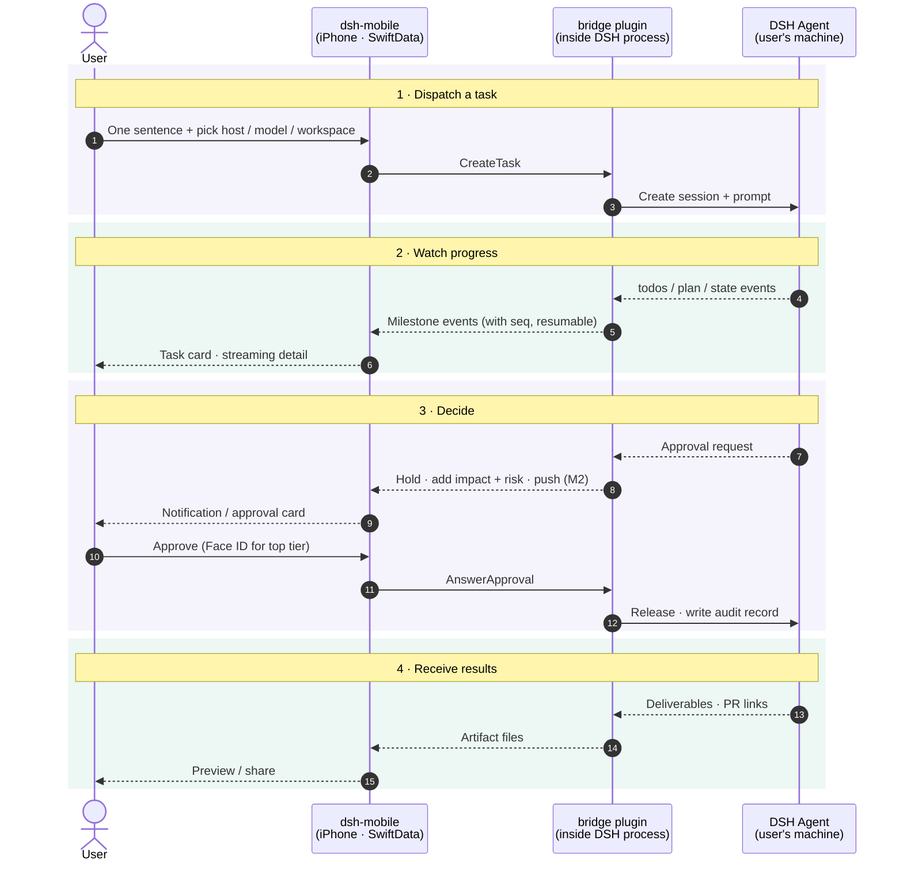

# ARCHITECTURE

Technical design for dsh-mobile. Product intent lives in [STORY.md](STORY.md); this file records **how** we build it and **why**. Decisions here were made on 2026-11-04 against upstream DSH `v0.2.2-rc.1` (developer preview, breaking changes expected).

## 1. Upstream reality (what DSH gives us today)

| STORY.md needs | Upstream DSH today | Consequence |
|---|---|---|
| Reach hosts behind NAT / LAN | Binds one concrete IP (default `127.0.0.1:3080`); no relay/tunnel (Liveshare is experimental, off) | We provide our own listener |
| QR pairing, per-device revoke | One launch token per process → cookie; revoke = revoke everything | We own pairing + device registry |
| Push notifications | None | We own push |
| Approvals belong to the account, pause until answered | No answering client ⇒ immediately `unavailable` (fail closed). Chain asks one answerer at a time; no timeout | We hold approvals in-process |
| Approvals describe impact + risk | Request carries only `toolName`, `callId`, `reason` | We join with the streamed tool call and classify risk |
| Milestone-level progress | Typed projections exist: `todos`, `plan`, `state`, `deliverables/presented`, errors | Map, don't summarize |
| Model list / switch mid-task | `session/modelCatalog`, `session/selectModel` (mid-session OK) | Pass through as-is (principle 8) |
| Add context mid-task: follow-up message, attachment, answer to an agent question (principles 4, 7) | **Not verified**: unknown whether a running session accepts a new message, and whether it is queued for the next turn or injected immediately | Spike before M2 (§8.6) |
| Stable, typed wire API | Undocumented TS-only protocol: `POST /api/<ns>/<method>` + one WebSocket mux `/api/remote.mux`; no schema, no versioning | Never let the app speak it |

## 2. System shape

```
 ┌─ iPhone ────────────┐                               ┌─ user's machine (×N) ──────────────────┐
 │ ① dsh-mobile (iOS)   │  E2E-encrypted frames over    │ DSH host process                        │
 │   SwiftUI            │◄────── one WebSocket ────────►│  └ ② bridge plugin (TypeScript, Cordis) │
 │   SwiftData cache    │  LAN / Tailscale (v1)         │     • facade API (protobuf)             │
 └──────────▲───────────┘  relay (v2, sees ciphertext)  │     • pairing + device registry         │
            │                                           │     • approval holder + risk classifier │
            │ APNs (M2+)                                │     • milestone mapper                  │
            └────────────── Apple APNs ◄────────────────┤     • PushSender → APNs direct          │
                                                        └─────────────────────────────────────────┘
```

Three deliverables, one monorepo:

```
ios/        ① SwiftUI app (+ extensions later)
bridge/     ② DSH companion plugin, TypeScript, installed by the user into their own DSH
protocol/   .proto schema + codegen scripts (Swift + TS); the only contract between ① and ②
gateway/    (deferred) shared push gateway, only if builds are ever distributed to others
```

The current Xcode project moves under `ios/` when real code lands.

### Round trip: user → executor → user

The four phases are the phone's four jobs from STORY.md. Every app ⇄ bridge hop is E2E-encrypted.



Solid arrows are the outbound path (user → executor), dashed arrows the return path (executor → user). Not drawn:
- **Push before M2.** In M1 the app receives over the foreground WebSocket only. From M2 the bridge calls APNs directly.
- **Interrupt and mid-task model switch.** Both follow the same outbound shape as "Approve" in phase 3.

## 3. Key decisions

| # | Decision | Rationale |
|---|---|---|
| D1 | **Native SwiftUI** for every M1–M4 screen, including streaming detail (Markdown, code, diffs, terminal) | Core UX; offline from cache; immune to web-UI churn. No WebView in M1. |
| D2 | **iOS 26 minimum, Swift 6 language mode**, complete concurrency checking, `MainActor` default isolation | New app, developer-preview upstream; compile-time race safety for the streaming layer. |
| D3 | **Companion plugin ("bridge")** fills every upstream gap | Fits DSH's everything-is-a-plugin model; user installs it into the DSH they already run (STORY: we don't install/host DSH). Upstream PRs only where a plugin can't reach. |
| D4 | **App talks only to the bridge facade**, never to DSH's native protocol | Upstream breaks often; App builds update slowly. Breakage is absorbed in the bridge. |
| D5 | **Protobuf** schema in `protocol/` → swift-protobuf + protobuf-es | Message-level types inside an encrypted envelope; `oneof` for events; explicit evolution rules. |
| D6 | **App-layer E2E encryption** (Noise-style handshake, host static key delivered by QR). *Provisional — pending user review* (X2, `spikes/x2-noise/README.md`): pairing `Noise_IKpsk1_25519_ChaChaPoly_SHA256` with psk = the QR's 32-byte one-time secret; reconnect `Noise_IK_25519_ChaChaPoly_SHA256`; the pair/reconnect mode and protocol version are bound into the prologue; own Noise state machine on CryptoKit (Swift) and `@noble/*` (TS). | Every transport is untrusted: plain LAN HTTP, Tailscale, future relay. Relay later needs no crypto redesign. IK because the QR already delivers the host key; psk1 rather than psk2 so the host rejects a wrong pairing secret at message 1. CryptoKit has no BLAKE2, hence SHA256. |
| D7 | **Reachability: direct in v1, relay in v2** behind a `Transport` abstraction | v1 user provides reachability (same Wi-Fi, Tailscale/VPN, own domain). |
| D8 | **Push: bridge → APNs directly** with the builder's own `.p8` key, behind a `PushSender` interface | Open-source, self-built debug app: the builder owns both the signing team and the hosts, so no server is needed. A shared gateway is a future `PushSender`. |
| D9 | **SwiftData** local cache; host is source of truth | Offline viewing; nothing lost across disconnects. |
| D10 | **`@Observable` stores + protocol services via `Environment`**, Swift Testing; Apple-first, few vetted SPM deps | Plain, testable, minimal supply chain. Candidates: swift-protobuf, a Markdown renderer. |
| D11 | **Milestones = deterministic mapping of DSH projections** (`todos`, `plan`, `state`, deliverables, errors) | Free, real-time, no hidden model calls. Quality depends on agents using todos. |
| D12 | **Workspace: per-host default + recent-workspace picker** | DSH sessions need a cwd. Prompt-based inference later. |
| D13 | **1 task = 1 DSH session**; "quick answers" are short sessions rendered inline | One entry point (principle 3) without a second concept. |
| D14 | **Strings in a String Catalog, zh-Hans + en; MIT license** | Matches upstream license. |

## 4. iOS app (`ios/`)

### Layers

```
Features (SwiftUI views + @Observable stores)
   TaskList · TaskDetail · Composer · Approvals · Hosts/Pairing · Settings
Domain (pure Swift value types)
   Host · Task · Milestone · ApprovalRequest · Artifact · ModelChoice
Services (protocols; real + fake implementations)
   HostRegistry · SessionSync · ApprovalService · ArtifactService · CredentialStore
Transport
   SecureChannel (Noise over WebSocket) · RPC + event-stream mux · Reconnect/backoff
Persistence
   SwiftData models (per-host task/milestone/approval cache, sync cursors)
Generated
   protocol/ → Swift (swift-protobuf)
```

- **One `HostConnection` actor per paired host.** It owns its WebSocket, handshake, reconnect, and resume cursor, and emits domain events into SwiftData. Views observe SwiftData / stores, never the socket.
- **Unified task list** (principle 4) is a SwiftData query across hosts; a host is a task attribute. Offline hosts are named explicitly (principle 3).
- **Resync on reconnect**: the bridge keeps a per-host monotonic event seq (DSH has no server-side resume cursor), so the app sends `resume(after: seq)` and receives the gap, including still-pending approvals.
- **Background**: iOS cannot keep sockets alive. M1 refreshes on foreground. M2 uses push to wake the user; M4 Live Activities.
- **Keys**: device identity key in Secure Enclave (P-256, signing); Noise static key (X25519) in Keychain, `ThisDeviceOnly`. Secure Enclave doesn't support X25519, which is why there are two keys.

### Free Personal Team constraints (current signing setup)

Builds expire after 7 days; **no push**, so M2 requires a paid account. App Groups (needed for the Share Extension in M3) must be verified on the free team before M3. M1 depends on neither.

## 5. Bridge plugin (`bridge/`)

A Cordis plugin installed into the user's DSH profile. Responsibilities:

1. **Listener**: its own WebSocket port (DSH's webserver binds loopback only). All payloads are E2E-encrypted, so a plain-HTTP LAN bind is acceptable.
2. **Pairing**: shows a QR (in DSH UI or terminal) containing host address(es), host static public key, and a one-time pairing secret. The device registry supports list/revoke (principle 9).
3. **Facade**: translates DSH sessions, projections, models, and files into the protobuf API. It's the only code that knows DSH internals.
4. **Approval holder**: registers an in-process answerer on DSH's `approval/request` waterfall (a supported seam per upstream `docs/subsystems/approval.md`). It parks requests until a paired device answers, so they never hit `unavailable` just because the phone is asleep. It joins the request with the streamed tool call via `callId` to describe impact, assigns a risk tier, and writes the audit trail (who, when, which device, what). It auto-cancels after a configurable timeout and notifies (principle 5: never default-allow).
5. **Milestone mapper**: DSH projections → `Milestone` events.
6. **PushSender** (M2): APNs HTTP/2 with token auth (`.p8`), sandbox environment for debug builds. Payloads are minimal or encrypted to the device key.

## 6. Protocol (`protocol/`)

- **Envelope**: WebSocket binary frames → Noise transport messages → protobuf `Frame { oneof { Request, Response, Event, … } }`.
- **RPC**: request/response correlated by id. Examples: `ListTasks`, `CreateTask`, `Prompt`, `Interrupt`, `AnswerApproval`, `ModelCatalog`, `SelectModel`, `ListWorkspaces`, `GetArtifact`.
- **Events**: server push with a per-host `seq`. Examples: `TaskUpserted`, `MilestoneAdded`, `AssistantChunk`, `ApprovalPending`, `ApprovalResolved`, `ArtifactPresented`, `HostStatus`.
- **Versioning**: `Hello { protocol_version, capabilities[] }` on connect. Protobuf additive-only rules. The bridge supports N and N-1.

## 7. Milestones

| Milestone | Scope |
|---|---|
| **M1** | Pairing (QR + E2E), unified task list, composer (text, host, workspace, model + effort), milestone progress + native streaming detail, interrupt, mid-task model switch, **in-app approvals** held by the bridge (basic impact view). Foreground only. |
| **M2** | Push via bridge → APNs (needs paid account), risk tiers, Face ID for top tier (no lock-screen approval), plan alignment + pre-authorization, pause timeout + re-confirm. Mid-task context: follow-up messages and answers to agent questions (attachments with M3), pending §8.6. |
| **M3** | Artifacts: Quick Look preview, share sheet out; Share Extension + attachment upload (share-in); photos as context. |
| **M4** | Live Activities / Dynamic Island, voice task entry. Relay transport (v2 reachability). |

## 8. Open risks / spikes before M1 coding

1. **Approval answerer ownership**: upstream treats a "non-owning" answerer as `unavailable`. Verify that a plugin answerer can own approvals for all agents, and decide ordering versus the web/desktop UI answerers (who asks first, and does the web UI still see them).
2. **Plugin listener**: confirm a Cordis plugin can open its own port, and see how the user installs and enables a bundle or plugin in their profile.
3. **Noise implementation**: a CryptoKit-based Swift implementation plus TS (`@noble/*`) must interoperate. Validate both against the official Noise test vectors before trusting either.
4. **Upstream churn**: pin the supported DSH version range in the bridge; add a CI job against DSH `main`.
5. **Streaming Markdown renderer**: choose an SPM package or build on `swift-markdown`, and benchmark incremental rendering of long transcripts.
6. **Mid-task context** (before M2, not blocking M1):
   - Can the bridge add a message or attachment to a session that is still running? Is it queued for the next turn or injected immediately?
   - How does an agent's open question to the user surface, as distinct from an approval request? It needs the same hold-and-notify treatment as approvals (principle 4).
