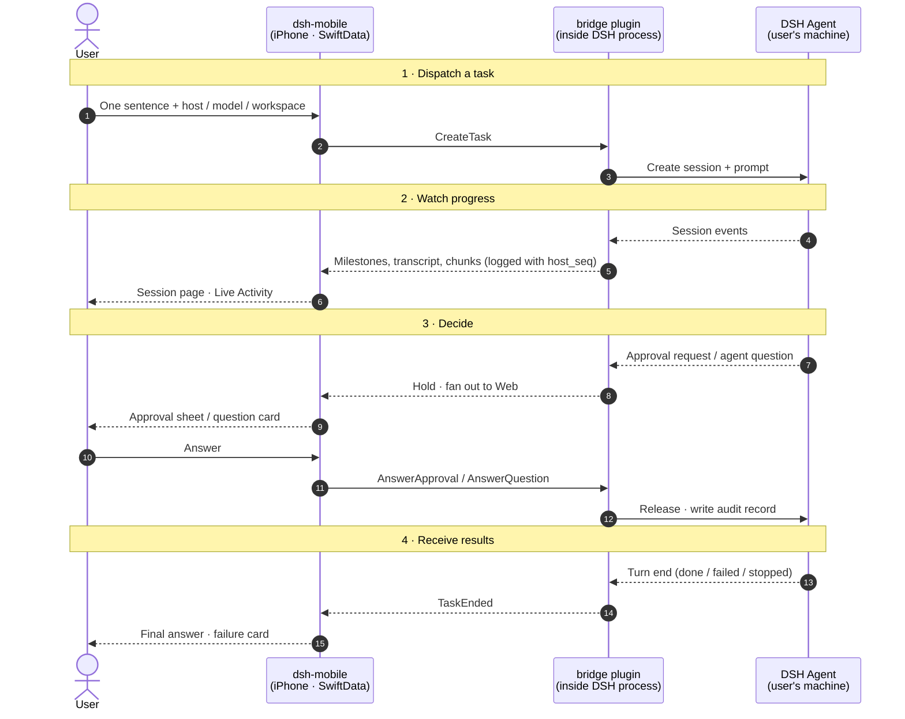

# ARCHITECTURE

How dsh-mobile is built now, and why. Product intent is in [STORY.md](STORY.md), screens in `design/screens.json`. It tells only the current state; change it in the same commit as the code. A choice that the user has not confirmed yet is marked **provisional**. Ideas and work still to do are [GitHub issues](https://github.com/laichang/dsh-mobile/issues), not entries here.

Upstream is DeepSeek Harness (DSH) `0.2.2-rc.1`, a developer preview with breaking changes expected.

## 1. Upstream DSH and what the bridge adds

| STORY.md needs | Upstream DSH | What dsh-mobile does |
|---|---|---|
| Reach hosts behind NAT or on a LAN | Binds one IP (default `127.0.0.1:3080`); no relay or tunnel | The bridge opens its own listener; the user gives reachability (same Wi-Fi, or Tailscale on both ends) |
| QR pairing, revoke per device | One launch token per process; revoke = revoke everything | The bridge owns pairing and a device registry |
| Approvals belong to the account and wait until answered | With no answerer, a request is `unavailable` (fails closed). Under `dsh web` the Web forwarder holds a request until a tab connects. Subagents never ask | The bridge holds approvals in process, first in the chain, and fans a copy out to the Web (§4.4) |
| Approvals say what they do | A request carries only `toolName`, `callId`, `reason` | The bridge joins it with the streamed tool call to show the arguments |
| Progress as milestones | Typed events: `todo/write`, `plan/mode`, `turn/start`/`end`, `llm/retry` | Map them deterministically; never summarize with a model |
| Model list, switch mid-task | `session/modelCatalog`, `session/selectModel` (also mid-session) | Pass through as DSH gives them (STORY §8) |
| Add context mid-task | `sessionController.prompt` takes text and file parts into a running session: `steer` (next step) or `queue` (next turn). Agent questions use their own `user-questions/request` waterfall | Pass through as follow-up messages; hold questions like approvals |
| A stable, typed wire API | Undocumented TS protocol (`POST /api/<ns>/<method>`, one WebSocket mux); no schema, no versioning | The app never speaks it; only the bridge knows DSH internals |

## 2. System shape

```
 iPhone                                         user's machine (x N)
 +----------------------+                       +------------------------------------+
 | 1 dsh-mobile (iOS)   |  E2E-encrypted frames | DSH host process                   |
 |   SwiftUI            |<--- one WebSocket --->|  2 bridge plugin (TS, Cordis)      |
 |   SwiftData cache    |  LAN / Tailscale      |    facade API (protobuf)           |
 +----------------------+                       |    pairing + device registry       |
                                                |    approval + question holders     |
                                                |    milestone + transcript mappers  |
                                                |    host event log (resume)         |
                                                +------------------------------------+
```

One monorepo, three parts:

```
ios/        1 SwiftUI app, Live Activity extension, local package DSHKit
bridge/     2 DSH companion plugin, TypeScript; the user installs it into their own DSH
protocol/   .proto schema + golden fixtures; the only contract between 1 and 2
```

There is no server of ours (no push gateway, no relay): the phone talks only to the bridges of paired hosts.

### Round trip

The phone's four jobs from STORY.md; each app ⇄ bridge hop is E2E-encrypted.



Interrupt, model switch and follow-up messages take the same outbound path as an answer in phase 3.

## 3. Key choices

| Choice | Why |
|---|---|
| **Native SwiftUI** for every screen, the streaming transcript too. No WebView | Core UX; works offline from the cache; not hit by Web UI changes |
| **iOS 26 minimum, Swift 6** language mode, complete concurrency checking, `MainActor` default isolation in the app target | A new app on a preview upstream; races in the streaming layer are compile errors |
| **A companion plugin (the bridge)** fills each upstream gap | Fits DSH's plugin model; the user installs it into the DSH they already run (we never install or host DSH). Upstream changes only where a plugin cannot reach |
| **The app talks only to the bridge facade** | Upstream breaks often and app builds update slowly; the bridge absorbs the breakage |
| **Protobuf** in `protocol/` (swift-protobuf, protobuf-es) | Typed messages in an encrypted envelope; `oneof` for events; additive evolution |
| **TLS 1.3 with a QR-pinned host key** | Every transport is untrusted (plain LAN, Tailscale). Details in §4.2 |
| **Direct reachability only**: same LAN, or Tailscale on both ends. No relay, no public tunnel | Only the user's devices reach the bridge; a relay is a server to run |
| **No APNs push** | Needs a paid Apple account and a key on each host. The app updates while it runs; a local Live Activity covers the lock screen (§5.7) |
| **SwiftData cache**; the host is the source of truth | Offline viewing; nothing lost across disconnects |
| **`@Observable` stores**, services as protocols with real and fake implementations; Swift Testing; Apple frameworks first, few pinned dependencies | Plain, testable, small supply chain |
| **Milestones and transcript rows = deterministic maps of DSH events** | Free, real time, no hidden model calls. The quality depends on the agent's use of todos |
| **1 task = 1 DSH session**; a quick answer is a short session | One entry point (STORY §3) without a second concept |
| **Workspace: host default + recent workspaces + any absolute path** on the host. The phone does not guess a host or a workspace from the prompt | Defaults the user can see and change; a guess could run a command in the wrong place |
| **Strings in String Catalogs**, zh-Hans + en, one catalog per feature | Parallel work does not edit the same file |
| **License PolyForm Noncommercial 1.0.0** | The user allows personal and other noncommercial use; commercial use needs a separate license from the user |
| **Signing** in `ios/Config/Signing.xcconfig`; each builder's team ID and bundle ID prefix in the git-ignored `Signing.local.xcconfig` | Anyone can build to their own iPhone without editing `project.pbxproj` |

### Toolchain

- Codegen: `buf` + `protoc-gen-es` (pinned devDependencies of `bridge/`) and `protoc-gen-swift` built by SwiftPM from the swift-protobuf version that `ios/DSHKit` pins. One entry point: `scripts/codegen`.
- Generated code is committed; `scripts/codegen --check` fails when regeneration changes a file. Xcode builds without a codegen toolchain, and protocol changes show in review.
- Bridge: pnpm, pinned by `packageManager` (Node ≥ 24.9, as DSH requires); tests use `node:test`.
- Swift: DSHCore wraps DSHTransport, package-visible protobuf messages and SwiftData. DSHFeatures consumes typed DSHCore operations and shares DSHActivity with the app. The widget links only DSHActivity. Debug composition uses DSHTestSupport factories. `scripts/swift-test` checks these boundaries before running the package tests on macOS.
- `scripts/check-core-api macos` and `scripts/check-core-api ios` compile DSHCore and inspect its external signatures with the Swift API digester. A per-platform allowlist identifies the declaration and referenced type of each existing exposure. Adding a reference or leaving a repaired one in the allowlist fails the check.
- Dependencies are pinned to exact versions (`ios/DSHKit/Package.swift`, `bridge/package.json`).

## 4. Bridge plugin (`bridge/`)

A Cordis plugin in the user's DSH profile (install: `bridge/README.md`). It is the only code that knows DSH internals. In-process `ctx.sessionController` / `ctx.workspaceController` calls run as the owner, so it needs no Peer (`bridge/src/dsh.ts`).

### 4.1 Listener

- Its own WebSocket port, default `0.0.0.0:47801` (DSH's web server binds loopback only). Every network connection requires TLS 1.3.
- When the listener cannot open (port in use, no permission, address not available), the bridge writes one line with the address, the cause and the fix to stderr (tagged `[dsh-mobile-bridge]`) and to DSH's logger (`bridge/src/listen-error.ts`). `dsh web` has no console exporter for plugin loggers, so stderr is the line the user sees. DSH keeps running; the bridge does not try again until DSH restarts, and never moves to another port by itself (the phone saved the port at pairing).

### 4.2 Pairing and the encrypted wire

- The running host issues a single-use, ten-minute offer through owner-only local IPC. The pairing CLI displays the v2 QR with advertised addresses, the P-256 SPKI pin, offer ID, secret and expiry.
- The phone verifies the server certificate, name and pin before sending the offer to `/enroll`. Each paired phone keeps its own bearer in a ThisDeviceOnly Keychain item. The bridge authenticates the WSS upgrade against the TLS device registry. One binary message carries one protobuf frame.
- The TLS identity and credential digests live under `$DSH_HOME/dsh-mobile-bridge/tls/`. The existing DSH session store and approvals journal survive upgrades. Legacy pairing and revocation records contribute only to audit history. Installation and certificate renewal: `bridge/README.md`.

### 4.3 Tasks, the host log and resume

- Tasks belong to the host's `TaskHub` (`bridge/src/tasks/`), not to a connection: closing the socket does not stop a task.
- Each event that the bridge sends is appended to one per-host log with a monotonic `Event.host_seq`, named by a random `log_id` per bridge process. The log is in memory (the last 50,000 events). DSH has no resume cursor of its own, and the bridge keeps running when the phone sleeps. Restarting DSH starts a new log.
- `Resume { log_id, after_seq }` replays the logged events after the cursor, answers `Resumed`, and then sends live events. Replay and subscribe happen in one synchronous step, so nothing falls between them. When the cursor does not apply (another `log_id`, or trimmed events), the bridge sends `LogReset` and replays all it kept.
- `ListTasks` returns each task with its state, pending approvals and questions, model and workspace, so a card comes back after a trim or a fresh cache.
- **Sessions from other clients**: the bridge reads DSH's visible session list on resume and follows committed session events. One task row per DSH session ID. The title is DSH's session title once it has one, else the first prompt. With `sessions.v1`, the open session reads `SessionHistory` at one journal cursor. DSHCore maps messages and attachments identically from the host and the protobuf cache.

### 4.4 Approvals

- The holder registers on DSH's `approval/request` waterfall with `prepend: true`, parks each request, and sends a copy down the rest of the chain (the Web/desktop forwarder) with its own abort signal. The first answer wins (phone or browser); the other copy is withdrawn. A downstream `unavailable` means "nobody else", and the bridge keeps holding. Why: an appended answerer never sees a request (the Web forwarder holds it first); prepend alone hides the request from a user at the computer; removing the Web forwarder breaks the Web UI. Upstream says sibling order is "not a policy-priority mechanism", so a test pins this behavior. The desktop app is not verified.
- Each request gets a host-generated UUID (a tool call ID can repeat). The holder joins the call ID and tool name with the committed assistant message to show the original arguments. A phone can deny a request without arguments; it can allow one operation when the details are there. Answers are allow once or deny; there is no "always allow".
- The holder appends its first decision through a typed audit writer before releasing the tool. Device history reads the same `approvals.jsonl` journal, which records the authenticated device ID for phone answers. A Web/desktop answer exposes only its outcome, so those entries name the owner and DSH client together.
- `approvalTimeoutMs` (default 24 hours) settles a request as rejected, never allowed. An interrupt cancels held requests before its acknowledgement.

### 4.5 Agent questions

- `QuestionHolder` (`bridge/src/questions/holder.ts`) holds `user-questions/request` with the same prepend and fan-out. An answer names offered options (one, or one or more when `multi_select`), or typed text (`custom`), or both when `multi_select`; the model gets `{ answers: [{ id, selected, custom? }] }`.
- **No timeout.** A question has no safe default: an answer the bridge made up would reach the model as the user's choice, and DSH Web waits too. The task waits until a person answers, the user stops it, or DSH aborts the turn (`CANCELLED`). With DSH's opt-in timed mode, DSH aborts the request at its deadline and the card closes as not answered.
- A task is `WAITING_ON_USER` while a question waits, like an approval, so it is under 等我处理 everywhere. The bridge hides the `ask_user_question` tool row; the card replaces it.

### 4.6 Milestones and the transcript

- **Milestones** (`bridge/src/milestones/mapper.ts`), from the raw durable events on `sessionController.follow`: `turn/start` → STARTED (first turn only); `todo/write` → PLANNED when the items change, then TODO_DONE / TODO_STARTED per status change; `plan/mode` → PLAN_MODE_ENTERED / LEFT; `llm/retry` → RETRYING with DSH's message; `turn/end` → FINISHED, INTERRUPTED (`aborted` with cause `user`) or FAILED. Unknown events are ignored. Raw events, not the projection views, because they carry the transition and DSH's time.
- `MilestoneAdded` carries a kind, DSH's own words and the **whole todo list**, so the card never folds history and a resumed client needs only the latest one. The app labels kinds itself; no text is generated. `seq` is per task.
- Follow-up turns add no milestones, except a follow-up after a failure: the failed turn did no work, so the timeline goes on with the turn that does it.
- **Transcript blocks** (`bridge/src/transcript/`): thinking from the timed `reasoning-delta` chunks (duration from DSH's chunk times); tool calls from `tool/call` and `tool/result` (a target from the arguments; lines added and removed from the result's diffs). One `TranscriptBlock` per change, keyed by `block_id`, sent only to clients with `transcript.v1`. No offset on the wire: the app places a new row after the text streamed so far, which the log order makes the same on every replay. Block IDs of later turns get the prefix `turn-N-` (DSH's turn number).

### 4.7 Conversation: follow-ups, the queue, stop

- A follow-up is one more `sessionController.prompt` into the same session (the message ID is DSH's `requestId`, so a repeated send is accepted once). It is taken for a phone task that is completed, failed, stopped, or running.
- **While the task runs** the app sends `QUEUE` by default: the message waits above the composer and runs as the next turn. 立即发送 (`EditQueue` STEER) calls DSH's `updateQueue` steer, so the agent reads it at its next step. Why queue by default: a steer the user did not choose can derail a step half done, and the Codex and Claude apps also wait for the turn. When DSH answers `session/steer-unavailable`, the message stays queued.
- `QueuedMessage { placement: QUEUED | STEERING | REMOVED | RETURNED }` is logged, so the queue is the same after a reconnect. `UserMessage` is logged where DSH writes the message into the session (`user/message` with `source.rpcId`).
- DSH writes a steered message only when the current step ends, which can be minutes into a long tool call. So the app shows a STEERING message in the transcript at once, marked "Agent 下一步读到" until its `UserMessage` comes.
- **Stop**: `sessionController.cancel`. Only the durable `turn/end` with `aborted` and cause `user` makes a task interrupted (the host decides when completion races a stop). DSH keeps its queue after a cancel, so the bridge removes the task's waiting messages and logs them RETURNED; the app puts their text back into the composer. Nothing runs that the user did not see go.
- A queued message makes DSH start the next turn by itself, so the bridge keeps following the session past a completed `turn/end` while a message of the task still waits (checked against `sessionController.state`). One follow across turns: a new follow per turn could miss the first events of the next turn.

### 4.8 Attachments

- `UploadBegin { upload_id, media_type, name, size, sha256 }` → `UploadAck`; `UploadChunk { index, data }` → `UploadAck`, one part at a time, 48 KiB of data each; `UploadEnd` → `UploadStaged`. Then `CreateTask.upload_ids` or `SendMessage.upload_ids` names them. Each request waits for its response, so there is no window or flow control.
- Limits: at most 5 per message, each at most 20 MiB (the bridge keeps staged files in memory). The bridge checks size and SHA-256 at the end; refusals are `upload/…` error codes.
- Uploads belong to the connection and are used up by the request that names them.
- JPEG, PNG, WebP and GIF go into the prompt as images (`ctx.fileUploads.uploadImageStream`); other files are staged with `uploadStream`, and the model gets the name and the path. Parts keep the user's order.
- While a task runs, a message carries text only; the bridge refuses files for a running task.
- `AttachmentRef { kind, name, size, media_type }` is on `UserMessage` and `SessionMessage`, so the bubble shows attachments after a resume, on another phone, and for a session read from the journal. Golden fixture: `protocol/fixtures/attachments/`.

### 4.9 Models, workspaces, failures

- **Models** (`models.v1`): DSHCore maps ordered providers, defaults, optional effort and failures to Swift values. Live and cached selections use the same mapping. The bridge applies an explicit choice before the first prompt or rejects `CreateTask` with DSH’s error. On a running task, `selectModel` changes the next turn and DSH saves the host default for phone and Web.
- **Workspaces** (`workspaces.v1`): DSHCore maps the host reply to `WorkspaceList` (default and registered paths, newest first). DSH validates and registers custom paths. Default order: configured `cwd`, DSH default, home.
- **Model failures**: DSH ends the turn with `turn/end { reason: { kind: 'error', error: { message, code, status } } }`. `code` is DSH's stable class (`AUTH`, `QUOTA`, `RATE_LIMIT`, `INVALID_REQUEST`, `SERVER`, `HTTP_<status>`, …; route on it, never parse the message). DSH itself retries `RATE_LIMIT`, `SERVER`, `TIMEOUT`, `TRANSPORT`, `EMPTY_RESPONSE` in the turn (5 times, about 16 s for a 429); the bridge does not retry. The task ends as **failed** with `failure_code` and DSH's `message` (`failures.v1`); the session stays usable, so a new message continues it. Evidence: `spikes/model-failures/README.md`.

### 4.10 Devices, audit and the upstream guard

- **Devices** (`devices.v1`): both screens use the selected online host’s `HostDeviceManagement` API. Enrolled devices have equal rights. Revocation atomically removes the bearer digest and records the action, then closes that device’s sockets.
- **Audit**: pairing and revoke history together with the approval journal, 50 entries per page (`ListAudit`).
- **Upstream guard**: the bridge supports exactly the verified DSH release (`0.2.2-rc.1`), read from the running launcher's app-boot manifest. The loader range is broad, so a host with another DSH can still pair and answer Hello; then the bridge injects no DSH services, registers no holder and refuses other requests, and the phone shows the installed and supported versions. CI runs the bridge suite on the pinned runtime and, non-blocking, on DSH's default branch (`scripts/ci/bridge-upstream`).

## 5. iOS app (`ios/`)

### 5.1 Layers

```
Features (SwiftUI views + @Observable stores)
   Shell (ShellModel: page, SheetRoute, drawer), Drawer, Session page + composer, All tasks
  , Approval sheet, Questions, Pickers, Hosts, Devices, First run, Voice, Attachments, Live Activity
Theme
   DSHTheme (base tokens) + Theme+<feature>.swift files
DSHFeatures
   TaskListStore, TaskComposer, DrawerTree, TaskOutcome, Dictation, LiveActivities
DSHCore
   HostConnection, Pairing, HostSync, Milestones, Transcript, FollowUpQueue, Questions, Attachments
Persistence
   SwiftData: CachedHost (cursor), CachedTask (transcript, milestones, blocks, attachments, read state)
DSHTransport
   Ordered WebSocket I/O, endpoint probing and device-only Keychain storage
DSHProtocol
   generated from protocol/ (swift-protobuf)
```

- **Design as data (provisional, pending user confirmation):** `design/screens.json`: screens and shared parts (needs, nav, STORY sections, rules with XCUITests). A screen is `design/screens/<id>.html` on `design/kit/` (png: `scripts/render-design`); `scripts/check-design` checks them and the theme names. Not chosen: one board.
- **One `HostConnection` per paired host.** Each address attempt negotiates a pinned TLS connection. Each socket has one DSHTransport frame dispatcher, ordered writer and request table. Its receive loop waits for Core to map and yield each event before resolving a later reply. HostSync can request reconciliation after Resumed while the consumer and its batched save still have work queued.
- **`HostSync`** owns one host’s connection loop and SwiftData context. It resumes from its saved cursor and backs off on disconnect. Backgrounding flushes each host and closes its socket; foregrounding waits for shutdown before reconnecting. `TaskListStore` consumes snapshots and host commands. `TaskComposer` owns drafts, selection, upload progress and send state. HostSync stages files and records successful sends.
- **Cache**: events at or below the cursor, and chunks at or below a task's chunk seq, are skipped, so replays are idempotent. Equal summary timestamps use the turn start to distinguish a resumed task from a stale replay. Each host saves pending events and their cursor together after 150 ms. A `LogReset` persists a pending `ListTasks` reconciliation, so a relaunch finishes marking lost running tasks failed.
- The host certificate can renew under the same pinned key. A changed key requires a fresh enrollment. Both app configurations use the default App Transport Security policy. `scripts/check-release-clean` inspects built plists and binaries.

### 5.2 Hosts and connections

- Pairing (scan or paste the link) tries the offer's addresses in order. The host (name, addresses, host key) is saved as JSON (`paired-hosts.json`) in Application Support. File mutations serialize the complete read, comparison and atomic replacement across store instances. Only a missing file starts empty. The displayed list omits legacy and pending-cleanup records. Revocation persists the pending credential ID before Keychain deletion and acknowledges it after deletion succeeds.
- A reconnect tries each saved address one at a time, the last working one first. Each try (WebSocket open and handshake) has 5 s. After a try with no answer, a plain TCP connect of at most 1 s (`TCPPortProbe`) tells "another program", "nothing listens" or "not reachable". A try that the host answers with a refusal ends the search (4003, or a bridge that needs a DSH update). On success the working address is saved first.
- Each failed address gets a reason (`AddressFailure`): nothing listens, another program (not a bridge), or not reachable. The hosts sheet lists each address with its reason and what to do; the all-offline card names the most telling reason per host.
- **Close 4003 is final**: the store drops the host and its rows and stops retries. The app forgets its pairing, reports an external revoke once and shows first run when no hosts remain. A self-revoke recognizes either the response or the refusal. Pairing again clears `AppModel.forgottenHostKeys` for that host.
- **Multi-host**: the phone syncs every paired host. The composer's host is kept in UserDefaults. When it goes offline, the app does not switch hosts by itself: another host could run the command in another workspace.
- **All offline**: once every host has failed (offline, or its DSH needs an update), the new session shows the all-offline card and the send key is off; the drawer and the cache still open.

### 5.3 Shell and navigation

- One `ShellModel` holds the page (`ShellPage`: new session, session, all tasks), the sheet (`SheetRoute`) and the drawer. No `NavigationStack`.
- The app opens on a blank new session with the default host and workspace, also when the cache has tasks; it never reopens the last place (STORY §3). When the host accepts the first message, the same page becomes that session's page at once, whatever the reply; a failed send keeps the prompt and shows `composer.error`.
- The drawer (from the left edge) groups host > workspace (by path) > session, with marks for waiting, running and unread. Read state is local: `CachedTask.readThrough` stores the host `updatedAt` that the user saw (host and phone clocks differ). The badge counts 等我处理.
- Landing (06, F4): a read session opens where the user last scrolled in this run, else at the end.
- The keyboard goes away before any action that is not typing: `ShellModel` dismisses it when the page, sheet or drawer changes; composer menus open in place, so each has `.dismissesKeyboardBeforeMenu()` (it hooks the UIKit control that SwiftUI draws; `KeyboardMenusUITests` fails if a later iOS changes it).

### 5.4 Session page

- From the top: page bar, `MilestoneBar` (the step in progress, `done / total` finished todos, a progress line; a tap opens the timeline), a status line, the transcript, the composer. The bar and the status line do not scroll.
- The transcript is `StructuredTranscript`: streamed text cut by thinking rows ("已思考 8 秒 ›"), tool rows (DSH's tool name · target · +/− lines), user bubbles, and question cards; a row opens its details in a sheet. Without `transcript.v1`, or for a session read from the journal, it is plain Markdown.
- **Markdown** (`TranscriptBlocks`): Foundation attributed Markdown for prose, native rows for fenced code, diffs and terminal output, GFM pipe tables (columns sized to the widest cell up to 240 pt, the table scrolls sideways in its row), and CJK emphasis (`CJKEmphasis`: `*`/`**` pairs next to CJK text that CommonMark refuses, as DSH Web's remark-cjk-friendly renders them). No Markdown package.
- **Provisional, pending user confirmation**: completed blocks render once, and only the unfinished tail is parsed again as chunks arrive. On 5,000 lines in the Simulator the p95 update time fell from 12.80–15.06 ms (whole-prefix reparse) to 1.14–2.06 ms. Real-device timing is still open: `spikes/x3-markdown/run` on an iPhone.
- **Approval sheet** (screen 05): the command (else the path, else the arguments), the reason, 拒绝 / 允许一次. It closes only when the approval leaves the task (an answer here or `ApprovalResolved` from elsewhere), so a failed answer does not hide it; a swipe leaves a one-line bar. Offline host: grey buttons with one line why.
- **Outcome**: before the final answer, one row 已工作 · N 步 · M 次审批 (N = milestones, M = answered approvals). Done: 用时 (from the latest turn's start, `turn_started_at_ms`, else `createdAt`) and the model. Failed: a red card (screen X1) with DSH's message and the code as a tag. `AUTH` and `QUOTA` show the app's own copy; other codes show DSH's message. Stopped: the same card, neutral. Nothing is summarized.
- **Composer**: text, "+" (Photo Library, Camera, Files; one item per use), chips with progress, the mic key, send/stop in one place. Files larger than 20 MiB are refused before upload. Follow-ups queue above the field while the task runs, with 立即发送 and remove. While a question waits, the field says "回答 Agent…" and the send key answers it; text equal to an option label picks that option.

### 5.5 All tasks

A drawer page with 等我处理 / 正在跑 / 已完成 across hosts, from the cache. One line per offline host. A task with pending approvals shows one card per approval, a task with a waiting question its question card; both answer in place. Other tasks are one-line rows; a short completed answer shows inline.

### 5.6 Voice input

`SpeechAnalyzer` on the device (`SpeechTranscriber`, else `DictationTranscriber`). Tap the mic to listen, tap again to stop; nothing is sent until the user taps send. Each result replaces the words of the result before it (`DictationSplice`), so typed text stays as typed. No audio or text leaves the phone except the message the user sends. Permission callbacks that run on a system queue go through `SystemCallback.value`: a main-actor closure there stops the app under Swift 6.

### 5.7 Live Activity

- One activity per task that runs on an online host: title, host, time since the turn started (`Text(timerInterval:)`, so it ticks while the app is suspended), the latest step, `done/total`. `LiveActivities` (DSHFeatures) brings them in line with the task list after each change: start, update with a `staleDate` 15 minutes on, end when the task is done, failed, stopped or waits on the user. An ended activity stays on the lock screen; never two for one task; after a relaunch existing activities are taken over by task key.
- Local only: without push, the step changes only while the app runs; then `staleDate` greys it.
- The app sends everything in the ActivityKit state (`DSHActivity` library). No App Group, no shared files, no entitlements, so a free Apple team can sign the extension (`ios/LiveActivity`).


## 6. Protocol (`protocol/`)

- **Envelope**: TLS 1.3 WebSocket binary message → protobuf `Frame { oneof { Request, Response, Event } }`. Requests and responses are correlated by `id`.
- **Hello** first on every connection: `protocol_version` (the bridge supports N and N−1), capabilities, and from the host the DSH version, the supported range and `requires_bridge_update`.
- **Evolution**: additive only; never reuse or renumber a field. Each feature's messages live in their own `.proto` file with its own block of 20 field numbers in `Request`, `Response` and `Event`; `frame.proto` has one line per message. An absent optional field means the older behavior.
- **Capabilities** (the app hides what the bridge cannot serve):

| Capability | Gives |
|---|---|
| `tasks.v1` | `CreateTask`, `AssistantChunk`, `TaskEnded` |
| `resume.v1` | `ListTasks`, `Resume`, `TaskUpserted`, `LogReset`, `host_seq` |
| `milestones.v1` | `MilestoneAdded` |
| `approvals.v1` | `ApprovalPending`, `AnswerApproval`, `ApprovalResolved` |
| `interrupt.v1` | `Interrupt` → `InterruptAccepted` |
| `models.v1` | `GetModelCatalog`, `SelectModel`, `ModelSelected` |
| `workspaces.v1` | `ListWorkspaces` |
| `devices.v1` | `ListDevices`, `RevokeDevice`, `ListAudit` |
| `sessions.v1` | `ReadSession` → `SessionPage` (journal of any session) |
| `drawer.v1` | `TaskSummary.workspace` |
| `transcript.v1` | `TranscriptBlock` |
| `conversation.v1` / `.v2` | `SendMessage`, `UserMessage` / `QueuedMessage`, `EditQueue` |
| `questions.v1` | `QuestionPending`, `AnswerQuestion`, `QuestionResolved`, `TaskSummary.pending_questions` |
| `attachments.v1` | `UploadBegin` / `Chunk` / `End`, `upload_ids`, `AttachmentRef` |
| `failures.v1` | `failure_code` on `TaskEnded` and `TaskSummary`; follow-up after a failure |

- Golden fixtures in `protocol/fixtures/` are read by both the TS and the Swift tests.

## 7. Testing

- **DSHKit**: `swift test` on the Mac. `FakeHost` / `FakeBridge` (`DSHTestSupport`) is a fake bridge process whose tasks and log outlive connections, with scripts for milestones, approvals, questions, follow-ups, outcomes and turns. It closes and refuses with 4003 like the bridge.
- **Bridge**: `FakeDSH` (`bridge/test/`), and live checks against real DSH with its mock model (`scripts/dsh-up.mjs`).
- **Output wrappers (provisional, pending user confirmation):** `scripts/xc <action>`, `scripts/swift-test`, `scripts/pnpm-test` log to `/tmp/dshm-*` and emit JSON counts and errors as `file:line` (`scripts/lib/wrap.py`). `scripts/check-wrappers` enforces their use in demos and review. Select Node tests with `scripts/pnpm-test --node-test FILE`. `xcbeautify` and `xcpretty` lack JSON.
- **Plan data (provisional, pending user confirmation):** `scripts/plan verify` stores local evidence receipts. `scripts/plan merge` rechecks clean merges. Review changed commands, their directories, literal helpers and `scripts/lib/`. `.claude/workflows/run-plan.js` (`scripts/run-plan-args`) runs ≤3 nodes concurrently and commits ≤3 rounds per node. A local Git ref keyed by the plan creation commit routes repairs across worktrees to one chat. Milestone close syncs issues and verifies zero open.
- **Slice brief (provisional, pending user confirmation):** a build agent reads `scripts/brief <ID> --round N`, which links the preceding round’s review on rework (`scripts/brief-test`).
- **UI tests**: `scripts/demo/lib.sh` guards disk, CPU and devices. Network demos enroll a fresh device against an isolated TLS host profile. Cleanup uses assigned UDIDs, homes and branches. Plan close rechecks unused devices after deletion.
- **Debug-only entry points**, behind `#if DEBUG` and the Debug Info.plist; `scripts/check-release-clean` proves a Release build has none:
  - `-DSHM…` launch arguments (`DebugEntryPoints.swift`): `-DSHMFakeBridge` and `-DSHMFakeScenario <name>` put a `FakeHost` in process; an explicit `-DSHMBridgePort <port>` enables a loopback connection for tests. An ordinary unpaired launch shows the pairing welcome screen in Debug and Release. Other arguments preset the prompt, speech, the store and pairing.
  - Ordinary Debug and Release builds share the same Info.plist. Debug UI test builds made with `scripts/xc` register the `dshm://pair?…` scheme for pairing fixtures.
- `-DSHMUIKitAnimations NO` turns off UIKit view animations (XCUITest waits for them, up to 60 s a step). A Debug launch with a `-DSHM…` argument starts no Live Activities unless it passes `-DSHMLiveActivityProbe YES`.

## 8. Known limits and risks

- The host log is in memory: a DSH restart loses the resume cursor (the app then reloads the list and marks lost running tasks failed).
- Approval fan-out to the DSH desktop app is not verified.
- Review dynamically constructed evidence paths manually.
- Not built yet (STORY.md wants them; screens with `built: false` in `design/screens.json`): contact by other channels, artifact preview and share-out, the share extension, attachments while a task runs, and a later answer to a question that DSH's timed mode continued.
