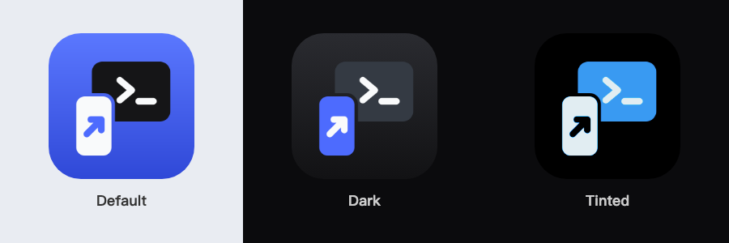

# DESIGN

The screens and interactions of dsh-mobile. This is a living doc: it doesn't get archived.

- **Source**: [design/board.html](design/board.html). Edit this file.
- **Renders**: `design/board.png` (the whole board) and `design/screens/<label>.png` (one per screen, 2x). Regenerate them with `scripts/render-design` after every edit, and commit them with the edit.

## STORY is DESIGN, DESIGN is STORY

[STORY.md](STORY.md) says what the app is for. This board shows what that looks like. They are one thing in two forms:

- Every STORY principle maps to at least one screen (table below). Every screen's caption cites the STORY section it serves.
- When STORY changes, update the board in the same change. When a design decision changes what the app does, update STORY in the same change. Don't leave them out of sync.
- The code is the truth for what ships (AGENTS.md). Each screen carries a milestone tag that says how far the code is:
  - **M1 · 已有 / 换样式 / 改导航 / 补状态**, **M2 · 已有**: the code has the capability. The screen is the target look or navigation for it.
  - **M2 / M3 / M4**: the capability is in a later milestone (ARCHITECTURE.md §7). The screen is a placeholder that fixes its shape.
- Data on the screens is real data: the fields the protocol and the code have (for example, devices have IDs, not names). If a screen needs data that doesn't exist yet, tag it with the milestone that brings it.
- Going against STORY or this board needs the user's confirmation, the same as STORY.

## Visual language

Aligned with DSH desktop and Web ([deepseek.com/harness](https://www.deepseek.com/en/harness/)):

| Token | Value | Use |
|---|---|---|
| Canvas | `#151517` | Session pages |
| Slate | `#343A43` | Workspace drawer (the desktop sidebar) |
| Bubble | `#2C2C2E` | User messages, the composer |
| Hairline | `rgba(255,255,255,.08)` | Separators, card borders |
| Text | `#F9FAFB` / `#ADB2B8` / `#71767E` | Primary / secondary / tertiary |
| Blue | `#4D6BFE` | Progress, primary actions only |
| Amber / red / green | `#F5A524` / `#F85149` / `#3FB950` | Needs you / failed or high risk / done |

System font (PingFang SC for Chinese), SF Mono for commands and paths. Thinking and tool calls collapse to one line; tool calls are `verb · target · +/−` rows.

Markdown in replies (screen 04): code blocks a shade below the canvas; tables as native tables, as DSH Web shows them: the header row on a light fill, hairlines between rows, each column aligned as the delimiter row says. A long cell wraps (a column is at most 240 pt). A table wider than the screen scrolls sideways in its own row; the page does not (S28, ARCHITECTURE.md D79).

### App icon

A phone in front sends work up to a terminal window: the user's own computer (STORY §1, execution elsewhere). Original artwork. It doesn't use the DeepSeek whale or any other mark: dsh-mobile is a client, not DeepSeek's app.

- **Source**: [design/icon.svg](design/icon.svg). Run `scripts/render-icon` after an edit; it writes the three PNGs into `ios/dsh-mobile/Assets.xcassets/AppIcon.appiconset/` (`--preview` also rewrites `design/icon-preview.png`). Asset catalog, not an Icon Composer `.icon` file (ARCHITECTURE.md D70).
- **Appearances**: default = Blue background, a Canvas terminal, a white phone with a Blue arrow. Dark = transparent background (iOS draws the dark one), a Slate terminal, a Blue phone. Tinted = grayscale on transparent; iOS tints it from the brightness.
- **Safe area**: every shape stays inside x 170–854, y 200–860 of 1024, clear of the masked corners.

## Navigation

- **Launch**: a blank new session with the default host and workspace (STORY §3). The first message creates the session.
- **Workspace drawer**: swipe right from the left edge, or tap the drawer button. It pushes the page (it doesn't cover it). Contents: new session → 所有任务 → host › workspace › sessions.
- **Tap a session in the drawer**: the peeking edge swaps to that session first (from the cache), then slides in (about 350 ms).
- **The keyboard goes first** (D67): with the keyboard up, any action other than typing (the drawer button or edge drag, a picker or sheet, another page, a tap or swipe down on the page) puts the keyboard away first.
- **Back to a finished session** (06, D60, D76): unread → the page opens at the start of the final answer, with no marker drawn there; read → at the end. 用时 counts the latest turn only.
- **Session pages have no back button.** Details (tool calls, approvals, pickers) open as bottom sheets, so the left edge belongs to the drawer.
- **iPad** (not drawn yet): the drawer stays open as a sidebar.

## STORY → screens

| STORY | Screens |
|---|---|
| §1 Execution elsewhere; the phone's four jobs | 01, 04, 05, 06 · relay between hosts: not drawn (M3) |
| §2 Hosts treated the same | 02, H |
| §3 One entry; open on a new session; default host and workspace; all hosts offline | 01, 07, X3 · host guessed from the prompt: not drawn (later) |
| §4 Async first; milestones; 所有任务; sessions from other clients; failed or stuck; agent questions | 02, 03, 04, P1, F1–F4, X1, L |
| §5 Approvals show impact; never allowed by default; risk tiers; plan and pre-authorization; re-confirm | 03, 05, P3, P2, P4, L |
| §6 Usable by anyone; first run | 08 |
| §7 Results come to the phone; phone as context; add to a running task | 06 (M3 card; follow-up after it is done, D89), 04 (follow-ups queued while it runs, send now, D101), X1 (continue after a stop), 01 (M2 photo key), P1 · share sheet, voice: not drawn (M3/M4) |
| §8 User picks the model; never swapped silently | M, X4, 04 |
| §9 Control: devices, revocation, audit | H, X2 |

## Known gaps

- **§6 pairing**: STORY's example is scanning in the DSH interface. 08 says the code is printed in the terminal, as S11 does today. Switch 08 when upstream DSH has a pairing entry (STORY, "依赖上游").
- **§7 context sources** (share sheet, voice) and **§1 relay**: not drawn. Draw them when M3/M4 are planned. Photos: one photo in a new session is drawn on 01; files that are not photos, more than one, and photos in a follow-up are not drawn yet.
- **iPad layout**: not drawn.
