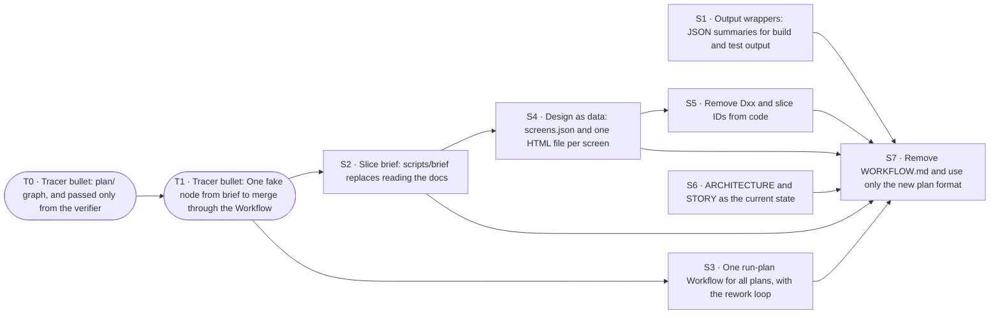

# PLAN · M2.5 · Process as code

M2.5 · Process as code. Product intent: [STORY.md](STORY.md). Technical design: [ARCHITECTURE.md](ARCHITECTURE.md). Process: [WORKFLOW.md](WORKFLOW.md).

This file exists only while this requirement is in progress. It serves this requirement only: ideas and work it does not do are GitHub issues (§7). When the exit (§6) passes, the user deletes this file and `evidence/`, and tags the commit; git keeps the history. `scripts/plan new` wrote this file; change it with `scripts/plan` (WORKFLOW.md §3.1).

## How to use this file

**Process rules** live in [WORKFLOW.md](WORKFLOW.md): set up a Mac, roles and ownership (who writes §0, §8, §9, and each slice section), start and stop a work session, the long-horizon run, resources for each slice, status titles, session settings, default choices, merging a slice, and what stays with the user. Read it before you pick up work. This section keeps only the format of this file and the rules for Done when items.

**Slice fields**, always in this order. Write "—" for an empty field; never drop one.
`Status · Needs · Branch` on one line, then **Why**, **Cuts**, **Demo**, **Done when**, **Not**, **Log**.
- **Status** is one of `todo` / `doing` / `blocked` / `review` / `done`. The slice owner sets it on the branch; the coordinating session brings §0 in line.
- **Log** is append-only and dated: done, not done, next step, and anything learned along the way. Technical decisions go into ARCHITECTURE.md as a `Dxx` entry; the Log just says "see Dxx".

**Done when items** are checkboxes: `- [ ] [tier] description — Evidence: …`
- **Tiers**
  - `[auto]`: unit or integration test against `FakeBridge`, `FakeDSH`, or golden fixtures. Evidence: `test:` pointers, green in CI or a script.
  - `[ui]`: verified in the Simulator, preferably by XCUITest (`test:`), otherwise by an agent driving it through `scripts/demo/<slice>.sh` (`cmd:`). Add a `shot:` as a snapshot for people. Before the slice is marked `done`, a review subagent that didn't take part in development reruns every `[ui]` item.
  - `[human]`: real device, camera, packet capture, subjective experience, or a decision only the user can judge. **Only the user ticks these.** An agent never does.
- **Edit rules**: you may only tick `[ ]` → `[x]` or add new items. Never delete, reword, re-tier, untick, or move an item. Agents add items unticked and tick them in a later edit. If an item truly has to change, explain the original text, the new text, and the reason to the user in the conversation first, and let the user make the edit.
- **Evidence** on a ticked item is one or more typed pointers separated by ` · `. Each one must resolve, otherwise check-plan fails; unknown types fail too.

  | Pointer | Resolves when |
  |---|---|
  | `test:<Name>` | the name appears in Swift/TS test sources (`Suite/name` = both parts in one file) |
  | `cmd:<path> [args]` | the repo-relative path exists and is executable, e.g. `cmd:scripts/demo/t0.sh` |
  | `commit:<hash>` | `git cat-file -e <hash>^{commit}` succeeds |
  | `shot:<path>` | the file exists under `evidence/<slice ID>/` |
  | `human:<YYYY-MM-DD> <device or note>` | `[human]` items only, e.g. `human:2026-11-20 iPhone 16, PR link …` |

  The real evidence is something re-runnable: a test or `scripts/demo/<slice>.sh`. Screenshots are only snapshots for people:
  - Scale them to about 1/3 size and save as compressed PNG, a few hundred KB each.
  - Commit them under `evidence/<slice ID>/`.
  - Recordings stay out of git. If one is really needed, the user attaches it to the PR and the item cites it as `human:` plus the PR link.
  - When the plan ends, `evidence/` is deleted with this file; git keeps both.
- **Enforcement**: `scripts/check-plan` runs from the git pre-commit hook (`.githooks/`) and from a Claude Code PreToolUse hook (`.claude/settings.json`). Edits to the guard files themselves (`scripts/check-plan`, `.githooks/`, `.claude/hooks/`, `.claude/settings.json`) ask the user first, and only the user commits them. Never use `git commit --no-verify` or any other way around them.

## 0. Status

| ID | Status | Branch/PR | Updated | Next action |
|---|---|---|---|---|
| T0 | done | merged `e3daa5a` | 2026-11-10 | — |
| T1 | done | merged `15982e9` | 2026-11-10 | — |
| S1 | done | merged `3b960e8` | 2026-11-10 | — (provisional D150 in §9) |
| S2 | done | merged `a75b85c` | 2026-11-10 | — |
| S3 | done | merged `ea755c4` | 2026-11-10 | — |
| S4 | done | merged `7a73893` | 2026-11-10 | — |
| S5 | doing | `claude/s5-remove-ids` | 2026-11-10 | Slice owner builds (§8) |
| S6 | done | merged `46d4f3d` | 2026-11-10 | — |
| S7 | todo | — | 2026-11-10 | Assign it and start a session |

## 1. Approach

**Tracer bullet first.** Before any feature is built properly, fire one thin round trip through *every* layer that the requirement touches. It is thin, but it is production code, not a throwaway prototype. Everything after it thickens that path.

**Then slices that are almost independent and stand alone.** Each slice after the tracer:

- is **vertical**: it touches protocol + bridge + app + tests, and has a demo you can do on its own;
- **depends on the tracer and nothing else**, unless a dependency is named explicitly (at most one, where possible);
- can be built, reviewed, merged, and dropped **in any order** relative to its siblings.

### How slices stay independent

| Rule | Mechanism |
|---|---|
| Own files | Each slice gets its own feature files (`protocol/<feature>.proto`, `ios/…/Features/<Feature>/`, `bridge/src/<feature>/`), named after the feature, never after the slice ID: code outlives this plan. Shared files (`frame.proto`, app root, plugin entry) only get a one-line registration. |
| No field-number collisions | Each slice reserves a block of 20 field numbers in the `Request` / `Event` oneofs: the next free block after the highest number in `frame.proto`. Write the block in the slice's Cuts. |
| Ship in any order | Each slice advertises a **capability string** in `Hello.capabilities` (e.g. `approvals.v1`). The app hides UI for capabilities the bridge lacks. |
| Test alone | Fakes at every boundary: **`FakeBridge`** (Swift, in-process) for app tests and previews; **`FakeDSH`** (TS) for bridge tests. No slice needs a neighbor slice or a real DSH to pass CI. |
| Cross-language truth | `protocol/fixtures/` holds golden encoded frames. Swift and TS tests both decode/encode them, so the two sides can't drift. |
| Seams | When two slices meet, **the slice that lands second owns the seam** and adds it to its Done when. |

**Done** for any slice = every Done when item ticked with evidence, merged to `main`, ARCHITECTURE.md updated if a decision changed (AGENTS.md: code is truth).

Requirement-specific notes: —

## 2. Map

`scripts/plan` writes this map from the **Needs** of each tracer, spike and slice. Do not edit it.

## 3. Tracer bullets

A tracer is one thin round trip that one session can finish without running out of context: at most 3 Done when items (`scripts/plan` stops more). Prefer `[auto]` and `[ui]` items; use `[human]` only for what only a real device can show. If a tracer needs more, split it into more tracers.

### T0 · Tracer bullet: plan/ graph, and passed only from the verifier

**Status** doing · **Needs** — · **Branch** —

**Why**: Part of #57. The data half of the new path: the graph and the items move to JSON, and no agent can set passed by hand. The current run still uses PLAN.md; plan/ lives next to it.

**Cuts**
- `plan/plan.json` (nodes: id, kind, title, needs, branch) and `plan/<ID>.json` (items: tier, text, files, screens; `"passed": false` at the start). The schema is in `scripts/lib/`.
- `scripts/plan dag --json`: writes the graph from `plan/plan.json`.
- Verifier results are stored per slice and per commit; `passed` is derived from the results for the head commit of the slice branch. A new commit makes old results stale. Where the results live: decide in the slice and write it in ARCHITECTURE.md.
- `scripts/check-plan` also checks `plan/`. Fixtures in `scripts/plan-test`.

**Demo**: scripts/plan-test

**Done when**
- [x] [auto] `scripts/plan dag --json` writes the graph of `plan/plan.json`; a cycle or an unknown need makes it fail — Evidence: cmd:scripts/plan-test · commit:7fa61e3
- [x] [auto] A hand edit that sets `passed` to true makes `scripts/check-plan` fail; `passed` follows only the verifier results for the head commit, and a new commit makes them stale — Evidence: cmd:scripts/plan-test · commit:7fa61e3 · commit:47fdbf5

**Not**: The Workflow and the brief (T1). Replacing PLAN.md (S7).

**Log**: —
- **2026-11-10 · Built plan/ and verifier results; check-plan hook waits for the user.** Done:
  - `plan/plan.json` and `plan/<ID>.json` (from the current PLAN.md), schema `scripts/lib/plan.schema.json`, checks in `scripts/lib/plandata.py`.
  - `scripts/plan dag --json` (cycle, unknown need, self need, wrong ID kind fail), `scripts/plan passed <ID>`, `scripts/plan record <ID>`; `scripts/plan lint` also checks plan/.
  - Verifier results: git notes in `refs/notes/dshm-verify` on the head commit of the slice branch (D147, provisional). `passed` in a file is `const false`; a new commit makes old results stale (`passed` names them).
  - plan-test: plan/ fixtures; `failures: 0`, one skip (below). The test clone now starts from the registry header: the live S1 row made "assign with no plan is refused" fail.
  - §4.1: no script creates the simulator `dshm-<ID>`; I created `dshm-T0` with `xcrun simctl create`. SwiftPM needed the proxy (`GIT_CONFIG_*` http.proxy). The first UI run on the new simulator failed one test (keyboard focus), the next run passed all.

  Not done:
  - Item 2, its check-plan part: `scripts/check-plan` is a guard file and imports nothing from `scripts/lib/`. The user must add `plan_dir_errors()` (calls `plandata.staged_errors`) to `--staged`. The patch is with the coordinator. When it is in, the skipped plan-test cases run, and item 2 can be ticked.

  Next: the user applies the check-plan patch; then run plan-test, tick item 2, and run the review again.
- **2026-11-10 · Item 2 done with the check-plan hook.** Done:
  - The user committed the check-plan hook (`plan_dir_errors`, 47fdbf5). plan-test now runs the check-plan cases: a staged `"passed": true` fails, a good plan/ passes, an unknown need fails. `failures: 0`, no skip.
  - Item 2 ticked: check-plan refuses `passed` true; `scripts/plan passed` follows only the results for the head commit; a new commit makes them stale (plan-test cases).

  Flaky: `T0DemoUITests/testDemoAgainstRealDSH` (scripts/demo/t0.sh) failed one time (no keyboard focus on `composer.prompt`) on the new simulator `dshm-T0`. The next full run passed all 4 UI tests with no code change. T0 changes no app code, so this is not from T0. Not repaired (WORKFLOW §10.1).

  Not done: the review. `scripts/review` refuses a slice with no [ui] items; the coordinator starts a separate reviewer.

  Provisional: D147 (plan/ format; verifier results as git notes in `refs/notes/dshm-verify`). No new dependency.
- **2026-11-10 · Merged main; ARCHITECTURE in the new style.**
  - Merged main (S1 wrappers, S6 ARCHITECTURE rewrite) into the branch: 5e40021. ARCHITECTURE.md: the plan/ data and where the verifier results live are one provisional bullet in §7 Testing, with no ID (the file is at the 10k-token cap: about 9,990 now).
  - plan-test failed after the merge: its provisional-decision fixture needed the `| D57 |` row, which S6 removed. The fixture now adds the row at the end when there is no table. `scripts/check-docs`, `scripts/check-wrappers`, `scripts/plan-test` (`failures: 0`) pass.
  - Next: the coordinator's reviewer.
- **2026-11-10 · Review FAIL repaired: verify is the only writer of results.**
  - The review at c78da12 found a bypass: `scripts/plan record` took any JSON, and `git notes` could write the results ref by hand.
  - Repair (e8b680b): `record` is gone. `scripts/plan verify <ID>` checks out the branch head clean, runs the `cmd:` evidence of each item there, checks `commit:` pointers, and stores commands, exit codes and logs as the note for that commit. `passed` counts an item only with runs that all exited 0, from a note in the verify shape. Items get an `evidence` list (plan/T0.json has it).
  - plan-test: no `scripts/plan` command takes `--results`; verify runs each check one time and removes its checkout; a failing check, a hand-written note and a committed hand edit of `passed` do not pass. `failures: 0`. check-docs and check-wrappers pass.
  - ARCHITECTURE: results are advisory (a shell can forge a note); the merge step reruns verify.
  - Guard patches for the user, not applied: /tmp/dshm-t0-patch2/a-protect-plandata.patch (plandata.py and the schema into PROTECTED, also in plan-guard) and /tmp/dshm-t0-patch2/b-git-guard-notes.patch (git-guard denies agent writes to refs/notes/dshm-verify; verify passes because the hook sees only the typed command). guard-test on a scratch clone with both: failures: 0.

### T1 · Tracer bullet: One fake node from brief to merge through the Workflow

**Status** todo · **Needs** T0 · **Branch** —

**Why**: Part of #57 (with T0 closes it). The process half of the thin round trip: `scripts/brief <ID>` → one Workflow node starts a fresh agent → `scripts/review` in a different context writes the verifier results → the merge step runs the verifier again on the commit that it merges. It never reads the report of the implementing agent.

**Cuts**
- `scripts/brief <ID>`: a stub that writes the items of the slice only (S2 completes it).
- One Workflow script (`.claude/workflows/run-plan.js`): one node, prompt = slice ID + round + brief path. Scheduling and merge logic go in a module that a test can load with a fake `agent()`.
- `scripts/review` writes the verifier results of T0 for the head commit.
- A fake plan in `plan/` fixtures with one node whose `[auto]` item a script can make pass.

**Demo**: The coordinator runs the Workflow tool once on the fake plan; the fake node merges into a throwaway branch.

**Done when**
- [x] [auto] With a fake agent, a test takes one node from brief to merge; the merge step runs the verifier again on the merge commit and ignores the agent's report — Evidence: cmd:scripts/run-plan-test · cmd:scripts/plan-test
- [x] [auto] One real Workflow run takes the fake node to a merge on a throwaway branch (Evidence: the run ID and the merge commit) — Evidence: commit:77d9088c6b51bf5dc86583ce37f882c911652d5d

**Not**: More than one node, the rework loop, and fixes (S3). The full brief (S2).

**Log**: —
- **2026-11-10 · Item 1 done; item 2 waits for the real Workflow run.** Done:
  - `scripts/plan merge <ID> --into <branch>` is the merge step. It runs the copy of the tools committed at the tip of the target (it starts that copy from a clean checkout when the running copy differs), takes the branch and the items from plan/ as committed there (the branch may only add evidence pointers), makes the merge commit in a clean checkout, runs the evidence on it, keeps the results in a git note on the merge commit, and moves the target only on a pass. Inputs: the ID and the target. It reads no report and no earlier results.
  - The three gaps from the T0 review: a `cmd:` that is a symlink, goes through a symlink, or is not an executable file of the commit fails (exit 127); `verify` and `passed` take the branch from plan/ as committed (`--base`, default HEAD); the merge-time rerun is `scripts/plan merge`. Tests in `scripts/plan-test`.
  - `scripts/brief <ID>` (stub): slice, branch, worktree, items with evidence, rules, from plan/ as committed at `--base`.
  - `.claude/workflows/run-plan.js`: one node, brief → build agent (prompt: ID, round, brief path) → `scripts/plan verify` → `scripts/plan merge`. Self-contained (the Workflow runtime has no imports); `scripts/run-plan-test` loads the file with a fake `agent()` and runs the shell steps for real in a temporary clone: honest build merges; a build that lies plus a verifier that lies does not merge; an honest verifier stops it before the merge step.
  - Fake plan: `scripts/fixtures/fake-plan/` (node S99, its check, and `setup` for throwaway branches `claude/fake-plan-base` and `claude/s99-fake-node`).

  Not done: item 2 (the coordinator runs the Workflow tool; args are in the report).

  Provisional: the merge step makes and checks the merge commit, not only the slice head; the branch adds evidence, main keeps tier, text, files and screens; the evidence commands run from the merged tree (a branch can still change a check script: the reviewer sees that diff); the workflow logic stays in the workflow file, which the test evaluates, instead of a separate module.
- **2026-11-10 · Item 2 done: real Workflow run merged the fake node.** Done: the coordinator ran the run-plan Workflow once on the fake plan. Run wf_5c566787-723 (task w7k1wtev3): 4 agents (brief, build, verify, merge), 0 errors, 81 s, status "merged". Args: {"slice": "S99", "round": 1, "into": "claude/fake-plan-base", "repo": "/tmp/dshm-fake-plan/base"}. The build agent's head was 62096c7 on claude/s99-fake-node. `scripts/plan merge` made the merge commit 77d9088 (parents bd7e365 and 62096c7), ran scripts/fixtures/fake-plan/check on it (exit 0, git note on 77d9088), and moved claude/fake-plan-base to it. Checked in this worktree.
  Found: the Workflow tool does not load a scriptPath under /tmp. The coordinator passed the script inline (the same code). A later run can use the path of the file in a repo checkout.
  Not done: nothing for T1. Keep claude/fake-plan-base, claude/s99-fake-node and /tmp/dshm-fake-plan until the review is done and T1 is merged (the commit: pointer). Then: scripts/fixtures/fake-plan/setup --remove.
  Next: the review (separate reviewer).
- **2026-11-10 · Review round 1: evidence changed by the slice stops the merge.** Review at 8f50672: RESULT: FAIL, case (a). A branch that changed its own `scripts/fixtures/fake-plan/check` to `exit 0` and did not do the work was merged, because the merge step ran the branch's copy of the evidence.
  Done (rule from the coordinator, provisional): the tools still come from the target. `scripts/plan merge` now finds the evidence files of the items: each `cmd:` executable, each argument that is a file, and each repo path that such a text file names (one level; `$ROOT/x` counts as `x`). If the target has one of them and the branch changed or deleted it (against the merge base), the merge refuses with "evidence changed by the slice: a reviewer or the user must look at it" and the path. After a reviewer has read that diff, the coordinator passes `--allow-changed-evidence <path>`; the merge commit message records `allow-changed-evidence: <path>`. Evidence files that only the branch has merge and are listed as "new evidence, judged by the reviewer" (output and merge commit message). New tests in `scripts/plan-test`: a changed inner file that the check runs refuses; case (a) refuses; a flag for another path still refuses; a new evidence file merges and is listed; case (a) with the flag merges and the commit records it. `scripts/plan-test` (failures: 0), `scripts/run-plan-test` (3 pass), `scripts/check-docs`, `scripts/check-wrappers` pass.
  Known limits: the scan of named files goes one level deep only, so a file that a named file runs in turn is not covered. A check script that names a source file that the slice changes on purpose also stops the merge and needs the flag. ARCHITECTURE.md is at the 10,000-token cap.
  For S2/S3: `scripts/xc build` failed for the reviewer because the simulator that DSHM_SIM names (dshm-T1) did not exist; it passed with DSHM_SIM unset. `scripts/xc` could create that simulator or fall back to a default destination.
  Next: review again.
- **2026-11-10 · Review round 2: protect the directories of evidence and scripts/lib/.** Review at f5c3925: RESULT: FAIL, case (a4). A check that calls its helper as `"$(dirname "$0")/helper"` let a branch set the helper to `exit 0`. The name scan finds only path-like words, so it did not see the helper.
  Done (rule from the coordinator, provisional, written in ARCHITECTURE.md): the protected evidence set is now each file of the target that the evidence names (as before, with the path scan), plus every file of the target in the directory of each `cmd:` file and below it, plus `scripts/lib/`. A `cmd:` file at the top of the repo protects only itself, so that the whole repo is not protected. A branch change or deletion of a protected file stops the merge, and the refusal names each file. `--allow-changed-evidence <path>` is needed for each one, and the merge commit records it. It does not follow calls. New tests in `scripts/plan-test`: (a4) with the dirname idiom refuses and names the helper and a changed `scripts/lib/` file; a flag for only one of them still refuses; a flag for each one merges and the commit records both. `plan/T1.json` now has the same evidence as PLAN.md (item 2: `commit:77d9088…`; note that `scripts/plan verify` passes an item only with a `cmd:` pointer, so item 2 shows as not passed there). `scripts/plan-test` (failures: 0), `scripts/run-plan-test` (3 pass), `scripts/check-docs`, `scripts/check-wrappers` pass.
  Effect: more merges need the flag. Each slice that changes a file next to a check, or in `scripts/lib/`, needs a reviewed flag for each file (T1 itself: `scripts/lib/plandata.py`).
  For S2/S3: `scripts/xc build` fails when DSHM_SIM names a simulator that does not exist (for example dshm-T1); it passes with DSHM_SIM unset.
  Next: review again.

## 4. Spikes

Each spike ends in a short written conclusion, plus throwaway code if needed. None of them blocks the tracer.

## 5. Slices

Each slice needs only the tracer, unless "Needs" says otherwise.

A slice is built by one session too: at most 5 Done when items (`scripts/plan` stops more). If a slice needs more, split it.

### S1 · Output wrappers: JSON summaries for build and test output

**Status** todo · **Needs** — · **Branch** —

**Why**: Closes #58. Agents run xcodebuild without a wrapper, so the full log goes into their context.

**Cuts**
- `scripts/xc build|test`, and wrappers for `swift test` and `pnpm test`: a JSON summary (counts, the first N errors as `file:line`); the full log goes to `/tmp/dshm-*`.
- `scripts/demo/*.sh` and `scripts/review` call the wrappers.

**Demo**: —

**Done when**
- [x] [auto] A failing test shows as one `file:line` line, and the full log is in `/tmp/dshm-*` — Evidence: cmd:scripts/wrap-test
- [x] [auto] A passing run of each wrapper (`scripts/xc build`, `scripts/xc test`, `swift test`, `pnpm test`) writes 20 lines or fewer — Evidence: cmd:scripts/wrap-test --real
- [x] [auto] A check fails when a demo script or `scripts/review` calls `xcodebuild`, `swift test` or `pnpm test` without a wrapper — Evidence: cmd:scripts/check-wrappers · cmd:scripts/wrap-test

**Not**: Changes to what the tests check.

**Log**: —
- **2026-11-10 · Wrappers done; all items ticked.** Done: scripts/xc, scripts/swift-test, scripts/pnpm-test (parsing in scripts/lib/wrap.py) print a JSON summary of 6-7 lines on a pass and one file:line line per error (first 10); the full log goes to --log FILE or /tmp/dshm-logs/. All 44 demo scripts, lib.sh and scripts/review call them (xcodebuild ... > LOG 2>&1 became scripts/xc ... --log LOG). scripts/review also greps the logs named by the summaries' "log" lines for test: pointers, and its swift test run keeps its log. scripts/check-wrappers fails on a raw call; scripts/wrap-test (fast) and scripts/wrap-test --real test all three items. T0 demo passes through the wrappers (6 UI tests). Provisional: D150. No new dependencies.
  Not done: check-wrappers runs on demand only; it is not in the pre-commit hook (a guard file, owned by the user). bridge-errors.sh still runs `node --test` on one file bare (not in the scope of the check). scripts/review S1 cannot pass: S1 has no [ui] items, and review exits 2 for that.
  Note: the simulator dshm-S1 did not exist; I created it (iPhone 17 Pro, iOS 26.4).
  Next: coordinator merges; user confirms D150.

### S2 · Slice brief: scripts/brief <ID> replaces reading the docs

**Status** review · **Needs** T1 · **Branch** —

**Why**: Closes #59. Today a slice agent reads AGENTS, WORKFLOW, ARCHITECTURE, STORY and DESIGN before it starts: about 53k tokens. The brief is the one packet that it reads instead.

**Cuts**
- `scripts/brief <ID>`: the items, the files, the commands (with the S1 wrappers when they are merged) and the rules of the slice, from `plan/<ID>.json`. Screens come in S4.
- The `/run-plan` prompt and the slice agent read the brief, not the docs.

**Demo**: —

**Done when**
- [x] [auto] A test makes sure that the brief of each node in the `plan/` fixtures is 3k tokens or fewer — Evidence: cmd:scripts/brief-test · commit:8dcbe97
- [x] [auto] Each file and command that a brief names exists (test) — Evidence: cmd:scripts/brief-test · commit:8dcbe97

**Not**: Screens in the brief (S4).

**Log**: —
- **2026-11-10 · Build: scripts/brief and scripts/brief-test.** Done: `scripts/brief <ID>` writes the packet from `plan/plan.json` and `plan/<ID>.json` at `--base`: items with tier and evidence (new evidence marked), the files of the node (new files marked), the commands (evidence, demos the items name, `scripts/plan-test`, `scripts/check-docs`, `scripts/check-wrappers`, and the wrappers of the areas its files touch; all areas when it names no files), facts quoted by bullet or paragraph from AGENTS.md (Repo layout) and ARCHITECTURE.md, and the rules of a slice agent. T1 interface kept (`--round`, `--base`, `--out`); new `--preview` for a node with no branch (without it, refused as before). `.claude/workflows/run-plan.js` not changed.
  Test: `scripts/brief-test` (new file, so no existing evidence changes): each node of the live `plan/`, the fake plan fixture and a generated node of the largest size is 3k tokens or fewer (the estimate of `scripts/check-docs`); each path and command it names exists at the base; each quoted fact is found; the checks catch a bad brief. Largest brief: about 2.6k tokens (the generated node); live nodes 1.3k–2.2k.
  Checks: `scripts/brief-test`, `scripts/plan-test`, `scripts/run-plan-test`, `scripts/check-docs`, `scripts/check-wrappers` pass; T0 demo passed (without `DSHM_SIM`: simulator `dshm-S2` does not exist).
  Provisional: the brief design (ARCHITECTURE.md §7 "Slice brief"); `--preview`; a demo is listed only when the items name it (not `scripts/demo/<id>.sh`, which old milestones reuse).
  Note for §8: ARCHITECTURE.md was at 10,000 tokens; to fit the new bullet the "Output wrappers" bullet is shorter. It is now just under the cap, so the next slice that adds to it must cut too.
  Not done: the `/run-plan` prompt that tells the build agent to read only the brief is in S3 (run-plan.js).
  Next: review.
- **2026-11-10 · Round 2: Why, Cuts and Not in the brief.** Done: merged main (S3, ea755c4); the ARCHITECTURE.md conflict keeps both sides, and the wrappers and brief bullets are shorter to stay at most 10k tokens. The brief has the node's Why, Cuts and Not, read from its section of the plan file at `--base` with the section parser of `scripts/lib/plangen.py`. The file list adds each file that the Cuts name: a path, a glob (a glob with more than 5 matches is listed as itself, for example `scripts/demo/*.sh`), a unique file name (`Theme+S14.swift`) and a bare path (`DESIGN.md`). New rule: do not run `scripts/plan verify` or `scripts/plan merge`. The AGENTS.md repo layout is in the brief only when the node names no files, each bullet cut to its first sentence. Files listed: at most 30.
  Test: `scripts/brief-test` also checks that each live node and each fixture brief has its Why, Cuts and Not, and each file of the base that the Cuts name is in the file list; fixtures get a plan file section. Largest real brief: about 2.55k tokens (S3); largest fixture: about 2.64k (the generated node).
  Checks: brief-test, plan-test, run-plan-test, check-docs, check-wrappers pass.
  Note for S7: `plan/<ID>.json` has no Why, Cuts or Not, so `scripts/brief` reads them from the plan file section; S7 moves these fields into `plan/` and changes `scope()` in `scripts/brief` to read them there.
  Next: review.

### S3 · One run-plan Workflow for all plans, with the rework loop

**Status** doing · **Needs** T1 · **Branch** —

**Why**: Closes #60. One fixed Workflow script runs every plan; the graph comes in as args from `scripts/plan dag --json`.

**Cuts**
- Scheduling: when a node ends, start each node whose needs are met; 3 at the same time or fewer.
- Prompt = slice ID + round + brief path; never `needs`, so a graph change keeps the resume cache. A graph change = stop, then resume with `resumeFromRunId` and the new args.
- Rework: a node runs again in a fresh context until all items pass. `blocked` and tell the user after 3 rounds, after 2 rounds in sequence with the same evidence, or when the agent reports the problem is outside its slice.
- Fixes add a `passed: false` item; they block only nodes that have not started and share files or screens.
- Return schema about 300 tokens. `/run-plan` calls this Workflow.

**Demo**: —

**Done when**
- [x] [auto] With a fake agent: a node starts when its needs are met, and 3 nodes or fewer run at the same time — Evidence: cmd:scripts/run-plan-test --test-name-pattern=needs.are.merged
- [x] [auto] The prompt of a node has only its ID, round and brief path; the same node in a changed graph has the same prompt — Evidence: cmd:scripts/run-plan-test --test-name-pattern=brief.path
- [x] [auto] A node becomes blocked after 3 rounds, after 2 rounds with the same evidence, and after an out-of-scope report — Evidence: cmd:scripts/run-plan-test --test-name-pattern=rework|blocked|honest.verifier|needs.review
- [x] [auto] A fix adds a `passed: false` item and blocks only the nodes that have not started and share files or screens with it — Evidence: cmd:scripts/run-plan-test --test-name-pattern=a.fix.blocks|brief.to.merge
- [x] [auto] The return of the Workflow fits the schema and is about 300 tokens or fewer; `/run-plan` calls the Workflow — Evidence: cmd:scripts/run-plan-test --test-name-pattern=return.fits

**Not**: Replacing PLAN.md (S7).

**Log**: —
- **2026-11-10 · Run-plan Workflow for the graph; all items ticked.** Done: .claude/workflows/run-plan.js runs the graph from scripts/run-plan-args (new, read only: dag --json of the plan at --into, scope = files and screens of each node, done = nodes with merge-step results on the first-parent history plus --done, fixes from --fix ID:ITEM, --started, --round). 3 nodes at a time or fewer; a node starts when its needs are merged. Prompts: ID, round, brief path (shell steps also the target and checkout), never needs. Rework: fresh rounds until the merge step merges; blocked after 3 rounds, 2 rounds with the same failure evidence (verify or merge), a build report outside_slice (BUILD_SCHEMA, the only field read), or a failed brief. A merge refused for changed evidence returns review with the files; the Workflow never passes --allow-changed-evidence. Return: {into, tip, merged, blocked, review, waiting}, under 300 tokens in a 9-node test. /run-plan (.agents/skills/run-plan) calls the Workflow. scripts/run-plan-test: 10 tests (6 scripted graph tests, 4 real-shell round trips); it now forwards args (--test-name-pattern) for per-item evidence.
  Provisional: scripts/run-plan-args as the args source; done derived from merge-step notes; blocked also on a failed brief; a running node is never held by a fix (the stopped run's nodes come in as --started); ARCHITECTURE.md trimmed to stay under 10k tokens.
  Not done: the T1 known limits (a helper reached via ../ is not protected; plan passed trusts any note) need a scripts/lib/ change (a checker): listed in ARCHITECTURE.md §8 instead. Nodes merged by hand (T0, T1, S1, S6) need --done. No real Workflow run (not needed for S3). Merging S3 changes scripts/run-plan-test and scripts/test/run-plan.test.mjs, which are evidence files: the merge step refuses them without review (option A).
  Note: the simulator dshm-S3 does not exist; T0 demo passed with DSHM_SIM unset (scripts/xc not changed).
  Next: separate reviewer; coordinator merges.

### S4 · Design as data: screens.json and one HTML file per screen

**Status** todo · **Needs** S2 · **Branch** —

**Why**: Closes #61. DESIGN.md and the one large board move to a screen graph and one file per screen, so that a brief carries only the screens of its slice.

**Cuts**
- `design/screens.json`: nodes of type `component` or `screen` with `needs`, `nav`, `story` (STORY section) and `rules` (each with an XCUITest name).
- `design/screens/<id>.html` + png per screen; `scripts/render-design` renders them.
- Tokens stay in DSHTheme: `Theme+S14.swift` and the other files with slice IDs, and the `s19*` names, get feature names.
- `scripts/check-design`; `scripts/brief` adds the screens of the slice.
- Remove DESIGN.md and `design/board.*`; each known gap becomes an issue; AGENTS.md points to `design/screens.json`.

**Demo**: —

**Done when**
- [x] [auto] `scripts/check-design` passes on main, and fixtures make it fail for a STORY section without a screen, a cycle, and a rule whose XCUITest does not exist — Evidence: cmd:scripts/check-design cmd:scripts/check-design-test design commit:e751ce2
- [x] [auto] A check fails when a DSHTheme file or token name contains a slice ID (`S14`, `s19`, …) — Evidence: cmd:scripts/check-design-test theme cmd:scripts/check-design commit:e751ce2
- [x] [auto] `scripts/brief <ID>` includes the screens of the slice from `design/screens.json`, and the 3k token test still passes — Evidence: cmd:scripts/check-design-test brief cmd:scripts/brief-test commit:e751ce2
- [x] [ui] `scripts/render-design` renders each `design/screens/<id>.html` to its png — Evidence: cmd:scripts/render-design cmd:scripts/check-design commit:e751ce2

**Not**: New screens or UI changes.

**Log**: —
- **2026-11-10 · Design as data; all items ticked.** Done (e751ce2): design/screens.json (7 components = the shared parts of design/kit/kit.js, 26 screens; needs, nav, story, 62 rules each with its XCUITest method name). design/screens/<id>.html per screen on design/kit/ (kit.css, kit.js); scripts/render-design renders each to its png and checks 882x1800 (pngs byte-identical to the board renders). scripts/check-design: graph, needs cycle, STORY coverage, XCUITest names (unique func in ios/dsh-mobileUITests), html and png per screen, and no slice ID in a DSHTheme file or token name; scripts/check-design-test (design, theme, brief). Theme files and tokens renamed for their features (Theme+Drawer, +Outcomes, …; s19*/s16*/s28* to failFill, codeFill, tableHeaderFill, …). scripts/brief adds a Screens section in what the rest of the brief leaves of 3k tokens. DESIGN.md and design/board.* removed; visual language in DSHTheme.swift, icon notes in design/icon.svg; docs and code comments point to design/screens.json.
  Provisional: design as data (ARCHITECTURE §5.1); rule tests as method names only (no class, so no slice ID); the Screens budget in the brief.
  Not done: known gaps not opened as issues (no permission to post): 08 pairing waits for an upstream pairing entry; share sheet and iPad not drawn; L draws push notifications and L, X1, P1 captions call push later work, but STORY now has no push. Captions still cite decision and slice IDs (S5). UI tests not run (comments only changed); scripts/xc build passes. Simulator dshm-S4 does not exist (DSHM_SIM unset).
  Next: separate reviewer; coordinator merges.

### S5 · Remove Dxx and slice IDs from code

**Status** todo · **Needs** S4 · **Branch** —

**Why**: Closes #31; with S6 closes #62. Code, tests, scripts and protocol names still carry `Dxx` and slice IDs (about 643 references in all). After S4, because S4 renames the theme files.

**Cuts**
- Remove each `Dxx` reference in `ios/`, `bridge/`, `protocol/`, `scripts/`, tests; keep a still-useful reason as a comment without an ID.
- Rename slice IDs out of type, test, file and protocol names. Field numbers do not change.
- A check (run by the pre-commit hook) fails on `\bD[0-9]+\b` or a slice ID in code.

**Demo**: —

**Done when**
- [ ] [auto] The check fails on a fixture with `D18` or `S14` in code, and passes on the slice branch — Evidence:
- [ ] [auto] The golden fixtures in `protocol/fixtures/` are the same bytes as before — Evidence:
- [ ] [auto] `swift test`, `pnpm test` and the XCUITest build pass after the renames — Evidence:

**Not**: Docs (S6). WORKFLOW.md (S7 removes it).

**Log**: —

### S6 · ARCHITECTURE and STORY as the current state

**Status** todo · **Needs** — · **Branch** —

**Why**: Closes #35; with S5 closes #62. ARCHITECTURE.md is about 37k tokens of decisions and their history. It must tell only what dsh-mobile is now.

**Cuts**
- Write ARCHITECTURE.md again: the current state only. Remove each `Dxx` entry and the §7 milestones.
- Remove `Dxx` references in STORY.md, AGENTS.md, README files and `bridge/README.md`.
- STORY.md: the 2026-11-08 decisions (no APNs, no relay, no host guess; X4 → red failure).

**Demo**: —

**Done when**
- [x] [auto] A test fails when ARCHITECTURE.md, STORY.md, AGENTS.md or a README contains `\bD[0-9]+\b` or a milestones section — Evidence: cmd:scripts/check-docs-test cmd:scripts/check-docs
- [x] [auto] ARCHITECTURE.md is 10k tokens or fewer (test) — Evidence: cmd:scripts/check-docs-test cmd:scripts/check-docs

**Not**: Code (S5). WORKFLOW.md and DESIGN.md (S7, S4 remove them).

**Log**: —
- **2026-11-10 · Items ticked; review next.** Done: ARCHITECTURE.md written again as the current state (no Dxx, no §7 milestones; about 9.8k tokens by the scripts/check-docs estimate, was about 37k). STORY.md: no APNs push, no relay (direct LAN or Tailscale), no host guess; X4 as a red failure was already in §8. README.md, README.zh-CN.md: Roadmap replaced by a short Status, D1–D55 reference gone, relay and push in Out of scope. bridge/README.md and the five spike READMEs: Dxx references replaced. AGENTS.md: the ARCHITECTURE.md entry and scripts/check-docs. New scripts/check-docs and scripts/check-docs-test (failures: 0). T0 demo passed (§4.1).
  Provisional: the retained-block Markdown rendering stays provisional in ARCHITECTURE.md §5.4 (real-device timing open), as #35 allows. The token count is an estimate (ASCII/3.7 + one per other character; the old file gives 37.3k), not a real tokenizer.
  Not done (other slices): code comments still cite "ARCHITECTURE §4 Keys" and Dxx numbers (S5); old section numbers in code comments will be wrong after this rewrite (S5). DESIGN.md and design/board.html still show push and relay as later work and the host guess as "later" (S4). check-docs is not in the pre-commit hook (a guard file; the user decides).
  Setup: dshm-S6 did not exist; created with xcrun simctl create dshm-S6 "iPhone 17 Pro". SwiftPM could not clone swift-protobuf (network reset); copied the cached bare repo from the main checkout's ios/DSHKit/.build into this worktree's .build.
  Next: scripts/review S6 by a reviewer subagent.
- **2026-11-10 · TLS 1.3 next transport; review has no parts.** At the coordinator's request: ARCHITECTURE.md §4.2 describes the wire as built (Noise) and adds TLS 1.3 over WSS as the user's decided next transport (2026-11-10, not built), from the coordinator's paraphrase of the user's uncommitted edit on main; nothing was copied from the main checkout. To stay under 10k tokens, three sentences elsewhere were shortened; the estimate is now about 9.9k, so the margin is about 90 tokens.
  Review: a reviewer subagent ran `scripts/review S6`. It printed "review: S6 has no [ui] items" and wrote no result file: S6 has only [auto] items, so the review run has nothing to run. Both [auto] items are re-runnable with scripts/check-docs-test (failures: 0 on the head commit).
- **2026-11-10 · Merged main (S1 wrappers).** At the coordinator's request: merged main (S1 merged, 3b960e8) into the slice branch. ARCHITECTURE.md conflict resolved: the S6 rewrite stays; §7 Testing now describes the output wrappers (scripts/xc, scripts/swift-test, scripts/pnpm-test, scripts/check-wrappers) as the current state, without an ID, marked provisional pending user confirmation, with their reason and alternatives. AGENTS.md keeps main's wrapper line. To stay under 10k tokens, the drawer motion line, the Free Personal Team section (folded into §5.7) and three sentences were shortened; the estimate is now about 9.9k. scripts/check-docs: ok; scripts/check-docs-test: failures: 0.

### S7 · Remove WORKFLOW.md and use only the new plan format

**Status** todo · **Needs** S1, S2, S3, S4, S5, S6 · **Branch** —

**Why**: Closes #63. The last slice: plan/ replaces PLAN.md, and scripts replace WORKFLOW.md.

**Cuts**
- `scripts/plan` and `scripts/check-plan` read only `plan/`. A one-time import moves this run's PLAN.md into `plan/`, so the coordinator can record the merge of this slice.
- A short process section in AGENTS.md: the decisions that stay with the user, never go around the hooks, the entry commands. AGENTS.md in ASD-STE100.
- Each refusal of a script or hook tells the next step.
- Remove WORKFLOW.md and `scripts/lib/plan-template.md`; update the `/start-requirement` and `/run-plan` skills.

**Demo**: —

**Done when**
- [ ] [auto] `scripts/plan` and `scripts/check-plan` read only `plan/`; the import of this run's PLAN.md passes `scripts/check-plan` — Evidence:
- [ ] [auto] A test runs each refusal of `scripts/plan`, `scripts/check-plan`, `scripts/review` and the hooks, and each message names a next step — Evidence:
- [ ] [auto] No living doc, skill or script refers to WORKFLOW.md or `plan-template.md` — Evidence:

**Not**: —

**Log**: —

## 6. Exit

From a real device. All items are human-only.

- [ ] [human] The user reads the context use of one slice session in this run that started from `scripts/brief`, and it is under about 40% of the window — Evidence:
- [ ] [human] The user reads ARCHITECTURE.md, STORY.md and the AGENTS.md process section, and accepts them as the current state — Evidence:

## 7. Not in this plan

Ideas, follow-ups, and anything this plan does not do are GitHub issues: <https://github.com/laichang/dsh-mobile/issues>. Do not list them here.

## 8. Plan log

Append-only, dated.

- **2026-11-10 · Plan started.** M2.5 · Process as code.

- **2026-11-10 · Run started: heartbeat and first batch.** Heartbeat: CronCreate job 1b7fe4cd (7,27,47 * * * *, durable). Keep-awake requested. First batch: T0, S1, S6.

- **2026-11-10 · T0 assigned.** Branch `claude/t0-plan-graph`, simulator `dshm-T0`, DSHM_HOME `~/.dshm/home-t0`, bridge 47810, web 3283; second host 47840/3313. Decision numbers D147–D149. `eval "$(scripts/slice-env T0)"` exports them.

- **2026-11-10 · S1 assigned.** Branch `claude/s1-output-wrappers`, simulator `dshm-S1`, DSHM_HOME `~/.dshm/home-s1`, bridge 47811, web 3284; second host 47841/3314. Decision numbers D150–D152. `eval "$(scripts/slice-env S1)"` exports them.

- **2026-11-10 · S6 assigned.** Branch `claude/s6-architecture-current`, simulator `dshm-S6`, DSHM_HOME `~/.dshm/home-s6`, bridge 47812, web 3285; second host 47842/3315. Decision numbers D153–D155. `eval "$(scripts/slice-env S6)"` exports them.

- **2026-11-10 · Coordinator rule: a slice with no [ui] item passes review by a separate test run.** scripts/review refuses a slice with no [ui] items (issue #45). Seven of the nine M2.5 slices are [auto] only. The coordinator applies the user's M2 rule for fix slices (2026-11-09, "reviewer跑测试") to them: a separate reviewer, on the clean head commit, runs each cmd:/test: pointer of the slice, the full DSHKit swift test, the bridge tests and an app build for testing; all pass → RESULT: PASS in /tmp/dshm-review/<ID>-<commit>.txt. Pending user confirmation (§9).

- **2026-11-10 · Heartbeat deleted: all work waits for the user.** Heartbeat 1b7fe4cd deleted (WORKFLOW §5.5). Waiting for the user: S1 merge (uncommitted AGENTS.md/ARCHITECTURE.md on main block it; stash-merge-reapply or user commits first); T0 and S6 each wait for a shell-command approval in their sessions. A new heartbeat starts when work runs again.

- **2026-11-10 · S1 merged.** Merged as `3b960e8`; `scripts/check-plan` on the merge commit passed. `scripts/review S1` at `d7c4462`: `RESULT: PASS`, no flaky part (`/tmp/dshm-review/S1-d7c4462.txt`). No open `[human]` items, so S1 is `done`. §9 rows 1 (D150).

- **2026-11-10 · S1 merged; heartbeat restarted.** S1 merged as 3b960e8 (review: separate reviewer, /tmp/dshm-review/S1-d7c4462.txt, RESULT: PASS). The user's uncommitted AGENTS.md/ARCHITECTURE.md edits were stashed for the merge and reapplied without conflict (user's choice). Reviewer notes for later: check-wrappers is not in the pre-commit hook; bridge-errors.sh calls node --test directly; the xc failing case uses a recorded log. New heartbeat: CronCreate job 1a5c4ac0. T0 and S6 still wait for a shell-command approval by the user.

- **2026-11-10 · Interruption: the Mac slept about 5.5 h.** Heartbeat 1a5c4ac0 did not fire from about 10:00 to 15:37 (the Mac or the app slept; the app restarted). Recovery (§5.4): T0 resumed by itself after the restart and runs plan-test. S6 finished at 87befa7 (with the user's TLS 1.3 next transport); a separate reviewer runs its review now (rule of §8 for slices with no [ui] item).

- **2026-11-10 · User confirms: a slice with no [ui] item passes review by a separate test run.** The user confirmed the coordinator rule of 2026-11-10 (in chat, 2026-11-10: "可以") for M2.5: a separate reviewer runs, on the clean head, each cmd:/test: pointer of the slice, the full DSHKit swift test, the bridge tests and an app build for testing; all pass → RESULT: PASS in /tmp/dshm-review/<ID>-<commit>.txt. No longer provisional.

- **2026-11-10 · S6 merged.** Merged as `46d4f3d`; `scripts/check-plan` on the merge commit passed. `scripts/review S6` at `ef8004c`: `RESULT: PASS`, no flaky part (`/tmp/dshm-review/S6-ef8004c.txt`). No open `[human]` items, so S6 is `done`.

- **2026-11-10 · S6 merged.** S6 merged as 46d4f3d (closes #35; #62 closes with S5). Reviews by a separate reviewer: /tmp/dshm-review/S6-87befa7.txt PASS, then /tmp/dshm-review/S6-ef8004c.txt PASS after the owner merged main (S1's D150 now a provisional entry without an ID). The user's uncommitted AGENTS.md line (FEATURES.md) was reapplied; the user's uncommitted ARCHITECTURE.md D6/D21 edit (TLS 1.3) is superseded by S6's text and kept in /tmp/dshm-user-architecture-superseded.patch. T0 waits for the user to commit a guard patch to scripts/check-plan (/tmp/dshm-t0-patch).

- **2026-11-10 · All work waits for the user; heartbeat deleted.** T0 is blocked at 4cd16d1: item 2 needs the guard patch to scripts/check-plan (/tmp/dshm-t0-patch/scripts/check-plan), which only the user commits. All other open slices need T0. Heartbeat 1a5c4ac0 deleted (§5.5); a new one starts when work runs again.

- **2026-11-10 · Guard patch committed by the user; T0 continues; heartbeat restarted.** The user approved and committed the scripts/check-plan patch on claude/t0-plan-graph as 47fdbf5 (CHECK_PLAN_ALLOW=1, by hand). T0 back to doing. New heartbeat: CronCreate job 1a6d2c25.

- **2026-11-10 · T0 review FAIL: results can be recorded without a verifier.** Separate review at c78da12: RESULT: FAIL (/tmp/dshm-review/T0-c78da12.txt). All parts passed except the adversarial check: scripts/plan record --results <agent JSON> or a direct git notes write on refs/notes/dshm-verify makes passed true with no verifier run. Also plandata.py (imported by check-plan) is not protected. Sent back to the owner: one writer that runs the checks itself; a test; ARCHITECTURE says the merge-time rerun (T1) is the gate; guard patches (protect plandata.py; git-guard blocks writes to the notes ref) for the user to commit.

- **2026-11-10 · User decision: checker changes reviewed by the user at merge; branches verified with main's scripts.** The user chose option A (2026-11-10, in chat). (1) The merge step (T1, S3) verifies a slice branch with the check scripts of main, not the branch's own copy, so a branch that edits a checker cannot pass itself. (2) A slice that changes a checker or a hook (scripts/check-plan and what it imports, scripts/review, .githooks/, .claude/hooks/, .claude/settings.json, .codex/) merges only after the user has looked at that diff; the coordinator shows it at merge time. (3) S7 removes the PLAN.md guards and replaces the branch-time block on guard files with the merge-time review of (2). Until S7 merges, the current guards stay as they are. T0's guard patches in /tmp/dshm-t0-patch2/ are not needed under this rule (the merge-time rerun covers them); they are not applied. Later slices add new checks to non-guard scripts that the merge step runs, where possible, so that they do not wait for the user.

- **2026-11-10 · T0 merged.** Merged as `e3daa5a`; `scripts/check-plan` on the merge commit passed. `scripts/review T0` at `ab98dbc`: `RESULT: PASS`, no flaky part (`/tmp/dshm-review/T0-ab98dbc.txt`). No open `[human]` items, so T0 is `done`.

- **2026-11-10 · T1 assigned.** Branch `claude/t1-workflow-round-trip`, simulator `dshm-T1`, DSHM_HOME `~/.dshm/home-t1`, bridge 47810, web 3283; second host 47840/3313. Decision numbers D156–D158. `eval "$(scripts/slice-env T1)"` exports them.

- **2026-11-10 · T0 merged by the user; T1 starts.** The user committed the T0 merge as e3daa5a (CHECK_PLAN_ALLOW=1, guard file scripts/check-plan; merge-time review of option A). Review: /tmp/dshm-review/T0-ab98dbc.txt PASS (first review c78da12 FAIL, repaired). Gaps handed to T1: no script does the merge-time verify rerun yet; a cmd: pointer can be a symlink to a file outside the commit; an uncommitted edit to plan/plan.json can point verify at another branch. T0's guard patches in /tmp/dshm-t0-patch2/ are not applied (option A).

- **2026-11-10 · T1 review FAIL: a branch can rewrite its own evidence.** Separate review at 8f50672: RESULT: FAIL (/tmp/dshm-review/T1-8f50672.txt). scripts/plan merge runs evidence in the merged tree, so a branch that changes its existing check to exit 0 merges. Coordinator rule sent to the owner (provisional): tooling from the target; an evidence file that exists on the target and is changed by the branch blocks the merge unless the coordinator passes --allow-changed-evidence after a reviewer read the diff (recorded in the merge message); new evidence files are allowed and listed for the reviewer. All other attacks held. plandata.py diff (user reviews at merge, option A): no check of check-plan is weakened.

- **2026-11-10 · Interruption: app restart stopped the T1 reviewer.** The T1 review at f5c3925 was running when the app restarted; no result file was written. Recovery (§5.4): the same reviewer resumed, with leftovers cleaned first. T1 owner is idle at f5c3925 (clean).

- **2026-11-10 · T1 review 2 FAIL: changed helper via dirname $0.** Separate review at f5c3925: RESULT: FAIL (/tmp/dshm-review/T1-f5c3925.txt), only case (a4): a helper called as "$(dirname "$0")/helper" can be set to exit 0 by the branch and merges silently. Coordinator rule sent (round 3, provisional): protected evidence set = each cmd: file on the target, every existing file in its directory and below, and scripts/lib/; any change needs --allow-changed-evidence per file after a reviewer read it. Also: scripts/xc build fails when DSHM_SIM names a missing simulator (note for S2/S3).

- **2026-11-10 · T1 review PASS; waits for the user's merge approval; heartbeat deleted.** Third separate review at 80be885: RESULT: PASS. Known limits for S3: a helper reached through ../ outside the cmd: directory is not protected; scripts/plan passed (advisory) trusts a hand-written note. Under option A the user approves the scripts/lib/plandata.py diff before the merge. Heartbeat 1a6d2c25 deleted (§5.5).

- **2026-11-10 · T1 merged.** Merged as `15982e9`; `scripts/check-plan` on the merge commit passed. `scripts/review T1` at `80be885`: `RESULT: PASS`, no flaky part (`/tmp/dshm-review/T1-80be885.txt`). No open `[human]` items, so T1 is `done`.

- **2026-11-10 · S2 assigned.** Branch `claude/s2-slice-brief`, simulator `dshm-S2`, DSHM_HOME `~/.dshm/home-s2`, bridge 47810, web 3283; second host 47840/3313. Decision numbers D159–D161. `eval "$(scripts/slice-env S2)"` exports them.

- **2026-11-10 · S3 assigned.** Branch `claude/s3-run-plan-workflow`, simulator `dshm-S3`, DSHM_HOME `~/.dshm/home-s3`, bridge 47811, web 3284; second host 47841/3314. Decision numbers D162–D164. `eval "$(scripts/slice-env S3)"` exports them.

- **2026-11-10 · T1 merged; S2 and S3 start; heartbeat restarted.** T1 merged as 15982e9 after the user approved the scripts/lib/plandata.py diff (option A); closes #57 with T0. Fake plan branches and T1 worktree removed. New heartbeat: CronCreate job 88097d29. S2 and S3 assigned. Briefs carry: no Dxx IDs in docs, wrappers, no guard file edits, the T1 known limits (S3), and the scripts/xc missing-simulator issue (S2 owns scripts/brief only; S3 fixes scripts/xc if it needs it).

- **2026-11-10 · Run paused by the user.** The user paused the run (2026-11-10, in chat: "先暂停"). Stopped: the separate reviews of S2 (cc5b2bf) and S3 (b60495c), before they wrote results. Heartbeat 88097d29 deleted. S2 and S3 are built, committed and clean on their branches; their slice sessions are idle. To resume: rerun both reviews; merge the first that passes; the other merges main (they conflict only in ARCHITECTURE.md); then S4.

- **2026-11-10 · Run resumed by the user.** The user resumed the run (2026-11-10, in chat: "继续"). S2 cc5b2bf and S3 b60495c unchanged. New heartbeat: CronCreate job 09bd2dd0. The S2 and S3 reviewers resumed.

- **2026-11-10 · S3 merged.** Merged as `ea755c4`; `scripts/check-plan` on the merge commit passed. `scripts/review S3` at `b60495c`: `RESULT: PASS`, no flaky part (`/tmp/dshm-review/S3-b60495c.txt`). No open `[human]` items, so S3 is `done`.

- **2026-11-10 · S3 merged; S2 round 2 for brief content.** S3 merged as ea755c4 (closes #60). Review /tmp/dshm-review/S3-b60495c.txt PASS; note: MAX_ROUNDS counts rounds of the current run only (args.rounds {ID:2} gives 3 more). S2 review /tmp/dshm-review/S2-cc5b2bf.txt PASS on its items, but a brief carries only the items, not Why/Cuts/Not, so a fresh agent cannot build S4 from it. S2 round 2: merge main; add Why/Cuts/Not from the PLAN.md section (S7 moves them into plan/); add the rule not to run verify/merge; tests.

- **2026-11-10 · S4 assigned.** Branch `claude/s4-design-as-data`, simulator `dshm-S4`, DSHM_HOME `~/.dshm/home-s4`, bridge 47811, web 3284; second host 47841/3314. Decision numbers D165–D167. `eval "$(scripts/slice-env S4)"` exports them.

- **2026-11-10 · S2 merged.** Merged as `a75b85c`; `scripts/check-plan` on the merge commit passed. `scripts/review S2` at `479c065`: `RESULT: PASS`, no flaky part (`/tmp/dshm-review/S2-479c065.txt`). No open `[human]` items, so S2 is `done`.

- **2026-11-10 · S2 merged; S4 runs as a background agent (session start refused).** S2 merged as a75b85c (closes #59); review /tmp/dshm-review/S2-479c065.txt PASS. The user's uncommitted AGENTS.md line was stashed for the merge and reapplied (backup /tmp/dshm-user-agents-s2.patch). S4 assigned; the app refused a session start in a turn from a subagent message (§5.3), so S4 runs as a background agent in its own worktree, from /tmp/dshm-brief/S4-r1.md (scripts/brief --preview: no command writes branches into plan/plan.json yet, a gap for S7). Reviewer notes for later: S5's Cut asks for a pre-commit check but guard edits are forbidden (put it in check-docs); S7 needs guard edits (user review at merge, option A); run-plan.js needs branches in plan/plan.json.

- **2026-11-10 · S4 built by a background agent; separate review runs.** S4 at d222eb6 (worktree agent-a39dfdb065bf5ebff): 7 components, 26 screens, 62 rules; 8 theme files and 13 tokens renamed; DESIGN.md and board removed. Agent: 116 tool uses, about 25 min, 221k tokens in all (sum over turns, not the peak context). Issues to open at the end (user consent): pairing screen 08 vs upstream; share sheet and iPad not drawn; screen L draws push, which STORY excludes; screen captions cite decision and slice IDs (S5).

- **2026-11-10 · S4 merged.** Merged as `7a73893`; `scripts/check-plan` on the merge commit passed. `scripts/review S4` at `d222eb6`: `RESULT: PASS`, no flaky part (`/tmp/dshm-review/S4-d222eb6.txt`). No open `[human]` items, so S4 is `done`.

- **2026-11-10 · S5 assigned.** Branch `claude/s5-remove-ids`, simulator `dshm-S5`, DSHM_HOME `~/.dshm/home-s5`, bridge 47810, web 3283; second host 47840/3313. Decision numbers D168–D170. `eval "$(scripts/slice-env S5)"` exports them.

- **2026-11-10 · S4 merged; S5 runs as a background agent.** S4 merged as 7a73893 (closes #61); review /tmp/dshm-review/S4-d222eb6.txt PASS (captions and bodies byte-identical to the old board, 26/26 pngs identical, token values unchanged). The user's AGENTS.md line was stashed and reapplied (backup /tmp/dshm-user-agents-s4.patch). S5 assigned; it starts as a background agent from /tmp/dshm-brief/S5-r1.md (session start refused in a turn from a subagent message). Scope: 643 Dxx lines in 238 files and slice IDs in names; the check goes into a plain script, the hook wiring is for S7 (user review).

- **2026-11-10 · S5 built by a background agent; separate review runs.** S5 at a31ef62 (worktree agent-a97ffb07f7089f892): Dxx lines in code 643 → 62 (binaries, golden data, check scripts, plan tools); scripts/check-ids finds 0 on the branch; 33 UI test classes, 5 suites, 32 demo scripts, fixtures, env names, s2.proto and bridge/src/s2 renamed; fixtures same bytes. UI tests only compiled, so the review runs real demos. Open for S7: scripts/review looks for scripts/demo/<ID>.sh, which check-ids now forbids; hook wiring of check-ids. The user's uncommitted FEATURES.md (65 references) and scripts/feature-map-test (2) cite the old demo and test names.

## 9. Pending user confirmation

Kept by the coordinating session on `main`. It lists provisional `Dxx` entries, dependencies, downloads, and open `[human]` items that wait for the user (WORKFLOW.md §9).

| # | Slice | Kind | Item | Branch | Commit |
|---|---|---|---|---|---|
| 1 | S1 | decision | ARCHITECTURE D150, *provisional*: Build and test output goes through wrappers | `claude/s1-output-wrappers` | merged `3b960e8` |
