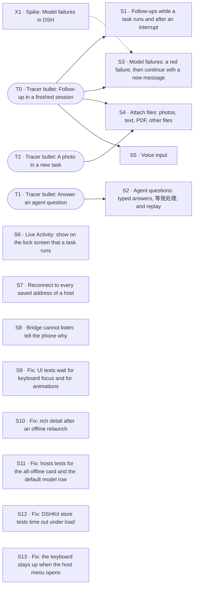

# PLAN · M2 · dsh-mobile第二阶段

M2 · dsh-mobile第二阶段. Product intent: [STORY.md](STORY.md). Technical design: [ARCHITECTURE.md](ARCHITECTURE.md). Process: [WORKFLOW.md](WORKFLOW.md).

This file exists only while this requirement is in progress. It serves this requirement only: ideas and work it does not do are GitHub issues (§7). When the exit (§6) passes, the user deletes this file and `evidence/`, and tags the commit; git keeps the history. `scripts/plan new` wrote this file; change it with `scripts/plan` (WORKFLOW.md §3.1).

## How to use this file

**Process rules** live in [WORKFLOW.md](WORKFLOW.md): set up a Mac, roles and ownership (who writes §0, §8, §9, and each slice section), start and stop a work session, the long-horizon run, resources for each slice, status titles, session settings, default choices, merging a slice, and what stays with the user. Read it before you pick up work. This section keeps only the format of this file and the rules for Done when items.

**Slice fields**, always in this order. Write "—" for an empty field; never drop one.
`Status · Needs · Branch` on one line, then **Why**, **Cuts**, **Demo**, **Done when**, **Not**, **Log**.
- **Status** is one of `todo` / `doing` / `blocked` / `review` / `done`. The slice owner sets it on the branch; the coordinating session brings §0 in line.
- **Log** is append-only and dated: done, not done, next step, and anything learned along the way. Technical decisions go into ARCHITECTURE.md as a `Dxx` entry; the Log just says "see Dxx".

**Done when items** are checkboxes: `- [ ] [tier] description — Evidence: …`
- **Tiers**
  - `[auto]`: unit or integration test against `FakeBridge`, `FakeDSH`, or golden fixtures. Evidence: `test:` pointers, green in CI or a script.
  - `[ui]`: verified in the Simulator, preferably by XCUITest (`test:`), otherwise by an agent driving it through `scripts/demo/<slice>.sh` (`cmd:`). Add a `shot:` as a snapshot for people. Before the slice is marked `done`, a review subagent that didn't take part in development reruns every `[ui]` item.
  - `[human]`: real device, camera, packet capture, subjective experience, or a decision only the user can judge. **Only the user ticks these.** An agent never does.
- **Edit rules**: you may only tick `[ ]` → `[x]` or add new items. Never delete, reword, re-tier, untick, or move an item. Agents add items unticked and tick them in a later edit. If an item truly has to change, explain the original text, the new text, and the reason to the user in the conversation first, and let the user make the edit.
- **Evidence** on a ticked item is one or more typed pointers separated by ` · `. Each one must resolve, otherwise check-plan fails; unknown types fail too.

  | Pointer | Resolves when |
  |---|---|
  | `test:<Name>` | the name appears in Swift/TS test sources (`Suite/name` = both parts in one file) |
  | `cmd:<path> [args]` | the repo-relative path exists and is executable, e.g. `cmd:scripts/demo/t0.sh` |
  | `commit:<hash>` | `git cat-file -e <hash>^{commit}` succeeds |
  | `shot:<path>` | the file exists under `evidence/<slice ID>/` |
  | `human:<YYYY-MM-DD> <device or note>` | `[human]` items only, e.g. `human:2026-11-20 iPhone 16, PR link …` |

  The real evidence is something re-runnable: a test or `scripts/demo/<slice>.sh`. Screenshots are only snapshots for people:
  - Scale them to about 1/3 size and save as compressed PNG, a few hundred KB each.
  - Commit them under `evidence/<slice ID>/`.
  - Recordings stay out of git. If one is really needed, the user attaches it to the PR and the item cites it as `human:` plus the PR link.
  - When the plan ends, `evidence/` is deleted with this file; git keeps both.
- **Enforcement**: `scripts/check-plan` runs from the git pre-commit hook (`.githooks/`) and from a Claude Code PreToolUse hook (`.claude/settings.json`). Edits to the guard files themselves (`scripts/check-plan`, `.githooks/`, `.claude/hooks/`, `.claude/settings.json`) ask the user first, and only the user commits them. Never use `git commit --no-verify` or any other way around them.

## 0. Status

| ID | Status | Branch/PR | Updated | Next action |
|---|---|---|---|---|
| T0 | done | merged `71577b2` | 2026-11-08 | — (provisional D89 in §9) |
| T1 | done | merged `8f55a72` | 2026-11-08 | — (provisional D92 in §9) |
| T2 | doing | `claude/t2-attachments` | 2026-11-08 | Slice owner builds (§8) |
| X1 | todo | — | 2026-11-08 | Assign it and start a session |
| S1 | doing | `claude/s1-followup-queue` | 2026-11-08 | Slice owner builds (§8) |
| S2 | todo | — | 2026-11-08 | Assign it and start a session |
| S3 | todo | — | 2026-11-08 | Assign it and start a session |
| S4 | todo | — | 2026-11-08 | Assign it and start a session |
| S5 | todo | — | 2026-11-08 | Assign it and start a session |
| S6 | todo | — | 2026-11-08 | Assign it and start a session |
| S7 | done | merged `1978046` | 2026-11-08 | — (provisional D98 in §9) |
| S8 | todo | — | 2026-11-08 | Assign it and start a session |
| S9 | todo | — | 2026-11-08 | Assign it and start a session |
| S10 | todo | — | 2026-11-08 | Assign it and start a session |
| S11 | todo | — | 2026-11-08 | Assign it and start a session |
| S12 | todo | — | 2026-11-08 | Assign it and start a session |
| S13 | todo | — | 2026-11-08 | Assign it and start a session |

## 1. Approach

**Tracer bullet first.** Before any feature is built properly, fire one thin round trip through *every* layer that the requirement touches. It is thin, but it is production code, not a throwaway prototype. Everything after it thickens that path.

**Then slices that are almost independent and stand alone.** Each slice after the tracer:

- is **vertical**: it touches protocol + bridge + app + tests, and has a demo you can do on its own;
- **depends on the tracer and nothing else**, unless a dependency is named explicitly (at most one, where possible);
- can be built, reviewed, merged, and dropped **in any order** relative to its siblings.

### How slices stay independent

| Rule | Mechanism |
|---|---|
| Own files | Each slice gets its own feature files (`protocol/<feature>.proto`, `ios/…/Features/<Feature>/`, `bridge/src/<feature>/`), named after the feature, never after the slice ID: code outlives this plan. Shared files (`frame.proto`, app root, plugin entry) only get a one-line registration. |
| No field-number collisions | Each slice reserves a block of 20 field numbers in the `Request` / `Event` oneofs: the next free block after the highest number in `frame.proto`. Write the block in the slice's Cuts. |
| Ship in any order | Each slice advertises a **capability string** in `Hello.capabilities` (e.g. `approvals.v1`). The app hides UI for capabilities the bridge lacks. |
| Test alone | Fakes at every boundary: **`FakeBridge`** (Swift, in-process) for app tests and previews; **`FakeDSH`** (TS) for bridge tests. No slice needs a neighbor slice or a real DSH to pass CI. |
| Cross-language truth | `protocol/fixtures/` holds golden encoded frames. Swift and TS tests both decode/encode them, so the two sides can't drift. |
| Seams | When two slices meet, **the slice that lands second owns the seam** and adds it to its Done when. |

**Done** for any slice = every Done when item ticked with evidence, merged to `main`, ARCHITECTURE.md updated if a decision changed (AGENTS.md: code is truth).

Requirement-specific notes: —

## 2. Map

`scripts/plan` writes this map from the **Needs** of each tracer, spike and slice. Do not edit it.

## 3. Tracer bullets

A tracer is one thin round trip that one session can finish without running out of context: at most 3 Done when items (`scripts/plan` stops more). Prefer `[auto]` and `[ui]` items; use `[human]` only for what only a real device can show. If a tracer needs more, split it into more tracers.

### T0 · Tracer bullet: Follow-up in a finished session

**Status** review · **Needs** — · **Branch** —

**Why**: Part of #1. Today the phone sends one message per task and then takes no more input (user, 2026-11-08: "现在我只能发一条消息，然后就不给发了，不是连续的agent loop"). The thinnest round trip of a continuous conversation: one more message into the same DSH session after the task is done.

**Cuts**
- `protocol/conversation.proto`: `SendMessage { task_id, mode, text }` → `MessageAccepted`. Field block 360–379. Capability `conversation.v1`.
- Bridge `bridge/src/conversation/`: `sessionController.prompt` on the DSH session of the task (D18). The new turn streams under the same task ID (`AssistantChunk`, `TaskEnded`, the S2 host log).
- App: the session composer takes text when the task is completed and the host has `conversation.v1`. The user bubble and the reply go under the first answer on the same page. Without the capability, the composer stays as it is.
- ARCHITECTURE D18 amended; DESIGN 04 caption.

**Demo**: `scripts/demo/followup.sh` (feature name: `t0.sh` is the M1 baseline). Finish a task, send a follow-up from its page, see the second reply under the first, on the phone and in the same session on DSH web.

**Done when**
- [x] [auto] The bridge sends a `SendMessage` for a completed task into the same DSH session, and the new turn streams under the same task ID (`FakeDSH`) — Evidence: test:FollowUpAgainstFakeDSH/aFollowUpOnACompletedTaskStreamsTheNextTurnUnderTheSameTaskID · test:FollowUpAgainstFakeDSH/resumeReplaysTheWholeConversationInOrder · cmd:scripts/demo/followup.sh
- [x] [auto] DSHKit: a follow-up on a completed task adds the user message, sets the task to running, and adds the reply after the first answer; a reconnect replays the same transcript (`FakeBridge`) — Evidence: test:FollowUpTests/followUpOnACompletedTaskAddsTheMessageRunsAndAppendsTheReply · test:FollowUpTests/aReconnectReplaysTheSameTranscript · test:FollowUpTests/killAndReopenDuringTheFollowUpFillsTheGapOnce · cmd:scripts/demo/followup.sh
- [x] [ui] On a completed session page, send a follow-up: the reply streams into the same page, against real DSH with the mock model (`cmd:scripts/demo/followup.sh`) — Evidence: cmd:scripts/demo/followup.sh · test:FollowUpUITests/testFollowUpInAFinishedSessionAgainstRealDSH · shot:evidence/T0/followup-streaming.png · shot:evidence/T0/followup-done.png

**Not**: Follow-ups while the task runs, or after a failure or an interrupt (S1, S3). Attachments (T2). Agent questions (T1).

**Log**: —
- **2026-11-08 · built; all [auto]/[ui] ticked, review next.** Done: conversation.v1 (protocol/conversation.proto: SendMessage, MessageAccepted, UserMessage; Event/Request/Response 360). Bridge TaskHub.sendMessage + DshTasks.followUp prompt the task's DSH session with mode steer; the turn streams under the same task ID, chunk seq goes on, a logged UserMessage puts the bubble in place and Resume replays it. App: the session composer takes text on a completed task (TaskListStore.canFollowUp/sendFollowUp); the bubble and reply go under the first answer. Demo scripts/demo/followup.sh (real DSH Web + mock LLM; followup-host.mjs checks DSH has both messages in one session). See D89 (provisional) and the D18 amendment. No new dependencies. Learned: the page drew every journal user message as a top bubble, so the follow-up showed twice once the journal loaded; fixed (only the first prompt on top when the page uses the streamed transcript). The mock model at 60 ms/chunk ends a turn in about 1.4 s, so the UI test missed RUNNING; the demo host uses 400 ms/chunk. Flaky: under load (load average 100-190 with T1/T2 running) swift test can time out in S16CodingTaskTests and TaskListStoreTests waits (5 s), also on main; they pass alone. Not done (later slices): the milestone bar keeps the first turn's last step (完成) while a follow-up turn runs, because follow-up turns add no milestones; follow-ups while running or after a failure/stop (S1, S3); follow-ups in sessions from other clients. Next: reviewer runs scripts/review T0.

### T1 · Tracer bullet: Answer an agent question

**Status** review · **Needs** — · **Branch** —

**Why**: Part of #1. STORY §4 and §5: a question from the agent is a decision, like an approval. The task waits and the phone answers. The thinnest round trip: one question with options, answered with one tap (screen P1).

**Cuts**
- `protocol/questions.proto`: `QuestionPending` event, `AnswerQuestion` request → `QuestionResolved`. Field block 380–399. Capability `questions.v1`.
- Bridge `bridge/src/questions/`: a prepended answerer on `user-questions/request` holds the request and fans a copy out to the web; the first answer wins (D17, D18).
- App: the P1 card in the transcript with one chip per option. A tap answers; the card then shows the answer.
- DESIGN P1 tag: built.

**Demo**: `scripts/demo/questions.sh`: a task asks which of two templates to use; tap one; the task continues with that answer.

**Done when**
- [x] [auto] The bridge holds a `user-questions/request`, sends `QuestionPending` with the text and options of DSH, and answers DSH with the chosen option; an answer from the web withdraws the card (`FakeDSH`) — Evidence: test:Questions/bridgeHoldsQuestionSendsPendingAndAnswersDshWithTheChosenOption · test:Questions/answerFromTheWebWithdrawsTheCard · test:Questions/noOtherAnswererKeepsTheQuestionHeldAndInterruptCancelsIt
- [x] [ui] The P1 card shows the question and its options; a tap on an option answers it and the task continues, against real DSH with the mock model (`cmd:scripts/demo/questions.sh`) — Evidence: test:AgentQuestionUITests/testTapAnOptionAnswersAndTheTaskContinues · cmd:scripts/demo/questions.sh · shot:evidence/T1/questions-pending.png · shot:evidence/T1/questions-answered.png

**Not**: Typed and multi-select answers, 等我处理 and the drawer badge, replay after a reconnect (S2).

**Log**: —
- **2026-11-08 · Built; review PASS.** Done: questions.v1 end to end. protocol/questions.proto (QuestionPending, AnswerQuestion, QuestionResolved; fields 380–399). Bridge QuestionHolder: prepended user-questions/request answerer, holds for the phone, fans a copy out to DSH Web, first answer wins, no timeout, interrupt cancels; the ask_user_question tool row is hidden (the card replaces it). App: P1 card as a .question transcript row; a tap answers; the card then shows the answer. FakeDSH asks through a question waterfall (bridge/test/questions.test.ts). Demo scripts/demo/questions.sh on real DSH + mock model; shots in evidence/T1/. DESIGN P1 tag: M2 · 已有.
  Review: /tmp/dshm-review/T1-5012584.txt RESULT: PASS (full run). No flaky parts.
  Provisional: D92 (agent questions holder, wire, no timeout). No new dependencies.
  Notes for §8: (1) no script creates the dshm-<ID> simulator; T1 made dshm-T1 by hand (simctl create, iPhone 17 Pro, iOS 26.4). (2) scripts/review --resume cannot pass a test: pointer whose demo part it skips: the skipped part's output is not in the new log (T1-5012584 failed that way before the full run passed). (3) scripts/demo/t0.sh writes logs to a fixed /tmp/dshm-t0, so parallel slices overwrite each other's logs.
  Not done: typed and multi-select answers, 等我处理 and the drawer badge, pending questions in TaskSummary for replay after a trimmed log (slice Not).
  Next: coordinator merge.

### T2 · Tracer bullet: A photo in a new task

**Status** todo · **Needs** — · **Branch** —

**Why**: Part of #2. A file larger than one Noise message (65535 bytes, D21) must go to the host in parts and reach DSH as a prompt part. The thinnest round trip: one photo attached to a new task.

**Cuts**
- `protocol/attachments.proto`: `UploadBegin` / `UploadChunk` / `UploadEnd` → `UploadStaged { upload_id }`; `CreateTask` carries upload IDs. Field block 400–419. Capability `attachments.v1`.
- Bridge `bridge/src/attachments/`: put the parts together, check the size and the hash, stage the file through `ctx.fileUploads`, and give it to the first prompt as an image part (D18).
- App: a photo key on composer 01 (`PhotosPicker`), one thumbnail chip, upload before `CreateTask`. The user bubble shows the thumbnail.
- A new Dxx: part size, size limit, hash.

**Demo**: `scripts/demo/attachments.sh`: attach a photo, send a task; the DSH session has the image.

**Done when**
- [ ] [auto] A file of several Noise messages arrives byte-identical, is staged through `fileUploads`, and goes into the first prompt as an image part; a wrong hash or a missing part is refused (`FakeDSH`, a golden fixture that the Swift and TS tests both read) — Evidence:
- [ ] [ui] Attach one photo on 01 and send: the user bubble shows its thumbnail and the DSH session has the image, against real DSH with the mock model (`cmd:scripts/demo/attachments.sh`) — Evidence:

**Not**: Files that are not photos, more than one attachment, attachments in follow-ups (S4).

**Log**: —

## 4. Spikes

Each spike ends in a short written conclusion, plus throwaway code if needed. None of them blocks the tracer.

### X1 · Spike: Model failures in DSH

**Status** todo · **Needs** — · **Branch** —

**Why**: For #4 (S3). What does DSH 0.2.2-rc.1 send when the model of a running task is unavailable, its key is not valid, or the account has no balance (DeepSeek answers 402 "Insufficient Balance")? Does DSH retry, pause, or end the turn, and with which text? Can the mock LLM of DSH, or a small fake provider, make each case for tests?

**Cuts**: A throwaway script in `spikes/model-failures/` against real DSH with a fake provider. The conclusion goes in its README. The events that it records become fixtures for the bridge test of S3.

**Demo**: —

**Done when**
- [ ] [auto] A script runs one task against real DSH for each failure (model not found, key not valid, no balance, rate limit) and records the events and the text that DSH sends — Evidence:
- [ ] [auto] The README says for each failure whether DSH retries, pauses or ends the turn, and which text the phone can show; the recorded events are fixtures that S3 can replay — Evidence:

**Not**: Production code.

**Log**: —

## 5. Slices

Each slice needs only the tracer, unless "Needs" says otherwise.

### S1 · Follow-ups while a task runs and after an interrupt

**Status** todo · **Needs** T0 · **Branch** —

**Why**: Part of #1. STORY §7: "任务进行中也能补充：追加一句话…纠正方向，不必打断重来". The user, 2026-11-08: "参考codex、claude，用户发送后，先排队，但给定"立即发送"/steer的标识，用户点击后直接发送". This changes the default of D18 from steer to queue.

**Cuts**
- A follow-up sent while the task runs is queued by default (`SendMessage` mode `QUEUE`, the next turn). It shows as a queued message above the composer, as in the Codex and Claude apps, with a "立即发送" (steer) action and a remove action.
- "立即发送" moves it into the current turn (steer): it goes in at the next step. How (the queue-edit methods of `sessionController`, or remove and prompt again with `steer`; X4 did not try them) is a provisional Dxx. A queued message that the turn reaches by itself runs as the next turn.
- The queue survives a reconnect (the S2 replay or `sessionController.state().queue`). The transcript shows each follow-up where DSH takes it.
- The session composer is a text field while the stop key shows (screen 04). ARCHITECTURE D18 (default: queue, with send-now to steer) and the DESIGN 04 caption and board change with it.
- After an interrupt, a new message continues the same session (X1 card: "在原会话里接着说"). DESIGN X1 caption.

**Demo**: `scripts/demo/followup.sh --running`: while a task runs, send a follow-up; it waits as queued; tap 立即发送 on a second one; the next step answers it. Interrupt, then continue.

**Done when**
- [ ] [auto] A follow-up on a running session is queued and runs as the next turn; send-now moves a queued message into the current turn at its next step; remove takes it out; the queue and the order stay the same after a reconnect (`FakeDSH`, `FakeBridge`) — Evidence:
- [ ] [ui] While a task runs, send a follow-up: it shows as queued above the composer and runs after the turn; tap 立即发送 on another one: the next step of the agent answers it, and the stop key stays (`cmd:scripts/demo/followup.sh`) — Evidence:
- [ ] [ui] After an interrupt, send a new message in the same session: the task runs again and the interrupted card goes (`cmd:scripts/demo/followup.sh`) — Evidence:

**Not**: Attachments in follow-ups (S4). A failed task (S3). Editing the text of a queued message.

**Log**: —

### S2 · Agent questions: typed answers, 等我处理, and replay

**Status** todo · **Needs** T1 · **Branch** —

**Why**: Closes #1 (with T0, T1 and S1). Screen P1: the user can also answer in the composer, and a question counts as "需要决策" in 等我处理, the drawer badge and the session marks, like an approval.

**Cuts**
- A typed answer from the composer ("回答 Agent…") and multi-select answers.
- The pending question is in the S2 summary and the replay (as D25 does for approvals), in 所有任务 under 等我处理, in the drawer badge, and in the amber milestone bar ("等你回答").
- An answer from another client withdraws the card. A held question times out to a refusal, as an approval does (D25).

**Demo**: `scripts/demo/questions.sh --all`.

**Done when**
- [ ] [auto] A pending question is in the S2 summary and the replay and counts in 等我处理; a typed and a multi-select answer reach DSH as given (`FakeDSH`, `FakeBridge`) — Evidence:
- [ ] [ui] Answer a question by typing in the composer: the card shows the answer and the task continues (`cmd:scripts/demo/questions.sh`) — Evidence:
- [ ] [ui] A pending question shows under 等我处理 in 所有任务 and in the drawer badge, and is still there after a relaunch (`cmd:scripts/demo/questions.sh`) — Evidence:

**Not**: Push for questions. Plan alignment and pre-authorization (#9).

**Log**: —

### S3 · Model failures: a red failure, then continue with a new message

**Status** todo · **Needs** T0, X1 · **Branch** —

**Why**: Closes #4. User, 2026-11-08: "模型失效，或者没token了，直接展示红色的失败文案，用户如果要继续做，他会去充值token，然后重新发消息触发任务继续执行". This replaces the pause into 等我处理 on screen X4: DESIGN X4 and STORY §8 change in the same commit.

**Cuts**
- Bridge: each failure that X1 found ends the task as failed with the text of DSH, and with a failure kind if the app needs one (field block 420–439 only if the protocol changes).
- App: the X1 failure card in red with that text. The composer continues the same session after a failure (T0).
- DESIGN X4 caption and tag; STORY §8 line on an unavailable model.

**Demo**: `scripts/demo/model-failures.sh`: a task on a provider with no balance fails in red with the reason; after the fake top-up, a new message in the same session continues it.

**Done when**
- [ ] [auto] Each failure that X1 recorded ends the task as failed with the text of DSH, and no retry keeps it running (`FakeDSH` with the X1 fixtures) — Evidence:
- [ ] [ui] A task whose provider has no balance shows the red failure card with the reason; after the top-up, a new message in the same session continues it (`cmd:scripts/demo/model-failures.sh`) — Evidence:

**Not**: A top-up link. A model switch inside the failure card.

**Log**: —

### S4 · Attach files: photos, text, PDF, other files

**Status** todo · **Needs** T0, T2 · **Branch** —

**Why**: Closes #2. User, 2026-11-08: "这个要支持，不仅是照片，也可以是txt、pdf或其他文件，你参考claude、codex的交互".

**Cuts**
- A "+" menu on the composer, as in the Claude and Codex apps: photo library, camera, files (`fileImporter`).
- More than one attachment: chips with remove and upload progress. Images go as image parts, other files as file parts (D18: the model gets a saved-path note).
- Attachments in follow-ups (T0). A size limit, and errors on the chip. The user bubble shows the attachments, also after a replay.
- DESIGN: draw the attach menu and the chips (01, 04); STORY §7 and the DESIGN map row.

**Demo**: `scripts/demo/attachments.sh --all`.

**Done when**
- [ ] [auto] Text, PDF and an unknown file type are staged and reach DSH as file parts with their names; more than one attachment keeps its order; a file over the limit is refused before the upload (`FakeDSH`, `FakeBridge`) — Evidence:
- [ ] [ui] Attach a photo, a .txt and a .pdf on 01, remove one, and send: the bubble shows the other two and the DSH session has them (`cmd:scripts/demo/attachments.sh`) — Evidence:
- [ ] [ui] Attach a file to a follow-up in a completed session: it reaches the same DSH session (`cmd:scripts/demo/attachments.sh`) — Evidence:

**Not**: The Share Extension (#18). Artifacts back to the phone (#17).

**Log**: —

### S5 · Voice input

**Status** todo · **Needs** T0 · **Branch** —

**Why**: Closes #3. STORY §7: "语音下任务". Typing a task on a phone is slow.

**Cuts**
- A mic key on the composer (01 and the session page). On-device speech to text (Speech framework; provisional Dxx for the API) writes into the field while the user speaks. The user edits and taps send: nothing is sent without a tap.
- Permission denied: a line that tells how to turn it on.
- A fake transcriber for tests (a launch argument, as D16 does for the other fakes).
- DESIGN: draw the mic state on the composer.

**Demo**: `scripts/demo/voice.sh`.

**Done when**
- [ ] [auto] Partial and final results replace the dictated range in the field and keep the typed text (fake transcriber) — Evidence:
- [ ] [ui] Tap the mic, the fake transcriber says a task, the field fills, tap send: the task starts with that text (`cmd:scripts/demo/voice.sh`) — Evidence:
- [ ] [ui] With speech permission denied, the mic tells how to turn it on and the field does not change (`cmd:scripts/demo/voice.sh`) — Evidence:

**Not**: Spoken replies. Sending without a tap. Transcription on the host.

**Log**: —

### S6 · Live Activity: show on the lock screen that a task runs

**Status** todo · **Needs** — · **Branch** —

**Why**: Closes #7. User, 2026-11-08: "dsh-mobile也做这个，这样我也能看到它在动". This moves the Live Activity of screen L from M4 to M2: DESIGN L and ARCHITECTURE §4 (Background) and §7 change with it.

**Cuts**
- A widget extension with an ActivityKit configuration: the lock screen view, and minimal Dynamic Island views.
- One activity for each running task: title, host, elapsed time (`Text(timerInterval:)`, so it ticks while the app is suspended), latest milestone. The app updates it on each milestone while it runs, and sets `staleDate`.
- It ends with done, failed, or waiting (an approval, or a question when `questions.v1` is there).
- No APNs: a local activity only (provisional Dxx).

**Demo**: `scripts/demo/live-activity.sh`.

**Done when**
- [ ] [auto] The activity follows the task: it starts when the task runs, shows the latest step on each milestone, and ends with done, failed or waiting; one activity for each task, also after a relaunch (`FakeBridge`, a fake activity client) — Evidence:
- [ ] [ui] A running task shows its Live Activity on the Simulator lock screen with the title, the host, a ticking time and the latest step, and it ends as done (`cmd:scripts/demo/live-activity.sh`) — Evidence:
- [ ] [human] On a real iPhone signed with the free team, the app starts a Live Activity for a running task — Evidence:

**Not**: Push updates of the activity (no APNs).

**Log**: —

### S7 · Reconnect to every saved address of a host

**Status** doing · **Needs** — · **Branch** —

**Why**: Closes #12. The user asked for this first after M1. A reconnect tries only the first saved address (`AppComposition` uses `host.addresses.first`), so a phone off the LAN does not try Tailscale. Changes D21 (e).

**Cuts**
- The host connection tries each saved address (in order, or raced: provisional Dxx), the address that worked last first, with a short timeout for each. On success it saves that address first.
- The hosts sheet (H) shows the address in use. All addresses fail: the host is offline, with the last error of each address.
- D21 (e) amended.

**Demo**: `scripts/demo/reconnect.sh`: a host saved with a dead first address and a live second address.

**Done when**
- [x] [auto] With the first address dead and the second live, a reconnect uses the second and saves it first; with all addresses dead, the host is offline with the error of each address (DSHKit, two fake hosts) — Evidence: test:ReconnectTests/deadFirstAddressFallsThroughToTheSecondAndIsSavedFirst · test:ReconnectTests/allAddressesDeadShowTheHostOfflineWithTheErrorOfEach · cmd:scripts/demo/reconnect.sh
- [x] [ui] A host paired with a dead first address shows online and takes a task (`cmd:scripts/demo/reconnect.sh`) — Evidence: cmd:scripts/demo/reconnect.sh · test:ReconnectUITests/testDeadFirstAddressFallsThroughToTheSecond · shot:evidence/S7/reconnect-online-via-second.png · shot:evidence/S7/reconnect-all-dead.png

**Not**: Finding new addresses (Bonjour). A relay.

**Log**: —
- **2026-11-08 · built; review next.** Done: HostConnection tries every saved address, the last working one first, 5 s for each; a new working address is saved first (PairedHostStore.update keeps the host's place). All dead: HostConnectionError.unreachable with the error of each address. Hosts sheet (H) shows the address in use, and offline the error of each address; board H updated. Pairing uses the same loop. See D98 (provisional, in order and not raced); D21 (e) amended. No new dependencies. Demo scripts/demo/reconnect.sh: pairs through a proxy that dies after one connection, then the app reconnects through the bridge and runs a task; then DSH stops and H shows both errors. Both UI parts and DSHKit passed on the first run (no flaky parts). After that run I fixed the demo's EXIT trap (it returned 1 after 'reconnect demo passed'); the review run checks it. Learned: the dshm-S7 simulator did not exist (created it by hand); the first T0 run failed on a GitHub fetch of swift-protobuf (network reset), the second passed. Next: a reviewer runs scripts/review S7.

### S8 · Bridge cannot listen: tell the phone why

**Status** todo · **Needs** — · **Branch** —

**Why**: Closes #15. When the bridge port is taken, `bridge/src/index.ts` only logs "failed to start", and the phone shows the host offline with no reason.

**Cuts**
- A bridge that cannot listen cannot answer the phone, so the reason comes from both sides (provisional Dxx):
- Bridge: a log line in the DSH log and the terminal names the port, the cause and the fix (which setting to change). DSH keeps running.
- App: tells apart "nothing listens" (connection refused), "another program listens on this port" (no dshm handshake) and "host not reachable" (timeout), and shows it on the host row (H) and on the offline card (X3).
- Field block 440–459 only if the protocol changes.

**Demo**: `scripts/demo/bridge-errors.sh`: another program holds the bridge port.

**Done when**
- [ ] [auto] With the port taken, the bridge logs one line that names the port, the cause and the fix, and DSH keeps running (bridge test) — Evidence:
- [ ] [auto] DSHKit sorts a refused connection, another service on the port, and a timeout into three reasons (fake sockets) — Evidence:
- [ ] [ui] With another program on the bridge port, the hosts sheet says that another program uses the port, not only "offline" (`cmd:scripts/demo/bridge-errors.sh`) — Evidence:

**Not**: Moving to another port without the user.

**Log**: —

### S9 · Fix: UI tests wait for keyboard focus and for animations

**Status** todo · **Needs** — · **Branch** —

**Why**: Closes #24 and #25. The user, 2026-11-08, for #22–#28: "这些看看还能不能复现，能的话就修复了". If a bug does not reproduce, the Log names the runs that show it, and the coordinator closes the issue with them.

**Cuts**
- One shared `send` helper that waits for `hasKeyboardFocus` (as the S18, S19 and S23 helpers do), used by the older UI tests.
- Find what makes a step wait 60 s for the app to idle (for example an animation that repeats), and stop it under UI tests or wait on an element instead.
- `scripts/demo/ui-health.sh` runs the tests that #24 and #25 name.

**Demo**: `scripts/demo/ui-health.sh`.

**Done when**
- [ ] [ui] `S3MilestonesUITests/testTodosTickOffOnCardWithFakeBridge`, `S2DurableListUITests/testCachedMilestonesAfterKillAndReopenWithFakeBridge` and `T0DemoUITests/testDemoAgainstRealDSH` pass in the review run with no retry (`cmd:scripts/demo/ui-health.sh`) — Evidence:
- [ ] [ui] `S16SessionPageUITests/testMilestoneBarStaysAtTopWhileTranscriptScrolls` takes less than 120 s, and no step of the tests that #25 names waits 60 s for the app to idle (`cmd:scripts/demo/ui-health.sh`) — Evidence:

**Not**: Flaky tests that #24 and #25 do not name: record them in the Log.

**Log**: —

### S10 · Fix: rich detail after an offline relaunch

**Status** todo · **Needs** — · **Branch** —

**Why**: Closes #22. The user, 2026-11-08, for #22–#28: "这些看看还能不能复现，能的话就修复了". If a bug does not reproduce, the Log names the runs that show it, and the coordinator closes the issue with them.

**Cuts**: `S8RichDetailUITests/testCachedRichDetailAfterRelaunch` finds no 所有任务 row after the relaunch; it also failed on main `9621fd2`. Find out whether the test or the app is wrong, and fix that. Remove the `--no-s8` workaround from `scripts/demo/s28.sh`.

**Demo**: `scripts/demo/rich-detail.sh`.

**Done when**
- [ ] [ui] `S8RichDetailUITests/testCachedRichDetailAfterRelaunch` finds the 所有任务 row after an offline relaunch and passes in the review run with no retry, and `scripts/demo/s28.sh` has no `--no-s8` (`cmd:scripts/demo/rich-detail.sh`) — Evidence:

**Not**: —

**Log**: —

### S11 · Fix: hosts tests for the all-offline card and the default model row

**Status** todo · **Needs** — · **Branch** —

**Why**: Closes #23 and #27. The user, 2026-11-08, for #22–#28: "这些看看还能不能复现，能的话就修复了". If a bug does not reproduce, the Log names the runs that show it, and the coordinator closes the issue with them.

**Cuts**
- #23: the card shows, but `hosts.offlineCard` is missing from the accessibility tree under `newSession.body`. Fix the identifier or the query.
- #27: `FakeHost` sends a model catalog, and a UI test checks the default model row of the hosts sheet.

**Demo**: `scripts/demo/hosts.sh`.

**Done when**
- [ ] [ui] `testAllOfflineCardNamesEachHostAndGoesWhenOneIsBack` and `testHostsSheetShowsEachHostsState` find `hosts.offlineCard` and pass in the review run with no retry (`cmd:scripts/demo/hosts.sh`) — Evidence:
- [ ] [ui] The hosts sheet shows the default model of the catalog that `FakeHost` sends, and a UI test checks it (`cmd:scripts/demo/hosts.sh`) — Evidence:

**Not**: —

**Log**: —

### S12 · Fix: DSHKit store tests time out under load

**Status** todo · **Needs** — · **Branch** —

**Why**: Closes #26. The user, 2026-11-08, for #22–#28: "这些看看还能不能复现，能的话就修复了". If a bug does not reproduce, the Log names the runs that show it, and the coordinator closes the issue with them.

**Cuts**: `MilestoneStoreTests/todosTickOffOnTheTimelineAgainstFakeBridge` polls for progress, and `S16CodingTaskTests/codingTaskHoldsAtThreeOfFiveAndStopsOnInterrupt` timed out after the `0575fe2` fix. Make both wait on store changes, with no polling and no fixed sleep.

**Demo**: `swift test` in `ios/DSHKit`.

**Done when**
- [ ] [auto] `todosTickOffOnTheTimelineAgainstFakeBridge` and `codingTaskHoldsAtThreeOfFiveAndStopsOnInterrupt` wait on store changes with no polling or fixed sleep, and pass while the other DSHKit tests run in parallel — Evidence:

**Not**: —

**Log**: —

### S13 · Fix: the keyboard stays up when the host menu opens

**Status** todo · **Needs** — · **Branch** —

**Why**: Closes #28. D67: the keyboard goes first before any action that is not typing. D67 puts the keyboard away on page changes, sheets and the drawer, but not for the host `Picker(.menu)` on the composer (`SessionPage.swift`, shown with 2 or more hosts).

**Cuts**: Put the keyboard away before the host `Picker(.menu)` (and each other menu on the composer) opens; test with 2 hosts. Amend D67 if the mechanism changes.

**Demo**: `scripts/demo/keyboard.sh`.

**Done when**
- [ ] [ui] With the keyboard up on 01, open the host menu: the keyboard goes first, then the menu shows (`cmd:scripts/demo/keyboard.sh`) — Evidence:

**Not**: —

**Log**: —

## 6. Exit

From a real device. All items are human-only.

- [ ] [human] On a real iPhone over Tailscale: when a task is done, send a follow-up in the same session; the reply comes, and the same session on DSH web shows both messages (T0) — Evidence:
- [ ] [human] While a task runs on a real model, send a follow-up: it waits as queued and runs after the turn; tap 立即发送 on another one, and the agent takes it at its next step (S1) — Evidence:
- [ ] [human] A task on a real model asks a question; answer it once with an option and once by typing, and the task continues (T1, S2) — Evidence:
- [ ] [human] Take a photo with the camera and attach it together with a PDF from Files; the real model reads both (T2, S4) — Evidence:
- [ ] [human] Dictate a task in Chinese, correct it, and send it (S5) — Evidence:
- [ ] [human] Lock the phone while a task runs: the Live Activity shows the title, the host, a ticking time and the latest step, and it ends as done (S6) — Evidence:
- [ ] [human] Turn off Wi-Fi: the phone reconnects to the host over Tailscale with no new pairing (S7) — Evidence:
- [ ] [human] With a model key that has no balance, a task fails with a red reason; after a top-up, a new message in the same session continues it (S3) — Evidence:

## 7. Not in this plan

Ideas, follow-ups, and anything this plan does not do are GitHub issues: <https://github.com/laichang/dsh-mobile/issues>. Do not list them here.

## 8. Plan log

Append-only, dated.

- **2026-11-08 · Plan started.** M2 · dsh-mobile第二阶段.

- **2026-11-08 · Demo scripts are named after the feature.** Each tracer and slice of this plan writes its demo as `scripts/demo/<feature>.sh` (for example `followup.sh`), not `scripts/demo/<id>.sh`: `t0.sh` and `s1.sh`–`s31.sh` are the M1 demos, and `t0.sh` is the baseline of WORKFLOW §4.1. Each `[ui]` item cites its demo with a `cmd:` pointer, so `scripts/review` does not fall back to `scripts/demo/<id>.sh`. No open issue has the `upstream` label (the label does not exist yet), so this plan includes no upstream issue.

- **2026-11-08 · The upstream label exists; no open upstream issue.** The `upstream` label now exists (for the daily compatibility check, #21). No open issue has it, so this plan includes no upstream issue. This replaces the label note in the entry before.

- **2026-11-08 · Follow-ups while a task runs: queue first, send now to steer.** The user, 2026-11-08: "参考codex、claude，用户发送后，先排队，但给定"立即发送"/steer的标识，用户点击后直接发送". S1 and exit item 2 were rewritten before the first commit of this file. S1 amends D18 (default queue, with send-now to steer) and DESIGN 04.

- **2026-11-08 · Run started; heartbeat e8ffa347.** The user sent /run-plan. Keep-awake is on. Heartbeat: durable cron job e8ffa347 (7,27,47 * * * *, prompt "Heartbeat (WORKFLOW.md §5.5)."). First batch: T0, T1, T2 (the tracers unblock S1–S5). The working tree on main has local user changes (DEVELOPMENT_TEAM in project.pbxproj, Xcode reformat of 6 xcstrings files); the coordinator leaves them alone.

- **2026-11-08 · T0 assigned.** Branch `claude/t0-followup`, simulator `dshm-T0`, DSHM_HOME `~/.dshm/home-t0`, bridge 47810, web 3283; second host 47840/3313. Decision numbers D89–D91. `eval "$(scripts/slice-env T0)"` exports them.

- **2026-11-08 · T1 assigned.** Branch `claude/t1-questions`, simulator `dshm-T1`, DSHM_HOME `~/.dshm/home-t1`, bridge 47811, web 3284; second host 47841/3314. Decision numbers D92–D94. `eval "$(scripts/slice-env T1)"` exports them.

- **2026-11-08 · T2 assigned.** Branch `claude/t2-attachments`, simulator `dshm-T2`, DSHM_HOME `~/.dshm/home-t2`, bridge 47812, web 3285; second host 47842/3315. Decision numbers D95–D97. `eval "$(scripts/slice-env T2)"` exports them.

- **2026-11-08 · T1 merged.** Merged as `8f55a72`; `scripts/check-plan` on the merge commit passed. `scripts/review T1` at `5012584`: `RESULT: PASS`, no flaky part (`/tmp/dshm-review/T1-5012584.txt`). No open `[human]` items, so T1 is `done`. §9 rows 1 (D92).

- **2026-11-08 · T1 findings for the tooling.** From the T1 report (handled at the end of the plan as issues): (1) no script creates the dshm-<ID> simulator; the first T0 baseline failed with "did not boot" and the T1 owner made dshm-T1 by hand. (2) scripts/review --resume cannot pass a test: pointer whose demo part it skips (the skipped part's output is not in the new log); a bare test:<name> is read as a suite, so pointers need Suite/name. (3) scripts/demo/t0.sh writes its logs to a fixed /tmp/dshm-t0, so parallel baselines overwrite each other. No flaky part in the T1 review.

- **2026-11-08 · S7 assigned.** Branch `claude/s7-reconnect`, simulator `dshm-S7`, DSHM_HOME `~/.dshm/home-s7`, bridge 47811, web 3284; second host 47841/3314. Decision numbers D98–D100. `eval "$(scripts/slice-env S7)"` exports them.

- **2026-11-08 · T1 merged; S7 runs as a background agent.** T1 merged (review PASS on 5012584, T1-5012584.txt; head 91f12c8 only adds PLAN changes). D92 is in §9. S7 assigned. The app refused start_session in the heartbeat turn (the chain from the user turn ended), so S7 runs as a background agent in its own worktree (WORKFLOW §5.3 step 3).

- **2026-11-08 · T0 review PASS, but it conflicts with main.** T0 review PASS on 08e35d3 (T0-08e35d3.txt). git merge-tree shows conflicts with T1 on main in 12 files (frame.proto, generated code, HostConnection, ARCHITECTURE.md, ...). The coordinator does not change code, so it asked the T0 owner to merge main into claude/t0-followup, regenerate with scripts/codegen, and run a full scripts/review T0 again. T2 waits on its review run; it will need the same step after T0 merges.

- **2026-11-08 · T2 review PASS, but it conflicts with main.** T2 review PASS on 0752a3d (T2-0752a3d.txt; head 3ce48d2 adds only PLAN changes). It conflicts with T1 on main in 8 files (frame.proto, generated code, FakeBridge, ARCHITECTURE.md, ...). The T2 owner merges main now and reviews again; one more small merge follows after T0 lands.

- **2026-11-08 · T0 merged.** Merged as `71577b2`; `scripts/check-plan` on the merge commit passed. `scripts/review T0` at `7f6c6c1`: `RESULT: PASS`, no flaky part (`/tmp/dshm-review/T0-7f6c6c1.txt`). No open `[human]` items, so T0 is `done`. §9 rows 2 (D89).

- **2026-11-08 · S1 assigned.** Branch `claude/s1-followup-queue`, simulator `dshm-S1`, DSHM_HOME `~/.dshm/home-s1`, bridge 47810, web 3283; second host 47840/3313. Decision numbers D101–D103. `eval "$(scripts/slice-env S1)"` exports them.

- **2026-11-08 · T0 merged; S1 runs as a background agent.** T0 merged as 71577b2 (review PASS on 7f6c6c1 after the merge of main, T0-7f6c6c1.txt). D89 is in §9. To merge, the coordinator stashed the user's uncommitted Localizable.xcstrings (Xcode reformat); it did not apply cleanly after the merge, so it stays as stash@{0} for the user and the file on main is the merged version. T2 asked to merge main again. S1 assigned; the app refused start_session in this event turn, so S1 runs as a background agent in its own worktree (§5.3 step 3).

- **2026-11-08 · S7 merged.** Merged as `1978046`; `scripts/check-plan` on the merge commit passed. `scripts/review S7` at `90b3822`: `RESULT: PASS`, no flaky part (`/tmp/dshm-review/S7-90b3822.txt`). No open `[human]` items, so S7 is `done`. §9 rows 3 (D98).

## 9. Pending user confirmation

Kept by the coordinating session on `main`. It lists provisional `Dxx` entries, dependencies, downloads, and open `[human]` items that wait for the user (WORKFLOW.md §9).

| # | Slice | Kind | Item | Branch | Commit |
|---|---|---|---|---|---|
| 1 | T1 | decision | ARCHITECTURE D92, *provisional*: Agent questions (screen P1, extends D18) | `claude/t1-questions` | merged `8f55a72` |
| 2 | T0 | decision | ARCHITECTURE D89, *provisional*: A follow-up message continues the task (screen 04) | `claude/t0-followup` | merged `71577b2` |
| 3 | S7 | decision | ARCHITECTURE D98, *provisional*: A reconnect tries every saved address of the host, one at a time, the last working one first (amends D21 e) | `claude/s7-reconnect` | merged `1978046` |
