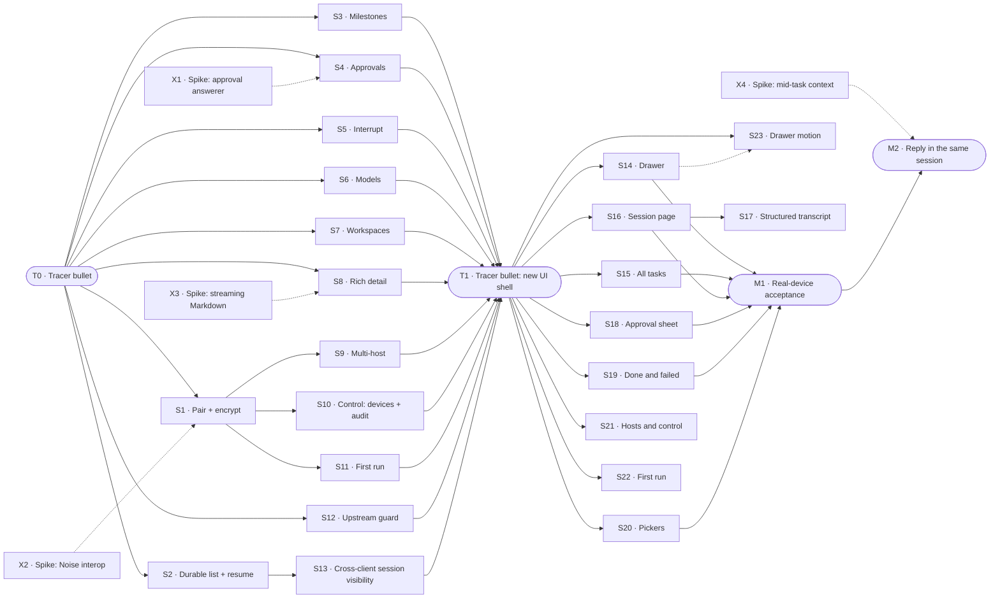

# PLAN

How we get from the Xcode template to M1, tracer-bullet style. Product intent: [STORY.md](STORY.md). Technical design: [ARCHITECTURE.md](ARCHITECTURE.md). This file is a working doc: when M1 exits, archive it to `.archive/YYYYMMDD/plan-m1.md` and write the next one.

## How to use this file

**Process rules** live in [WORKFLOW.md](WORKFLOW.md): set up a Mac, roles and ownership (who writes §0, §8, §9, and each slice section), start and stop a work session, the long-horizon run, resources for each slice, status titles, session settings, default choices, merging a slice, and what stays with the user. Read it before you pick up work. This section keeps only the format of this file and the rules for Done when items.

**Slice fields**, always in this order. Write "—" for an empty field; never drop one.
`Status · Needs · Branch` on one line, then **Why**, **Cuts**, **Demo**, **Done when**, **Not**, **Log**.
- **Status** is one of `todo` / `doing` / `blocked` / `review` / `done`. The slice owner sets it on the branch; the coordinating session brings §0 in line.
- **Log** is append-only and dated: done, not done, next step, and anything learned along the way. Technical decisions go into ARCHITECTURE.md as a `Dxx` entry; the Log just says "see Dxx".

**Done when items** are checkboxes: `- [ ] [tier] description — Evidence: …`
- **Tiers**
  - `[auto]`: unit or integration test against `FakeBridge`, `FakeDSH`, or golden fixtures. Evidence: `test:` pointers, green in CI or a script.
  - `[ui]`: verified in the Simulator, preferably by XCUITest (`test:`), otherwise by an agent driving it through `scripts/demo/<slice>.sh` (`cmd:`). Add a `shot:` as a snapshot for people. Before the slice is marked `done`, a review subagent that didn't take part in development reruns every `[ui]` item.
  - `[human]`: real device, camera, packet capture, subjective experience, or a decision only the user can judge. **Only the user ticks these.** An agent never does.
- **Edit rules**: you may only tick `[ ]` → `[x]` or add new items. Never delete, reword, re-tier, untick, or move an item. Agents add items unticked and tick them in a later edit. If an item truly has to change, explain the original text, the new text, and the reason to the user in the conversation first, and let the user make the edit.
- **Evidence** on a ticked item is one or more typed pointers separated by ` · `. Each one must resolve, otherwise check-plan fails; unknown types fail too.

  | Pointer | Resolves when |
  |---|---|
  | `test:<Name>` | the name appears in Swift/TS test sources (`Suite/name` = both parts in one file) |
  | `cmd:<path> [args]` | the repo-relative path exists and is executable, e.g. `cmd:scripts/demo/t0.sh` |
  | `commit:<hash>` | `git cat-file -e <hash>^{commit}` succeeds |
  | `shot:<path>` | the file exists under `evidence/<slice ID>/` |
  | `human:<YYYY-MM-DD> <device or note>` | `[human]` items only, e.g. `human:2026-11-20 iPhone 16, PR link …` |

  The real evidence is something re-runnable: a test or `scripts/demo/<slice>.sh`. Screenshots are only snapshots for people:
  - Scale them to about 1/3 size and save as compressed PNG, a few hundred KB each.
  - Commit them under `evidence/<slice ID>/`.
  - Recordings stay out of git. If one is really needed, the user attaches it to the PR and the item cites it as `human:` plus the PR link.
  - When M1 is archived, `evidence/` moves with this file to `.archive/YYYYMMDD/`.
- **Enforcement**: `scripts/check-plan` runs from the git pre-commit hook (`.githooks/`) and from a Claude Code PreToolUse hook (`.claude/settings.json`). Edits to the guard files themselves (`scripts/check-plan`, `.githooks/`, `.claude/hooks/`, `.claude/settings.json`) ask the user first, and only the user commits them. Never use `git commit --no-verify` or any other way around them.

## 0. Status

| ID | Status | Branch/PR | Updated | Next action |
|---|---|---|---|---|
| T0 | done | merged `84db2e8` | 2026-11-07 | — |
| X1 | done | merged `ccc8ff9` | 2026-11-05 | — |
| X2 | done | merged `e34a8bc` | 2026-11-05 | — (provisional D6 and deps in §9) |
| X3 | done | merged `7f1b4b8` | 2026-11-08 | — (device benchmark and D10 deferred, §7) |
| X4 | done | merged `ccc8ff9` | 2026-11-05 | — |
| S1 | done | merged `1f35fa2` (batch 1) | 2026-11-08 | — |
| S2 | done | merged `1f35fa2` (batch 1) | 2026-11-05 | — (provisional D20, D23 in §9) |
| S3 | done | merged `1f35fa2` (batch 1) | 2026-11-05 | — (provisional D19 in §9) |
| S4 | done | merged `acbf2c0` | 2026-11-05 | — (provisional D25 in §9) |
| S5 | done | merged `529bb16` | 2026-11-05 | — (provisional D28 in §9) |
| S6 | done | merged `d62fd6d` | 2026-11-05 | — (provisional D31 in §9) |
| S7 | done | merged `21aabd8` | 2026-11-05 | — (provisional D37 in §9) |
| S8 | done | merged `8e9fa87` | 2026-11-08 | — |
| S9 | done | merged `575bf62` | 2026-11-08 | — (two-Mac check deferred, §7) |
| S10 | done | merged `4a983eb` | 2026-11-05 | — (provisional D40 in §9) |
| S11 | done | merged `12e1afc` | 2026-11-08 | — |
| S12 | done | merged `ed3f7bf` | 2026-11-05 | Hosted compatibility checks deferred; local runner available (§8) |
| S13 | done | merged `c56d47f` | 2026-11-07 | — |
| T1 | done | merged `4f289bc` | 2026-11-07 | — |
| S14 | done | merged `6a120f7` | 2026-11-06 | — (provisional D54 in §9) |
| S15 | done | merged `a298f38` | 2026-11-06 | — (provisional D55 in §9) |
| S16 | done | merged `66fd823` | 2026-11-07 | — (provisional D56 in §9) |
| S17 | done | merged `3a9f11e` | 2026-11-07 | — (provisional D61 in §9) |
| S18 | done | merged `8d25764` | 2026-11-06 | — (provisional D57 in §9) |
| S19 | done | merged `077a9f3` | 2026-11-07 | — (provisional D60 in §9) |
| S20 | done | merged `e849e8e` | 2026-11-07 | — (provisional D58 in §9) |
| S21 | done | merged `13648eb` | 2026-11-08 | — |
| S22 | done | merged `4deb8d0` | 2026-11-07 | — (provisional D63 in §9) |
| S23 | done | merged `47acc0d` | 2026-11-08 | — |
| S24 | done | merged `28a6409` | 2026-11-07 | — |
| S25 | done | merged `2a189da` | 2026-11-07 | — |
| S26 | done | merged `bfd1c39` | 2026-11-07 | — |
| S27 | review | merged `02ec58b` | 2026-11-08 | User confirms D76 (§9) |
| S28 | review | merged `f4594e5` | 2026-11-08 | User confirms D79 (§9) |
| S29 | review | merged `3b1a903` | 2026-11-08 | User confirms D82 (§9) |
| S30 | review | merged `4679afe` | 2026-11-08 | User confirms D85 (§9) |
| S31 | review | merged `a5e48c0` | 2026-11-08 | User confirms D88 (§9) |

## 1. Approach

**Tracer bullet first.** Before any feature is built properly, fire one thin round trip through *every* layer of the real architecture: SwiftUI → `HostConnection` → `SecureChannel` → WebSocket → protobuf `Frame` → bridge plugin → DSH session → and back. It's thin but it's production code, not a throwaway prototype. Everything after it thickens that path.

**Then slices that are almost independent and stand alone.** Each slice after the tracer:

- is **vertical**: it touches protocol + bridge + app + tests, and has a demo you can do on its own;
- **depends on the tracer (T0) and nothing else**, unless a dependency is named explicitly (at most one, where possible);
- can be built, reviewed, merged, and dropped **in any order** relative to its siblings.

### How slices stay independent

| Rule | Mechanism |
|---|---|
| Own files | Each slice gets `protocol/<slice>.proto`, `ios/…/Features/<Slice>/`, `bridge/src/<slice>/`. Shared files (`frame.proto`, app root, plugin entry) only get a one-line registration. |
| No field-number collisions | `Request` / `Event` oneofs reserve **20 field numbers per slice** (T0: 1–19, S1: 20–39, S2: 40–59, …). Parallel branches never fight over tags. |
| Ship in any order | Each slice advertises a **capability string** in `Hello.capabilities` (e.g. `approvals.v1`). The app hides UI for capabilities the bridge lacks. This is the same mechanism that later handles bridge N / N-1. |
| Test alone | Fakes at every boundary: **`FakeBridge`** (Swift, in-process) for app tests and previews; **`FakeDSH`** (TS) for bridge tests. No slice needs a neighbor slice or a real DSH to pass CI. |
| Cross-language truth | `protocol/fixtures/` holds golden encoded frames. Swift and TS tests both decode/encode them, so the two sides can't drift. |
| Seams | When two slices meet (e.g. resume × approvals), **the slice that lands second owns the seam** and adds it to its Done when. |

**Done** for any slice = every Done when item ticked with evidence, merged to `main`, ARCHITECTURE.md updated if a decision changed (AGENTS.md: code is truth).

## 2. Map

Solid = must land first. Dotted = spike result must exist first (a written conclusion, not code). Spikes depend on nothing and can start today, in parallel with T0. One exception: `S14 -.-> S23` means "S14 first is better, but not necessary".

## 3. T0 · Tracer bullet

**Status** review · **Needs** — · **Branch** `claude/t0-tracer-513793` (merged `84db2e8`)

**Why**: prove every layer of the architecture end to end before building any feature. Type one sentence in the iOS Simulator; text streams back from a DSH agent running on the same Mac.

**Cuts**
- `ios/`: move the Xcode project here. One screen: text field, send button, streaming text. `@Observable` store, in-memory only. One `HostConnection` actor, address hardcoded to `127.0.0.1:<port>`. `SecureChannel` protocol with a single `PlaintextChannel` implementation that **refuses any non-loopback address**.
- `protocol/`: `frame.proto` with `Frame { oneof { Request, Response, Event } }`, `Hello { protocol_version, capabilities }`, `CreateTask { prompt }` → `TaskCreated { task_id }`, events `AssistantChunk { task_id, seq, text }`, `TaskEnded { task_id, status }`. Codegen script for Swift + TS. First golden fixtures.
- `bridge/`: Cordis plugin that opens its own WebSocket listener on loopback, speaks the frame protocol through the same plaintext channel, maps `CreateTask` to a DSH session + prompt (DSH's default model and a fixed cwd), and forwards assistant text.
- Tests: fixture round trip in Swift and TS; bridge test against `FakeDSH`; app store test against `FakeBridge`.
- Testability entry points, **debug builds only**:
  - launch arguments that inject `FakeBridge` and preset state;
  - accessibility identifiers on key controls;
  - a reserved `dshm://pair?…` deep link, so S1's pairing flow can be tested end to end in the Simulator without a camera.

**Demo**: in the Simulator, type a read-only prompt; the answer streams back from the real DSH on the same Mac.

**Done when**
- [x] [auto] Golden fixtures round-trip in both Swift and TS tests — Evidence: test:GoldenFixtures/fixturesRoundTrip · cmd:scripts/demo/t0.sh
- [x] [auto] Bridge `CreateTask` → session + prompt → `AssistantChunk` / `TaskEnded` passes against `FakeDSH` (CI) — Evidence: test:BridgeAgainstFakeDSH/createTaskStreamsChunksThenTaskEnded · test:BridgeAgainstFakeDSH/failedTurnEndsWithFailedStatus · cmd:scripts/demo/t0.sh
- [x] [auto] App store test streams a task to completion against `FakeBridge` — Evidence: test:TaskStoreTests/streamsTaskToCompletionAgainstFakeBridge · cmd:scripts/demo/t0.sh
- [x] [auto] `PlaintextChannel` refuses a non-loopback address — Evidence: test:PlaintextChannelTests/refusesNonLoopbackAddress · test:PlaintextChannelTests/connectionRefusesNonLoopbackBeforeOpeningTransport · test:PlaintextChannelBridge/refusesNonLoopbackAddress
- [x] [ui] Demo passes in the Simulator against a real DSH `v0.2.2-rc.1` (local acceptance; CI uses `FakeDSH`) — Evidence: test:T0DemoUITests/testDemoAgainstRealDSH · cmd:scripts/demo/t0.sh · shot:evidence/T0/t0-real-dsh-done.png
- [x] [ui] With the `FakeBridge` launch argument, an XCUITest runs the demo with no DSH, finding controls by accessibility identifier — Evidence: test:T0DemoUITests/testDemoWithFakeBridge · cmd:scripts/demo/t0.sh · shot:evidence/T0/t0-fakebridge-done.png
- [x] [auto] Debug build routes `dshm://pair?…` to a pairing entry point (a stub until S1) — Evidence: test:DebugEntryPointTests/routesPairDeepLink · test:T0DemoUITests/testPairDeepLinkOpensPairingStub · shot:evidence/T0/t0-pair-deeplink-stub.png
- [x] [auto] Release build contains none of the testability entry points (launch arguments, `FakeBridge`, `dshm://pair`) — Evidence: cmd:scripts/check-release-clean
- [x] [human] Following `bridge/README.md` installs and enables the plugin in a DSH profile (answers ARCHITECTURE §8.2) — Evidence: human:2026-11-07 installed into ~/.dsh web profile; the bridge listens on 47801. README gap: the pairing QR does not show in dsh web's terminal; pair.js works
- [x] [human] Toolchain choices (codegen tool, whether generated code is committed, bridge package manager, Swift package layout) recorded in ARCHITECTURE.md — Evidence: human:2026-11-07 read D15
- [x] [human] Testability entry points (launch arguments, accessibility identifiers, `dshm://` deep link) recorded in ARCHITECTURE.md — Evidence: human:2026-11-07 read D16

**Not**: pairing, encryption, persistence, reconnect, milestones, approvals (DSH fails closed on any approval, which is fine; use read-only prompts), model or workspace choice, real device.

**Log**
- **2026-11-05 · start.**
  - Done:
    - Fast-forwarded the branch to local `main` (`10d4639`); it had been cut from `0bda405`, before PLAN.md and the guards. `origin/main` is still at `0bda405`.
    - Moved the Xcode project to `ios/` (`ios/dsh-mobile.xcodeproj`, `ios/dsh-mobile/`). It still builds for the iOS Simulator; the template's build settings (multiplatform, Swift 5 mode) are untouched for now.
    - Drafted `protocol/frame.proto`: `Frame { Request | Response | Event }`, `Hello` as the first request (answered with the bridge's `Hello`), `CreateTask` → `TaskCreated`, `AssistantChunk`, `TaskEnded`, plus a generic `Error` response. Field ranges per slice are written in its header.
  - Found: no DSH `v0.2.2-rc.1` install on this Mac (npm `next` = `0.2.2-rc.1`; `~/.dsh/profiles/web` exists but has only the default bundles; no `protoc`/`buf`). Prior art in `~/dsh-remote/spikes/host/SPIKE-S1.md`: a Cordis plugin bundle installed with `dsh plugin --profile web add <dir>`, DSH needs Node ≥ 24.9, and `@deepseek-ai/dsh-llm-mock-server` drives a DSH session without a model key.
  - Not done: everything else. Blocked on the user for the toolchain choices (codegen tool, committing generated code, bridge package manager, Swift package layout), the dependencies to add, and where the DSH install and profile should live.
  - Next: once the user answers, record the choices as a `Dxx` entry, add codegen + fixtures, then bridge + `FakeDSH`, then the app + `FakeBridge`.
- **2026-11-05 · built, to review.**
  - The user's answers were relayed by the coordinating session: use the recommended defaults and mark them provisional, approve every listed dependency and download, use the mock LLM (no API key), and tick the real-DSH `[ui]` item with the mock noted. Choices are recorded in D15 (toolchain) and D16 (testability entry points), both *provisional, pending user confirmation*.
  - Done (commits `28d1bda`, `b54c8d5`, `03cc202`, `f562e52`; history was rewritten to drop an accidental `ios/DSHKit/.build/` commit):
    - **Protocol**: `protocol/frame.proto`, buf config, `scripts/codegen` (`--check` for drift), 9 golden fixtures.
    - **Bridge**: `bridge/` with its own WebSocket listener, `src/dsh.ts` mapping a task onto one DSH session through in-process `ctx.workspaceController` / `ctx.sessionController` (no Peer needed), `FakeDSH`, `node:test` suite, README.
    - **App**: `ios/DSHKit` (`HostConnection` actor, `SecureChannel` / `PlaintextChannel`, `@Observable TaskStore`, `FakeBridge`), the one-screen app, and the D16 debug entry points. The project is now iOS-only, iOS 26.0, Swift 6.
    - **Verification**: XCUITests, `scripts/demo/t0.sh`, `scripts/check-release-clean` (it also confirms Debug *does* contain the markers), and screenshots in `evidence/T0/`.
  - **Real DSH**: the bridge runs inside DSH `0.2.2-rc.1` via `node scripts/dsh-up.mjs` (web 127.0.0.1:3281, bridge 127.0.0.1:47801, `DSH_HOME=~/.dshm/home`). The model is DSH's **mock LLM** (`@deepseek-ai/dsh-llm-mock-server`, fixed reply), not a real model. A demo with a real key waits for the user.
  - **Independent review**: a review subagent that took no part in development reran both `[ui]` items. It ran `scripts/demo/t0.sh` (exit 0, 4/4 UI tests) and the FakeBridge UI test alone (DSH session count 7 → 7). It decoded the DSH session log to confirm the app's prompt and reply live in a real DSH session, and confirmed the evidence pointers resolve. Doubts it raised:
    1. `runDemo` checks only that text appeared, not that it arrived in pieces. Incremental streaming is covered by `TaskStoreTests/streamsTaskToCompletionAgainstFakeBridge`.
    2. The FakeBridge "no DSH" claim rests on code plus the unchanged session count, not on a run with DSH stopped, because DSH is shared.
  - **Provisional, pending user confirmation**:
    - **Decisions**: D15 toolchain, D16 testability entry points (commit `03cc202`).
    - **Bridge dependencies** (`bridge/pnpm-lock.yaml`, `28d1bda`):
      - runtime: `@bufbuild/protobuf` 2.16.0, `ws` 8.22.1;
      - dev: `@bufbuild/buf` 1.75.0, `@bufbuild/protoc-gen-es` 2.16.0, `typescript` 7.0.2, `@types/node` 24.19.2, `@types/ws` 8.18.2;
      - pnpm 11.28.5 via corepack.
    - **Swift dependency**: `apple/swift-protobuf` 1.39.0, revision `3d537cb81aef272a03cb3be815439e9bf0eb3bd3` (`ios/DSHKit/Package.resolved`, `b54c8d5`).
    - **Downloads**:
      - npm `@deepseek-ai/dsh@0.2.2-rc.1` (`sha512-ijR9UEVYkG15Q/Q79JzvzLBzQOQfc63VLr9n6flpwHPhr5IKn2UxthnSoto/P9l7qGd7pPvI1Ra6TW7LH3oKpg==`) and `@deepseek-ai/dsh-llm-mock-server@0.2.2-rc.1` (`sha512-hxBNmQEGeibDdmdEtWv3Pmm/11omcnvWbyh6RULkasUQoNVfgppJbrBtres2EaqUjaEULIRuMFhdLZcX13zMhQ==`), installed into `~/.dshm/runtime`.
      - A shallow clone of swift-protobuf 1.39.0 in `~/.dshm/mirrors/swift-protobuf`. It seeds the SwiftPM cache because a full clone ran at about 50 KB/s.
    - **Local setup outside the repo**:
      - `~/.dshm/bin/pnpm`, a shim for `corepack pnpm@11.28.5`; Node 24's default corepack pnpm is broken here.
      - SwiftPM cache entry `~/Library/Caches/org.swift.swiftpm/repositories/swift-protobuf-88c150a7`, seeded from that clone.
    - **DSH location**: `~/.dshm` (`DSH_HOME=~/.dshm/home`). The user said `~/.dsh` may be cleared, but it was left untouched because `~/.dshm` was already set up. Recorded in `bridge/README.md`.
  - Not done: the three `[human]` items, which are the user's to tick. There is no CI yet, so the "(CI)" in the `FakeDSH` item is met by `scripts/demo/t0.sh --fake-only`.
  - Known gaps:
    - If DSH abandons an attempt and retries it, text deltas already forwarded are not retracted.
    - The bridge only logs if its port is taken.
    - A sheet presented from `onOpenURL` didn't show up in XCUITest's accessibility tree, so the pairing stub replaces the screen instead.
  - Next: the user reviews the provisional list, then ticks the `[human]` items (README install, D15, D16).

## 4. Spikes

Each spike ends in a short written conclusion (a working note, archived once acted on), plus throwaway code if needed. None of them blocks T0.

### X1 · Spike: approval answerer

**Status** review · **Needs** — · **Branch** `claude/x1x4-spikes`

**Why**: can a plugin answerer own approvals for **all** agents? How does it order against web/desktop answerers, and does the web UI still see a held request? (ARCHITECTURE §8.1) Unblocks S4.

**Cuts**: minimal throwaway plugin + a release script.

**Demo**: —

**Done when**
- [x] [auto] A minimal plugin parks one approval and a script releases it — Evidence: cmd:spikes/x1-approval/scripts/run · commit:ee2c64c
- [x] [human] Ordering versus web/desktop answerers, and web UI visibility, written down — Evidence: human:2026-11-05 read spikes/x1-approval/README.md

**Not**: production code.

**Log**
- **2026-11-05 · built, to review.** Conclusion in `spikes/x1-approval/README.md`. Commits `ee2c64c` (plugin, release script, runner), `977805e` (README), `e9d2fa6` (ARCHITECTURE).
  - Done: a throwaway plugin parks `approval/request` in-process, and `release.mjs` releases it. `spikes/x1-approval/scripts/run` runs 11 scenarios (36 checks, all pass) against real DSH `0.2.2-rc.1` (`dsh web` on 3282, mock LLM, `DSH_HOME=~/.dshm/home-x1x4`, control port 47803, mock proxy 47804).
  - Learned:
    - A prepended, unscoped plugin answerer owns every root agent's approvals and can hold them indefinitely (DSH has no timeout). Turn cancel aborts `request.signal`. Real `bash` sandbox escalations reach it too.
    - Subagents never ask: DSH pins them to policy `never`, so they are rejected before any answerer runs.
    - Under `dsh web`, the gateway's Remote forwarder is already an answerer. It holds requests **even with no tab open** and delivers them when a tab connects, which corrects ARCHITECTURE §1's "immediately `unavailable`". Append = the plugin never sees requests; prepend = the web sees nothing.
    - Recommended prepend + fan-out (first answer wins, other copy withdrawn) works both ways, verified with an in-process stand-in for a browser tab on the gateway's event stream.
  - Provisional, pending user confirmation: **D17** (approval holder ordering: prepend + fan-out), plus the ARCHITECTURE §1 approvals row, §5.4 and §8.1 notes. No dependencies or downloads (uses T0's `~/.dshm/runtime`).
  - Not done: the `[human]` item is the user's to tick. Not verified: the DSH desktop app, and a real browser tab (J–L use the in-process stand-in).
  - For the coordinator: §0 X1 → `review`. The D17 number may collide with a parallel slice's Dxx; renumber on merge if so.
  - Next: the user reads the README and ticks the `[human]` item; S4 builds the holder on D17. S12 should pin the prepend ordering with a test.

### X2 · Spike: Noise interop

**Status** done · **Needs** — · **Branch** `claude/x2-noise-b1b3cc` (merged `e34a8bc`)

**Why**: do a CryptoKit Swift Noise implementation and a TS `@noble/*` one interoperate? Which pattern (likely `IK` with the host static key from the QR)? (ARCHITECTURE §8.3) Unblocks S1.

**Cuts**: Swift and TS Noise implementations + test vector harness.

**Demo**: —

**Done when**
- [x] [auto] Swift and TS implementations both pass the official Noise test vectors — Evidence: test:NoiseVectorTests/officialVector · cmd:spikes/x2-noise/scripts/interop
- [x] [auto] Swift and TS complete a handshake against each other in a test — Evidence: test:InteropTests/swiftInitiatorTsResponder · test:InteropTests/tsInitiatorSwiftResponder · cmd:spikes/x2-noise/scripts/interop

**Not**: —

**Log**
- 2026-11-05: Done; status `review`. Conclusion in `spikes/x2-noise/README.md`.
  - **Interop:** yes. Swift (CryptoKit only, no SPM deps) and TS (`@noble/curves`, `@noble/ciphers`, `@noble/hashes` 2.4.0, user-approved) both pass 12 official vectors: IK, IKpsk1, IKpsk2, XX × ChaChaPoly/AESGCM × SHA256, from cacophony @18b7348 and snow @d00b360 (download user-approved; sha256-pinned; filtered subset committed). They cross-handshake in both directions over stdio pipes (no socket, no Simulator), with transport messages; wrong secret and wrong host key are rejected. `spikes/x2-noise/scripts/interop` runs it all.
  - **Recommendation:** pairing `Noise_IKpsk1_25519_ChaChaPoly_SHA256` (psk = the QR's one-time secret); reconnect `Noise_IK_25519_ChaChaPoly_SHA256`. Not `IKpsk2`: there a wrong secret passes the host's first read. Not `XX`: the QR already gives the host key.
  - **CryptoKit lacks** BLAKE2 (so SHA256) and any Noise state machine (about 390 lines, ours). HKDF, nonce layout and the tag split are small glue.
  - **For the coordinator:** §0 X2 → `review`. S1 should port the code, not depend on `spikes/`.
  - **Proposed** (user's call): refine ARCHITECTURE D6 with the concrete patterns and the prologue binding. Open question for S1: whether the Secure Enclave P-256 identity key is still needed in M1, since the IK static key already authenticates the device.
  - Next: S1 (after T0).
- 2026-11-05: Provisional dependencies and downloads, pending user confirmation. All are under `spikes/x2-noise/` only.
  - **npm** (`spikes/x2-noise/ts/package.json`, exact pins, installed with `--ignore-scripts`; commit 3f4d72e):
    - `@noble/curves@2.4.0` from npmjs.com; its only dependency is `@noble/hashes`.
    - `@noble/ciphers@2.4.0` from npmjs.com.
    - `@noble/hashes@2.4.0` from npmjs.com.
  - **Downloads** (gitignored raw files, sha256 in `vectors/SHA256SUMS`, filtered subset committed as `vectors/subset.json`; commit 3f4d72e):
    - `cacophony.txt` from github.com/haskell-cryptography/cacophony `vectors/cacophony.txt` @ `18b7348c54fd61fcd0c220298883de0d09c8364d`.
    - `snow.txt` from github.com/mcginty/snow `tests/vectors/snow.txt` @ `d00b360cc61a7fe519ce7539974dca4f36c4654a`.
  - **SPM:** none.
  - **Provisional decision:** ARCHITECTURE D6 now names the concrete Noise patterns and suite, marked "provisional — pending user review" (see the commit that adds this entry).

### X3 · Spike: streaming Markdown

**Status** doing · **Needs** — · **Branch** `claude/x3-markdown`

**Why**: which Markdown path survives incremental rendering of long streaming transcripts? (ARCHITECTURE §8.5) Unblocks S8.

**Cuts**: benchmark harness for 2–3 candidates.

**Demo**: —

**Done when**

**Not**: production code.

**Log**
- **2026-11-05 · Started.** The isolated T0 passed: 42 bridge tests, 46 DSHKit tests, four simulator UI tests, and the real DSH CLI round trip. Assigned `dshm-X3`, bridge 47813, web 3286, `~/.dshm/home-x3`.
- **2026-11-05 · Simulator evidence and handoff.** Release XCTest rendered 61 incremental updates of 5,000 lines on iOS 26.0.1. Three rounds gave p95 12.80–15.06 ms for full-prefix rebuilds and 1.14–2.06 ms for retained blocks; visible rows matched on every update. See `spikes/x3-markdown/README.md` and `spikes/x3-markdown/run`. D10 records the provisional retained-block choice for S8. No new dependencies or downloads. The user still owns both human items: run the same test on a physical iPhone and confirm the D10 choice.

### X4 · Spike: mid-task context

**Status** review · **Needs** — · **Branch** `claude/x1x4-spikes`

**Why**: STORY principles 4 and 7. Can the bridge add a follow-up message or attachment to a DSH session that is still running? Is it queued for the next turn or injected immediately? How does an agent's open question to the user surface, as distinct from an approval request? (ARCHITECTURE §8.6) Unblocks the M2 mid-task context slice; doesn't block M1.

**Cuts**: throwaway plugin or script that sends a message into a running session and observes when the agent sees it.

**Demo**: —

**Done when**
- [x] [auto] A script sends a message into a running session of a real DSH and records whether it is queued or injected — Evidence: cmd:spikes/x4-midtask/scripts/run · commit:7a861fb
- [x] [human] Queue-vs-inject behavior, attachment support, and how agent questions surface written down — Evidence: human:2026-11-05 read spikes/x4-midtask/README.md

**Not**: production code · any M1 slice.

**Log**
- **2026-11-05 · built, to review.** Conclusion in `spikes/x4-midtask/README.md`. Commits `7a861fb` (plugin, runner), `977805e` (README), `e9d2fa6` (ARCHITECTURE).
  - Done: `spikes/x4-midtask/scripts/run` runs 6 scenarios (19 checks, all pass) against real DSH `0.2.2-rc.1` (`dsh web` on 3282, mock LLM, `DSH_HOME=~/.dshm/home-x1x4`, control port 47805, mock proxy 47804). It reuses the X1 host lib.
  - Learned:
    - `sessionController.prompt` accepts messages into a running session. `mode: steer` is injected at the next step of the current turn: after the running tool returns, or after the current stream ends, without interrupting either; on an idle session it starts a new turn. `mode: queue` runs as the next turn. Both show in `state().queue` as `steering` / `queued`.
    - Files (staged via `ctx.fileUploads`; the model gets a saved-path note, not the contents) and inline images (the model gets an image block plus a note) work mid-task.
    - Agent questions use `user-questions/request`, not `approval/request`. The web holds them like approvals (`pendingInput: ['question']`), and a prepended plugin answerer can park them. The request carries no `callId`; the answer is `{answers:[{id, selected, custom?}]}`. A steer doesn't release a waiting question. Subagents can't ask.
  - Provisional, pending user confirmation: **D18** (`SendMessage` with steer/queue, default steer; questions held like approvals, as their own messages), plus the ARCHITECTURE §1 mid-task row and §8.6 notes. No dependencies or downloads.
  - Not done: the `[human]` item is the user's to tick. Not verified: real-model reactions, image refusal on a non-vision route, timed questions, queue edits, steering a subagent.
  - For the coordinator: §0 X4 → `review`. The D18 number may collide with a parallel slice's Dxx; renumber on merge if so.
  - Next: the user reads the README and ticks the `[human]` item; the M2 mid-task context slice builds on D18.

## 5. M1 slices

Each slice needs only T0, unless "Needs" says otherwise.

### S1 · Pair + encrypt

**Status** review · **Needs** T0, X2 · **Branch** `claude/s1-pair-encrypt`

**Why**: principle 6 (anyone can pair) and D6 (every transport is untrusted). This slice unlocks the real device.

**Cuts**: bridge shows a QR (terminal first, DSH UI later) with address(es), host static key, one-time secret · app scanner + `NoiseChannel: SecureChannel` · device identity key (Secure Enclave) + Noise static key (Keychain) · bridge device registry (store only, no UI).

**Demo**: a fresh iPhone scans the QR and runs the T0 demo over Wi-Fi or Tailscale. A packet capture shows only ciphertext.

**Done when**
- [x] [auto] `PlaintextChannel` is debug-only and loopback-only — Evidence: test:PlaintextChannelTests/refusesNonLoopbackAddress · test:PlaintextChannelTests/connectionRefusesNonLoopbackBeforeOpeningTransport · test:PlaintextChannelDevOnly/plaintextPathRefusedUnlessConfigured · test:PlaintextChannelDevOnly/devPlaintextRequiresLoopbackListener · cmd:scripts/check-release-clean · cmd:scripts/demo/s1.sh
- [x] [auto] A reused or expired pairing secret is rejected — Evidence: test:PairingBridge/reusedSecretIsRejected · test:PairingBridge/expiredSecretIsRejected · test:PairingTests/reusedSecretIsRejected · test:PairingTests/expiredSecretIsRejectedByHost · test:PairingTests/expiredOfferIsRefusedBeforeConnecting · cmd:scripts/demo/s1.sh
- [x] [ui] Pairing through the `dshm://pair?…` deep link in the Simulator, then the T0 demo over `NoiseChannel` against the local bridge — Evidence: test:S1PairingUITests/testPairViaDeepLinkThenDemoOverNoise · test:S1PairingUITests/testRelaunchReconnectsOverNoise · test:S1PairingUITests/testExpiredPairingLinkIsRefused · cmd:scripts/demo/s1.sh · shot:evidence/S1/s1-paired.png · shot:evidence/S1/s1-demo-over-noise.png · shot:evidence/S1/s1-reused-code-refused.png
- [x] [human] A fresh iPhone scans the QR and runs the T0 demo over Wi-Fi or Tailscale — Evidence: human:2026-11-07 iPhone 17 Pro paired over Wi-Fi and got a streamed reply
- [x] [human] A packet capture of that session shows only ciphertext — Evidence: human:2026-11-08 tcpdump port 47801, 70 packets iPhone↔Mac; no PINEAPPLE-77 / 明文检查 / protocol words in the capture; only the WebSocket upgrade headers are readable; no compression negotiated
- [x] [auto] The Swift and TS Noise ports pass the official vectors and agree byte for byte on golden pairing and reconnect transcripts and the offer URL — Evidence: test:NoiseVectors/officialVector · test:NoiseVectorsBridge/officialVectors · test:NoiseChannelTests/goldenTranscripts · test:NoiseGoldenTranscripts/transcriptsMatchFixture · test:PairingOfferTests/parsesGoldenOfferURL · cmd:scripts/demo/s1.sh
- [x] [auto] The bridge registers a device only after a completed pairing handshake, and a key it doesn't know can't reconnect — Evidence: test:PairingBridge/deviceRegisteredOnlyAfterFirstTransportMessage · test:PairingBridge/unpairedDeviceCannotReconnect · test:PairingTests/unpairedPhoneCannotReconnect · cmd:scripts/demo/s1.sh
- [x] [ui] Seam with S2 (S1 landed second): after kill/reopen the app reconnects over `NoiseChannel` (IK) and still resumes from its cursor; the gap is filled from the bridge — Evidence: test:S1PairingUITests/testResumeOverNoisePhase2GapFilled · test:S1PairingUITests/testResumeOverNoisePhase1KillWhileConnected · test:NoiseResumeTests/killAndReopenReconnectsOverNoiseAndResumesFromTheCursor · test:ResumeOverNoise/ikReconnectResumesFromTheCursor · cmd:scripts/demo/s1.sh · shot:evidence/S1/s1-resumed-over-noise-list.png · shot:evidence/S1/s1-resumed-over-noise-detail.png

**Not**: QR inside the DSH UI (terminal first) · device registry UI (S10).

**Log**
- **2026-11-05 · built, to review.**
  - Done (commits `6b1f0bf`, `7d74a63`, `4181b8f`, then this one):
    - **Bridge** (`bridge/src/pairing/`): X2's Noise ported (no dependency on `spikes/`); IKpsk1 pairing with the QR's one-time secret, IK reconnect, mode and offer id bound into the prologue (D6, D20). Offers are single use (burnt at the first valid message 1) and expire after 10 minutes. Terminal QR at startup while no device is paired, more with `node bridge/lib/scripts/pair.js`. State in `$DSH_HOME/dsh-mobile-bridge/` (host key, offers, device registry; store only). The listener is Noise on every path; plaintext only with `devPlaintext`, only on `/plaintext`, only on loopback.
    - **App** (`ios/DSHKit` + views): `NoiseChannel: SecureChannel`; `SecureChannel` now runs a handshake and returns a `FrameCipher`, and `HostConnection` seals and sends from one ordered outbox (Noise nonces). `PlaintextChannel` and `HostEndpoint.localBridge` are Debug-only. Device Noise key in the Keychain (`ThisDeviceOnly`), paired hosts in Application Support. Pairing screen, VisionKit QR scanner with a paste-the-link fallback, `-DSHMResetPairing` launch argument, `host.channel` / `pairing.*` accessibility identifiers. T0's pairing stub is replaced; its UI test now checks the real screen refuses T0's offer-less link.
    - **Cross-language truth**: `protocol/fixtures/noise/official-vectors.json` (X2's subset) and `transcripts.json` (fixed-key pair/reconnect transcripts + an offer URL), checked by both sides.
    - **Verification**: `scripts/demo/s1.sh` (exit 0): bridge and DSHKit tests, `scripts/check-release-clean`, CLI pair → task → IK reconnect → task against real DSH 0.2.2-rc.1 (mock LLM), reused code refused (`closed 4001 pairing secret used`), T0 plaintext path, then XCUITests in `dshm-S1`: S1 (pair via deep link, T0 demo over Noise, reused code refused, relaunch reconnects over Noise, expired code refused) and all T0 UI tests. `scripts/demo/t0.sh --fake-only` also passes.
  - **Decisions** (provisional, pending user confirmation): **D20** pairing offer, wire header, close codes, bridge state, listener defaults. **D21** the X2 open question: no Secure Enclave P-256 key in M1 (the IK static key already authenticates the device; SE returns with Face ID approvals in M2). D17–D19 were skipped because X1, X4 and S3 already use them on their branches; renumber on merge if needed.
  - **Provisional dependencies** (bridge runtime, `bridge/pnpm-lock.yaml`, commit `6b1f0bf`): `@noble/curves` 2.4.0, `@noble/ciphers` 2.4.0, `@noble/hashes` 2.4.0 (same versions X2 approved), `uqr` 0.1.3 (terminal QR, no dependencies). No new Swift packages (CryptoKit, VisionKit). No downloads.
  - **Changed shared behavior**: the bridge's default listen address is now `0.0.0.0` with Noise only; `scripts/dsh-up.mjs` keeps the dev host on `127.0.0.1` with `devPlaintext` on, so T0's demo is unchanged. `scripts/check-release-clean` markers: dropped the stub's, added `PlaintextChannel`, `/plaintext`, `FakeNoiseHost`, `DSHMResetPairing`.
  - Not done: the two `[human]` items (real iPhone over Wi-Fi/Tailscale: run `DSHM_BRIDGE_HOST=0.0.0.0 DSHM_BRIDGE_DEV_PLAINTEXT=0 node scripts/dsh-up.mjs` or the plugin in a real profile, then `pair.js` and scan; packet capture of that session). Camera scanning is untested (Simulator has no camera). Known limits: one address on reconnect; Noise's 65535-byte message cap (M3 artifacts need chunking); the hand-rolled Noise is unaudited.
  - For the coordinator: §0 S1 → `review` after an independent rerun of the `[ui]` item (`scripts/demo/s1.sh`); add D20, D21 and the four npm deps to §9; the two `[human]` items go to §9 (real iPhone + Wi-Fi/Tailscale; Wireshark/tcpdump on the Mac).
  - Next: independent `[ui]` rerun, merge, then the user's `[human]` acceptance on a real iPhone.
- **2026-11-05 · batch 1 integration** (branch `claude/batch1-integration`, merged last, after S3 and S2).
  - Renumbering: the entries this Log calls **D20** and **D21** are now **D21** (pairing and the encrypted wire) and **D22** (no Secure Enclave key in M1) in ARCHITECTURE.md (main keeps D17/D18, S3 took D19, S2 took D20). Still *provisional, pending user confirmation*.
  - S2 replaced T0's `ContentView`: S1's host channel row (`host.channel`) and pairing button (`pairing.scan`) now live on S2's task list; `AppModel` builds S2's `TaskListStore` for the paired host (or the Debug dev paths) and swaps it on pairing. `HostConnection` keeps both S1's outbox/cipher and S2's reconnect generations. `FakeNoiseHost` now fronts S2's `FakeHost`. `scripts/demo/s2-host.mjs` and `s3-host.mjs` enable the bridge's dev plaintext path on loopback. See **D24** (*provisional, pending user confirmation*).
  - Seam with S2 (S1 landed second, so S1 owns it): added and ticked "resume over Noise". `scripts/demo/s1.sh` now kills the paired app, runs a task on the bridge from the CLI, and reopens: a fresh IK handshake, then `Resume` from the cursor brings the missed task with its transcript. s1.sh now runs only S1 and T0 UI tests (it used to run the whole scheme, which now includes S2/S3 real-DSH tests that need their own hosts) and fails on any skipped test.
  - Full `scripts/demo/s1.sh --shots` run on the integration branch: exit 0, refreshed `evidence/S1/`.

### S2 · Durable list + resume

**Status** review · **Needs** T0 · **Branch** `claude/s2-durable-list`

**Why**: principle 4 (unified list; nothing lost across disconnects), D9.

**Cuts**: bridge per-host monotonic `seq` + event log · `Resume { after_seq }` · `ListTasks` · app SwiftData models, unified task list (running / waiting on me / done), reconnect with backoff, refresh on foreground · offline host named explicitly (principle 3).
- Seams it owns if it lands second: replay of pending approvals (S4), cached milestones (S3).

**Demo**: start a task, kill the app, wait, reopen. The list and transcript are intact, and the gap is filled from the bridge.

**Done when**
- [x] [auto] Bridge `Resume { after_seq }` returns exactly the events after `after_seq` — Evidence: test:ResumeAgainstFakeDSH/resumeReturnsExactlyTheEventsAfterSeq · test:HostLog/sinceReturnsExactlyTheEventsAfterSeq · test:ResumeAgainstFakeDSH/taskOutlivesTheConnectionThatCreatedIt · commit:73ca56c
- [x] [ui] Start a task, kill the app, wait, reopen: the list and transcript are intact and the gap is filled from the bridge — Evidence: test:S2DurableListUITests/testKillAndReopenAgainstRealDSH · test:TaskListStoreTests/killAndReopenKeepsTheListAndFillsTheGapFromTheBridge · cmd:scripts/demo/s2.sh · shot:evidence/S2/s2-reopened-from-cache.png · shot:evidence/S2/s2-gap-filled.png · shot:evidence/S2/s2-list-after-resume.png
- [x] [ui] With the host unreachable, the list names that host as offline — Evidence: test:S2DurableListUITests/testOfflineHostIsNamedWithFakeBridge · test:S2DurableListUITests/testOfflineRealHostIsNamed · test:TaskListStoreTests/unreachableHostIsNamedAsOffline · cmd:scripts/demo/s2.sh · shot:evidence/S2/s2-offline-fakebridge.png · shot:evidence/S2/s2-offline-real-host.png
- [x] [ui] Seam with S3 (S2 landed second): list rows show the `MilestoneCard`, and after kill/reopen a task's milestones are still shown from the cache — Evidence: test:S2DurableListUITests/testCachedMilestonesAfterKillAndReopenWithFakeBridge · test:CachedMilestoneTests/milestonesSurviveKillAndReopenAndTheGapIsReplayed · test:ResumeReplaysMilestones/resumeAfterSeqReplaysTheMissedMilestonesOnce · cmd:scripts/demo/s2.sh · shot:evidence/S2/s2-cached-milestones-list.png · shot:evidence/S2/s2-cached-milestones-timeline.png

**Not**: background refresh (M1 refreshes on foreground; push is M2).

**Log**
- **2026-11-05 · built, to review.**
  - Done (commits `3ebac5b` protocol, `73ca56c` bridge, `7063405` DSHKit, `babd28c` app, `2b14fd0` UI tests + demo + D17):
    - **Protocol**: `protocol/s2.proto` (`ListTasks`/`TaskList`, `Resume`/`Resumed`, `TaskUpserted`, `LogReset`, `TaskState`), registered in `frame.proto` at 40–59, plus `Event.host_seq` (40). Capability `resume.v1`. 7 new golden fixtures (`s2_*`).
    - **Bridge**: `bridge/src/s2/` (`HostLog`, `TaskHub`). Tasks belong to the host, not the connection; closing the socket no longer aborts a task. `Resume` replays exactly the gap and subscribes in one synchronous step. T0-style clients (no `Resume`) still get only their own tasks' events. `TaskUpserted(state)` now comes just before `TaskEnded`, so `TaskEnded` stays last.
    - **App**: SwiftData cache (`CachedHost` with the cursor, `CachedTask` with transcript + chunk cursor), `TaskListStore` (sync loop per host, Resume, reconnect with backoff 0.5 s → 30 s, foreground refresh, offline host named), unified list (waiting on me / running / done) + task detail + composer in `ios/dsh-mobile/Features/TaskList/`. T0's `ContentView` is gone; its identifiers live on in the new screens, so T0's UI tests pass unchanged. T0's `TaskStore` stays in DSHKit (its tests are T0 evidence) but the app no longer uses it.
    - **Testability**: `FakeHost` in `DSHTestSupport` (a fake bridge process whose log outlives connections; can go unreachable, drop connections, restart); launch arguments `-DSHMFakeBridge offline`, `-DSHMResetStore YES`, `-DSHMConnectDelay <s>`, added to `scripts/check-release-clean`'s markers.
    - **Demo**: `scripts/demo/s2.sh` (env `DSHM_BRIDGE_PORT`=47811, `DSHM_WEB_PORT`=3284, `DSHM_HOME`=~/.dshm/home-s2, `DSHM_SIM`=dshm-S2) starts `scripts/demo/s2-host.mjs` (real DSH 0.2.2-rc.1, mock LLM slowed to 250 ms per chunk, so a task streams ~6 s), runs the kill/reopen XCUITest, then stops the host and checks the app names it offline. Full run exit 0 on 2026-11-05.
  - Decisions: see D17 (*provisional, pending user confirmation*). No new dependencies or downloads; uses the shared `~/.dshm/runtime` read-only. Local setup: `~/.dshm/home-s2` (DSH home with the bridge linked from this worktree, port 47811 via its `cordis.patch.yml`); Simulator `dshm-S2` (already existed).
  - Not done: no independent `[ui]` rerun yet (the coordinating session's reviewer should run `scripts/demo/s2.sh`). The `[ui]` items were verified by me, in the Simulator, with the commands above.
  - Seams: S3 (cached milestones) is being built in parallel; **whichever of S2/S3 lands second owns the seam** (cache `MilestoneAdded` in `CachedTask` and replay it through `Resume`). S4 (replay of pending approvals) is the same: S4 lands after S2, so S4 owns it. Expect merge conflicts in `frame.proto` (both add oneof entries, different numbers), `protocol/fixtures/fixtures.json` (end of the array), the generated code (rerun `scripts/codegen`), and the app root / `AppComposition.swift`.
  - Learned / known gaps:
    - The bridge log is in memory: restarting DSH starts a new log; the app then marks its still-running cached tasks of the old log as failed ("the bridge restarted"). Persisting the log is an alternative in D17.
    - `XCUIApplication.terminate()` kills the app without a background phase, so the kill test relies on the ~150 ms coalesced save; the `[ui]` test passes with that.
    - T0's `TaskStoreTests/streamsTaskToCompletionAgainstFakeBridge` samples the transcript every 10 ms and once missed an intermediate value while the S2 store tests loaded the main actor in parallel. `TaskListStoreTests` is now `.serialized`; 7 runs in a row were green.
    - The composer lives on the list screen only; the detail screen shows state and transcript.
    - The D17 number may collide with S1/S3 entries written in parallel; renumber on merge if needed.
  - Next: independent `[ui]` rerun via `scripts/demo/s2.sh`, then merge. The coordinating session updates §0 (S2 → review) and lists D17 in §9.
- **2026-11-05 · batch 1 integration** (branch `claude/batch1-integration`, merged after S3, before S1).
  - Renumbering: the entries this Log calls **D17** are now **D20** in ARCHITECTURE.md (main keeps D17/D18 from X1/X4, S3 took D19). Still *provisional, pending user confirmation*.
  - Seam with S3 (S2 landed second, so S2 owns it): added and ticked the "cached milestones" item. The bridge logs `MilestoneAdded` in the host log, so `Resume` replays it; the app caches each task's whole milestone timeline in `CachedTask.milestonesData`; list rows and the task detail show `MilestoneCard` from the cache. See **D23** (*provisional, pending user confirmation*).
  - Fixed on the way: `FakeHost` task ids are now unique per instance; before, a task cached by an earlier launch (`fake-task-1`) collided with the next launch's first task, which S3's UI tests (no `-DSHMResetStore`) exposed.
  - `scripts/demo/s2.sh` also runs the seam UI test.

### S3 · Milestones

**Status** review · **Needs** T0 · **Branch** `claude/s3-milestones`

**Why**: principle 4 (milestone summary by default, details on demand), D11.

**Cuts**: bridge mapper DSH `todos` / `plan` / `state` / errors → `MilestoneAdded` · app task card showing the current milestone, detail view showing the milestone timeline.

**Demo**: a multi-step prompt shows its todos ticking off on the card without opening the transcript.

**Done when**
- [x] [auto] Mapper turns `FakeDSH` `todos` / `plan` / `state` / error projections into the expected `MilestoneAdded` events — Evidence: test:MilestoneMapperAgainstFakeDSH/mapsTodosPlanStateAndErrorsIntoMilestoneAdded · test:MilestoneMapperAgainstFakeDSH/failedTurnBecomesFailedMilestone · test:MilestoneMapper/ignoresMalformedPayloadsLaterTurnsAndEventsAfterTheEnd · test:MilestoneStoreTests/todosTickOffOnTheTimelineAgainstFakeBridge · cmd:scripts/demo/s3.sh
- [x] [ui] A multi-step prompt shows its todos ticking off on the card without opening the transcript — Evidence: test:S3MilestonesUITests/testTodosTickOffOnCardWithFakeBridge · test:S3MilestonesUITests/testMilestonesAgainstRealDSH · cmd:scripts/demo/s3.sh · shot:evidence/S3/s3-real-dsh-card-ticking.png · shot:evidence/S3/s3-fakebridge-card-ticking.png
- [x] [ui] The detail view shows the milestone timeline — Evidence: test:S3MilestonesUITests/testTimelineWithFakeBridge · test:S3MilestonesUITests/testMilestonesAgainstRealDSH · cmd:scripts/demo/s3.sh · shot:evidence/S3/s3-real-dsh-timeline.png · shot:evidence/S3/s3-fakebridge-timeline.png

**Not**: summarizing with a model (never; D11).

**Log**
- **2026-11-05 · built, to review** (workflow `wf_219b7aa1-71c`, unattended; commits `8a78489`, `ecf6123`, `debb402` and this one).
  - Done:
    - **Protocol**: `protocol/milestones.proto` (`MilestoneAdded { task_id, seq, kind, text, todos[], time_ms }`, Event field 60, capability `milestones.v1`) and two golden fixtures (`s3_milestone_*`).
    - **Bridge**: `bridge/src/milestones/` maps DSH `turn/start`, `todo/write`, `plan/mode`, `llm/retry` and `turn/end` into milestones; `server.ts` emits them before `TaskEnded`. `FakeDSH` gained scripted session events. The CLI client prints milestones. Choices in **D17**: "state" is read as the turn lifecycle (DSH has no `state` projection; the keys are `todos`, `plan`, `llmRetry`, `goal`, `title`, …), and "errors" as a failed turn plus `llm/retry`.
    - **App**: `MilestoneTimeline` on `TaskStore` (DSHKit); `Features/Milestones/`: a task card above the transcript (headline = the todo in progress, `n of m`, checklist), tapping it opens the timeline. No card when the bridge sends no milestones, so T0's screen is unchanged for a bridge without `milestones.v1`. `FakeBridge` scripts a three-todo task with `-DSHMFakeMilestones YES` (added to `scripts/check-release-clean`'s markers).
    - **Real DSH**: `scripts/demo/s3-host.mjs` runs DSH 0.2.2-rc.1 + the bridge (`~/.dshm/home-s3`, web 3285, bridge 47812) with DSH's mock LLM scripted to call `todo_write` four times, then answer. The card ticks 0/3 → 3/3 in the Simulator `dshm-S3` against it; no API key.
    - **Verification**: `scripts/demo/s3.sh` (exit 0): codegen check, 12 bridge tests, 16 DSHKit tests, the real-DSH CLI milestone sequence, and 4 S3 UI tests on `dshm-S3` (real-DSH one not skipped). T0's UI tests still pass on `dshm-S3` (FakeBridge; the real-DSH one skipped, since T0's host is T0's). `scripts/check-release-clean` passes; it now takes `DSHM_RELEASE_DD`, because the shared default DerivedData collided with a parallel slice's build ("database is locked").
    - The UI test samples the transcript before the card, so "transcript still empty while the card shows < 3/3" is causal, not timing-dependent (the first version flaked under load).
  - Not done: the independent review rerun of the two `[ui]` items (the coordinator's review agent). Rerun: `DSHM_SIM=dshm-S3 DSHM_BRIDGE_PORT=47812 DSHM_WEB_PORT=3285 DSHM_HOME=~/.dshm/home-s3 scripts/demo/s3.sh` (starts and stops its own host when 47812 is free).
  - **Provisional, pending user confirmation**: **D17** (milestone mapping, wire shape, card + timeline UI, `-DSHMFakeMilestones` and identifiers, the mock-LLM proxy in `s3-host.mjs`). No new dependencies or downloads; `s3-host.mjs` uses the already-installed `@deepseek-ai/dsh-llm-mock-server@0.2.2-rc.1` from `~/.dshm/runtime`.
  - Seams for others: S2 (lands second) owns cached milestones; every `MilestoneAdded` carries the whole todo list, so the latest one is enough to restore a card. S2's list should reuse `MilestoneCard`. `ContentView.swift` gets a ~14-line insert that may conflict with S2's list rewrite.
  - For §0 (coordinator): S3 → `review`, branch `claude/s3-milestones`.
  - Next: independent `[ui]` rerun, merge; the user reviews D17.
- **2026-11-05 · batch 1 integration** (branch `claude/batch1-integration`, merged first).
  - Renumbering: the entries this Log calls **D17** are now **D19** in ARCHITECTURE.md (main keeps D17/D18 from X1/X4). Still *provisional, pending user confirmation*.
  - S2 replaced T0's `ContentView`: the milestone card now sits in S2's task detail (above the transcript, same identifiers) and in the list rows; S2 owns that seam (D23). `MilestoneTimelineView` takes a `MilestoneTimeline` instead of the T0 `TaskStore`. `FakeBridge`'s milestone script runs inside S2's `FakeHost`.

### S4 · Approvals (in-app, held)

**Status** doing · **Needs** T0, X1 · **Branch** `claude/s4-approvals`

**Why**: principle 5. Approvals pause and never default-allow. ARCHITECTURE §5.4.

**Cuts**: bridge answerer on `approval/request` that parks requests, joins by `callId` with the streamed tool call for a basic impact view (tool, command / files / args), times out → cancel + `ApprovalResolved(timeout)`, writes an audit record · `ApprovalPending`, `AnswerApproval`, `ApprovalResolved` · app approval card in the list and in the detail view.

**Demo**: prompt "delete `/tmp/x`". The phone shows the exact command, you deny it, and the task continues without running it. Repeat with the app closed: the request waits, and when you reopen the app it's there.

**Done when**
- [x] [auto] A held request that times out is cancelled with `ApprovalResolved(timeout)`, never allowed — Evidence: test:approvalTimeoutRejectsAndEmitsTimeout
- [x] [auto] Every answer writes an audit record (who, when, which device, what) — Evidence: test:firstAnswerAuditsWhatWhenWhoAndDevice
- [x] [ui] Prompt "delete `/tmp/x`": the card shows the exact command, you deny it, and the task continues without running it — Evidence: test:S4ApprovalUITests/testDenyExactCommandAndContinue · cmd:scripts/demo/s4.sh · shot:evidence/S4/s4-detail-pending.png · shot:evidence/S4/s4-denied.png
- [x] [ui] With the app closed, the request waits; reopening the app shows it — Evidence: test:S4ApprovalUITests/testApprovalWaitsWhileClosedAndReturnsOnList · shot:evidence/S4/s4-reopened-waiting.png

- [x] [auto] A pending approval survives a trimmed resume log and a stale answer cannot release a second request — Evidence: test:trimmedResumeRetainsPendingAndStaleAnswerCannotReleaseNextRequest
- [x] [auto] An approval from an upstream session can be answered by the phone or the downstream owner, with one resolution — Evidence: test:upstreamSessionIsVisibleOnlyWhileAnApprovalIsHeld
- [x] [ui] An approval created outside the phone appears after reconnect, and a web answer removes it from the phone — Evidence: test:S4ApprovalUITests/testUpstreamWebApprovalAppearsAfterReconnectAndWebAnswerWithdrawsIt · shot:evidence/S4/s4-upstream-reopened.png
- [x] [auto] A waiting task accepts a model switch, and interrupting it cancels its approval before a stale answer can grant permission — Evidence: test:waitingTaskSwitchesModelResumesBothFieldsAndInterruptCancelsApproval
- [x] [auto] Resuming a waiting task restores its approval and selected model together — Evidence: test:waitingTaskSwitchesModelResumesBothFieldsAndInterruptCancelsApproval
- [x] [ui] Switch effort on a held task, reopen it, then interrupt: the approval is withdrawn and the task is interrupted — Evidence: test:S4ApprovalUITests/testSwitchWhileHeldResumeThenInterrupt · cmd:scripts/demo/s4.sh · shot:evidence/S4/s4-interrupted-held-task.png

**Not**: risk tiers, Face ID, push (M2).

**Log**
- **2026-11-05**: Started on `claude/s4-approvals`; requested coordinator status: blocked. Read AGENTS, WORKFLOW, PLAN §0/S4, ARCHITECTURE, STORY, X1 conclusion, and recent git history. No implementation or acceptance items completed.
  - T0 attempted with assigned environment (`DSHM_BRIDGE_PORT=47810`, `DSHM_WEB_PORT=3283`, `DSHM_HOME=/Users/bytedance/.dshm/home-s4`, `DSHM_SIM=dshm-S4`, `DSHM_DD=/tmp/dshm-s4-dd`). An untracked `/tmp/dshm-s4-t0.sh` copy substitutes only the repository root and `/tmp/dshm-t0` log prefix; tracked T0 script unchanged. Output: `/tmp/dshm-s4-t0-run.log`.
  - Environment blockers: dependency installation cannot complete; offline retry reports missing locked tarballs (including `@noble/curves@2.4.0`). `xcrun simctl list devices available` fails with CoreSimulator connection denied and log access `Operation not permitted`. Assigned home-s4 directory is absent and outside this session's writable roots. Shared runtime exists and was not changed.
  - This session has restricted network/filesystem access and approval policy `never`; it cannot provision the assigned home or access Simulator services. Next: coordinator relaunches S4 with working assigned resources and sufficient execution permissions, reruns T0, then implements all S4 auto/UI items, capability gating, bidirectional fixtures, and S2 replay seam. D25–D27 remain unallocated; no new dependencies or provisional decisions. Git staging also failed: the sandbox denies creating `/Users/bytedance/dsh-mobile/.git/worktrees/dsh-mobile/index.lock`; no commit was possible. `.githooks/pre-commit` was invoked but there were no staged changes.
- **2026-11-05**: Resumed on the assigned worktree with network and Simulator access. The assigned T0 codegen, bridge, Swift and real DSH CLI checks passed. Added the S2 resume seam above before implementation.
- **2026-11-05**: T0 passed on the assigned simulator (41 bridge, 46 Swift and 4 UI tests). Implemented the D17 holder, typed approval frames and fixtures, authenticated device audit, SwiftData caching and actionable cards. The host stores approval-only rows for upstream sessions until the final pending request closes. A bridge with a trimmed log can restore pending cards from its task snapshots. Older clients do not receive temporary rows.
  - `scripts/demo/s4.sh` runs the real DSH bridge and mock model. The deletion target is a disposable fixture ending in `tmp/x`; the app shows its exact command. The test verifies DSH actually reported rejection to the model and the file remained intact. X1's real remote-event gateway fixture handles the web answer in the upstream-session test. All three simulator tests passed. Final bridge suite: 46 tests. Swift: 46 tests. No new dependencies. One intermediate Swift run missed a transient milestone in an existing timing assertion; subsequent full suites passed.
  - Provisional D25 records the timeout, audit attribution, explicit request identity and the S2 snapshot choice. Independent UI rerun and merge belong to the coordinator.
- **2026-11-05 · S4 × S5 × S6 integration.** Merged S4 into the integrated S5/S6 branch at `ef34e70`. Per-host Hello capabilities drive all three controls. A task waiting on an approval can switch models. The host's task snapshot restores both pending approvals and its last observed selection after a log reset. Interrupting a bridge task closes its pending approvals before acknowledging; an already-closed request cannot authorize execution. Upstream approval-only sessions expose the approval card without task controls.
  - Verified on the assigned S4 simulator and real DSH: chose low effort, waited for the deletion request, switched to high while held, reopened the app, found the same command and high-effort transcript, then interrupted. The card disappeared, the task showed interrupted, and the fixture survived. Automatic checks: 51 bridge + 47 Swift tests; `scripts/demo/s4.sh` ran the 4 S4 UI cases. Independent review is the coordinator's next step. No new dependencies; D25 now records this integration.

### S5 · Interrupt

**Status** doing · **Needs** T0 · **Branch** `claude/s5-interrupt`

**Why**: "随时打断" (interrupt at any time) in STORY.

**Cuts**: `Interrupt { task_id }` → DSH interrupt · app stop button in the detail view; task status `interrupted`.

**Demo**: interrupt a long-running task; it stops within a few seconds and the card says so.

**Done when**
- [x] [auto] Bridge maps `Interrupt { task_id }` to a DSH interrupt and reports status `interrupted` (`FakeDSH`) — Evidence: test:interruptCallsDSHAndReportsInterrupted
- [x] [ui] Interrupt a long-running task: it stops within a few seconds and the card says so — Evidence: test:S5InterruptUITests/testInterruptLongRunningTask · cmd:scripts/demo/s5.sh · shot:evidence/S5/s5-interrupted-detail.png
- [x] [ui] Reopen after an interrupt: the cached task and its milestone still say interrupted (S2 × S3 × S5) — Evidence: test:S5InterruptUITests/testInterruptLongRunningTask · cmd:scripts/demo/s5.sh · shot:evidence/S5/s5-interrupted-detail.png

**Not**: continuing an interrupted task with a new prompt in the same session (later, together with adding context mid-task).

**Log**
- —
- **2026-11-05 · Started.** Read the workflow, slice requirements, architecture, product story, and recent git history. Resources: bridge 47811, web 3284, `DSHM_HOME=/Users/bytedance/.dshm/home-s5`, simulator `dshm-S5`, DerivedData `/tmp/dshm-s5-dd`. T0 invoked from an untracked `/tmp/dshm-s5-t0.sh` copy with isolated `/tmp/dshm-s5-t0` logs; tracked T0 script unchanged. Coordinator owns the corresponding §0 update.
- **2026-11-05 · Environment blocked before implementation.** T0 did not reach tests: dependency installation stalled; an offline recovery attempt failed with `ERR_PNPM_NO_OFFLINE_TARBALL` (including `@noble/hashes@2.4.0`). `xcrun simctl list devices booted` failed with CoreSimulator connection refusal and an explicit sandbox denial opening its log. The assigned DSH home does not exist and is outside this session's writable roots. WORKFLOW §2 and §4 require a passing local T0 before slice work. No acceptance items are ticked; no dependencies or provisional design decisions were added. Next: coordinator supplies a session with access to the assigned simulator, DSH home, dependency cache/network, and worktree git metadata; rerun the isolated T0 command, then implement and verify S5. Existing machine-wide ByteSec hooksPath is unchanged.

- **2026-11-05 · Baseline restored.** The replacement owner ran T0 in the assigned worktree and profile. All 41 bridge tests, 46 Swift tests and 4 UI tests passed, including the real DSH round trip. Implementation resumed.
- **2026-11-05 · Implementation and owner verification.** `c5b1739` adds `interrupt.v1`, the host stop command and interrupted state/milestone through the S2 cache. See provisional D28. No new dependency or download. `scripts/demo/s5.sh --shots` passed 42 bridge tests, 46 DSHKit tests and the real DSH Simulator test, with zero skips. The UI test stopped a streaming task, checked its partial reply and list row, then relaunched without a connection and read its interrupted state and milestone. Independent UI rerun and merge are with the coordinator.

### S6 · Models

**Status** doing · **Needs** T0 · **Branch** claude/s6-models

**Why**: principle 8. The host provides the list, names are shown as given, there's no silent substitution, and you can switch mid-task.

**Cuts**: `ModelCatalog` / `SelectModel` passthrough of `session/modelCatalog` / `session/selectModel` · composer model + effort picker defaulting to the host's default · mid-task switch in the detail view · explicit error when the chosen model is unavailable.

**Demo**: start on low effort, raise it mid-task, and see the switch recorded in the transcript.

**Done when**
- [x] [auto] Catalog names and the default pass through unchanged from `session/modelCatalog` — Evidence: test:hostCatalogPreservesGroupsNamesEffortsAndDefault
- [x] [auto] Choosing an unavailable model returns an explicit error; no other model is substituted — Evidence: test:unavailableModelDoesNotPromptOrSubstitute · test:modelSwitchReplaysInOrderAndRejectedSelectionDoesNotChangeTask
- [x] [ui] Start on low effort, raise it mid-task, and see the switch recorded in the transcript — Evidence: test:S6ModelsUITests/testRaiseEffortDuringRealTask · cmd:scripts/demo/s6.sh · shot:evidence/S6/s6-effort-switch.png
- [x] [auto] Resume replays model selections with their original host sequence numbers — Evidence: test:modelSwitchReplaysInOrderAndRejectedSelectionDoesNotChangeTask

**Not**: renaming or regrouping models (principle 8).

**Log**
- —
- **2026-11-05**: Started S6 (`doing`), read the required project documents and git history, and attempted the prerequisite T0 rerun with bridge 47812, web 3285, `DSHM_HOME=/Users/bytedance/.dshm/home-s6`, Simulator `dshm-S6`, and DerivedData `/tmp/dshm-s6-dd`. Used an untracked `/tmp/dshm-s6-t0.sh` copy with only the root and temporary log paths changed (`/tmp/dshm-s6-t0-20261105*`). No tracked T0 script change. T0 stopped before tests: dependency installation stalled; offline installation reported `ERR_PNPM_NO_OFFLINE_TARBALL`, and attempting the existing shared pnpm store with copy imports reported `ERR_SQLITE_ERROR: unable to open database file`. Direct `xcrun simctl list devices available` reported CoreSimulator connection failure and `Operation not permitted` opening its log. The assigned DSH home is absent and outside this session's writable roots. The fixed sandbox cannot request escalation. Status is `blocked`; no implementation or acceptance checkbox changes, no new dependencies or provisional decisions. Next: coordinator supplies a session that can use the assigned Simulator, DSH home, dependency cache, and worktree git metadata; rerun T0 before implementing S6. Independent UI review remains with the coordinator.
- **2026-11-05**: Coordinator supplied a new owner with access to the isolated resources. The full T0 rerun passed (41 bridge, 46 DSHKit, four UI tests and real DSH). Implementation resumed.
- **2026-11-05**: Implemented S6 and the S2 replay seam (see D31). Verified the pinned DSH 0.2.2-rc.1 model catalog and effort switch against the real host with its mock LLM. The demo passed 44 bridge tests, 46 DSHKit tests and the Simulator UI test, with no skips. A first UI run lost its host when a concurrent bridge rebuild triggered DSH's reload; rerunning after a clean host start passed. No new dependencies or downloads. Next: independent UI review and merge.

### S7 · Workspaces

**Status** doing · **Needs** T0 · **Branch** `claude/s7-workspaces`

**Why**: D12 (DSH sessions need a cwd).

**Cuts**: `ListWorkspaces` (per-host default + recents) · `CreateTask.workspace` · composer picker.

**Demo**: run the same prompt in two different repos and get correct, different answers.

**Done when**
- [x] [auto] `CreateTask.workspace` becomes the DSH session cwd (`FakeDSH`) — Evidence: test:chosenWorkspaceBecomesSessionCwdWithModelAndRecentPaths
- [x] [ui] The same prompt run in two different repos gives correct, different answers — Evidence: test:S7WorkspaceUITests/testSamePromptReadsTwoActualRepositories · cmd:scripts/demo/s7.sh · shot:evidence/S7/s7-default.png · shot:evidence/S7/s7-selected.png · shot:evidence/S7/s7-picker.png

- [x] [auto] Explicit workspace and model selections both reach the same DSH session (S6 × S7) — Evidence: test:chosenWorkspaceBecomesSessionCwdWithModelAndRecentPaths

**Not**: inferring the workspace from the prompt.

**Log**
- **2026-11-05 · Start.** Isolated T0 passed on dshm-S7: 45 bridge tests, 47 Swift tests, 4 UI tests, real DSH round trip. Resources: bridge 47815, web 3288, profile ~/.dshm/home-s7. Implementing the workspace picker and the S6 seam.
- **2026-11-05 · Implementation and verification.** `e7ddc45` implements the DSH-backed picker and explicit workspace/model dispatch. See provisional D37. No new dependencies or downloads. The owner ran `scripts/demo/s7.sh --shots`: 46 bridge tests, 48 Swift tests, and one real DSH UI test passed without skips. The same prompt read different marker files from two git repositories. Opening the picker again showed the selected repository in the host recent list. The host-downgrade test retained its explicit workspace until the user chose the default. Independent UI rerun and merge belong to the coordinator.

### S8 · Rich detail

**Status** doing · **Needs** T0, X3 · **Branch** `claude/s8-rich-detail`

**Why**: D1 (native streaming detail), D13 (quick answers inline).

**Cuts**: native rendering of Markdown, code, diffs, and terminal output in the transcript, incremental while streaming · short tasks rendered inline as an answer, not as a task page.

**Demo**: a coding task's diff and test output read well on a phone. "Translate this sentence" just shows the answer.

**Done when**
- [x] [ui] "Translate this sentence" just shows the answer inline, not a task page — Evidence: test:S8RichDetailUITests/testTranslationCompletesInline · cmd:scripts/demo/s8.sh · shot:evidence/S8/s8-inline-answer.png
- [x] [human] A coding task's diff and test output read well on a phone — Evidence: human:2026-11-08 demo Python function + test task; diff and test output read well (tables: fix slice S28)

- [x] [auto] Fragmented Markdown renders the same blocks as cached source, preserving code, diff, and terminal output — Evidence: test:TranscriptBlocksTests/fragmentedMarkdownMatchesCachedSource · test:TranscriptBlocksTests/unfinishedFenceUpdatesOnlyTheTail
- [x] [ui] A streaming coding reply renders structured blocks and opens from the offline cache after relaunch (S2 × S8) — Evidence: test:S8RichDetailUITests/testCodingReplyStreamsFences · test:S8RichDetailUITests/testCachedRichDetailAfterRelaunch · cmd:scripts/demo/s8.sh · shot:evidence/S8/s8-rich-detail.png

**Not**: WebView (D1).

**Log**
- **2026-11-05 · Started.** The isolated T0 demo passed with 42 bridge tests, 46 Swift tests, real DSH and four Simulator tests. Next: implement inline answers and retained native transcript blocks from D10.
- **2026-11-05 · Owner verification.** `dd46ca0` implements D10’s retained Markdown blocks and D34’s inline answer routing without new dependencies. The real DSH demo passed 42 bridge tests, 48 DSHKit tests and three UI tests, with no skips. It streamed a diff and console output, then read the same blocks from SwiftData with the host stopped. T0’s four UI tests and S5’s real interrupt demo passed. Five focused UI regressions passed for S2 offline/cache, S3 milestones and T0. Next: independent UI rerun and merge. The user checks diff and test-output readability on a real iPhone connected to a paired host.

### S9 · Multi-host

**Status** doing · **Needs** S1 · **Branch** `claude/s9-multi-host`

**Why**: principles 1–3 (one phone, many hosts, all hosts treated the same, smart default).

**Cuts**: pair a second host · host attribute on tasks · composer host picker (default: last used; prompt-based guess later) · per-host `HostConnection` · "all hosts offline" names each machine.
- Seam: if S2 has landed, the unified list spans hosts.

**Demo**: two Macs, tasks from both in one list; take one offline and it's named.

**Done when**
- [x] [ui] With two hosts (`FakeBridge` ×2), tasks from both appear in one list; one taken offline is named — Evidence: test:S9MultiHostUITests/testTwoHostsShareTheListAndTheOfflineHostIsNamed · cmd:scripts/demo/s9.sh · shot:evidence/S9/s9-two-hosts.png · shot:evidence/S9/s9-office-offline.png

- [x] [auto] Pair a second host over Noise, dispatch to either host and retain the first host’s connection and cached task — Evidence: test:pairingASecondHostPreservesTheFirstConnectionAndRoutesEachPrompt
- [x] [auto] Only configured hosts contribute cached tasks, including a paired host that is offline — Evidence: test:cachedTasksAppearOnlyForConfiguredHostsEvenWhenOffline · test:offlineSelectionNeverSendsToAnotherHost

- [x] [ui] Two paired Noise hosts show their own devices, and short answers from both selected hosts stay inline — Evidence: test:S9PairedHostsUITests/testPairedDevicesAndInlineAnswersStayWithTheirHost · cmd:scripts/demo/s9.sh

**Not**: prompt-based host guess (later).

**Log**
- **2026-11-05**: Started on `claude/s9-multi-host` using ports 47817/3290, profile `~/.dshm/home-s9`, simulator `dshm-S9`. Isolated T0 passed 52 bridge tests, 48 Swift tests, the real DSH CLI and four UI tests.
- **2026-11-05**: Implementation `064a868` uses every paired Noise host, remembers the composer selection and keeps offline tasks visible only for configured hosts (D43, provisional). The no-fallback, separate model/workspace choices, same-name hosts and encrypted second pairing checks passed. `scripts/demo/s9.sh --shots` passed 52 bridge, 53 Swift and one two-host UI test with zero skips. The viewer saw both tasks together and verified that the offline target remained selected across a relaunch. The Release marker check passed. No new dependencies or downloads. Ready for independent UI review. The real two-Mac check is open.
- **2026-11-05**: Integrated S8/S10 on the S9 branch. The new real DSH test pairs two isolated profiles over Noise using the same phone identity. A distinct CLI peer appears only on its own host, and both selected hosts return their own inline reply. `scripts/demo/s9.sh --shots` passed 55 bridge tests, 55 Swift tests and both multi-host UI tests with zero skips. The fake-host screenshots use fixture host names. The real-host screenshot stays in the local test result. `1726b40` makes the T0 stream assertion deterministic by pausing the fake after its first chunk. No new dependency or decision. Independent integrated review is next.

### S10 · Control: devices + audit

**Status** doing · **Needs** S1 · **Branch** `claude/s10-devices-audit`

**Why**: principle 9.

**Cuts**: `ListDevices` / `RevokeDevice` · app host + device management screen · audit view (who, when, which device, what) for approvals and pairing.
- Seam: the audit view covers approvals if S4 has landed.

**Demo**: revoke the phone from a second device; its next connection is refused.

**Done when**
- [x] [auto] Bridge refuses a connection from a revoked device — Evidence: test:revokedDeviceLosesOpenSocketsAndCannotReconnect
- [x] [ui] Revoke a device from the management screen; its next connection is refused — Evidence: test:S10DevicesUITests/testAuditAndRevokeAnotherPairedDevice · cmd:scripts/demo/s10.sh · shot:evidence/S10/s10-revoked.png
- [x] [ui] Audit view shows who, when, which device, and what for pairing events — Evidence: test:S10DevicesUITests/testAuditAndRevokeAnotherPairedDevice · shot:evidence/S10/s10-devices.png · shot:evidence/S10/s10-audit.png

- [x] [ui] An approval denied on the phone is visible in the audit view with the authenticated device and exact operation (S4 × S10) — Evidence: test:S10DevicesUITests/testAuditAndRevokeAnotherPairedDevice · cmd:scripts/demo/s10.sh · shot:evidence/S10/s10-audit.png

**Not**: —

**Log**
- **2026-11-05 · Started.** Isolated T0 passed on dshm-S10 with the pinned DSH runtime; ports 47816 and 3289, profile ~/.dshm/home-s10. Implementing device management and the approval audit seam.
- **2026-11-05 · Owner verification.** Implementation `f45e1f7` passed 54 bridge tests, 47 Swift tests and one real DSH UI scenario, with zero skips. Two clients paired over Noise. The phone denied a held command, inspected its timestamp, device and operation, then revoked the CLI. The original CLI key received close 4003 on reconnect. Tests also verified revocation closes existing sockets, a pending IK connection, and persisted access after restart. See provisional D40. No new dependencies or downloads. Next: independent UI rerun and integration.
- **2026-11-05 · Integrated with S7.** Rebuilt the protocol artifacts with both workspace and device requests. The integrated S10 demo passed 55 bridge tests, 48 Swift tests and one real DSH UI scenario, with zero skips. The approved device viewed the pairing and denial history and revoked the other client. Its next connection was refused with code 4003.

### S11 · First run

**Status** doing · **Needs** S1 · **Branch** `claude/s11-first-run`

**Why**: principle 6 (with no host paired, the app explains what it is and what's missing).

**Cuts**: empty state → pairing guide → first task suggestion.

**Demo**: someone who has never seen DSH gets from install to their first answer without help, given a DSH that's already running.

**Done when**
- [x] [human] With no host paired, the app explains what it is and what's missing — Evidence: human:2026-11-08 checked on iPhone; the first screen explains the app and the need for a DSH host
- [x] [human] Someone who has never seen DSH gets from install to their first answer without help, given a DSH that's already running — Evidence: human:2026-11-08 checked by the user on iPhone

- [x] [ui] A fresh Release install explains what runs on the phone and computer, and shows where to get a pairing code in English and Simplified Chinese — Evidence: test:S11FirstRunUITests/testChineseWelcomeAndGuide · test:S11FirstRunUITests/testFirstRunFromWelcomeToReply · cmd:scripts/demo/s11.sh · shot:evidence/S11/s11-welcome.png · shot:evidence/S11/s11-guide.png
- [x] [ui] Paste a real pairing link, edit the suggested first task, send it, and receive the reply over Noise — Evidence: test:S11FirstRunUITests/testFirstRunFromWelcomeToReply · cmd:scripts/demo/s11.sh · shot:evidence/S11/s11-first-task.png

- [x] [ui] Reopening a paired phone retains its task list; a saved host that cannot open offers recovery instead of first-run guidance (S9 × S11) — Evidence: test:S11FirstRunUITests/testFirstRunFromWelcomeToReply · test:S11FirstRunUITests/testSavedHostWithoutAnAddressOffersRecovery · cmd:scripts/demo/s11.sh

**Not**: installing DSH for the user (STORY non-goal).

**Log**
- **2026-11-05 · Started.** Isolated T0 passed on dshm-S11 with 55 bridge tests, 50 Swift tests, the real DSH CLI and 4 UI tests; bridge 47819, web 3292, profile `~/.dshm/home-s11`. Next: first-run and encrypted pairing in a fresh Release install.
- **2026-11-05 · Implementation and owner verification.** See provisional D49. No new dependencies. The Release app explains the phone and computer roles in English and Simplified Chinese, locates the terminal code, and supports both scanning and pasting. At the first pairing or on an empty task list, the user can fill the composer with a read-only starter and edit it before sending. The real DSH demo began with a previous peer's task, paired this phone over Noise, sent the edited suggestion, and verified the completed reply. 55 bridge, 50 Swift and 2 Release UI tests passed without skips. One earlier run reproduced the T0 partial-chunk polling flake independently fixed in S9 (`1726b40`); the final run passed. The original human items remain open for a new user and a real iPhone.
- **2026-11-05 · Integration.** Preserved S9's selected target and per-host rows. The first encrypted task reached the newly paired computer even though that computer already had a task from another device. A saved host with no usable connection now offers retry and re-pair instead of opening the first-run welcome. The S9 × S11 item is registered for independent Release verification.
- **2026-11-05 · Integrated verification.** The real Release demo passed all 55 bridge, 55 Swift and 3 UI tests with zero skips. Reopening retained both the prior client's task and this phone's completed reply. The saved-host fixture preserved pairing, exercised retry and pairing recovery, and restored the original address in the current simulator app container. The two original human items stay open.

### S12 · Upstream guard

**Status** doing · **Needs** T0 · **Branch** `claude/s12-upstream-guard`

**Why**: ARCHITECTURE §8.4 (upstream churn).

**Cuts**: supported DSH version range pinned in the bridge and reported in `Hello` · CI: bridge tests against the pinned DSH and a non-blocking job against DSH `main`.

**Demo**: point the bridge at an unsupported DSH; the app shows "host needs bridge update" instead of breaking.

**Done when**
- [x] [auto] Bridge reports the supported DSH range and an unsupported DSH in `Hello` — Evidence: test:helloReportsSupportedRangeAndBlocksUnsupportedDshBeforeDispatch
- [x] [auto] CI runs bridge tests against the pinned DSH, plus a non-blocking job against DSH `main` — Evidence: cmd:scripts/ci/bridge-upstream · commit:74e9f1e
- [x] [auto] The bridge approval holder runs before the existing web answerer, fans out, and releases once on either answer (D17) — Evidence: cmd:scripts/ci/bridge-upstream · commit:ac8a0aa
- [x] [ui] Against an unsupported DSH, the app shows "host needs bridge update" instead of breaking — Evidence: test:S12UpstreamUITests/testUnsupportedHostDisplaysBridgeUpdateAndKeepsPrompt · cmd:scripts/demo/s12.sh · shot:evidence/S12/s12-update-required.png
- [x] [auto] An unsupported host retains its draft and choices while another paired host can dispatch (S9 × S12) — Evidence: test:unsupportedHostRetainsDraftAndChoicesWhileAnotherHostDispatches · commit:d0ae9b5

**Not**: blocking CI on DSH `main`.

**Log**
- **2026-11-05 · Started.** Isolated T0 passed with the installed DSH CLI, 55 bridge tests, 48 Swift tests and 4 Simulator UI tests. Use `dshm-S12`, bridge 47818 and web 3291.
- **2026-11-05 · Implementation.** `ac8a0aa` adds the bridge range, Hello fields, iOS recovery status and CI compatibility jobs. See provisional D46. No new app or bridge runtime dependency. The baseline release is already in the T0 log.
- **2026-11-05 · External inputs for confirmation.** The older-runtime UI test installed npm `@deepseek-ai/dsh@0.2.2-alpha.3` (integrity `sha512-ffV06fOgiOeIJOmA3EgPj+U6azJrsLACiscLj9t+AfM7p9p14bMzErWRhgeC8nizBTyQ2ckxkPQtj4Pqon8mGw==`) outside the repo. CI uses `actions/checkout@3d3c42e5aac5ba805825da76410c181273ba90b1` (v7.0.1) and `actions/setup-node@820762786026740c76f36085b0efc47a31fe5020` (v7.0.0). The advisory lane follows upstream's default branch (currently `master`) and logs its exact commit. Tested `fcc0ad462172522aaf5c93a7b2e01f6b9f0b0159`; SHA-256 of `git archive HEAD` was `a169c6128a7fd7d142291ce5abc4764e95b42f0c922110e271211b4b6b2f6fa1`.
- **2026-11-05 · Local verification.** Clean upstream source build passed all 8 upstream build gates. Both pinned and source-built DSH passed the CI command: 56 bridge tests, one held tool observed on both clients, and a single audit entry whether the phone or web answered first. The fixture survived both denials. The real older DSH accepted the plugin, returned its actual installed version and refused execution. On the Simulator the warning included the supported version and preserved the draft. The UI demo passed 56 bridge + 48 Swift + 1 UI, zero skips. GitHub-hosted runs await a user push or PR.
- **2026-11-05 · Install isolation.** During local upstream setup, lefthook's installer replaced three machine-level hooks with wrappers. The original scripts were restored from the installer's byte-identical backups. The restored scanner passed on the exact staged trees of both commits made in that interval. `74e9f1e` isolates the upstream CI checkout's Git config and explicitly disables optional dependency hook installation. A second clean install, source build (8/8 gates), 56 bridge tests and the live D17 probe passed with the three original hook checksums unchanged.
- **Next:** independent review on the Simulator, then coordinator merge.
- **2026-11-05 · Integrated.** `d0ae9b5` preserves S9’s selected host and names it when its bridge needs an update. The two-host regression checks that the selected host keeps its draft, model and workspace, no task is misrouted, and the compatible host can dispatch. Integrated tests passed: 56 bridge, 56 Swift and one real older-DSH UI. Both CI commands passed on the pinned release and the source-built default branch at `fcc0ad46`. The three original hook checksums stayed unchanged.

### S13 · Cross-client session visibility

**Status** review · **Needs** S2 · **Branch** `codex/s13-visibility`

**Why**: STORY principle 4. A user who starts work in DSH Web or on the desktop can pick up the phone and see what happened in the same session.

**Cuts**: Show sessions from each paired host in the task list, keyed by host and DSH session ID. Show message history and results in the detail view. Apply later turns to the same row and recover missed updates on reconnect.

**Demo**: Open a session in the Web default workspace, read it on the phone, then send a second Web message while the phone has that session open.

**Done when**
- [x] [auto] A Web session created before pairing and another created after pairing each appear once under their host and DSH session ID. A session started on the phone also appears only once. — Evidence: test:webSessionsBeforeAndAfterPairingAndPhoneTaskHaveOneHostRowEach
- [x] [ui] Send “网页第一条” in the Web default workspace. Open the session on the phone and read the message and assistant reply. Send “网页第二条” in the same Web session and see the open detail view update without refreshing. — Evidence: test:S13SessionVisibilityUITests/testWebTurnsUpdateOpenDetailAndResumeAfterDisconnect · cmd:scripts/demo/s13.sh · shot:evidence/S13/s13-live-turn.png
- [x] [ui] While the phone is disconnected, continue the same session on the Web. After reconnect, the phone shows each missed message once and in order. — Evidence: test:S13SessionVisibilityUITests/testWebTurnsUpdateOpenDetailAndResumeAfterDisconnect · cmd:scripts/demo/s13.sh · shot:evidence/S13/s13-reconnected.png
- [x] [human] On a paired iPhone and Mac, repeat the two-message Web demo and verify that the phone shows the same session and its latest reply. — Evidence: human:2026-11-07 two Web messages, then a third live; the phone showed the same session, title and latest reply

**Not**: Sending a reply from the phone into an existing session belongs to M2 (§7).

**Log**
- **2026-11-05 · Planned.** A message sent in the Mac's Web default workspace did not appear on the paired iPhone. The user confirmed cross-client session visibility as an M1 requirement.
- **2026-11-05 · Implemented.** Real DSH Web created a session in its default workspace before the phone connected. The open phone detail showed both messages for each online turn. The demo cut the bridge socket, submitted two more Web turns and restored the same detail with all eight messages exactly once, in order. The bridge and Swift suites passed. New provisional decision: D50 (durable session listing and journal pages); no new dependency or download. Next: independent Simulator rerun, then coordinator integration; the paired iPhone acceptance remains open.

### UI to the design board (T1, S14–S23)

The M1 UI is a `NavigationStack` with the title "Tasks". The task list is the home screen, and the detail view is a pushed page with a back button. The design board ([DESIGN.md](DESIGN.md), `design/board.html`) is different. The app opens on a blank new session (01). History is in a drawer that pushes the page (02). Details open as bottom sheets. Thus the main change is the navigation shell, not the style of one screen.

T1 is the tracer bullet for the UI. It replaces the shell, with thin versions of 01, 02 and 04. After T1, all M1 capabilities work in the new shell. Each slice S14–S23 makes one or more screens complete. Each slice needs only T1, unless "Needs" says otherwise.

**How the UI slices stay independent.** These rules add to §1.

| Rule | Mechanism |
|---|---|
| Own files | Each slice owns `ios/dsh-mobile/Features/<Screen>/`. The shell has registration points: drawer sections, `SheetRoute` cases and page states. A slice adds one line at each point that it uses. |
| Frozen tokens | T1 puts the DESIGN.md tokens in `DSHTheme`. Slices do not change them. A slice that needs a new token adds it in `Theme+<Slice>.swift`. |
| Stable identifiers | Accessibility identifiers are the contract between views and tests. Do not rename an identifier. You can add identifiers. |
| Test alone | Each slice has its own `FakeBridge` scenario and its own `<ID>…UITests.swift`. |
| Compare to the design | Each `[ui]` item has a `shot:` from the Simulator. The PR shows it next to `design/screens/<label>.png`. |
| Protocol | Most slices change only the app. S14 and S17 also change the protocol. They follow §1: own `.proto` file, own field numbers (S14: 280–299, S17: 340–359), and a capability string. Without the capability, the app shows the T1 view. |
| Design board | A slice that changes what a screen does also changes `design/board.html` and STORY.md in the same commit (DESIGN.md). Run `scripts/render-design` after each board edit. |

After T1, these slices touch different files and can run in parallel: S14, S15, S16, S18, S20, S21, S22. S19 shares the session page with S16; start it after S16, or in the same work session. S17 needs S16. S23 is best after S14.

### T1 · Tracer bullet: new UI shell

**Status** doing · **Needs** — (the merged M1 code on `main`) · **Branch** `claude/t1-ui-shell`

**Why**: STORY §3 (one entry; open on a new session), DESIGN.md "Navigation". All other UI slices add to this shell.

**Cuts**
- `DSHTheme` with the DESIGN.md tokens (canvas, slate, bubble, hairline, three text colors, blue, amber, red, green; SF Mono for commands and paths). The app always uses dark mode.
- `ShellView` with a push drawer. A drag from the left edge moves the drawer and the page with the finger. Position and velocity decide if the drawer opens or goes back. `NavigationStack` is removed.
- On launch, the app shows a blank new session with the default host and workspace. One line above the composer shows "host · workspace". The first message creates the session, and the same page becomes the session page.
- Thin session page: user bubble on the right, the M1 `TranscriptView`, the milestone card, and the send key changes to stop while the task runs. It has no back button.
- Thin drawer: 新建会话, 所有任务 (the M1 task list), and the sessions in groups by host. A tap on a session shows it, with no animation.
- One `SheetRoute` enum. The milestone timeline, the workspace and model controls, and devices open as sheets, not pushed pages.
- D34 no longer applies: the app has no list routing after the first message. Record the new rule as a new `Dxx` in ARCHITECTURE.md, and mark D34 "superseded by Dxx". The 280-character inline rule stays only for rows in 所有任务.
- `UITestSupport` gets `openDrawer()` and `openSession(_:)`. All M1 UITest files move to the new shell with no identifier renamed.

**Demo**: Open the app. A blank new session shows. Send "Translate: Bonjour." The reply shows on the same page. Swipe from the left edge. The drawer shows the session under its host. Tap 所有任务, then tap a running task.

**Done when**
- [x] [ui] On launch, the app shows a blank new session with the default host and workspace, not the task list — Evidence: test:T1ShellUITests/testLaunchShowsBlankNewSession · cmd:scripts/demo/t1.sh · shot:evidence/T1/t1-launch-new-session.png
- [x] [ui] The first message creates the session, and the same page shows the reply — Evidence: test:T1ShellUITests/testFirstMessageCreatesSessionOnSamePage · cmd:scripts/demo/t1.sh · shot:evidence/T1/t1-first-message-reply.png
- [x] [ui] A drag from the left edge opens the drawer and pushes the page. A release with low velocity closes it again. — Evidence: test:T1ShellUITests/testEdgeDragOpensDrawerAndSlowReleaseCloses · cmd:scripts/demo/t1.sh · shot:evidence/T1/t1-drawer-open.png
- [x] [ui] The session page has no back button. The milestone timeline opens as a sheet. — Evidence: test:T1ShellUITests/testNoBackButtonAndTimelineSheet · cmd:scripts/demo/t1.sh · shot:evidence/T1/t1-session-page.png · shot:evidence/T1/t1-timeline-sheet.png
- [x] [ui] All M1 UITest files pass on the new shell, with no accessibility identifier renamed — Evidence: cmd:scripts/demo/t1.sh --all · test:T1ShellUITests · test:S9MultiHostUITests/testTwoHostsShareTheListAndTheOfflineHostIsNamed
- [x] [auto] ARCHITECTURE.md has the new `Dxx` for first-message routing, and D34 says "superseded" — Evidence: commit:7f4b8cd
- [x] [human] The user accepts that the app always uses dark mode — Evidence: human:2026-11-07 confirmed, the app is dark only by design

**Not**: Drawer animation (S23). Unread marks and workspace levels (S14). Restyled cards (S15, S18).

**Log**
- **2026-11-06 · built, to review.**
  - Done (commits `7f4b8cd`, `2d0125e`, then this one): `DSHTheme`; `ShellView` push drawer (edge zone 24 pt; release settles open when `offset + velocity × 0.15` is past the middle); `ShellModel` with `ShellPage` and one `SheetRoute` enum (milestones, workspace, model, devices); blank new session on launch with "host · workspace" above the composer; thin session page (user bubble, `TranscriptView`, milestone card, stop in the send position, no back button); thin drawer (新建会话, 所有任务, sessions by host, `host.manage`, `pairing.scan`). `TaskDetailView` and `RootView` are gone; there is no `NavigationStack` outside sheets. The app forces dark mode.
  - Decision: see **D51** (first-message routing; supersedes D34). *Provisional, pending user confirmation.*
  - UITests: `UITestSupport` has `openDrawer`, `closeDrawer`, `openSession`, `openAllTasks`, `newSession`. Every M1 UITest file moved to the shell; no accessibility identifier renamed. Under D51, the S8/S9 "short answer shows inline" checks now look at the 所有任务 row; the reply itself shows on the session page.
  - Verification: `scripts/demo/t1.sh --all` exit 0 on `dshm-T1`: T1 + all FakeBridge UITests 14/14, then t0.sh and s1.sh … s13.sh with real DSH, 40/40 UITests. 0 failed, 0 skipped. Each demo also ran bridge tests (57/57, 0 skipped) and `swift test` (58 tests in 14 suites). `t1.sh --all` restores other slices' `evidence/` after their demos rewrite it.
  - Provisional resource (pending coordinator confirmation): S9's second host in `t1.sh --all` uses bridge 47830 and web 3303 (`DSHM_SECOND_BRIDGE_PORT`, `DSHM_SECOND_WEB_PORT`). No new dependencies.
  - Learned: assigning `ShellModel.page` inside `withTransaction` lost the change while the composer re-rendered; assign it directly. One earlier run of `testNoBackButtonAndTimelineSheet` waited 4 × 60 s for "animations complete"; it did not happen again (34.6 s in the final run).
  - Not done: the `[human]` dark-mode item (the user decides).
  - For the coordinator: §0 T1 → `review` after an independent rerun of the `[ui]` items (`scripts/demo/t1.sh`, `scripts/demo/t1.sh --all`); add D51 and the 47830/3303 ports to §9.
  - Next: independent `[ui]` rerun, merge, then S14–S22 can start.
- 2026-11-06: Flaky-test fixes for the review, committed from the worktree after an app restart stopped the 5-run job.
  - Done: Debug-only `-DSHMFakeHold 'text'` keeps the FakeBridge task running until the test ends (`testAllTasksAndDrawerOpenSessions`), and is a release marker in `scripts/check-release-clean`. `testEdgeDragOpensDrawerAndSlowReleaseCloses` uses an explicit flick velocity. `swift test`: 59 tests passed.
  - Not done: the five back-to-back `T1ShellUITests` runs did not finish (the job was killed). Under WORKFLOW.md §10.1 they are not needed.
  - Next: `scripts/review T1` on this commit, then merge.

### S14 · Drawer

**Status** doing · **Needs** T1 · **Branch** `claude/s14-drawer`

**Why**: STORY §4 (sessions from other clients; status at a glance), screen 02.

**Cuts**: Levels: host › workspace › session · status marks: amber dot = waiting on you, spinner = running, blue dot = done and not read · an offline host is grey, and its cached sessions still open · pair and settings at the bottom · "2 / 3" hosts online at the top · the amber badge on the drawer button = the number of items in 等我处理 · **protocol**: `TaskSummary` gets the session workspace (field 280); the bridge reads it from the DSH session; capability `drawer.v1` · local read state for each session, in the cache.

**Demo**: Two hosts, and one is offline. A Web session and a phone session are in the same workspace. The drawer shows both under that workspace. The offline host is grey.

**Done when**
- [x] [auto] The bridge sends the workspace of a Web session and of a phone session, and golden fixtures decode the same in Swift and TS — Evidence: test:DrawerWorkspaces/phoneAndWebSessionsCarryTheirWorkspaceAsTheGoldenFixtures · test:goldenWebAndPhoneSessionsDecodeTheirWorkspace · cmd:scripts/demo/s14.sh
- [x] [ui] The drawer groups sessions by host and workspace, and shows the three status marks — Evidence: test:S14DrawerUITests/testDrawerGroupsByHostAndWorkspaceWithStatusMarks · test:S14DrawerUITests/testWebAndPhoneSessionsShareAWorkspaceWithRealDSH · cmd:scripts/demo/s14.sh · shot:evidence/S14/s14-drawer.png · shot:evidence/S14/s14-drawer-read.png · shot:evidence/S14/s14-web-and-phone.png
- [x] [ui] The badge count is the same as the count in 等我处理 — Evidence: test:S14DrawerUITests/testBadgeCountMatchesWaitingOnMe · cmd:scripts/demo/s14.sh · shot:evidence/S14/s14-badge.png
- [x] [ui] Sessions of an offline host open from the cache — Evidence: test:S14DrawerUITests/testOfflineHostSessionsOpenFromTheCache · cmd:scripts/demo/s14.sh · shot:evidence/S14/s14-offline-host.png
- [x] [ui] Without `drawer.v1`, the drawer shows host › session — Evidence: test:S14DrawerUITests/testWithoutDrawerCapabilityShowsHostAndSession · cmd:scripts/demo/s14.sh · shot:evidence/S14/s14-no-capability.png

**Not**: iPad sidebar. Drawer search.

**Log**
- **2026-11-06 · built, to review.**
  - Resume (WORKFLOW.md §5.4): the stopped workflow owner left WIP `a4fb1ad`. I examined it and kept it: protocol field `TaskSummary.workspace = 280` and fixtures `s14_phone_session_upserted_event`, `s14_web_session_upserted_event`; bridge `drawer.v1` (DSH `cwd` from the session list wins, else the phone's CreateTask directory); `DrawerTree` (host › workspace › session), `DrawerMark`, `CachedTask.workspace` and `readThrough`; `Features/Drawer/` (`DrawerHostTree`, hosts pill "2 / 3", badge, read tracker, settings button and `SheetRoute.settings`), `Theme+S14.swift`; `FakeDrawer` scenarios; `S14DrawerUITests`; `scripts/demo/s14.sh` and `s14-web.mjs`. Repaired: the diagnostic `session/list` call in `s14-web.mjs` used `request`; DSH wants `_request` (log only; the test does not depend on it).
  - Reverted the WIP change to `scripts/demo/t0.sh` (a log directory per simulator). S14 does not need it: `s14.sh` has its own log directory. Suggestion for a later change: parallel slices share `/tmp/dshm-t0` logs when they run t0.sh at the same time.
  - Decision: see **D54** (drawer levels, marks, local read state). *Provisional, pending user confirmation.* No new dependencies. The design board already shows screen 02 as built, so `design/board.html` and STORY.md do not change.
  - Verification: `scripts/demo/t0.sh` exit 0 on `dshm-S14` at the start. `scripts/demo/s14.sh --shots` exit 0 on `dshm-S14`: bridge tests 59/59, `swift test` 64/64, S14 UI tests 5/5 (4 FakeBridge, 1 with real DSH Web + bridge, ports 47811/3284).
  - Flaky tests, not added or changed by S14 (not repaired, for §8): under high load (load average 150–400, from `mediaanalysisd` in another simulator), `swift test` failed in two of six runs: `MilestoneStoreTests/todosTickOffOnTheTimelineAgainstFakeBridge`, `NoiseResumeTests/pairingASecondHostPreservesTheFirstConnectionAndRoutesEachPrompt`, `NoiseResumeTests/droppedNoiseConnectionReconnectsAndReplaysOnlyTheGap`, `TaskListStoreTests/reconnectsAfterTheConnectionDropsAndReplaysOnlyTheGap`. They pass at normal load (`send()` waits 500 ms).
  - For the coordinator: §0 S14 → review after `scripts/review S14`; add D54 to §9. D54 skips D52/D53; check that S15 and S16 do not also use D54.
  - Not done: —. Next: independent review run, then merge.
- **2026-11-06 · review repair round 1 of 3.**
  - Done: `scripts/review S14` at `c270ce1` failed in `s14-ui-fake`, on all 3 runs: `testOfflineHostSessionsOpenFromTheCache` read `office.label` one time, and the read returned a stale snapshot under load (the failure message, read a moment later, was correct). The app sets the label and the value in the same render of `DrawerHostHeader`, so the UI did not change. The test now waits for the label with a predicate (`label BEGINSWITH "Office-PC is offline"`). Each single read of a mark, workspace or page title in `S14DrawerUITests` now waits too (`expectValue`, label predicates).
  - Verification: `scripts/demo/s14.sh --shots` exit 0 on `dshm-S14`, after an app restart stopped one run: bridge 59/59, `swift test` 64/64, S14 UI tests 5/5. The `session/list` diagnostic now shows the same DSH `cwd` for the Web session and the phone session.
  - Flaky, not S14 (not repaired): `NoiseResumeTests` failed again at a high load (2 tests, 1 run). Five runs in a row at a load of about 100 passed.
  - Next: `scripts/review S14 --resume` on this commit.
- **2026-11-06 · merged `main` (S15) into the slice branch.** The review at `2d14273` passed, but the merge into `main` conflicted with S15 (`a298f38`). S14 lands second, so it owns the seam.
  - Done: kept both sides. `FakeHost` takes `seed`, `extraCapabilities` and S15's `approvals`; its Hello capabilities are the T0–S3 ones, then `approvals.v1` when it has approvals, then the extra ones. `DebugLaunchOptions` parses both `approvals…` and `drawer…`. ARCHITECTURE.md keeps D54 (S14) and D55 (S15).
  - Verification on the merged code, with the S14 resources (`dshm-S14`, 47811, 3284): `swift test` 65/65; `scripts/demo/s14.sh` exit 0 (bridge, swift, S14 UI 5/5); `scripts/demo/s15.sh` exit 0 (S15 UI 2/2, and the T1, S2, S3, S9 FakeBridge UI tests that use 所有任务, 5/5).
  - Next: `scripts/review S14 --resume` on this commit, then merge.

### S15 · All tasks

**Status** doing · **Needs** T1 · **Branch** `claude/s15-all-tasks`

**Why**: STORY §4 (one place for all hosts), §5 (approvals show the command), screen 03.

**Cuts**: The M1 task list in the DSH style, as a drawer page · sections 等我处理 / 正在跑 / 已完成, across hosts · approval card: tool, command, reason, tool parameters, 拒绝 / 允许一次 · for an offline host, the buttons are grey and one line tells why · short answers show in the row (the 280-character rule, see T1).

**Demo**: One approval waits on an offline host and one on an online host. Approve the online one from 所有任务.

**Done when**
- [x] [ui] 所有任务 opens from the drawer and shows the three sections across hosts — Evidence: test:S15AllTasksUITests/testAllTasksShowsThreeSectionsAcrossHosts · cmd:scripts/demo/s15.sh · shot:evidence/S15/s15-all-tasks.png · shot:evidence/S15/s15-tool-arguments.png
- [x] [ui] An approval for an offline host has grey buttons and tells that the host must reconnect first — Evidence: test:S15AllTasksUITests/testOfflineHostApprovalIsGreyAndTheOnlineOneIsApproved · cmd:scripts/demo/s15.sh · shot:evidence/S15/s15-offline-approval.png · shot:evidence/S15/s15-approved-online.png
- [x] [auto] An answer from 所有任务 (allow or deny) resolves a seeded FakeHost approval, and the task runs on to its reply — Evidence: test:AllTasksApprovalTests/answerFromTheListResolvesTheSeededApproval · cmd:scripts/demo/s15.sh

**Not**: Risk tiers and Face ID (M2, screen P3).

**Log**
- **2026-11-06 · built, to review.**
  - Done: 所有任务 (screen 03) as a drawer page in the DSH style: sections 等我处理 / 正在跑 / 已完成 with counts, across hosts, from the cache; one line for each offline host; approval cards (`AllTasksApprovalCard`) with tool, host, task title (opens the session), command or path in SF Mono, reason, 工具参数 › (full arguments), 拒绝 / 允许一次; grey buttons and one line of reason when the host is not online; short answers inline in rows (D51 rule). Own string catalog `Features/TaskList/AllTasks.xcstrings`, tokens in `Theme+S15.swift`. FakeBridge scenario `-DSHMFakeBridge approvals` / `approvals-office-offline` (`FakeHost(approvals:)`, seeded task ids stable across launches). Decision: see **D55**. *Provisional, pending user confirmation.* No new dependencies. No board or STORY change: the code follows screen 03 as drawn.
  - Resume (WORKFLOW.md §5.4): the stopped workflow owner left WIP `f63c6c7`. Kept it. Repaired: a row that moved from 等我处理 to 已完成 after 允许一次 kept its old view in the `LazyVStack` (same id in another section); 所有任务 now uses a `VStack`. Added `AllTasksApprovalTests` (store level) and wrapped `s15.sh` parts in `demo_part`.
  - Verification: `scripts/demo/s15.sh --shots` exit 0 on `dshm-S15`: `swift test` 60 tests in 15 suites; UI 7/7 (S15 ×2, T1 `testAllTasksAndDrawerOpenSessions`, S2 ×2, S3 ×1, S9 ×1), 0 skipped. `scripts/demo/t0.sh` passed at the start.
  - Flaky: none in S15 tests. The first `s15.sh` run failed in all earlier-slice tests (main thread busy, `kAXErrorServerNotFound`, terminate failed) while the Mac load average was 87–316 on 12 CPUs (TencentMeeting and simulator daemons); all passed on the next run. In `t0.sh`, `testPairDeepLinkOpensPairingStub` showed twice as passed (a retry by xcodebuild); not this slice's test.
  - Not done: —. Next: independent `scripts/review S15`, then merge. For the coordinator: §0 S15 → review after the merge; add D55 to §9.

### S16 · Session page

**Status** doing · **Needs** T1 · **Branch** `claude/s16-session`

**Why**: STORY §4 (milestones by default, details on demand), §8 (the model can change during a task), screen 04.

**Cuts**: User bubble on the right; assistant text has no bubble · the milestone bar stays at the top, and a tap opens all steps in a sheet · the stop key is in the send position · the model pill opens screen M (S20) · Markdown blocks in the DSH style · update D23 (b): the milestone card is a bar at the top of the session page and a part of rows in 所有任务; D23 (a) and (c) do not change.

**Demo**: Start a coding task. The milestone bar shows "3 / 5". Tap stop.

**Done when**
- [x] [ui] The milestone bar stays at the top while the transcript scrolls — Evidence: test:S16SessionPageUITests/testMilestoneBarStaysAtTopWhileTranscriptScrolls · cmd:scripts/demo/s16.sh · shot:evidence/S16/s16-session-top.png · shot:evidence/S16/s16-session-scrolled.png
- [x] [ui] Stop interrupts the task from the send position — Evidence: test:S16SessionPageUITests/testStopInterruptsFromTheSendPosition · cmd:scripts/demo/s16.sh · shot:evidence/S16/s16-stop-running.png · shot:evidence/S16/s16-stopped.png
- [x] [auto] ARCHITECTURE D23 (b) tells where the milestone card shows in the new UI — Evidence: commit:cb38321

**Not**: The "已思考 N 秒" row and the "verb · target · +/−" tool rows (S17). Follow-up messages (M2).

**Log**
- **2026-11-06 · built, to review.**
  - Done (WIP commit `cb38321` from the stopped workflow owner, examined and kept; then this commit): `Features/Session/MilestoneBar.swift`, the milestone bar at the top of the session page (headline = the step in progress, "done / total", a progress line; a tap opens `SheetRoute.milestones`). The bar and the status line sit outside the `ScrollView`, so they never scroll. The stop key takes the send key's frame while the task runs; the disabled send key comes back to the same frame. Assistant text has no bubble; the user's message is a bubble on the right. Markdown keeps `TranscriptBlocks` (D10) with the DSH style (inline code in SF Mono on the bubble color, links in blue, code blocks under a hairline, diff lines in green and red), tokens in `Theme+S16.swift`. The model pill opens `SheetRoute.model` (T1). ARCHITECTURE D23 (b) updated for the new UI.
  - Decision: see **D56** (session page layout; "3 / 5" counts finished todos). *Provisional, pending user confirmation.* No new dependencies.
  - Test support: Debug-only `-DSHMFakeScenario coding` (FakeBridge five-step coding task that holds at "3 / 5" after a long Markdown reply and answers `interrupt.v1` like the bridge). `DSHMFakeScenario` is a marker in `scripts/check-release-clean`; the check passes (Release carries none). `S16CodingTaskTests` in `swift test`.
  - This session: `scripts/demo/s16.sh` now copies the screenshots right after the S16 part, so a failure in a later part does not lose them. Final run of `scripts/demo/s16.sh --shots` on `dshm-S16`: exit 0. `swift test` 60/60; S16 UI 2/2; T1, S3 and S2 milestone UI 9/9. `scripts/demo/t0.sh` passed at the start.
  - Flaky under machine load (load average 300–770, not code): (1) `S2DurableListUITests/testCachedMilestonesAfterKillAndReopenWithFakeBridge` once lost the last typed key ("Milestone cache chec"); S16 did not change it, not repaired. (2) `S16SessionPageUITests/testMilestoneBarStaysAtTopWhileTranscriptScrolls` failed once after 1255 s: each step waited 60 s for "animations complete", and the recording shows the page went to a new session with the drawer open, with no test step that does that (stale touch events). It passed in 4 other runs. No repair round used.
  - Not done: lists and tables still show as plain text (D56 alternatives; S17 changes the transcript next).
  - For the coordinator: add D56 to §9.
  - Next: independent `scripts/review S16`, then merge.
- **2026-11-06 · merged main (S15, then S14) for the seam.** `scripts/review S16` passed on `8c1bdb8`; the coordinator's merge then conflicted, so S16 took the seam.
  - Done: merge commits `8e2a4db` (S15) and `030b891` (S14). Kept both sides. In `FakeBridge.swift`, S15's `approvals:` and `answerApproval` sit next to S16's `interruptible` and interrupt handling. In `DebugEntryPoints.swift`, `fakeScenario` (S16), `fakeApprovals` (S15) and `fakeDrawer` (S14) all stay. ARCHITECTURE.md has D54, D55 and D56, in that order. `DSHMFakeScenario` stays a Release marker.
  - Verified on `030b891` with S16's resources (`dshm-S16`): `swift test` 66 tests in 17 suites; `scripts/demo/s16.sh` (UI 11/11), `scripts/demo/s14.sh --part ui-fake` (4/4), `scripts/demo/s15.sh` (7/7), all exit 0. One run on `8e2a4db` was killed (exit 144) and two runs were stopped by app restarts and the pause; they were run again, not repaired.
  - Under load, `testMilestoneBarStaysAtTopWhileTranscriptScrolls` (1242 s) and `S15AllTasksUITests/testAllTasksShowsThreeSectionsAcrossHosts` (1398 s) passed but were slow: each step waited 60 s for "animations complete".
  - Next: `scripts/review S16 --resume` on this commit, then merge.
- **2026-11-07 · merged main again (guard fixes, then S18) for the seam.**
  - Done: merge commits `bee3c86` (guard fixes, README, license, `Signing.xcconfig`) and `ca76dd9` (S18). Kept both sides. In `FakeBridge.swift`, S18's `Script.ask`/`asks(_:)` and `answersApprovals` sit next to S16's `codingTask`, `interruptible` and interrupt handling. `DebugEntryPoints.swift` keeps `fakeScenario` and `fakeAsk`. `scripts/check-release-clean` keeps both `DSHMFakeScenario` and `DSHMFakeAsk`. ARCHITECTURE.md has D54–D57. Deleted `Features/Approvals/ApprovalCard.swift`: nothing uses it since S18's `PendingApprovalBar` (S18 Log, §8).
  - Verified on `ca76dd9` with S16's resources (`dshm-S16`): `swift test` (67 tests in 18 suites), `scripts/demo/s16.sh` (UI 11/11), `scripts/demo/s18.sh` (UI 4/4), `scripts/check-release-clean` (Release carries none). All exit 0.
  - Slow, not failing: `testMilestoneBarStaysAtTopWhileTranscriptScrolls` took 1290 s, with each step waiting 60 s for "animations complete", also under the new CPU-idle guard. Three of the last seven runs took ~1250 s; the others took 40–70 s. The stop test on the same running task stays fast, so the cause is probably in the scroll steps, not the spinner. Not repaired yet; a candidate for a later look.
  - Next: `scripts/review S16 --resume` on this commit, then merge.

### S17 · Structured transcript

**Status** doing · **Needs** S16 · **Branch** `claude/s17-transcript`

**Why**: Screen 04: thinking and tool calls collapse to one line each. DESIGN.md says that the data on screens is real data. The protocol does not have this data now: `SessionMessage` has only `text`.

**Cuts**: **Protocol**: `protocol/transcript.proto` with blocks for thinking (duration) and tool calls (tool, target, lines added and removed); field numbers 340–359; capability `transcript.v1` · the bridge maps typed DSH events into blocks, with no model summary (same rule as D11) · the app shows one collapsed row for each block, and a tap opens a sheet · without the capability, the app shows the S16 view.

**Demo**: A coding task shows "已思考 8 秒 ›", "Read TaskListStore.swift" and "Edit TaskListStore.swift +12 −3".

**Done when**
- [x] [auto] Golden fixtures for thinking and tool blocks decode the same in Swift and TS — Evidence: test:S17TranscriptFixtures/thinkingAndToolBlocksDecode · test:GoldenFixtures/fixturesRoundTrip · cmd:scripts/demo/s17.sh
- [x] [auto] The bridge maps DSH thinking and tool events into blocks against `FakeDSH` — Evidence: test:TranscriptMapperAgainstFakeDSH/mapsThinkingAndToolEventsIntoBlocks · test:TranscriptMapperAgainstFakeDSH/withoutTranscriptCapabilityTheClientGetsNoBlocks · cmd:scripts/demo/s17.sh
- [x] [ui] Tool rows show verb, target and +/−, and open a sheet on tap — Evidence: test:S17TranscriptUITests/testToolRowsShowVerbTargetAndLinesAndOpenASheet · cmd:scripts/demo/s17.sh · shot:evidence/S17/s17-rows.png · shot:evidence/S17/s17-tool-sheet.png
- [x] [ui] Without `transcript.v1`, the session page shows the S16 view — Evidence: test:S17TranscriptUITests/testWithoutTranscriptCapabilityShowsTheS16View · test:S17TranscriptStoreTests/withoutTheCapabilityThereAreNoRows · cmd:scripts/demo/s17.sh · shot:evidence/S17/s17-without-capability.png

**Not**: A full diff view inside the row.

**Log**: —
- **2026-11-07 · built, to review.**
  - Done: `protocol/transcript.proto` (`TranscriptBlock`: thinking with duration and DSH's reasoning text, tool with tool, target, lines added and removed, raw arguments, error; `Event.transcript_block = 340`; capability `transcript.v1`), one registration line in `frame.proto`, codegen, three golden fixtures (`s17_*`) decoded in Swift (`S17TranscriptFixtures`) and TS (`S17TranscriptFixtures`). Bridge `bridge/src/transcript/`: thinking from the timed `reasoning-delta` chunks of the live stream, tool rows from durable `tool/call` and `tool/result` (`meta.diffs` → +/−), no model summary; blocks are host-log events, sent only to a client with `transcript.v1` in its Hello. FakeDSH streams reasoning and tool calls. App: `TranscriptItem` / `StructuredTranscript` (DSHCore), `CachedTask.transcriptBlocksData`, `TaskRow.blocks` (empty when the host's Hello lacks `transcript.v1`); `Features/Transcript/` (`StructuredTranscriptView`: "Thought for 8 s ›" / "已思考 8 秒 ›" and `verb · target · +/−` rows, tool rows under one hairline; `TranscriptBlockSheet` via `SheetRoute.transcriptBlock`). One line each in `SessionPage.swift`, `ShellModel.swift`, `AppComposition.swift`. Fake: `-DSHMFakeScenario transcript` / `transcript-v0` (`FakeTranscript`, `Script.blocks`). Board 04 caption names S17 and the sheet; `scripts/render-design` run. `scripts/demo/s17.sh` (parts in `demo_part`).
  - Decision: see **D61** (structured transcript). *Provisional, pending user confirmation.* No new dependencies.
  - Merged main twice (S20, then S19 with conflicts in shared files; kept both sides, see the merge commit). Verified on the merge with `dshm-S17`: `scripts/demo/s17.sh --shots` (bridge 68/68, `swift test` 80 tests, S17 UI 2/2, S16 UI 2/2), `scripts/demo/s16.sh` (UI 11/11), `scripts/demo/s19.sh` as the seam check (UI 5/5). All exit 0. `scripts/demo/t0.sh` passed at the start (real DSH, UI 4/4).
  - Flaky, not repaired: one `t0.sh` run had 10 `swift test` failures, all `store.send() → nil` after the 500 ms `sendWaitsFor` (TaskListStoreTests, CachedMilestoneTests, NoiseResumeTests, S16CodingTaskTests, and the new S17 store tests), under load from other slices' simulators; the next run passed. The S17 store tests now wait 5 s; the older tests are not S17's.
  - Not done: sessions read from the journal (`sessions.v1`, other clients) keep the S16 view (D61, alternative 4); the board's "深入工作中… · N 步" group header over the tool rows is not built.
  - For the coordinator: add D61 to §9. `scripts/demo/s16.sh` and `s19.sh` write logs to the fixed `/tmp/dshm-s16` and `/tmp/dshm-s19`, which a second slice running them at the same time shares (one `ui-shell.log` was empty after a passing run).
  - Next: independent `scripts/review S17`, then merge.

### S18 · Approval sheet

**Status** doing · **Needs** T1 · **Branch** `claude/s18-approval-sheet`

**Why**: STORY §5 (approvals show the effect; nothing is allowed by default), screen 05.

**Cuts**: When the open session has a pending approval, a sheet comes up · contents: tool, full command, reason, tool parameters that you can expand · two buttons: 拒绝 / 允许一次; no "always allow" · the footer tells that the task stays paused and that each client can see the approval.

**Demo**: A task asks for `rm -rf ~/Desktop/Q3/tmp`. The sheet comes up in the session. Deny it.

**Done when**
- [x] [ui] The sheet comes up when the session opens with a pending approval, and when a new approval arrives — Evidence: test:S18ApprovalSheetUITests/testSheetComesUpWhenTheSessionOpensAndWhenANewApprovalArrives · cmd:scripts/demo/s18.sh · shot:evidence/S18/s18-sheet-on-open.png · shot:evidence/S18/s18-tool-arguments.png · shot:evidence/S18/s18-sheet-new-approval.png
- [x] [ui] After an answer from the Web, the sheet closes on the phone — Evidence: test:S18ApprovalSheetUITests/testWebAnswerClosesTheSheet · cmd:scripts/demo/s18.sh · shot:evidence/S18/s18-before-web-answer.png · shot:evidence/S18/s18-web-answered.png
- [x] [auto] With FakeHost, a running task asks for an approval, and an answer from another client resolves it and the task runs on — Evidence: test:ApprovalSheetFakeTests/aRunningTaskAsksAndAWebAnswerResolvesIt · cmd:scripts/demo/s18.sh
- [x] [ui] Seam: the S4 (real DSH) and S15 UI tests pass with the sheet over the session page — Evidence: test:S4ApprovalUITests/testSwitchWhileHeldResumeThenInterrupt · cmd:scripts/demo/s4.sh · test:S15AllTasksUITests/testAllTasksShowsThreeSectionsAcrossHosts · cmd:scripts/demo/s18.sh

**Not**: The dashed M2 parts of 05: risk tier, effect summary, Face ID, pre-authorization.

**Log**
- **2026-11-06 · built, to review.**
  - Done: screen 05 as a `SheetRoute.approval(taskKey:)` sheet (`Features/ApprovalSheet/`). `PendingApprovalBar` on the session page brings the sheet up when the session opens with a pending approval and when a new one arrives, and takes it down when no approval is left (an answer here, or `ApprovalResolved` from the Web or the desktop). Sheet: tool tag, 任务已暂停，等你决定, title by kind, task · host, full command in SF Mono, reason, 工具参数 展开 ›, 拒绝 / 允许一次 (no "always allow"), footer (not allowed by default; every client sees it); grey buttons with S15's reason when the host is not online. A swipe down hides it for that approval; the page keeps one line 等你决定 · command · 查看 › (`approval.pending`) that opens it again. The inline `ApprovalCard` no longer shows on the session page; no identifier renamed. Own string catalog `ApprovalSheet.xcstrings`, tokens in `Theme+S18.swift`. Board caption of 05 has the new behavior (STORY §5 unchanged: it already says any client can answer); `scripts/render-design` run. Decision: see **D57**. *Provisional, pending user confirmation.* No new dependencies.
  - FakeBridge: `Script.ask` (`-DSHMFakeAsk <text>`, also a release marker in `scripts/check-release-clean`) and `FakeHost.answerFromElsewhere(allow:)`. The UI test sends the Web's answer as a Darwin notification (`FakeApprovalSheet`, Debug only).
  - Seams (this slice lands second): `S4ApprovalUITests/testSwitchWhileHeldResumeThenInterrupt` and `S15AllTasksUITests/testAllTasksShowsThreeSectionsAcrossHosts` close the sheet before they use the page (`closeApprovalSheet`, `reopenApprovalSheet` in `UITestSupport`).
  - Verification: `scripts/demo/t0.sh` passed at the start (the first run, before the app restart, failed `testDemoAgainstRealDSH` on keyboard focus at load ~100; the next run passed). `scripts/demo/s18.sh --shots` exit 0 on `dshm-S18`: `swift test` 61 tests in 16 suites; UI S18 ×2, S15 ×2, 0 skipped. `scripts/demo/s4.sh` (real DSH, ports 47814/3287, `dshm-S18`) exit 0: S4 ×4. S4's evidence shots were not refreshed.
  - Flaky: none in S18 tests. One `swift test` run inside `t0.sh` at load ~130 failed 4 earlier-slice tests (`store.send()` → nil) and passed alone with no change. First S18 UI run failed: `swipeDown` on the sheet content did not close it; the tests now drag the grabber (repair round 1, not a flake).
  - Not done: —. The M1 `ApprovalCard` (`Features/Approvals/`) has no user now; left in place so that S16 (same page, in parallel) does not conflict; remove it after S16 merges.
  - Next: independent `scripts/review S18`, then merge. For the coordinator: §0 S18 → review/done after the merge; add D57 to §9.
- 2026-11-06: ticked the two items added in `9599cc6` (FakeHost ask and web answer; S4 and S15 seam), with the runs above as evidence. Not done: —. Next: `scripts/review S18` (it runs `scripts/demo/s18.sh` and `scripts/demo/s4.sh`).
- **2026-11-06 · merged `main` (S14 drawer), to review.**
  - Done: branch renamed to `claude/s18-approval-sheet`. `git merge main` (`a4d79ca`). Two conflicts; S18 owns the seam (lands after S14). `ShellModel.swift`: both `SheetRoute` cases kept (`.approval(taskKey:)`, `.settings`). `FakeBridge.swift`: hello advertises `approvals.v1` when `answersApprovals` (S15 seeded approvals or S18 `Script.ask`), then S14 `extraCapabilities`; init keeps `seed:`, `extraCapabilities:`, `approvals:`. D54, D55, D57 unchanged. No new decision, no new dependency.
  - Verification (`dshm-S18`): `swift test` 66 tests in 17 suites, pass. `scripts/demo/s18.sh` exit 0: S18 ×2, S15 ×2, 0 skipped. `scripts/demo/s14.sh --part ui-fake` exit 0: S14 ×4. `scripts/demo/s4.sh` not run: the merge changes no approval code on the real path (the bridge diff from S14 is the session `workspace` field and the `drawer.v1` capability only).
  - Flaky: none.
  - Not done: —. Next: independent `scripts/review S18`, then merge.

### S19 · Done and failed

**Status** doing · **Needs** T1 · **Branch** `claude/s19-outcomes`

**Why**: STORY §4 (call the user back when a task is done, failed or stuck), screens 06 and X1.

**Cuts**: The process collapses to one row: "已工作 · N 步 · M 次审批 ›" · a done session that is not read opens at the start of the final answer · failure: the top bar is red and shows the step; the raw failure message; "复制错误" and "新会话里再试" (puts the original prompt into 01) · an interrupted task shows the same card · the seam with S16 (session page layout): the slice that lands second owns it.

**Demo**: Start an upload that fails with 403. Open it, copy the error, and try again in a new session.

**Done when**
- [x] [ui] A done session that is not read opens at the start of the final answer — Evidence: test:S19OutcomesUITests/testDoneSessionNotReadOpensAtTheStartOfTheFinalAnswer · cmd:scripts/demo/s19.sh · shot:evidence/S19/s19-done-unread.png · shot:evidence/S19/s19-done-read.png
- [x] [ui] "新会话里再试" opens 01 with the original prompt, which you can edit — Evidence: test:S19OutcomesUITests/testFailedTaskRetriesInANewSessionWithTheOriginalPrompt · cmd:scripts/demo/s19.sh · shot:evidence/S19/s19-retry-prefilled.png
- [x] [ui] A failed task shows a red bar with the step, the raw failure message and "复制错误" — Evidence: test:S19OutcomesUITests/testFailedTaskRetriesInANewSessionWithTheOriginalPrompt · cmd:scripts/demo/s19.sh · shot:evidence/S19/s19-failed.png
- [x] [ui] A stopped task shows the same card, with "新会话里再试" — Evidence: test:S19OutcomesUITests/testStoppedTaskShowsTheSameCard · cmd:scripts/demo/s19.sh · shot:evidence/S19/s19-stopped.png
- [x] [auto] With FakeHost, an ended task gives its outcome: the steps, the answered approvals, the step where it stopped and the raw failure message — Evidence: test:OutcomeFakeTests/aDoneTaskCountsItsStepsAndTheApprovalAnsweredOnTheWeb · test:OutcomeFakeTests/aFailedTaskGivesTheStepAndTheRawError · test:OutcomeFakeTests/aStoppedTaskHasAnInterruptedOutcome · cmd:scripts/demo/s19.sh
- [x] [ui] Seam: the S16 session page tests pass with the S19 rows on the page — Evidence: test:S16SessionPageUITests/testMilestoneBarStaysAtTopWhileTranscriptScrolls · test:S16SessionPageUITests/testStopInterruptsFromTheSendPosition · cmd:scripts/demo/s19.sh · cmd:scripts/demo/s16.sh

**Not**: File cards (M3). Follow-up in the same session (M2). The "stuck" alert (M2 push).

**Log**
- **2026-11-07 · started.** `scripts/demo/t0.sh` passed on `dshm-S19` (ports 47817/3290). The first two runs stopped in `swift package resolve`: GitHub reset the connection; the next run passed with no change. Added four Done when items for the failed bar, the stopped card, the FakeHost outcome and the S16 seam.
- **2026-11-07 · built, to review.**
  - Done: screens 06 and X1 on the session page (`Features/Outcomes/`, `DSHCore/Outcome.swift`). `TaskOutcome` reads an ended task from the cache: done, failed or stopped; N 步 (the milestones on the timeline); M 次审批 (answered approvals, new cached field `CachedTask.approvalsAnswered`); the todo where it stopped; the raw failure message. Before the final answer, one row 已工作 · N 步 · M 次审批 › that opens all steps. A finished session that was not read when it opened shows 停在这里 · 最终回答开头 and opens there (the process row at the top, then the marker, then the answer); a read one opens at the end, as before. Done: a footer 用时 · model. Failed: the `MilestoneBar` gets a red border and 失败 · 第 N 步 (one optional `alert` parameter; S16's layout is unchanged), and a red card 任务失败 with the raw message, 复制错误 (已复制) and 新会话里再试 (01 with the first user message, on the task's host and workspace, editable). Stopped: the same card, neutral, 任务已停止, with 新会话里再试 only; the bar keeps S16's Interrupted. Own string catalog `Outcomes.xcstrings`, tokens in `Theme+S19.swift`. Board: X1's card no longer has the app-written "what was done and where" sentence (the agent's reply above says it, D11); captions of 06 and X1 say how N, M, the read state and the stopped card work; `scripts/render-design` run. STORY §4: one bullet for what the user sees when called back.
  - Decision: see **D60**. *Provisional, pending user confirmation.* No new dependencies.
  - Test support: `FakeBridge.Script.variants` (a prompt picks its own script; `FakeHost.stream(using:)`) and `Script.outcomes()` (`-DSHMFakeScenario outcomes`: a task that asks for `git push` and ends done with a long answer, one that fails on step 3 with `upload: 403 Forbidden (token expired)`, one that runs until stopped). The Web's answer reuses S18's `FakeApprovalSheet` notification. `DSHMFakeScenario` is already a Release marker.
  - Seam with S16 (this slice lands second): `SessionPage` gets the outcome rows, the scroll anchor for unread sessions and the `alert` on the bar; S16's tests pass unchanged.
  - Merged `main` (S21, `076ea07`): kept both sides; D59 then D60; `design/board.png` rendered again.
  - Verified on the merge with S19's resources (`dshm-S19`): `scripts/demo/s19.sh --shots` exit 0 (`swift test` 72 tests in 20 suites; UI S19 ×3, S16 ×2); `scripts/demo/s16.sh` exit 0 (UI 11/11).
  - Slow, not failing: on the first full run (load average ~240) `testDoneSessionNotReadOpensAtTheStartOfTheFinalAnswer` took 1410 s with each step waiting for "animations complete"; on the merge it took 78 s. No flaky test, no repair round used.
  - Not done: —. The X1 sentence about where the files are stays with the agent's reply; N 步 can switch to tool calls when S17's `transcript.v1` lands (D60).
  - For the coordinator: §0 S19 → review run; add D60 to §9.
  - Next: independent `scripts/review S19`, then merge.

### S20 · Pickers

**Status** doing · **Needs** T1 · **Branch** `claude/s20-pickers`

**Why**: STORY §3 (defaults that you can change at the composer), §8 (the user picks the model; no silent swap), screens 07, M and X4.

**Cuts**: A tap on the "host · workspace" line opens the workspace sheet: host switch at the top, host default, recent, absolute path · the choice applies only to this new session; the next launch uses the default again · a tap on the model pill opens the model sheet: groups by provider, original names, reasoning effort as its own group · if the model is unavailable, the sheet tells which model on which host, and 应用 stays off until you pick a new one · a provider whose list failed shows one row with 重试.

**Demo**: Pick the `dsh-mobile` workspace and DeepSeek-V41-Pro. Make Pro unavailable on the host. The sheet asks you to pick again.

**Done when**
- [x] [ui] The workspace choice does not stay after a relaunch — Evidence: test:S20PickersUITests/testWorkspaceChoiceDoesNotStayAfterRelaunch · cmd:scripts/demo/s20.sh · shot:evidence/S20/s20-workspace-sheet.png · shot:evidence/S20/s20-workspace-picked.png · shot:evidence/S20/s20-relaunch-default.png
- [x] [ui] With an unavailable model, 应用 is off and no other model is selected — Evidence: test:S20PickersUITests/testUnavailableModelKeepsApplyOffAndSelectsNothing · cmd:scripts/demo/s20.sh · shot:evidence/S20/s20-model-sheet.png · shot:evidence/S20/s20-model-unavailable.png
- [x] [auto] Against the FakePickers hosts, a model that leaves the catalog is named, nothing is selected in its place, 应用 accepts only an available model, and a sent task clears the workspace choice — Evidence: test:PickerTests/unavailableModelIsNamedAndNothingIsSelectedInItsPlace · cmd:scripts/demo/s20.sh

**Not**: A host guessed from the prompt (later).

**Log**
- **2026-11-07 · built, to review.**
  - Resume (WORKFLOW.md §5.4): the stopped background owner left WIP `3763c00`. I examined it and kept it: `ModelAvailability.swift` (`ModelSheetState`: the unavailable selection, the first draft, when 应用 is on), `FakePickers` (`-DSHMFakeBridge pickers`: MacBook-Pro and Office-PC with models and workspaces; DeepSeek-V41-Pro leaves the catalog once a task uses it; the OpenRouter list fails), `FakeHost(pickers:)` (`models.v1`, `workspaces.v1`, catalog, `SelectModel`, workspace list), `Features/Pickers/` (shared sheet parts, `Pickers.xcstrings`, `Theme+S20.swift`), the restyled `WorkspacePicker` (07: host switch, host default, recent, absolute path) and `ModelPicker` (M, X4), `TaskListStore` clears the workspace choice when the first message creates the session, `PickerTests`, `S20PickersUITests`, `scripts/demo/s20.sh`. No accessibility identifier renamed; new ones: `model.unavailable`, `model.provider`, `model.retry.<id>`, `model.failure.<id>`, `model.cancel`, `model.error`, `workspace.host`, `workspace.cancel`, `workspace.retry`.
  - Repaired: a running task with no recorded model selection opens the model sheet at the host default (the WIP showed no row and no effort group there). After the merge of S18, `Theme+S18.swift` also declares `DSHTheme.sheet` (same value), so `Theme+S20.swift` no longer declares it.
  - Decision: see **D58** (picker sheets). *Provisional, pending user confirmation.* No new dependencies. No board or STORY change: the code follows 07, M and X4 as drawn.
  - Merged `main` twice (guard fixes `2a6a0ed`, `51009d0`, README and signing config; then S18 `8d25764`). Conflicts in `ARCHITECTURE.md` (D57 and D58), `DebugEntryPoints.swift` (`fakePickers` and `fakeAsk`) and `FakeBridge.swift` (`pickers` and `answersApprovals`); kept both sides.
  - Verification on the merged code, with the S20 resources (`dshm-S20`, 47815, 3288, `~/.dshm/home-s20`): `scripts/demo/t0.sh` exit 0 at the start; `scripts/demo/s20.sh --shots --regress` exit 0: `swift test` 68 tests in 18 suites, UI 4/4 (S20 ×2, T1 `testLaunchShowsBlankNewSession`, S9), then `s6.sh` and `s7.sh` with real DSH (the model and workspace sheets against the real bridge).
  - Flaky, not S20 (not repaired): under high load (load average 100–290), `swift test` failed one run each in `AllTasksApprovalTests/answerFromTheListResolvesTheSeededApproval` ("not connected to the bridge"), `CachedMilestoneTests` and `TaskListStoreTests/streamsATaskIntoTheUnifiedList` (`send()` → nil); each passed on the next run. `S6ModelsUITests` failed twice because a DSH from a run killed by the pause still listened on 47815 with a dead mock LLM ("DeepSeek Messages transport failed"); after I stopped that process it passed. Suggestion for the coordinator: the demo scripts reuse any bridge that listens on their port, so a killed run can leave an orphan that breaks the next run on that port.
  - Slow, not failed: in one run `testWorkspaceChoiceDoesNotStayAfterRelaunch` took 559 s because the app did not go idle after the send (XCUITest waited 60 s for animations before each of 8 taps); other runs took 63–76 s.
  - Not done: the third line of the X4 caption on the board (a running task stops and waits in 等我处理 when its model goes away) is host behavior and not in this slice's Cuts; the FakeBridge task keeps running. For a later slice or upstream DSH.
  - For the coordinator: §0 S20 → review after `scripts/review S20`; add D58 to §9.
  - Next: independent `scripts/review S20`, then merge.
- **2026-11-07 · merged main (S16), rerun.**
  - Done: merged `main` at `9385fd2` (S16 session page, P0 process tooling). Conflict in `FakeBridge.swift` (`goneModels` and S16's `stopped`, `lastMilestones`); kept both sides.
  - Verification on the merged code, with `eval "$(scripts/slice-env S20)"`: `scripts/demo/s20.sh --shots --regress` exit 0: `swift test` 69 tests in 19 suites, UI 4/4 (S20 ×2, T1, S9), `s6.sh` and `s7.sh` with real DSH. The first run failed in `S16CodingTaskTests/codingTaskHoldsAtThreeOfFiveAndStopsOnInterrupt` (`send()` → nil at load average 200, not S20); it passed on the next run.
  - Earlier Log entries of this slice were edited by hand, before `scripts/plan` was on `main`.
  - Next: independent `scripts/review S20`, then merge.
- **2026-11-07 · merged main (PLAN only); s16.sh green.**
  - Done: merged `main` at `e275b16`; it added only PLAN.md bookkeeping (S16 `66fd823` was already in this branch). S20 restyles the model pill that sits on S16's session page, so I ran `scripts/demo/s16.sh` on `dshm-S20` (no `--shots`): exit 0, `swift test`, S16 UI 2/2, T1 and S3 shell UI tests all passed. The S20 code did not change since the green `s20.sh --shots --regress` run at `f75fff3`.
  - Next: independent `scripts/review S20`, then merge.
- **2026-11-07 · merged main (S21), rerun.**
  - Done: merged `main` at `f6e9afc` (S21 hosts and control). Conflicts in `ARCHITECTURE.md` (D58 and D59), `DebugEntryPoints.swift` (`pickers` and `hosts…`), `FakeBridge.swift` (`FakeHost(… pickers:, devices:)`, both capabilities, both request handlers) and `AppComposition.swift` (both scenarios); kept both sides.
  - Verification on the merged code (`eval "$(scripts/slice-env S20)"`): `scripts/demo/s20.sh --shots --regress`, then `DSHM_RESUME=1` for the failed part: `swift test` 71 tests in 20 suites, UI 4/4 (S20 ×2, T1, S9), `s6.sh` and `s7.sh` with real DSH all passed. The `swift test` inside `s7.sh` failed once in `AllTasksApprovalTests/answerFromTheListResolvesTheSeededApproval` ("not connected to the bridge", S15's flaky test, already in §8); it passed on the rerun. The screenshots in `evidence/S20/` are from `f75fff3`; the S20 views did not change since then.
  - Next: independent `scripts/review S20`, then merge.
- **2026-11-07 · review repair round 1 of 3.**
  - Done: `scripts/review S20` at `2108a3e` failed in `s20-swift-test` on all 3 runs, each time in a test of another slice: `AllTasksApprovalTests/answerFromTheListResolvesTheSeededApproval` ("not connected to the bridge"), `S16CodingTaskTests`, `CachedMilestoneTests`, `TaskListStoreTests` (`send()` → nil).
  - Cause, not S20: I ran `swift test` on this branch and on `main` side by side under the same load. `main` failed 3 of 3 runs (`send()` → nil in `NoiseResumeTests` ×3, `S16CodingTaskTests`, and the `AllTasksApprovalTests` race). The tests gave `send()` only 500 ms (`sendWaitsFor`) for the first connect, and under load the connect takes longer. In `AllTasksApprovalTests` the seeded task can arrive before the host is marked online, and `answerApproval` needs it online. S20's `FakeHost(pickers:)` adds nothing to a host without pickers, and its `TaskListStore` change runs only after `createTask` succeeds.
  - Repair (seam, test code only): `CachedMilestoneTests`, `S16CodingTaskTests`, `TaskListStoreTests` and `NoiseResumeTests` set `sendWaitsFor` to 5 s; `send()` still returns as soon as the host is online, and the tests that expect nil fail fast (no host online, bridge update). `AllTasksApprovalTests` also waits until the host is online before it answers. With the repair, the branch passed 3 of 3 of the same side-by-side runs where `main` failed 3 of 3.
  - Verification: `scripts/demo/s20.sh` exit 0 on `dshm-S20`: `swift test` 71 tests in 20 suites, UI 4/4 (S20 ×2, T1, S9).
  - For the coordinator: this repairs the `send()` → nil family in §8 for all slices once it is on `main`.
  - Next: `scripts/review S20 --resume` on this commit.

### S21 · Hosts and control

**Status** doing · **Needs** T1 · **Branch** `claude/s21-hosts`

**Why**: STORY §2 (all hosts are equal), §3 (say which host is offline), §9 (devices, revocation, audit), screens H, X2 and X3.

**Cuts**: A tap on "2 / 3" in the drawer opens the hosts sheet: online, encrypted, default model; an unsupported DSH version shows the installed and supported versions; an offline host shows its last connection and what waits on it · one host: device list (this device is marked), revoke, audit records, load older · confirm before revoke; a revoke of this device goes back to 08 · all hosts offline: a card on 01 lists each host and its last connection; the send key is off; history still opens.

**Demo**: Stop all hosts. 01 shows the card. Start one host. The card goes away.

**Done when**
- [x] [ui] The all-offline card names each host and its last connection — Evidence: test:S21HostsUITests/testAllOfflineCardNamesEachHostAndGoesWhenOneIsBack · cmd:scripts/demo/s21.sh · shot:evidence/S21/s21-all-offline.png
- [x] [ui] A revoke of this device asks for confirmation, then opens 08 — Evidence: test:S21HostsUITests/testRevokeThisDeviceAsksThenOpens08 · cmd:scripts/demo/s21.sh · shot:evidence/S21/s21-revoke-confirm.png · shot:evidence/S21/s21-revoked-08.png
- [x] [ui] A tap on the "2 / 3" pill opens the hosts sheet: an online host with its channel, an unsupported DSH with the installed and supported versions, an offline host with its last connection and what waits on it — Evidence: test:S21HostsUITests/testHostsSheetShowsEachHostsState · cmd:scripts/demo/s21.sh · shot:evidence/S21/s21-hosts-sheet.png
- [x] [ui] One host shows its devices (this device is marked) and its audit records, and "load older" adds the earlier records; a revoke of another device asks first and removes it — Evidence: test:S21HostsUITests/testRevokeThisDeviceAsksThenOpens08 · cmd:scripts/demo/s21.sh · shot:evidence/S21/s21-host-detail.png
- [x] [ui] With all hosts offline the send key is off and a cached session still opens; when one host is back, the card goes away and the send key is on — Evidence: test:S21HostsUITests/testAllOfflineCardNamesEachHostAndGoesWhenOneIsBack · test:S2DurableListUITests/testOfflineHostIsNamedWithFakeBridge · cmd:scripts/demo/s21.sh · shot:evidence/S21/s21-host-back.png
- [x] [auto] "All hosts offline" is set only when no host can take a task, stays set while hosts retry, and clears when one is online; the send key follows it — Evidence: test:HostsControlTests/allHostsOfflineOnlyWhenNoHostCanTakeATaskAndNotWhileOneComesBack · test:unreachableHostIsNamedAsOffline
- [x] [auto] The fake host's devices, audit pages and revoke match the bridge; a revoke of this device ends its access — Evidence: test:HostsControlTests/devicesAuditPagesAndARevokeOfThisDeviceEndsItsAccess
- [x] [human] On a real paired iPhone, a revoke of this device in the hosts sheet opens 08, and the host refuses the phone after that — Evidence: human:2026-11-08 revoke of this iPhone removed the Mac and opened 08; pairing again needed a new QR

**Not**: Device names (needs upstream).

**Log**
- **2026-11-07 · built, to review.** Branch `claude/s21-hosts`; simulator `dshm-S21`; `DSHM_HOME=~/.dshm/home-s21`. Ports 47816/3289 are only for `t0.sh`; the S21 demo uses in-process fakes. T0 demo passed on `dshm-S21` at the start.
  - Done: `Features/Hosts/`: `HostsSheet` (H) from the "2 / 3" pill (`SheetRoute.hosts`, `.opensHostsSheet()`; the pill keeps `drawer.hosts`); `HostDetailView` (X2): devices with this device marked, revoke behind an alert, audit pages with "load older"; `AllHostsOfflineCard` (X3) on 01. `TaskListStore.allHostsOffline` stays set while hosts retry, and `canSend` is false while it is set. A revoke of this device forgets the host; with no host left, the app shows 08. See **D59** (*provisional, pending user confirmation*). The X2 caption on the board now says what happens when other hosts are left (`scripts/render-design`; only `board.png` changed). STORY.md needs no change.
  - FakeBridge: `FakeHost(devices:)` (`FakeDevices`: `ListDevices`, paged `ListAudit`, `RevokeDevice`, like bridge/src/server.ts) and `FakeHosts` (`-DSHMFakeBridge hosts`, `hosts-one`); `FakeHostsSwitch` stops and starts the hosts on Darwin notifications.
  - Seams (S21 lands second): S2's `testOfflineHostIsNamedWithFakeBridge` and `TaskListStoreTests/unreachableHostIsNamedAsOffline` now expect the card and the send key off, not an error after the tap. S12's test taps send on a host that needs an update; the key is now off, so the tap does nothing, and its checks (prompt kept, no task) still hold. I did not rerun it here (it needs the old DSH; `scripts/demo/s12.sh`). `s21.sh` also runs two S14 drawer tests (the pill).
  - Verification: after `git merge main` (S16), `scripts/demo/s21.sh --shots` passed: `swift test` 69 tests, S21HostsUITests 3/3, seams 3/3.
  - Flaky, not S21's (for §8): `AllTasksApprovalTests/answerFromTheListResolvesTheSeededApproval` failed in 3 of 6 `s21.sh` runs (passed in the other 3), and in about 1 of 8 runs alone, under high load (load average about 190). It answers as soon as the seeded approval shows, which can be before the host is `.online` ("not connected to the bridge"). Not repaired (WORKFLOW §10.1). In S21's own tests, the alert-button query matched two buttons once; fixed with `firstMatch` (repair round 1 of 3).
  - Not done: the default model on the hosts sheet shows only when the host sends a model catalog. FakeHost has none, so no test covers it. Encryption shows "not encrypted (debug)" on the fakes; a Noise host shows "end-to-end encrypted". The `[human]` item is for the user.
  - No new dependencies. Board change: the X2 caption only.
  - For the coordinator: §0 S21 → `review` after `scripts/review S21`; add D59 and the `[human]` item to §9; add the S15 flaky test to §8.
  - Next: independent review run (`scripts/review S21`), then merge.

### S22 · First run

**Status** doing · **Needs** T1 · **Branch** `claude/s22-first-run`

**Why**: STORY §6 (anyone can use it), screen 08.

**Cuts**: Welcome and pairing in the DSH style · the copy follows S11: what the app is and what you need · the network requirement (same Wi-Fi or Tailscale) · scan, or paste a link · after pairing, 01 opens with a first task that you can edit (D49).

**Demo**: Fresh install. Paste a pairing link. 01 opens with the first task.

**Done when**
- [x] [ui] After the first pairing, 01 opens with a first task that you can edit — Evidence: test:S22FirstRunUITests/testPastedLinkPairsAndOpensTheFirstTask · cmd:scripts/demo/s22.sh · shot:evidence/S22/s22-welcome.png · shot:evidence/S22/s22-first-task.png · shot:evidence/S22/s22-first-task-edited.png

**Not**: Pairing from inside the DSH interface (needs upstream). The S11 `[human]` items stay in S11 (see §6).

**Log**: —
- **2026-11-07 · First run built; demo green after merging main.**
  - Built: 08 in the DSH style (`Features/FirstRun/WelcomeView.swift`): wordmark, purpose (copy per S11: the phone never calls a model), the end-to-end card, what you need, the network requirement as step 2 (same Wi-Fi or Tailscale), "扫描配对二维码" and "粘贴配对链接", and a link to the bridge setup. The paste button opens the scanner sheet without the camera, with the link field focused. The pairing review uses the same canvas, card, and white primary button. After the first pairing, 01 opens with the first task already in the composer and a hint; the user edits it and sends it (see D63, provisional; D49).
  - Tests: `S22FirstRunUITests/testPastedLinkPairsAndOpensTheFirstTask` (fresh Release install in Chinese, real DSH + bridge over Noise, paste, pair, first task in the composer, edit, send, reply; next launch is a blank 01). `scripts/demo/s22.sh` runs it and `scripts/demo/s11.sh` as the seam. Strings in `Features/FirstRun/FirstRun.xcstrings`.
  - Seam (S22 lands after S11): `S11FirstRunUITests/testFirstRunFromWelcomeToReply` now finds the first task in the composer (no `firstRun.suggestion` tap). The tap-to-fill suggestion stays for a later empty task list.
  - Verification: after `git merge main` (S19), `scripts/demo/s22.sh` passed: S22 1/1, S11 3/3 (with swift test 71, bridge tests). No flaky tests seen (2 full runs).
  - Board: the 08 caption cites D63; board.png rendered again. No new dependencies. Created the simulator `dshm-S22` (iPhone 17 Pro, iOS 26.4).
  - Not done: pairing from inside the DSH interface (needs upstream). The S11 `[human]` items stay with the user.
  - For the coordinator: add D63 to §9; §0 S22 → reviewer runs `scripts/review S22`.

### S23 · Drawer motion

**Status** doing · **Needs** T1 · **Branch** `claude/s23-motion`

**Why**: DESIGN.md "Navigation", screens F1–F4 and S.

**Cuts**: On tap, the row is highlighted, with light haptics · the visible edge of the page cross-fades to the target session from the cache (0–120 ms) · the page slides in with a spring and pushes the drawer away (120–350 ms) · the same animation applies to a tap on 所有任务 or on an approval card; after an approval card, the 05 sheet comes up · landing position: done and not read → start of the final answer; running → follow the bottom; already read → the last position · the seam with S19 (landing position): the slice that lands second owns it.

**Demo**: Open the drawer. Tap "Q3 summary slides". The page lands at the start of the final answer.

**Done when**
- [x] [ui] The three landing positions are correct — Evidence: test:S23DrawerMotionUITests/testDoneUnreadLandsAtTheAnswerAndReadReturnsToTheLastPosition · test:S23DrawerMotionUITests/testRunningSessionLandsAtTheBottom · cmd:scripts/demo/s23.sh · shot:evidence/S23/s23-done-unread.png · shot:evidence/S23/s23-read-last-position.png · shot:evidence/S23/s23-running-bottom.png
- [x] [human] The drawer motion feels smooth on a real iPhone — Evidence: human:2026-11-07 drawer open/close and session switching feel smooth on iPhone 17 Pro

**Not**: Settings for haptics.

**Log**: —
- **2026-11-07 · built, to review.**
  - Done: DESIGN.md F1–F4 in `ShellModel.open(_:)` and `Features/Motion/DrawerMotion.swift`. F1: drawer rows (sessions, 所有任务) are highlighted while pressed (`DrawerPressStyle`) and a tap gives a light impact haptic. F2 (0–120 ms): the peeking edge cross-fades to the target page from the cache; the drawer does not move. F3 (120–350 ms): one spring closes the drawer, so the page slides in and pushes it away; a released drag, the peeking-page tap and the drawer button use the same spring. F4: `ShellModel.moving` ends at 350 ms and S18's `PendingApprovalBar` waits for it, so 05 comes up after the page fills the screen (a waiting session from the drawer, or an approval card in 03; from 03 there is no drawer to push, so the page only cross-fades). The first message keeps D51 (`ShellModel.show`, no motion).
  - Landing (`SessionLanding`, on top of S19's D60, whose code it reuses): done and not read → the start of the final answer (S19's marker); running → the bottom, following the stream; read → the last position the user scrolled to (in memory, counted from below S19's rows because the marker shows only on the unread visit); a read session never scrolled opens at the end, as in D60, so S19's test is unchanged. `session.transcript` has the landing as its accessibility value.
  - Decision: see **D65**. *Provisional, pending user confirmation.* No new dependencies. D66 not used.
  - Seams (S14, S16, S19 landed first; this slice owns them): `scripts/demo/s23.sh` also runs S19OutcomesUITests, S16SessionPageUITests, the S14 FakeBridge tests, T1ShellUITests, S18ApprovalSheetUITests and S15AllTasksUITests. Merged `main` twice (S17 `3a9f11e`, S22 `4b0b4dd`): kept both sides (S17's `StructuredTranscriptView`; D61, D63, D65 in order).
  - Verified on `dshm-S23` after the last merge: `scripts/demo/s23.sh --shots` exit 0 (`swift test`; UI 20/20, 0 skipped). Before the S22 merge: `scripts/demo/s17.sh` exit 0 and `scripts/demo/s14.sh` exit 0 (with the real DSH part).
  - Learned: `ScrollPosition.scrollTo(y:)` takes back the raw `contentOffset.y` from `onScrollGeometryChange` (adding `contentInsets.top` was wrong). The simulator `dshm-S23` did not exist; created it as an iPhone 17 Pro on iOS 26.4, like the other slices.
  - Flaky: none seen. The two first-run failures of the S23 tests were real (wrong offset; the bottom check measured under the composer), fixed in code and test.
  - Not done: the `[human]` item (smooth on a real iPhone).
  - For the coordinator: §0 S23 → review run (`scripts/review S23`); add D65 to §9.

### S24 · Fix: Keyboard dismiss

**Status** doing · **Needs** — · **Branch** —

**Why**: The user reported a bug on 2026-11-07: 键盘弹起后，我点击展开侧边栏，键盘没有收起。应该说，键盘弹起后，只要没有发生用户输入的情况，其他的动作都应该先让键盘收起.

**Cuts**: Find the cause. Fix it. Add a test that fails without the fix.

**Demo**: —

**Done when**
- [x] [ui] A test reproduces the reported bug and passes with the fix — Evidence: test:S24KeyboardDismissUITests/testDrawerButtonPutsKeyboardAway · test:S24KeyboardDismissUITests/testEdgeDragPutsKeyboardAway · test:S24KeyboardDismissUITests/testPickerSheetsPutKeyboardAway · test:T1ShellUITests/testKeyboardGoesAwayOnTapOrSwipeDown
- [x] [human] The user no longer sees the bug — Evidence: human:2026-11-07 keyboard goes away before the drawer, edge drag and pickers on iPhone

**Not**: Other changes. Report other bugs to the coordinator as new fix slices.

**Log**: —
- **2026-11-07 · Fix: keyboard goes away before any non-typing action.** Cause: only `NewSessionBody` (04a3d0e) dismissed the keyboard. The drawer button, the edge drag and the sheets changed `ShellModel` state and nothing resigned the prompt's focus.
  Fix (ee144b9, D67 provisional): `ShellModel.page`, `sheet` and `drawerOpen` call `Keyboard.dismiss()` in `didSet` (page change, a sheet comes up, the drawer opens); the edge drag dismisses when it starts. One place, no per-button code. DESIGN.md "Navigation" has the rule.
  Tests: `S24KeyboardDismissUITests` (drawer button, edge drag, workspace and model sheets). Red run on the unfixed code: all 3 failed at the focus check after the action. Green: `scripts/demo/s24.sh` passed, with `T1ShellUITests` (6/6). No flaky part seen.
  New resource: created the simulator `dshm-S24` (iPhone 17 Pro, iOS 26.4); it did not exist and the guard does not create one.
  Not covered: the host menu (`Picker` `.menu`, only with 2+ hosts) is a menu, not a sheet.
  Next: reviewer runs `scripts/review S24`; then `[human]` on the iPhone.

### S25 · Fix: App icon

**Status** doing · **Needs** — · **Branch** —

**Why**: The user reported a bug on 2026-11-07: dsh-mobile 应该要有个app图标，适配下. (Coordinator: `ios/dsh-mobile/Assets.xcassets/AppIcon.appiconset` has slots and no images.)

**Cuts**: Find the cause. Fix it. Add a test that fails without the fix.

**Demo**: —

**Done when**
- [x] [ui] A test reproduces the reported bug and passes with the fix — Evidence: cmd:scripts/demo/s25.sh · shot:evidence/S25/s25-home-light.png · shot:evidence/S25/s25-home-dark.png
- [x] [human] The user no longer sees the bug — Evidence: human:2026-11-07 icon shows on the iPhone Home Screen

**Not**: Other changes. Report other bugs to the coordinator as new fix slices.

**Log**: —
- **2026-11-07 · App icon added; review PASS.** Cause: `AppIcon.appiconset` had slots and no images, so the built app had no `CFBundleIcons` and iOS showed a blank icon. Fix: an original icon (a phone that sends work to a terminal window) in `design/icon.svg`, rendered by `scripts/render-icon` (headless Chrome, as `scripts/render-design`; `scripts/lib/flatten-png.swift` removes the alpha channel of the default PNG) into one 1024 PNG per appearance: default, dark (transparent), tinted (grayscale). Mac slots removed. DESIGN.md "App icon"; ARCHITECTURE.md D70 (provisional: asset catalog, not an Icon Composer `.icon` file). No new dependency.
  Check: `scripts/demo/s25.sh` builds the Release app and checks `CFBundleIconName = AppIcon` and the default, `UIAppearanceDark` and `ISAppearanceTintable` renditions in `Assets.car`. Against the old asset catalog it fails ("Info.plist has no CFBundleIcons"); with the fix it passes. Review: `/tmp/dshm-review/S25-95265b9.txt`, RESULT: PASS, no flaky parts.
  Shots: `--shots` installs the app, puts it in the dock (edits SpringBoard's `IconState.plist` while the simulator is shut down) and saves light and dark Home Screen shots. Limit: in a fresh simulator the iOS 26 Home Screen icon style stays Default, and it has no command-line switch, so the dark shot shows the dark Home Screen with the default icon. The dark and tinted renditions are proven by `assetutil` and shown in `design/icon-preview.png`. The [human] item checks them on the iPhone.
  Setup note: the `dshm-S25` simulator did not exist; I created it (iPhone 17 Pro, iOS 26.4). `scripts/slice-env --assign` could create it (report to coordinator).
  Next: the user checks the icon on the iPhone (light, dark, tinted). Coordinator merges per §10.

### S26 · Fix: Page title centering

**Status** doing · **Needs** — · **Branch** —

**Why**: The user reported a bug on 2026-11-07: "新会话" 没有左右居中，不符合预期.

**Cuts**: Find the cause. Fix it. Add a test that fails without the fix.

**Demo**: —

**Done when**
- [x] [ui] A test reproduces the reported bug and passes with the fix — Evidence: test:S26TitleCenterUITests/testNewSessionTitleIsCentered · test:S26TitleCenterUITests/testSessionAndAllTasksTitlesAreCentered · test:S26TitleCenterUITests/testLongTitleTruncatesWithoutOverlap · shot:evidence/S26/s26-new-session.png
- [x] [human] The user no longer sees the bug — Evidence: human:2026-11-07 page titles are centered on iPhone

**Not**: Other changes. Report other bugs to the coordinator as new fix slices.

**Log**: —
- **2026-11-07 · Fix: the page title is centered on the screen.**
  - Cause: `PageBar` (Shell/ShellView.swift) is an HStack: the 40-pt drawer button, 12-pt spacing, the title with `maxWidth: .infinity`, then `trailing.frame(minWidth: 40)`. All three pages (new session, session, 所有任务) use the `EmptyView` init. An `EmptyView` takes no width, also in a frame, so the right side had no slot. The title was centered in the space right of the button: 26 pt to the right (title midX 227 pt, window midX 201 pt on an iPhone 17 Pro).
  - Fix: the trailing slot is always 40 pt (`Color.clear.frame(width: 40, height: 40)`, with the trailing view as an overlay), as on design screen 04. No decision number used.
  - Test: `S26TitleCenterUITests` (3 tests) compares the `page.title` and `page.subtitle` midX with the window midX, within 1 pt, on the new session, a session page and 所有任务. A long title must truncate, stay centered, and stay clear of the drawer button.
  - Red (unfixed code, `ef88c1f` + the test): all 3 tests failed, each with "227.0 is not equal to 201.0 +/- 1.0".
  - Green (`fd8938c`): `scripts/demo/s26.sh` passed: S26TitleCenterUITests 3/3, T1ShellUITests 6/6 (seam). Shots: evidence/S26/.
  - Not done: the [human] item (the user checks it on the iPhone). Next: review, then the coordinator merges.

### S27 · Fix: Outcome duration and marker

**Status** todo · **Needs** — · **Branch** —

**Why**: The user reported a bug on 2026-11-07: "用时2小时37分钟15秒"，离谱了；"停在这里·最终回答开头"，这是什么？（用户选择：Remove the label）. (Coordinator: 用时 runs from the session's first message, 21:07, to its last update, so it counts the idle time between turns. The marker is S19's landing line, D60.)

**Cuts**: Find the cause. Fix it. Add a test that fails without the fix.

**Demo**: —

**Done when**
- [x] [ui] A test reproduces the reported bug and passes with the fix — Evidence: test:S27OutcomeFooterUITests/testDoneFooterCountsTheLatestTurnOnly · test:S27OutcomeFooterUITests/testUnreadDoneSessionOpensAtTheFinalAnswerWithNoLabel · test:S19OutcomesUITests/testDoneSessionNotReadOpensAtTheStartOfTheFinalAnswer · test:S23DrawerMotionUITests/testDoneUnreadLandsAtTheAnswerAndReadReturnsToTheLastPosition · shot:evidence/S27/s27-footer-latest-turn.png · shot:evidence/S27/s27-unread-answer-start.png
- [x] [human] The user no longer sees the bug — Evidence: human:2026-11-08 用时 shows the latest turn and the answer-start label is gone on iPhone

**Not**: Other changes. Report other bugs to the coordinator as new fix slices.

**Log**: —
- **2026-11-08 · Fix done; review PASS.** Done. Cause 1: `OutcomeFooter` showed `updatedAt − createdAt`; for a Web session `createdAt` is the first turn, so 用时 took in the idle time between turns. Journal messages have no time on the phone, so the bridge now sends `TaskSummary.turn_started_at_ms` (optional, field 540): the latest `turn/start`, else the latest user message. The footer counts from it (`TaskRow.lastTurnStart`), else from `createdAt` (older bridge, single turn: same value as before). Cause 2: the user chose to remove the S19 marker. `AnswerStartMarker`, its strings and colors are gone; an unread done session still opens at the start of its final answer (`OutcomeAnchor.id` on the process row, `SessionLanding.answerStart`). Decision D76 (provisional, amends D60); DESIGN.md, board 06 and its render updated. New golden fixture `s27_web_session_upserted_event` (S14's stays as the older bridge's frame). FakeBridge: `-DSHMFakeScenario turns` (`FakeTurns`), and `FakeHost` answers `ReadSession` for seeded journals.
  Red (6be4f38 + tests, app unchanged): testDoneFooterCountsTheLatestTurnOnly failed with "用时 2小时37分钟15秒" (the user's exact text); testUnreadDoneSessionOpensAtTheFinalAnswerWithNoLabel failed (the marker sits between the process row and the answer). Green: scripts/demo/s27.sh passed: bridge pnpm test 70/70, LastTurnTests 2/2, S27 2/2, S19 3/3, S23 2/2. Review: `scripts/review S27` on 03aa1ba → RESULT: PASS, no flaky parts (/tmp/dshm-review/S27-03aa1ba.txt).
  Not done: the [human] item. Next: the coordinator merges (WORKFLOW §10); the user checks 用时 and the landing on the iPhone (needs the updated bridge on the Mac).
- **2026-11-08 · Correction: red run base.** Correction to the entry above: the red run was on 97f645d (main at assignment) plus the S27 tests, fake and bridge change, with the app code unchanged; not 6be4f38.

### S28 · Fix: Markdown tables

**Status** todo · **Needs** — · **Branch** —

**Why**: The user reported a bug on 2026-11-07: dsh web上，展示了表格；dsh-mobile上，展示的还是markdown的表格，没有渲染出来.

**Cuts**: Find the cause. Fix it. Add a test that fails without the fix.

**Demo**: —

**Done when**
- [x] [ui] A test reproduces the reported bug and passes with the fix — Evidence: test:S28MarkdownTablesUITests/testReplyTableShowsAsTable · test:S28MarkdownTablesUITests/testWideTableScrollsInItsRow · test:S17TranscriptUITests · test:TranscriptTablesTests/unfinishedTableAtTheStreamingTail · cmd:scripts/demo/s28.sh --no-s8 · shot:evidence/S28/s28-table.png · shot:evidence/S28/s28-wide-table-scrolled.png
- [x] [human] The user no longer sees the bug — Evidence: human:2026-11-08 Markdown tables render as tables on iPhone

**Not**: Other changes. Report other bugs to the coordinator as new fix slices.

**Log**: —
- **2026-11-08 · Markdown tables fixed; review PASS at 9cb3739.**
  - Cause: `TranscriptBlocks` had no table block; prose went through Foundation inline Markdown, which keeps `| a | b |` as text.
  - Fix: a `.table` block (GFM pipe table: alignment, optional outer pipes, `\|`, inline Markdown in cells) and `TranscriptTableView` (custom Layout, columns at most 240 pt with wrapping, own horizontal scroll). Streaming keeps D10: rows parse once; an open table is the tail and shows rows as they arrive. Provisional D79 (ARCHITECTURE.md). DESIGN.md and board screen 04 updated. No new dependency.
  - Red (unfixed renderer, 2026-11-08 00:11): `testReplyTableShowsAsTable` failed at line 59, no `transcript.table`. `testWideTableScrollsInItsRow` failed earlier, waiting for its reply on a loaded Mac; it is a new-coverage test, not the regression.
  - Green: `scripts/demo/s28.sh --only-s28` and `--shots` (90 DSHKit tests, S28, S17 pass). Review `/tmp/dshm-review/S28-9cb3739.txt`: RESULT: PASS, no flaky part.
  - Flaky outside S28 (not repaired, §10.1): `S16CodingTaskTests/codingTaskHoldsAtThreeOfFiveAndStopsOnInterrupt` timed out once ("the whole reply") at load average ~200 inside s8.sh; it passed in the other runs.
  - Bug on main, for a new fix slice: `S8RichDetailUITests/testCachedRichDetailAfterRelaunch` fails at line 60 (no All Tasks row for the coding task after the offline relaunch), also on main 9621fd2 without S28. S8's other two tests pass. So the review uses `cmd:scripts/demo/s28.sh --no-s8`; plain `s28.sh` still runs S8.
  - Not done: the `[human]` item (the user checks on the iPhone).

### S29 · Fix: Revoke this device

**Status** todo · **Needs** — · **Branch** —

**Why**: The user reported a bug on 2026-11-08: 我revoke了，发现UI上，侧边栏的设备，会间隔几秒出现loading去自动请求连线. (Coordinator: D59 says the app forgets the host after a revoke of this device and shows 08; on the real bridge it keeps the host and retries.)

**Cuts**: Find the cause. Fix it. Add a test that fails without the fix.

**Demo**: —

**Done when**
- [x] [ui] A test reproduces the reported bug and passes with the fix — Evidence: test:S29RevokeUITests/testRevokeThisDeviceInDrawerDevicesOnTheRealBridgeOpens08AndStays · test:S29RevokeUITests/testRevokedHostLeavesTheDrawerAndIsNotRetried · test:S29RevokeUITests/testRevokedLastHostOpens08 · test:RevokedHostTests/aHostThatClosesWith4003IsRevokedAndNotRetriedButAnOfflineHostIs · cmd:scripts/demo/s29.sh · shot:evidence/S29/s29-drawer-without-revoked-host.png · shot:evidence/S29/s29-revoked-notice.png · shot:evidence/S29/s29-real-bridge-drawer-08.png
- [x] [human] The user no longer sees the bug — Evidence: human:2026-11-08 revoke alert says the Mac is removed; the Mac leaves the drawer with no reconnect loading on iPhone

**Not**: Other changes. Report other bugs to the coordinator as new fix slices.

**Log**: —
- **2026-11-08 · built, to review.** Branch `claude/s29-revoke-forget`; simulator `dshm-S29` (created, iPhone 17 Pro, iOS 26.4); ports 47812/3285 (real host), 47842/3315 (S10 seam); `DSHM_HOME=~/.dshm/home-s29`.
  - Root cause: the app treated WebSocket close 4003 (device unknown, D21) like a dropped connection. `TaskListStore` retried with backoff forever, so the revoked host stayed in the drawer and showed "connecting" every few seconds. D59's forget ran only after the revoke response in X2. The drawer's "Devices and audit" under each host (S10's `DeviceManagementView`) can also revoke this device, and it only closed the view; a revoke from the web UI or another client had no app path at all. On a real bridge, the X2 path worked before the fix (the response arrives before the close); the drawer path reproduced the user's bug.
  - Fix: `HostConnection.deviceRevoked` (a live close 4003, a refused Noise handshake, or a refused transport). `TaskListStore` stops that host's loop, drops it and its rows, adds it to `revokedHosts`, and calls `onHostRevoked` once. `AppModel` forgets the host (D59) and shows "访问已被吊销 / <host> 已吊销这台手机的访问" once. X2 also forgets when the close comes before the response. An offline host retries as before. Bridge unchanged.
  - Fakes: `FakeBridge.drop(code:)`; `FakeHost` closes this device's sockets with 4003 after the revoke response and refuses reconnects with 4003 (was "unreachable"); `revokeThisDevice()` revokes from another client (Darwin `hosts-revoke`, `FakeHostsSwitch`); `connectAttempts`. `HostsControlTests` now expects the dropped host.
  - Red (unfixed code): `RevokedHostTests` 3/3 failed (the refused host was retried ~100 times in 5 s; log /tmp/dshm-s29/red-swift-test.kept.log). `S29RevokeUITests` on fakes 2/2 failed ("the revoked host is still in the drawer … MacBook-Pro is offline"). Real bridge: `testRevokeThisDeviceInDrawerDevicesOnTheRealBridgeOpens08AndStays` failed (host "… is offline" in the drawer), the X2 variant passed. The red UI runs skipped the swift part with a marker, because the new tests do not compile without the new API.
  - Green: `scripts/demo/s29.sh --shots` passed: swift test 83/83, S29 fakes 2/2, S29 real bridge 2/2, S21 revoke seam, `scripts/demo/s10.sh` (bridge tests, S10DevicesUITests, peer refused with 4003).
  - Provisional: **D82** (4003 is final: forget the host, say so once) and a dated amendment to D59. Board X2 caption updated (`scripts/render-design`; `board.png` changed). STORY.md needs no change.
  - Not run in the demo: S21's `testAllOfflineCardNamesEachHostAndGoesWhenOneIsBack` and `testHostsSheetShowsEachHostsState`. They fail on `main` e94a04e too (checked in a clean checkout): the card shows, but the `hosts.offlineCard` id is not in the tree under `newSession.body` (04a3d0e). For the coordinator: a new fix slice.
  - Environment: the disk was full (187 MB free, an xcresult write failed). I deleted stale DerivedData of merged slices in /tmp (`dshm-{int,rev,review,readme,release-check,s1–s4,s14–s23,t1,t1r}*-dd`, about 18 GB); kept t0, S24–S29.
  - Not done: `[human]` item.
  - Next: `scripts/review S29`.
- **2026-11-08 · scope addition: the revoke alert says what happens.** The user (relayed by the coordinator, 2026-11-08): 这里有个小点：revoke的时候，出二确弹窗，明确告知会将该设备移除，侧边栏也不会出现这个对应的设备，让用户无处点击.
  - Done: the alert before a revoke of this device now says "这台手机会从 <host> 移除。之后侧边栏里不再有 <host>，没有可点的入口，手机也不会再去连它。要再用，需要重新配对。" (en: "This phone will be removed from <host>. <host> will leave the drawer, with nothing left to tap, and the phone will not reconnect to it. To use it again, pair again."), in `Hosts.xcstrings`. The same words in X2 (`HostDetailView`) and in the drawer's "Devices and audit" (`DeviceManagementView`). A revoke of another device keeps its own message. The destructive button stays "吊销" (the brief said 撤销; the app and the board use 吊销).
  - Tests: both real-bridge tests in `S29RevokeUITests` check the alert's message (`expectRevokeThisDeviceMessage`). Shot: evidence/S29/s29-revoke-confirm.png.
  - Docs: D82 states the wording; the X2 caption on the board (`scripts/render-design`). DESIGN.md's table needs no change.
  - Verification: `scripts/demo/s29.sh --shots` passed at 12ef8c5 (swift test 83/83, S29 fakes 2/2, real bridge 2/2, S21 revoke seam, S10 demo).
  - Next: `scripts/review S29 --resume`.

### S30 · Fix: Pair again after a revoke

**Status** doing · **Needs** — · **Branch** —

**Why**: The user reported a bug on 2026-11-08: "无法打开已配对的电脑"（之前已经revoke了，现在装包后提示要重新配对，扫码重新配对后出现）. (Coordinator: `AppModel.forgottenHostKeys` keeps `noise:<host id>` after S29 forgets a host; the id comes from the host key, so the same Mac paired again is filtered out of `makeStore`, while `hasSavedHosts` is true.)

**Cuts**: Find the cause. Fix it. Add a test that fails without the fix.

**Demo**: —

**Done when**
- [x] [ui] A test reproduces the reported bug and passes with the fix — Evidence: test:S30PairAgainUITests/testPairTheSameHostAgainAfterARevokeOpensTheDrawer · test:S29RevokeUITests · test:S21HostsUITests/testRevokeThisDeviceAsksThenOpens08 · cmd:scripts/demo/s30.sh · shot:evidence/S30/s30-revoked-08.png · shot:evidence/S30/s30-paired-again.png · shot:evidence/S30/s30-paired-again-drawer.png
- [x] [human] The user no longer sees the bug — Evidence: human:2026-11-08 the same Mac pairs again after a revoke and shows in the drawer on iPhone

**Not**: Other changes. Report other bugs to the coordinator as new fix slices.

**Log**: —
- **2026-11-08 · Fix: pairing again clears the forgotten key.**
  - Cause (coordinator's diagnosis confirmed): after D59/D82 forget a host, `AppModel.forgottenHostKeys` keeps `noise:<host id>`; the id comes from the host key, so the same Mac paired again was filtered out of `makeStore` while `hasSavedHosts` was true → "Couldn't open your paired computers". A relaunch hid it (the set is in memory).
  - Fix (`49d789e`): `closePairing` removes the paired host's key from the set (D85, provisional, ARCHITECTURE.md). The set stays: fake hosts, the once-only notice (D82) and the Debug loopback need it.
  - Test: `S30PairAgainUITests` on a real bridge (three fresh links): pair, revoke in X2, 08, pair again, drawer 1/1, revoke again, pair a third time. Red without the fix: the root showed 无法打开已配对的电脑 (重试 / 配对电脑). Note: `openDeepLink` (`XCUIApplication.open`) relaunches the app and hid the bug; the test opens later links with `XCUIDevice.shared.system.open` in the running app.
  - `scripts/demo/s30.sh --shots` green: S30, S29RevokeUITests (fakes and real bridge), S21 revoke seam, swift test. Created simulator `dshm-S30` (it did not exist).
  - Provisional for §9: D85. Next: `scripts/review S30`; `[human]` stays with the user.

### S31 · Fix: Pair over Tailscale

**Status** doing · **Needs** — · **Branch** —

**Why**: The user reported a bug on 2026-11-08: 配对失败：couldn't reach the host at 30.34.227.222:47801, 100.79.171.34:47801（应该是我手机的wifi和我电脑的wifi不是同一个，怎么连？）. (Coordinator: the phone and Mac are on one tailnet; tcpdump on the Mac's utun6 shows Safari on the phone opening `http://100.79.171.34:47801` (SYN, handshake, HTTP), but 0 packets from the app's pairing attempt. Lead: App Transport Security blocks plain `ws://` to non-local IP addresses (the app has no ATS keys; LAN 192.168.x worked); verify it.)

**Cuts**: Find the cause. Fix it. Add a test that fails without the fix.

**Demo**: —

**Done when**
- [x] [ui] A test reproduces the reported bug and passes with the fix — Evidence: test:S31PairTailscaleUITests/testPairAndConnectThroughANonLocalAddress · cmd:scripts/demo/s31.sh · shot:evidence/S31/s31-pair-review.png · shot:evidence/S31/s31-paired.png · shot:evidence/S31/s31-online.png
- [x] [human] The user no longer sees the bug — Evidence: human:2026-11-08 iPhone pairs over Tailscale from another Wi-Fi

**Not**: Other changes. Report other bugs to the coordinator as new fix slices.

**Log**: —
- **2026-11-08 · Cause found (ATS), fixed, regression test.**
  - Cause: App Transport Security. The app had no ATS keys, so `URLSession` refused cleartext `ws://` to IPs outside the local ranges (Tailscale 100.x, the Mac's public 30.x Wi-Fi) with -1022, before any packet. 192.168.x passed, which is why LAN pairing worked.
  - Repro: `S31PairTailscaleUITests` on a real bridge bound to 0.0.0.0, QR rewritten to list only the Mac's non-local IPv4s (scripts/demo/s31.sh). The Simulator enforces ATS like the phone. Before the fix: "couldn't reach the host at 30.34.227.222:47810 (URL error -1022, App Transport Security), 100.79.171.34:47810 (…-1022…)" (`evidence/S31/before-fix-ui.txt`). After: paired, host online over Noise.
  - Fix (`bd6d2fb`): `NSAllowsArbitraryLoads` in Debug-Info.plist and a new Release-Info.plist (same key; `scripts/check-release-clean` fails when they differ, and passes). D88, provisional (ARCHITECTURE.md), alternatives recorded (Network.framework WebSocket is the fallback if App Review objects).
  - Also: `PairingError.unreachable` names the reason for each address (`PairingError.reason(for:)`); swift test `unreachableNamesTheReasonForEachAddress`.
  - The demo needs a non-local IPv4 on the Mac (Tailscale or public LAN); without one it fails with a message instead of passing falsely.
  - Created simulator `dshm-S31` (iPhone 17 Pro, iOS 26.4); it did not exist.
  - Provisional for §9: D88. Next: `scripts/review S31`; `[human]` stays with the user (pair over Tailscale on the iPhone; needs a rebuilt app).

## 6. M1 exit

From a real iPhone over Tailscale, against a home Mac. All items are human-only.

- [ ] [human] Pair by scanning a QR (S1) — Evidence:
- [ ] [human] "Fix the failing CI test in `<repo>`, open a PR", with workspace and model picked (S6, S7) — Evidence:
- [ ] [human] Watch milestones tick (S3); open the session and read the diff (S8) — Evidence:
- [ ] [human] Approve the `git push` from an approval card showing the exact command (S4) — Evidence:
- [ ] [human] Raise reasoning effort mid-task (S6). Kill the app and reopen it. Open the task from the drawer and find nothing lost (S2) — Evidence:
- [ ] [human] Get the PR link in the result — Evidence:

Do the exit on the new UI, after T1, S14, S15, S16, S18, S19 and S20 are done. If you do it on the M1 UI, you must check several items again after the UI slices land.

**When each open `[human]` item is ready.** The UI slices change some screens that these items check. The item text stays true; only the place where you check it changes. A UI slice does not tick these items. Only the user ticks them.

| Item | Ready after | Note |
|---|---|---|
| S8: diff and test output read well on a phone | S16 (and S17) | Style and tool rows change |
| S9: two real Macs | S14, S15, S21 | Tasks from both show in 所有任务; the drawer and the hosts sheet name an offline host |
| S11: explains what it is and what's missing | S22 | The copy changes |
| S11: first answer without help | T1, S22 | The first-run path changes: 08 → 01 with a first task |
| S13: same Web session on the phone | Now | Checks data. Find the session in the drawer after T1. |
| Exit: workspace and model picked | S20 | The pickers become sheets |
| Exit: open the session and read the diff | S16 | The session page is the detail view |
| Exit: approve from the approval card | S18 | The card becomes a sheet in the session |
| Exit: kill, reopen, nothing lost | T1, S14 | Reopen shows a blank new session (STORY §3); find the task in the drawer |
| T0 (3 items), X3 (2 items), S1 (2 items), Exit: pair by QR, Exit: PR link | Now | The UI change does not affect them |

When all of these are ticked and S13 is done, archive this file and plan M2 the same way.

## 7. After M1 (coarse, re-slice when we get there)

| Milestone | Candidate slices | Gate |
|---|---|---|
| M2 | Push via `PushSender` → APNs · risk tiers + Face ID for the top tier · plan alignment + pre-authorization · pause timeout + re-confirm on resume · mid-task context: follow-up messages + answering agent questions (attachments with M3; continues S5's interrupted tasks) | Paid Apple account; X4 result |
| M3 | Quick Look + share-out · Share Extension + attachment upload · photos as context | Verify App Groups on the signing team first |
| M4 | Live Activities / Dynamic Island · voice entry · relay `Transport` | Relay design note |

Follow-ups the user asked for (2026-11-07):

- **First after M1 closes:** a reconnect tries every saved address of a host, not only the first (for example LAN, then Tailscale). Changes D21 (e).
- **M2:** write the bridge host log to disk, so that a bridge or Mac restart does not mark running tasks as failed. Do it together with S4's held approvals (D20).
- **Later:** with `transcript.v1` (D61), "N 步" on the done row can count tool calls instead of milestones (D60). Then the row's › opens the tool calls, so that the user sees each step.
- **Deferred by the user (2026-11-08), not part of the M1 exit:** the X3 device benchmark and the D10 confirmation ("after the version is stable"; D10 stays provisional until then), and S9's two-Mac check ("when I have a second Mac"). The user removed their `[human]` items from the X3 and S9 sections (`b7b01b8`) and the §9 rows 27, 28 and 36. The user verifies them later.

For M2, a reply sent from the phone's session detail view goes into that same DSH session and appears there on the Web. Sending from the home screen creates a new task.

## 8. Plan log

Append-only, dated. Changes to this file's format and to the checks that guard it.

- **2026-11-04 · format + checks.**
  - Done:
    - Baseline commit `71b367a`; format change in `08f64b9`.
    - Added `scripts/check-plan`, `.githooks/pre-commit` (`git config core.hooksPath .githooks`, repo-local), `.claude/settings.json` with `.claude/hooks/plan-guard` (Edit|Write|MultiEdit) and `.claude/hooks/git-guard` (Bash).
  - Verification. Samples were derived from `PLAN.md` with `sed` and checked three ways: `scripts/check-plan --new <sample> --agent`, staged + `git commit` (pre-commit), and live Edit calls in a Claude Code desktop session in bypass-permissions mode.
    1. Reword the T0 fixtures item → rejected: check-plan exit 1, commit refused. Live Edit with `ask`: the confirmation dialog appeared.
    2. Tick a `[human]` M1 exit item → rejected: check-plan `--agent` exit 1, live Edit denied. Pre-commit allows it on purpose, because the user ticks human items by hand.
    3. Tick the T0 fixtures item with empty evidence → rejected: check-plan exit 1, commit refused, live Edit blocked (tested under `deny`; under `ask` it goes to the same dialog as sample 1).
    4. Tick it with evidence → passes: check-plan exit 0, commit succeeded (then undone), live Edit applied (then restored).
    - Also: deleting an item → rejected.
    - git-guard denies `--no-verify`, `git commit -n`, `core.hooksPath` overrides or unset, and `CHECK_PLAN_ALLOW`. It allows `git commit -am`, `git push -n`, and `git config core.hooksPath .githooks`.
  - Finding: in bypass-permissions mode a PreToolUse `ask` **still shows the confirmation dialog**. Tested twice; both times the user saw the dialog and clicked allow, so the edit went through. plan-guard therefore keeps `ask` for non-human violations; ticking a `[human]` item is always `deny`. Hooks in `.claude/settings.json` took effect mid-session, with no restart.
  - Known gaps:
    - An agent editing PLAN.md through Bash (`sed`, `python`) skips plan-guard. Pre-commit still catches rewrites and empty evidence, but not a `[human]` tick, because it can't tell who made it.
    - The `CHECK_PLAN_ALLOW=1 git commit` escape hatch is for the user only. It's blocked for agents by git-guard, not by git.
  - Next: —
- **2026-11-04 · user review.**
  - The evidence marker is `Evidence:` only; check-plan no longer accepts the Chinese marker.
  - The user confirmed the derived Done when items for S4–S12, the tier choices, and the §1 Done definition.
  - Still open: the S5 **Not** TODO.
- **2026-11-04 · four guard gaps + evidence pointers** (gaps found by a re-test in another session; fixes approved by the user).
  - Done:
    1. **Guard files are guarded.** plan-guard returns `ask` for Edit/Write/MultiEdit on `scripts/check-plan`, `.githooks/*`, `.claude/hooks/*`, `.claude/settings.json`. `check-plan --staged`, and so pre-commit, fails when any of them is staged unless the user commits with `CHECK_PLAN_ALLOW=1`.
    2. **Evidence is typed pointers** (`test:` / `cmd:` / `commit:` / `shot:` / `human:`, joined by ` · `), each resolved by check-plan. The rules are in "How to use this file", including screenshots and recordings. `test:` reports clearly that there are no Swift/TS test sources yet.
    3. **No pre-ticked new items in `--agent` mode** (plan-guard): agents add unticked and tick in a later edit. Pre-commit still allows the user to add and tick at once.
    4. **git-guard parses commands** instead of regex-matching `core.hooksPath`. It denies setting the value to anything but `.githooks`, `--unset`/`--unset-all`/`unset`, removing or renaming the `core` section, `git -c`/`--config-env` overrides, and `GIT_CONFIG_*` mentioning hooksPath, including inside `sh -c "…"`. It allows `git config core.hooksPath`, `--get`, `--get-regexp`, `--list`, and `git config core.hooksPath; git status`.
  - Verification. Harness: `/tmp/dshm-guard-tests/plan-run.py` and `gg-run.py` (outside the repo, because git-guard blocks any shell command containing the guarded strings). Result: 0 failures.
    - check-plan `--agent` and plan-guard: the original samples 1–4 are unchanged (reword → ask, `[human]` tick → deny, empty evidence → ask, valid tick with `commit:08f64b9 · cmd:scripts/check-plan` → allow; delete → ask).
    - New samples, all blocked: `Evidence: done`, `test:NoSuchTest`, adding a ticked item (even with valid evidence), adding a ticked item with `trust me`, unknown pointer `url:`, `human:` on an `[auto]` item.
    - plan-guard on each of the four guard paths → ask; AGENTS.md and files outside the repo → allow.
    - Pre-commit (staged vs HEAD, sample commits undone): rewrite, empty, `done`, missing test, bad pointers, and staged `scripts/check-plan` → refused; valid tick, user `[human]` tick, and an added ticked item with valid evidence → accepted.
    - git-guard: 25 cases, including the read-only `hooksPath` queries.
    - Live, in bypass-permissions mode: an Edit of `scripts/check-plan` (`return 1` → `return 0`) showed the confirmation dialog. The user clicked allow, and the change was reverted immediately.
  - Known gaps:
    - Writing guard files through Bash (`sed`, `python`, `cp`) skips plan-guard. Only pre-commit catches it, and only at commit time.
    - plan-guard and check-plan each keep a copy of the PROTECTED list; keep them in sync.
    - `shot:` and `cmd:` resolve against the working tree, not the index.
  - Next: the user reviews and commits the guard changes by hand (`CHECK_PLAN_ALLOW=1 git commit …`, since guard files are staged).
- **2026-11-04 · S5 scope.**
  - The user committed the guard fixes as `057acb1`.
  - S5 stays "stop only". Continuing an interrupted task with a new prompt is out of S5; it's for later, together with adding context mid-task. This closes the S5 **Not** TODO.
- **2026-11-05 · mid-task context.**
  - STORY.md now covers adding context mid-task (`cc91a02`).
  - Added spike X4 (no deps, doesn't block M1; ARCHITECTURE §8.6) and an M2 candidate slice, gated on X4.
- **2026-11-05 · §0 ownership + auto-merge** (both approved by the user).
  - Several slice branches editing adjacent §0 rows would conflict on merge. From now on §0 and this Plan log are written only by the coordinating session, on `main`, when a slice starts, is blocked, goes to review, or merges.
  - Slice sessions edit only their own slice's section and its Log, on their own branch. "Before you stop" and "Who writes this file" in "How to use this file" say so; the Status field note now says the coordinating session brings §0 in line.
  - The user chose "Auto-merge when complete". The new "Merging a slice" rule: the coordinating session merges without asking once every Done when item is ticked with resolving evidence, every `[ui]` item was rerun by an independent reviewer, and pre-commit passes. It reports afterwards. Its bookkeeping commits for §0 and this log don't need asking either. Ticking `[human]` items, `Dxx` entries, any push or PR, and guard-file changes stay with the user.
  - No Done when item changed.
- **2026-11-05 · T0 and X2 started.**
  - Both run in their own sessions and worktrees, cut from `10d4639`: T0 on `claude/t0-tracer-513793`, X2 on `claude/x2-noise-b1b3cc`.
  - Ports (each worktree uses only its own bridge port; the real DSH and the Simulator are shared, so tests that hit them run one at a time):

    | Port | Owner | Use |
    |---|---|---|
    | 3080 | real DSH | DSH webserver (shared) |
    | 47800 | `main` | bridge, for demos on `main` after merges |
    | 47801 | T0 | bridge listener, app's loopback address |
    | 47802 | X2 | cross-handshake socket, if needed |

  - Next: start X1 + X4 as one session once T0's bridge runs inside DSH. Start X3 when the user has real-device time.
- **2026-11-05 · session settings** (approved by the user).
  - The user's rule is "指定 opus 5.5 medium": every tracer, slice, and spike session runs on model `claude-opus-5-5` at effort `medium`. "Session settings" in "How to use this file" says so.
  - T0 and X2 already ran `claude-opus-5-5`; their effort went from `high` to `medium`, starting with each session's next turn.
- **2026-11-05 · default choices** (the user's rules, relayed by the coordinating parent session while the user is out; the user replied "确认").
  - Decisions: sessions go ahead with their own recommendation and mark the `Dxx` entry provisional, pending user confirmation. Dependencies and downloads: allowed, pinned, marked the same way. "Default choices" in "How to use this file" says so. The "still the user's call" line under "Merging a slice" now says *confirming* `Dxx` entries and dependencies.
  - New §9 "Pending user confirmation": the coordinating session's list of every provisional item, for the user to review at once.
  - The user hasn't seen this diff yet. It was committed because the user is out and the rule text is theirs. It's listed in §9 for review.
  - No Done when item changed.
- **2026-11-05 · merge first, accept later** (the user approved this as "Yes, switch", relayed by the coordinating parent session).
  - It replaces the auto-merge condition. A slice merges once its `[auto]` and `[ui]` items are ticked with resolving evidence, `[ui]` items were rerun by an independent reviewer, and pre-commit passes. It no longer waits for `[human]` ticks.
  - After the merge, §0 says `review` while `[human]` items are open (each one listed in §9), or `done` if there are none. A merged slice meets its dependents' Needs, even in `review`. Problems found while the user accepts are fixed forward on `main`.
  - No Done when item changed.
- **2026-11-05 · X2 merged** as `e34a8bc`, status `done` (no `[human]` items).
  - Checked before the merge: both `[auto]` items ticked with resolving pointers; `spikes/x2-noise/scripts/interop` rerun by the coordinating session in X2's worktree; all Swift and TS vector and cross-handshake tests green. No `[ui]` items.
  - `.githooks/` has only `pre-commit`, which doesn't run on a merge commit, so `scripts/check-plan --base <pre-merge PLAN.md> --new PLAN.md` was run by hand: exit 0.
  - Result: pairing `Noise_IKpsk1_25519_ChaChaPoly_SHA256`, reconnect `Noise_IK_25519_ChaChaPoly_SHA256` (provisional D6, §9). S1 ports the code instead of depending on `spikes/`. Open question for S1: is the Secure Enclave P-256 identity key still needed in M1?
- **2026-11-05 · T0's bridge runs inside real DSH; X1 + X4 proposed.**
  - T0 reports a full round trip on its branch (`c245373`): client → `ws 127.0.0.1:47801` → `Hello` / `CreateTask` → DSH session → streamed text → `TaskEnded COMPLETED`. It uses DSH 0.2.2-rc.1 in `~/.dshm/runtime` with the mock model server and no API key. The shared install's details are in `scripts/dsh-up.mjs` on T0's branch.
  - That meets the start condition for X1 + X4. The app only starts sessions on the user's own words, so the session is a proposal card in the coordinating session, waiting for the user.
  - More ports, plus a separate `DSH_HOME` for each DSH instance:

    | Port | Owner | Use |
    |---|---|---|
    | 3281 | T0 | DSH web of T0's instance (`DSH_HOME=~/.dshm/home`) |
    | 3282 | X1 + X4 | DSH web of the spikes' instance (`DSH_HOME=~/.dshm/home-x1x4`) |
    | 47803–47809 | X1 + X4 | plugin listener, mock model server, release scripts |

  - T0's `c245373` committed about 28 MB of `ios/DSHKit/.build/`, which `89f76df` removes only at the tip. T0 was asked to drop it from its branch history before review.
- **2026-11-05 · T0 merged** as `84db2e8`, status `review` (3 `[human]` items open, listed in §9).
  - Checked before the merge:
    - All 6 `[auto]` and both `[ui]` items are ticked, with resolving pointers.
    - T0's independent review subagent reran both `[ui]` items (see T0's Log).
    - The coordinating session reran `scripts/demo/t0.sh` in T0's worktree: codegen check, bridge tests, 11 DSHKit tests, the bridge inside real DSH (mock LLM), and 4 XCUITests. All green, exit 0.
    - `scripts/check-plan --base <pre-merge PLAN.md> --new PLAN.md`: exit 0.
    - No `ios/DSHKit/.build/` objects are left in the branch history. The branch was rewritten, so the `c245373` cited in the entry above is now `28d1bda`.
  - T0's Needs are met for S1 (X2 done), S2, S3, S5, S6, S7, and S12. S4 still waits for X1, S8 for X3.
  - Next: propose sessions for S1, S2, S3, at most 3 at a time. The app starts each one only on the user's word.
- **2026-11-05 · S1, S2, S3 proposed** as sessions, waiting for the user to start them (along with X1 + X4). Each slice gets its own bridge port, DSH instance, and Simulator device, so the three can run tests in parallel. All of them use the shared DSH install in `~/.dshm/runtime` read-only.

    | Slice | Bridge port | DSH web | `DSH_HOME` | Simulator |
    |---|---|---|---|---|
    | S1 | 47810 | 3283 | `~/.dshm/home-s1` | `dshm-S1` |
    | S2 | 47811 | 3284 | `~/.dshm/home-s2` | `dshm-S2` |
    | S3 | 47812 | 3285 | `~/.dshm/home-s3` | `dshm-S3` |
- **2026-11-05 · execution moves from sessions to a workflow** (the user: "先用 workflow 跑一批").
  - Why: the app starts a new session only from the user's own words, so the S1–S3 and X1 + X4 cards sat unstarted while the user was out. A Workflow script started from the main session runs the slices as background agents instead; it doesn't need the user to start each one.
  - Batch 1 is `wf_219b7aa1-71c`: X1 + X4, S1, S2, S3, each in its own worktree and branch, with the ports, `DSH_HOME`s and Simulators from the entry above. Agents run on `claude-opus-5-5` at effort `medium`, the same as "Session settings". A slice with `[ui]` items is then rerun by a separate review agent that didn't build it. Merging, §0 and §9 stay with the coordinating side on `main`, which is now the main session; the rules in "Merging a slice" are unchanged.
  - The X1 + X4, S1, S2 and S3 session cards in the coordinating session are superseded; don't start them.
- **2026-11-05 · X1 + X4 merged** as `ccc8ff9` from batch 1's workflow (`wf_5740da3d-b68`, which resumed the stopped `wf_219b7aa1-71c` in the same worktrees). Status of both is `review`: one `[human]` item each is open (§9).
  - Checked before the merge:
    - both `[auto]` items are ticked, with pointers that resolve;
    - the main session reran `spikes/x1-approval/scripts/run` (36/36) and `spikes/x4-midtask/scripts/run` (19/19) in the branch worktree;
    - `scripts/check-plan --base <main PLAN.md> --new <branch PLAN.md>` exited 0;
    - no build products are in the history.
  - There are no `[ui]` items and no new dependencies or downloads.
  - Results: provisional D17 (approval holder goes first in the chain and fans a copy out to the web; first answer wins) and D18 (`SendMessage` steer/queue; agent questions have their own messages). ARCHITECTURE §1, §5.4, §8.1 and §8.6 are updated and marked provisional.
  - S4's Needs are now met.
  - S3 and S1 also wrote new `Dxx` entries starting at D17. They are renumbered after D18 when they merge.
- **2026-11-05 · X1 and X4 accepted.** The user ticked both `[human]` items in `0eaa7e3` after reading a summary of the two conclusions, so both are now `done`. §9 rows 15 and 16 are removed. D17 and D18 stay provisional (rows 13 and 14) until the user confirms them.
- **2026-11-05 · D17 and D18 confirmed by the user** ("一起确认"). ARCHITECTURE.md drops their provisional markers, along with the related §1, §5.4, §8.1 and §8.6 notes. §9 rows 13 and 14 are removed. The S1 and S3 branches also number new entries from D17; those get renumbered when they merge.
- **2026-11-05 · batch 1 merged: S1, S2, S3** (`main` fast-forwarded to `1f35fa2`). S2 and S3 are `done`. S1 is `review`, with 2 `[human]` items open (§9).
  - **Build:** workflow `wf_5740da3d-b68`. Each slice was built in its own worktree, and a review agent that hadn't built it reran its `[ui]` items. All three passed.
  - **Integration:** workflow `wf_ab6e2118-9f3`, on branch `claude/batch1-integration` cut from `main`. The slices were merged in the order S3 (`eb429a9`), S2 (`3ce2088`), S1 (`f7c3c4d`).
  - **Seams**, each owned by the slice that landed second, added to its Done when, then built and ticked:
    - S2 × S3, cached milestones: list rows and the detail view show the milestone card from the cache after kill/reopen (D23).
    - S1 × S2, resume over Noise: kill/reopen reconnects with an IK handshake and resumes from the cursor (D24).
  - **Renumbered:** S3 D17 → D19, S2 D17 → D20, S1 D20 → D21 and D21 → D22. Each slice appended a Log line for this; older Log entries keep the old numbers.
  - **Demo scripts fixed:** `scripts/demo/lib.sh` installs bridge dependencies before `codegen --check`, and fails on skipped tests; each run gets its own DerivedData.
  - **Integration bug:** FakeHost task ids collided across app launches. They now carry a per-instance prefix (D23).
  - **Checked before the merge:**
    - The integrator reran `check-release-clean`, `t0.sh`, `s1.sh`, `s2.sh` and `s3.sh` from clean builds. All exited 0: 41 bridge tests, 46 DSHKit tests, nothing skipped.
    - A separate review agent reran every `[ui]` item of T0, S1, S2 and S3 at `1f35fa2`, including both seam items. All passed.
    - `scripts/check-plan --base <main PLAN.md> --new PLAN.md` exited 0. Dxx numbers are unique, with no dangling references. No build products are in the diff.
  - **Side effects:**
    - The DSH profiles in `~/.dshm/home*` now point at a review worktree's `bridge/`. The next demo run re-adds its own path.
    - `~/.dshm/home-s1` holds test devices from repeated runs.
  - Also updated: the two spike READMEs now say D17 and D18 are confirmed.
  - **Next:** batch 2. Ready now: S4, S5, S6, S7, S9, S10, S11, S12. X3 runs a Simulator benchmark, with the real-device check left as `[human]`.
- **2026-11-05 · process rules move to WORKFLOW.md** (asked for by the user before a move to another Mac).
  - "How to use this file" kept only the slice format and the Done when rules. Before you start / stop, Who writes this file, Merging a slice, Session settings and Default choices moved to the new WORKFLOW.md, rewritten in ASD-STE100-style English. The rules themselves are unchanged.
  - New in WORKFLOW.md: `scripts/bootstrap` for a new Mac (§2), the long-horizon run (§5: the user starts the coordinator once and does not click session cards; the coordinator falls back to a workflow or `codex exec` when the app refuses a session start), resources for each slice (§6), status titles (§7), and Codex support (§12, §13).
  - Codex guards: `.codex/hooks.json` runs `.codex/hooks/codex-guard` before `Bash` and `apply_patch`. It reuses `git-guard` and `check-plan`, and denies where Claude Code asks (Codex doesn't support `ask` yet). `.codex/hooks.json` and `.codex/hooks/*` joined `PROTECTED` in `scripts/check-plan` and `plan-guard`. Verified: `.codex/hooks/codex-guard-test` (16 cases, 0 failures), and a live `codex exec` run (codex-cli 0.146.0) in a scratch worktree, where the hook blocked a `[human]` tick, a guard-file edit and a `--no-verify` commit. The user commits these guard files by hand.
  - No Done when item changed.

- **2026-11-05 · Coordinator starts batch 2 on this Mac.** At `fb64666`, T0 passed with the real DSH CLI, 41 bridge tests, 46 DSHKit tests and 4 Simulator UI tests. The DSHKit Mac deployment target is 15 for host tests on this Mac (macOS 15.7.7, Xcode 26.0); the iOS target is 26. The pinned DSH packages were installed from the public npm registry.
  - Codex started three `codex exec` owners. Each worktree is under `~/.codex/worktrees/<branch suffix>/dsh-mobile`. Each owner uses its own Simulator, DSH profile, DerivedData and ports. The shared runtime is read-only to owners.
  - S4: `claude/s4-approvals`, `dshm-S4`, `~/.dshm/home-s4`, bridge 47810, web 3283.
  - S5: `claude/s5-interrupt`, `dshm-S5`, `~/.dshm/home-s5`, bridge 47811, web 3284.
  - S6: `claude/s6-models`, `dshm-S6`, `~/.dshm/home-s6`, bridge 47812, web 3285.

- **2026-11-05 · Batch 2 execution fallback.** The three CLI workspaces could not fetch missing dependencies or access CoreSimulator under their child sandbox. The coordinator transferred each slice to a Codex subagent in the same branch and worktree, with the same resources. Each owner reruns T0 before implementing its slice.

- **2026-11-05 · S5.** Merged `529bb16` after an independent rerun at b3ad3a8. All 42 bridge tests, 46 Swift tests and the real DSH UI test passed with zero skips. The reviewer verified the interrupted stream, list and offline reopened milestone. Evidence: scripts/demo/s5.sh and evidence/S5/s5-interrupted-detail.png. The merge PLAN comparison passed.

- **2026-11-05 · X3.** Assigned claude/x3-markdown, worktree ~/.codex/worktrees/x3-markdown/dsh-mobile, simulator dshm-X3, DSHM_HOME ~/.dshm/home-x3, bridge 47813, web 3286. The owner uses the shared DSH runtime read-only.

- **2026-11-05 · X3.** Independent Simulator rerun at ca3d59d passed the 5,000-line, 61-update benchmark. Whole-prefix p95 was 13.36–19.16 ms; retained-block p95 was 1.10–1.36 ms. Results and real-device command: spikes/x3-markdown/README.md. S8 may build on the provisional D10 choice.

- **2026-11-05 · S8.** Assigned claude/s8-rich-detail, worktree ~/.codex/worktrees/s8-rich-detail/dsh-mobile, simulator dshm-S8, DSHM_HOME ~/.dshm/home-s8, bridge 47814, web 3287. The owner uses the shared DSH runtime read-only.

- **2026-11-05 · S6.** Merged after an independent rerun on both the owner branch and integrated tree at 8cc6e11. Integration preserves interrupt and model selection and lets a user explicitly return to the host default after a bridge downgrade. Both real DSH demos passed, with 45 bridge and 47 DSHKit tests. Evidence: scripts/demo/s6.sh and evidence/S6/s6-effort-switch.png.

- **2026-11-05 · S7.** Assigned claude/s7-workspaces, worktree ~/.codex/worktrees/s7-workspaces/dsh-mobile, simulator dshm-S7, DSHM_HOME ~/.dshm/home-s7, bridge 47815, web 3288. The owner uses the shared DSH runtime read-only.

- **2026-11-05 · S4.** Merged after independent real DSH reviews at 24512be and integrated dfad6fc. All 51 bridge + 47 DSHKit tests and four real UI scenarios passed with zero skips. The tests cover API/Web requests, closed-app resume, first answer, and interrupt after a mid-approval model switch. The temporary target file survived both denial and interruption. Evidence: scripts/demo/s4.sh and evidence/S4/.

- **2026-11-05 · S10.** Assigned claude/s10-devices-audit, worktree ~/.codex/worktrees/s10-devices-audit/dsh-mobile, simulator dshm-S10, DSHM_HOME ~/.dshm/home-s10, bridge 47816, web 3289. The owner uses the shared DSH runtime read-only.

- **2026-11-05 · S7.** Independent review at a4063fa used a fresh DerivedData build and the real DSH. The identical prompt read Amber and Violet from different Git repos, and the recent directory list updated. All 52 bridge, 48 Swift and the UI test passed. Evidence: scripts/demo/s7.sh and evidence/S7/.

- **2026-11-05 · S9.** Assigned claude/s9-multi-host, worktree ~/.codex/worktrees/s9-multi-host/dsh-mobile, simulator dshm-S9, DSHM_HOME ~/.dshm/home-s9, bridge 47817, web 3290. The owner uses the shared DSH runtime read-only.

- **2026-11-05 · S10.** Independent integrated review at 1447dee passed 55 bridge and 48 Swift tests plus the real DSH UI. A paired phone saw the approval decision with identity, revoked the second client, and the original key received 4003 on reconnect. Verified S7 and S10 on the same Noise connection. Evidence: scripts/demo/s10.sh and evidence/S10/.

- **2026-11-05 · S12.** Assigned claude/s12-upstream-guard, worktree ~/.codex/worktrees/s12-upstream-guard/dsh-mobile, simulator dshm-S12, DSHM_HOME ~/.dshm/home-s12, bridge 47818, web 3291. The owner uses the shared DSH runtime read-only.

- **2026-11-05 · S8.** Independent integrated run at d6c4886 passed 52 bridge, 50 Swift and three real DSH UI tests with zero skips. Verified inline translation, streamed diff and terminal output, and offline reopening. S4–S7 demos also passed during integration. Evidence: scripts/demo/s8.sh and evidence/S8/.

- **2026-11-05 · S11.** Assigned claude/s11-first-run, worktree ~/.codex/worktrees/s11-first-run/dsh-mobile, simulator dshm-S11, DSHM_HOME ~/.dshm/home-s11, bridge 47819, web 3292. The owner uses the shared DSH runtime read-only.

- **2026-11-05 · S9.** Independent integrated rerun at 286c6f7 passed 55 bridge, 55 Swift, and both UI tests without skips. Two isolated real Noise profiles had distinct peer lists and correct inline replies. The first-chunk test now uses a release gate. Evidence: scripts/demo/s9.sh and evidence/S9/.

- **2026-11-05 · S12.** Independent review at 557afd1 passed 56 bridge and 56 Swift tests and the real alpha.3 simulator UI. Both local CI jobs ran against the pinned release and upstream fcc0ad46, with a single audit record for phone-first and web-first answers. Hosted execution awaits a user push or pull request. The upstream installer temporarily replaced three global Git hooks; originals were restored from its backups, both affected staged trees rescanned successfully, and an isolated clean build preserved all three hashes.

- **2026-11-05 · S11.** Independent Release run at 3f60373 passed 55 bridge, 55 Swift and three UI scenarios. English and Simplified Chinese onboarding, a real Noise pairing and edited first task, peer task retention and recovery of a saved host were checked. Evidence: scripts/demo/s11.sh and evidence/S11/.

- **2026-11-05 · M1 coordinator handoff.** All 17 slices are merged. §0 has 11 done and 6 in review; every remaining slice acceptance item is human-only. All 36 automatic and 28 Simulator acceptance items have evidence. The 6 exit items in §6 and the 11 human items in the slice sections remain open.
  - On the combined app, S1, S2 and S3 demos passed, including the T0 UI, real Noise pairing, offline/reopen and milestone transitions. The final combined suites passed 56 bridge and 56 DSHKit tests with no skips. The Release binary passed the debug-marker check.
  - The regression run found two stale test assumptions. S1 now reads device counts through PairingStore for both registry formats. S2 and S3 select English when asserting English milestone text; S11 separately covered Simplified Chinese and English in Release.
  - The user can start the real-device acceptance with the bridge install guide and §6. §9 lists the remaining slice checks and provisional decisions, dependencies and downloads. The user also owns the push/PR and the resulting hosted Actions run. Keep this plan active until the real-device exit items are accepted.

- **2026-11-05 · M1 scope update.** After real-device pairing, the user added S13 to cover Web-to-phone session visibility. M2 covers replies sent from the phone into the same session.

- **2026-11-05 · S13 started.** Slice owner runs in an isolated worktree on `codex/s13-visibility`. Bridge port 47810, Web port 3283, DSH home `~/.dshm/home-s13`, Simulator `dshm-S13`. The coordinator will assign independent UI review before merge.

- **2026-11-05 · S13 merged.** An independent reviewer reran `scripts/demo/s13.sh` on `dshm-S13` at `08de88d`. All 57 bridge tests, 58 Swift tests and both UI acceptance scenarios passed. Four Web turns shared a single session. After a socket outage, the open phone detail showed eight messages once each in order. Merged as `c56d47f`. The real-device check and D50 remain open. Screenshots: `evidence/S13/`.

- **2026-11-05 · S12 hosted checks deferred.** The user chose to publish without the GitHub Actions workflow. Pushes, pull requests and the weekly schedule no longer start the S12 compatibility checks. The local runner remains at `scripts/ci/bridge-upstream`.

- **2026-11-05 · UI to the design board planned.** The design board (DESIGN.md, `6be4f38`) changes the navigation shell, so M1 now includes a UI tracer bullet and ten UI slices: T1 and S14–S23 (§5). The IDs use T and S so that `check-plan` and `evidence/<ID>/` work with no change to the guard files.
  - Decisions in this plan, for the user to accept in review: the app always uses dark mode (T1 `[human]` item); S14 adds the workspace to `TaskSummary` (field 280) for the drawer levels; S17 adds structured thinking and tool blocks (`transcript.proto`), because screen 04 needs data that the protocol does not have.
  - D34 no longer applies after T1 (no list routing after the first message). D23 (b) changes in S16. §9 rows 33 and 21 stay until the user confirms the new entries.
  - The M1 exit now happens on the new UI (§2, §6). §6 tells when each open `[human]` item is ready.
  - The user approved three item rewordings: §6 "open the detail view" → "open the session"; §6 "Kill the app, reopen" → "… Open the task from the drawer …"; S9 "in one list" → "in 所有任务 … the drawer and the hosts sheet name it". The new UI has no single home list and no separate detail view.

- **2026-11-05 · T1 assigned.** New long-horizon run (coordinator on `main`). Branch `claude/t1-ui-shell`, own worktree from the session, simulator `dshm-T1`, DSHM_HOME `~/.dshm/home-t1`, bridge 47810, web 3283. The owner uses the shared DSH runtime read-only. S14–S23 wait for T1.

- **2026-11-06 · Run resumed; heartbeat.** The user restarted the coordinator. Keep-awake is on (`session_idle`). Heartbeat cron job `d4a0e2c2` (`7,27,47 * * * *`, recurring, durable), created 2026-11-06. T1 is already built at `7b4a0c0` on `claude/t1-ui-shell`; it is not built again. An independent reviewer runs `scripts/review T1` on that commit with the T1 resources (`dshm-T1`, `~/.dshm/home-t1`, bridge 47810, web 3283).

- **2026-11-06 · T1 merged.** Reviewer session ran `scripts/review T1` at `7b4a0c0`: `RESULT: PASS`, all 7 parts passed on the first run, no flaky part. Merged as `4f289bc`. `scripts/check-plan --base` passed on the merge. T1 is in `review`: the dark-mode `[human]` item waits for the user (§9). The S7 demo part ran slowly (about 27 minutes) under a load average of about 65 on 12 CPUs; it passed.

- **2026-11-06 · Batch UI-1 assigned: S14, S15, S16.** Each slice owner runs in its own session and worktree from `main` at the T1 merge. The owner uses the shared DSH runtime read-only.
  - S14: branch `claude/s14-drawer`, simulator `dshm-S14`, DSHM_HOME `~/.dshm/home-s14`, bridge 47811, web 3284.
  - S15: branch `claude/s15-all-tasks`, simulator `dshm-S15`, DSHM_HOME `~/.dshm/home-s15`, bridge 47812, web 3285.
  - S16: branch `claude/s16-session`, simulator `dshm-S16`, DSHM_HOME `~/.dshm/home-s16`, bridge 47813, web 3286.
  - Ports 47830 and 3303 stay reserved for the S9 second host in `scripts/demo/t1.sh --all` (§9 row 48).
  - Fallback (WORKFLOW.md §5.3, step 3): the app refused to start sessions from the review-completion turn (the chain had ended across heartbeat turns). Batch UI-1 runs as workflow `wf_20f9600c-fdc` (task `wc826829r`): one slice-owner agent per slice in worktrees `.claude/worktrees/s14-drawer`, `s15-all-tasks`, `s16-session` (created from `426049b`), then an independent reviewer agent runs `scripts/review <ID>`, with up to 3 repair rounds on FAIL. The coordinator merges. Second-host ports, if a demo needs one: S14 47841/3314, S15 47842/3315.

- **2026-11-06 · Run paused by the user.** Workflow `wf_20f9600c-fdc` stopped. Heartbeat `d4a0e2c2` deleted. Slice demo jobs stopped and `dshm-S14`–`dshm-S16` shut down. No slice commit yet: the work is uncommitted in `.claude/worktrees/s14-drawer` (32 changed paths), `s15-all-tasks` (11) and `s16-session` (12), all on base `426049b`. To resume: create a new heartbeat, then continue each slice in its worktree (WORKFLOW.md §5.4) or resume the workflow with `resumeFromRunId`.

- **2026-11-06 · Run resumed by the user.** Keep-awake on. New heartbeat cron job `0f66e06d` (`7,27,47 * * * *`, recurring, durable), created 2026-11-06; `d4a0e2c2` is deleted. The uncommitted work of the stopped workflow agents is saved as unreviewed WIP commits: S14 `a4fb1ad`, S15 `f63c6c7`, S16 `cb38321`. The coordinator worktrees under `.claude/worktrees/s1x-*` are removed. S14, S15 and S16 now continue as slice sessions (`s14-drawer`, `s15-all-tasks`, `s16-session`), each in its own app worktree cut from its WIP commit; each owner takes back the canonical branch name `claude/<id>-<name>`. Resources do not change.

- **2026-11-06 · S14 and S15 built; reviews started.** S14 at `c270ce1` (D54) and S15 at `bfd3d67` (D55): all `[auto]` and `[ui]` items ticked, worktrees clean, no guard file changed. The app refused to start reviewer sessions from the completion-event turn, so the reviewers run as background agents (WORKFLOW.md §5.3, step 3) in the slice worktrees (`.claude/worktrees/x2-noise-b1b3cc` for S14, a folder name the app reused; `.claude/worktrees/s15-all-tasks-3cf42f`) with the slice resources.
  - Flaky, not repaired (reported by S14; M1 tests that S14 did not change): under load averages of 150–400, `swift test` failed in two of six runs in `MilestoneStoreTests/todosTickOffOnTheTimelineAgainstFakeBridge`, `NoiseResumeTests/pairingASecondHostPreservesTheFirstConnectionAndRoutesEachPrompt`, `NoiseResumeTests/droppedNoiseConnectionReconnectsAndReplaysOnlyTheGap`, `TaskListStoreTests/reconnectsAfterTheConnectionDropsAndReplaysOnlyTheGap`. For a later slice.
  - Reported by S15: under the same load, a first `s15.sh` run failed all earlier-slice UI tests (`kAXErrorServerNotFound`); the next run passed. In `t0.sh`, xcodebuild retried `testPairDeepLinkOpensPairingStub` once.
  - Reported by S14: parallel slices share `/tmp/dshm-t0` logs when they run `scripts/demo/t0.sh` at the same time. A later change can give each simulator its own log directory.
  - Load: the Mac ran at load averages of 150–400 on 12 CPUs for hours (simulators, TencentMeeting, `mediaanalysisd`).

- **2026-11-06 · S14 review FAIL.** `scripts/review S14` at `c270ce1`: `RESULT: FAIL` (`/tmp/dshm-review/S14-c270ce1.txt`). Part `s14-ui-fake` failed on all 3 runs: `testOfflineHostSessionsOpenFromTheCache` read the host label once, while the label (`Office-PC is offline, 上次连接 …`) was still being updated. The real-DSH part did not run. Sent to the S14 owner as repair round 1 (WORKFLOW.md §10.1). Load average 120–500 during the run.

- **2026-11-06 · S15 merged.** Background reviewer ran `scripts/review S15` at `bfd3d67`: `RESULT: PASS` (`/tmp/dshm-review/S15-bfd3d67.txt`). Merged as `a298f38`; `scripts/check-plan --base` passed. No open `[human]` items, so S15 is `done`.
  - Flaky: part `s15-ui` passed on run 2 of 3. Run 1 failed only in `S3MilestonesUITests/testTodosTickOffOnCardWithFakeBridge` ("Neither element nor any descendant has keyboard focus" when it typed into `composer.prompt`). S15 did not change that test. For a later slice: wait for keyboard focus before typing.

- **2026-11-06 · S18 assigned.** Branch `claude/s18-approval-sheet`, worktree `.claude/worktrees/s18-approval-sheet` (from `29f90a1`), simulator `dshm-S18`, DSHM_HOME `~/.dshm/home-s18`, bridge 47814, web 3287. The owner runs as a background agent (WORKFLOW.md §5.3, step 3): the app refuses session starts from event turns.

- **2026-11-06 · Interruption: app restart (about 17:40).** Recovery (WORKFLOW.md §5.4): S14's session survived and runs its repair demo (`s14.sh --shots`, uncommitted test change). S16's session was idle with its `s16.sh --shots` run stopped and uncommitted PLAN.md, `s16.sh` and `evidence/S16/`; the coordinator sent it a brief to continue. The S18 background agent stopped with uncommitted changes; the coordinator resumed it with a message. Heartbeat `0f66e06d` survived; keep-awake requested again.

- **2026-11-06 · S14 repair round 1 done.** The owner made the UI tests wait for labels and values with predicates (`2d14273`); `s14.sh --shots` passed (UI 5/5). A background reviewer runs `scripts/review S14 --resume` on `2d14273`.

- **2026-11-06 · S16 built; review started.** S16 at `8c1bdb8` (D56; D23 (b) updated): all `[auto]` and `[ui]` items ticked, worktree clean, no guard file changed. A background reviewer runs `scripts/review S16`. Flaky under load (reported by S16, not repaired): `S2DurableListUITests/testCachedMilestonesAfterKillAndReopenWithFakeBridge` once lost the last typed key. Load averages of 300–770 were seen.

- **2026-11-06 · S14 review PASS; merge conflict.** `scripts/review S14 --resume` at `2d14273`: `RESULT: PASS` (`/tmp/dshm-review/S14-2d14273.txt`); `cmd1` flaky (`swift test` passed on run 3; `NoiseResumeTests` ×3 on run 1, `MilestoneStoreTests/todosTickOffOnTheTimelineAgainstFakeBridge` on run 2; already listed above). The merge into `main` conflicted with S15 in `FakeBridge.swift`, `DebugEntryPoints.swift` and `ARCHITECTURE.md`; the coordinator aborted it. S14 lands second and owns the seam (§1): the owner merges `main`, reruns `s14.sh` and `s15.sh`, then the reviewer runs `--resume` on the new commit.

- **2026-11-06 · S16 review PASS; merge conflict.** `scripts/review S16` at `8c1bdb8`: `RESULT: PASS` (`/tmp/dshm-review/S16-8c1bdb8.txt`), no flaky part. The merge into `main` conflicted with S15 in the same three files as S14; the coordinator aborted it. The S16 owner merges `main` and reruns `s16.sh` and `s15.sh`. S14 and S16 merge `main` at the same time; the one that lands second merges `main` again.

- **2026-11-06 · S14 merged.** The owner merged `main` (S15 seam) as `d2cd506`; `scripts/review S14 --resume` there: `RESULT: PASS`, no flaky part (`/tmp/dshm-review/S14-d2cd506.txt`). Merged as `6a120f7`; `scripts/check-plan --base` passed. No open `[human]` items, so S14 is `done`. S16 now needs one more merge of `main`.

- **2026-11-06 · S20 assigned.** Branch `claude/s20-pickers`, worktree `.claude/worktrees/s20-pickers` (from `a9193c7`), simulator `dshm-S20`, DSHM_HOME `~/.dshm/home-s20`, bridge 47815, web 3288. The owner runs as a background agent (WORKFLOW.md §5.3, step 3). S16 merges `main` again for the S14 seam.

- **2026-11-06 · S18 built.** S18 at `ffb61a8` (work in `9599cc6`; D57): all `[auto]` and `[ui]` items ticked, including a new seam item with S4 and S15; worktree clean; no guard file changed. Its branch conflicts with `main` (S14) in `FakeBridge.swift` and `ShellModel.swift`, so the owner merges `main` first and the review runs on the merged commit. The reviewer runs `scripts/review S18`, which runs `scripts/demo/s18.sh` and the real-DSH `scripts/demo/s4.sh` with the S18 ports.
  - Flaky, reported by S18 (not S18 tests): in one `swift test` run inside `t0.sh` at load about 130, 4 earlier tests failed with `store.send()` returning nil; they passed alone. Same family as the `NoiseResumeTests` entries above.
  - Clean-up after S16 merges: `ios/dsh-mobile/Features/Approvals/ApprovalCard.swift` is unused after S18 (left in place to avoid a conflict with S16).

- **2026-11-06 · Run paused by the user (about 19:00).** Heartbeat `0f66e06d` deleted. The S18 and S20 background agents stopped; slice demo jobs stopped; `dshm-*` simulators shut down. State: S16 `8e2a4db` (merge of `main` before S14; must merge `main` again, then review --resume), clean. S18 `ffb61a8` plus an unfinished merge of `main` in its worktree (40 changed paths). S20 at `a9193c7` with 12 uncommitted paths. To resume: create a new heartbeat, then continue each slice in its worktree (WORKFLOW.md §5.4).

- **2026-11-06 · Run resumed by the user (about 21:20).** Keep-awake on. New heartbeat cron job `c6c0c493` (`7,27,47 * * * *`, recurring, durable), created 2026-11-06; `0f66e06d` is deleted. Before the pause the user's iPhone 17 Pro Simulator got a Debug build of `main` (T1, S14, S15).
  - S16: the session merged `main` with S14 (`030b891`); it reruns `s16.sh`, `s14.sh --part ui-fake` and `s15.sh`, then reports.
  - S18: the unfinished merge of `main` in the old worktree was aborted (only the two conflicted files had changes); the branch is back at `ffb61a8`. S18 continues as a slice session (`s18-approval-sheet`) that merges `main` and reruns its demos.
  - S20: the background agent's uncommitted work is saved as unreviewed WIP `3763c00`. S20 continues as a slice session (`s20-pickers`).
  - The coordinator worktrees `.claude/worktrees/s18-approval-sheet` and `s20-pickers` are removed; each session takes back the canonical branch name. Resources do not change.

- **2026-11-06 · S18 merged `main`; review started.** The owner merged `main` (S14 seam) as `a4d79ca` and logged it at `9315a32`: `swift test` 66/66, `s18.sh` (S18 ×2, S15 ×2) and `s14.sh --part ui-fake` (S14 ×4) passed; no flaky test. A background reviewer runs `scripts/review S18` (with the real-DSH `s4.sh`) on `9315a32`. Its ready report reached the coordinator only through the heartbeat.

- **2026-11-06 · Guard fixes on `main`; slices merge `main`.** The user committed `2a6a0ed` (the guard waits on CPU idle, not load average; it stops noisy iOS services in `dshm-*` simulators) and `51009d0` (the watcher survives a killed job; simulators with no owner are shut down). At the user's request, each running slice merges `main` before its next demo. S16 (`107ab77`: `main` with S14 and S15 merged; `swift test`, `s16.sh`, `s14.sh --part ui-fake`, `s15.sh` passed) merges `main` again, then its review runs with `--resume`. S20 merges before its next demo. The S18 review on `9315a32` was already running and continues; S18 merges `main` before any repair.

- **2026-11-06 · S18 merged.** Background reviewer ran `scripts/review S18` at `9315a32` (with the real-DSH `s4.sh`): `RESULT: PASS`, no flaky part (`/tmp/dshm-review/S18-9315a32.txt`). Merged as `8d25764`; `scripts/check-plan --base` passed. No open `[human]` items, so S18 is `done`. S16 and S20 must merge `main` again (S18 changed `SessionPage.swift`, `ShellModel.swift`, `FakeBridge.swift`).

- **2026-11-06 · S21 assigned.** Branch `claude/s21-hosts`, worktree `.claude/worktrees/s21-hosts` (from `db51c26`), simulator `dshm-S21`, DSHM_HOME `~/.dshm/home-s21`, bridge 47816, web 3289; second host 47846/3319. The owner runs as a background agent (WORKFLOW.md §5.3, step 3): the app refused the session start from the review-completion turn. S19 waits for S16 (both change the session page).

- **2026-11-06 · Run paused by the user (about 23:00).** Heartbeat `c6c0c493` deleted. The S21 background agent stopped before its first commit (branch `claude/s21-hosts` at `db51c26`, worktree clean). The S16 and S20 sessions were stopped and told to do nothing until a new brief. Slice demo jobs stopped; `dshm-*` simulators shut down. State: S16 at `ca76dd9` (merged `main` with the guard fixes; check whether it includes S18 `8d25764`, then demos and `scripts/review S16 --resume`). S20 at `f319b99` (merged `main` with the guard fixes; it still needs S18 and its own demos). To resume: create a new heartbeat, then brief each slice (WORKFLOW.md §5.4).

- **2026-11-06 · Run resumed by the user (about 23:20).** Keep-awake on. New heartbeat cron job `5dd6aa73` (`7,27,47 * * * *`, recurring, durable), created 2026-11-06; `c6c0c493` is deleted. `main` had no new code. S16 (`ca76dd9`, includes S18) runs `swift test`, `s16.sh`, `s18.sh`, then review. S20 merges `main` (S18) and continues. S21 had no commit, so its branch and worktree were removed and S21 starts again as a slice session (`s21-hosts`) from `main`, with the same resources.

- **2026-11-07 · S16 merged `main`; review started.** S16 merged the guard fixes (`bee3c86`) and S18 (`ca76dd9`, seam owned by S16; `ApprovalCard.swift` removed) and logged it at `1388a9c`: `swift test` 67/67, `s16.sh` (UI 11/11), `s18.sh` (UI 4/4), `check-release-clean` passed. A background reviewer runs `scripts/review S16 --resume` on `1388a9c`.
  - Slow, not failing (reported by S16): `S16SessionPageUITests/testMilestoneBarStaysAtTopWhileTranscriptScrolls` took about 1250–1290 s in 3 of 7 runs (each step waited 60 s for "animations complete"); other runs took 40–70 s. Probably the scroll steps. For a later repair.

- **2026-11-07 · S16 merged.** Background reviewer ran `scripts/review S16 --resume` at `1388a9c`: `RESULT: PASS`, no flaky part (`/tmp/dshm-review/S16-1388a9c.txt`). Merged as `66fd823`; `scripts/check-plan --base` passed. No open `[human]` items, so S16 is `done`. S17 and S19 can start. S20 and S21 must merge `main` before review.

- **2026-11-07 · S19 assigned.** Branch `claude/s19-outcomes`, worktree `.claude/worktrees/s19-outcomes` (from `9962b4e`, with S16 merged; S19 owns the seam with S16), simulator `dshm-S19`, DSHM_HOME `~/.dshm/home-s19`, bridge 47817, web 3290. The owner runs as a background agent (WORKFLOW.md §5.3, step 3). S19 before S17: M1 needs S19.

- **2026-11-07 · S21 built; review started.** S21 at `477f9bd` (D59; `main` with S16 merged): all `[auto]` and `[ui]` items ticked, one `[human]` item open, worktree clean, no guard file changed. Seams owned by S21: the S2 offline test and `TaskListStoreTests/unreachableHostIsNamedAsOffline` now expect the all-offline card and the send key off; S12's update test adjusted the same way. A background reviewer runs `scripts/review S21`.
  - Flaky, not S21's (reported by S21): `AllTasksApprovalTests/answerFromTheListResolvesTheSeededApproval` (S15) failed in 3 of 6 `s21.sh` runs and in about 1 of 8 runs alone under load: it answers before the seeded approval is ready. For a later repair in S15's tests.
  - Not covered by a test (S21): the default model on the hosts sheet shows only when a host sends a model catalog; FakeHost sends none.

- **2026-11-07 · S21 merged.** Background reviewer ran `scripts/review S21` at `477f9bd`: `RESULT: PASS`, no flaky part (`/tmp/dshm-review/S21-477f9bd.txt`). Merged as `13648eb`; `scripts/check-plan --base` passed. One `[human]` item is open, so S21 is in `review` (§9). S19 and S20 must merge `main` before review.

- **2026-11-07 · S17 assigned.** Branch `claude/s17-transcript`, worktree `.claude/worktrees/s17-transcript` (from `96abed2`), simulator `dshm-S17`, DSHM_HOME `~/.dshm/home-s17`, bridge 47818, web 3291 (S12's old ports; S12 is done). Protocol: `transcript.proto`, fields 340–359, `transcript.v1`. The owner runs as a background agent (WORKFLOW.md §5.3, step 3).

- **2026-11-07 · S20 built; review started.** S20 at `2108a3e` (D58; `main` with S16 and S21 merged, seams owned by S20): all `[auto]` and `[ui]` items ticked, worktree clean, no guard file changed. `s20.sh --shots --regress` (with real-DSH `s6.sh` and `s7.sh`) and `s16.sh` passed on the merged code. A background reviewer runs `scripts/review S20`. The S20 Log says that earlier S20 Log entries were edited by hand; the Log is append-only (PLAN "How to use this file"), so the user may want to look at it.
  - S21's owner checked the flaky S15 test `AllTasksApprovalTests/answerFromTheListResolvesTheSeededApproval`: 12 of 12 passes on `main` and on S21 under load. The entry above stays as S15's.

- **2026-11-07 · S20 review FAIL.** `scripts/review S20` at `2108a3e`: `RESULT: FAIL` (`/tmp/dshm-review/S20-2108a3e.txt`). Part `s20-swift-test` failed on all 3 runs, each time in a different earlier test with `store.send() → nil` or "not connected to the bridge" (S15, S16, S2 tests); the S20 UI tests did not run. S20 changes `TaskListStore.swift` and `FakeBridge.swift`, and the S15 test passed 12/12 on `main`, so the owner first compares the failure rate on the branch and on `main`. Repair round 1 (WORKFLOW.md §10.1).

- **2026-11-07 · S20 repair round 1 done.** The owner found that the `send() → nil` failures also occur on `main`: the tests sent before the first connect. With the coordinator's approval it made a small test-only seam fix (`0575fe2`): five DSHKit test files (`AllTasksApprovalTests`, `CachedMilestoneTests`, `NoiseResumeTests`, `S16CodingTaskTests`, `TaskListStoreTests`) wait up to 5 s for the first connect before `send()`. No app code changed. This addresses the `NoiseResumeTests`, `MilestoneStoreTests`-family and S15 flaky entries above once S20 is merged. A background reviewer runs `scripts/review S20 --resume` on `0575fe2`.

- **2026-11-07 · S19 built; review started.** S19 owner finished at `595b24b`: all six Done when items ticked, D60 provisional, no flaky tests. It merged `main` (S21) and `s19.sh` and `s16.sh` passed. It used a new iPhone 17 Pro simulator with iOS 26.4 as `dshm-S19`. An independent reviewer now runs `scripts/review S19` on `595b24b` (ports 47817/3290).

- **2026-11-07 · S20 merged.** Merged as `e849e8e`; `scripts/check-plan` on the merge commit passed. `scripts/review S20 --resume` at `0575fe2`: `RESULT: PASS`, no flaky part (`/tmp/dshm-review/S20-0575fe2.txt`), after repair round 1 (test-only connect waits). No open `[human]` items, so S20 is `done`. D58 to §9. `scripts/plan merged S20` refused the merge: its `--agent` check of parent 1 against the merge flags the S20 `[auto]` item as added already ticked, although the branch added it unticked (`6b19ba2`) and ticked it later. Bookkeeping done with `row`, `pending` and `log` instead; reported to the user.

- **2026-11-07 · S22 assigned.** Branch `claude/s22-first-run`, worktree `.claude/worktrees/s22-first-run` (from `c2bdee1`), simulator `dshm-S22`, DSHM_HOME `~/.dshm/home-s22`, bridge 47810, web 3283; second host 47840/3313. Decision numbers D63–D64. `eval "$(scripts/slice-env S22)"` exports them.

- **2026-11-07 · S19 merged.** Merged as `077a9f3`; `scripts/check-plan` on the merge commit passed. `scripts/review S19` at `595b24b`: `RESULT: PASS`, no flaky part (`/tmp/dshm-review/S19-595b24b.txt`), with `s19.sh`, `s16.sh` and the S16 seam tests. No open `[human]` items, so S19 is `done`. D60 to §9. `scripts/plan merged` refused again for the items added on the branch (same cause as S20); bookkeeping done with `row`, `pending` and `log`.

- **2026-11-07 · S23 assigned.** Branch `claude/s23-drawer-motion`, worktree `.claude/worktrees/s23-drawer-motion` (from `7c5ed5b`), simulator `dshm-S23`, DSHM_HOME `~/.dshm/home-s23`, bridge 47811, web 3284; second host 47841/3314. Decision numbers D65–D66. `eval "$(scripts/slice-env S23)"` exports them.

- **2026-11-07 · S17 built; review started.** S17 owner finished at `a151a3e`: four `[auto]`/`[ui]` items ticked, D61 provisional, no new dependencies. It merged `main` (S20, S19); `s17.sh`, `s16.sh`, `s19.sh` and `t0.sh` passed. Flaky: one `t0.sh` run had 10 `swift test` failures (`store.send() → nil` after the 500 ms wait) in the older store tests while other simulators loaded the Mac; the next run passed. Same cause as the S20 repair round 1; the older tests keep their 500 ms wait. Also: `s16.sh` and `s19.sh` log to fixed `/tmp/dshm-s16` and `/tmp/dshm-s19` folders, so two slices that run them at once share them. Open for later: sessions read from another client's history keep the S16 view; the "深入工作中… · N 步" header is not built; D60 "N 步" could count tool calls now. An independent reviewer runs `scripts/review S17` on `a151a3e` (ports 47818/3291).

- **2026-11-07 · S17 review FAIL: tool gap, not code.** `scripts/review S17` at `a151a3e`: `RESULT: FAIL` (`/tmp/dshm-review/S17-a151a3e.txt`). All parts passed (`s17.sh`, both S17 UI tests; `swift test` 80 tests passed). The one FAIL was `test:S17TranscriptStoreTests/withoutTheCapabilityThereAreNoRows`: a Swift Testing `@Test` in DSHKit, which the review could only match in XCTest form. The pointer cannot change (ticked item). Fix in the tool on `main` (`4f91fc1`): such pointers now run `swift test --filter Suite/name` and need the test's own pass line. Not a repair round for S17. The owner merges `main`, then the review runs again with `--resume`. In §9 for the user.

- **2026-11-07 · S22 built; review started.** S22 owner finished at `2196033`: the `[ui]` item ticked, D63 provisional, no new dependencies, no flaky tests in two full demo runs. It merged `main` (S19); `s22.sh` passed with the S11 seam tests (3/3). S22 lands after S11, so it owns the seam: `S11FirstRunUITests/testFirstRunFromWelcomeToReply` now finds the first task already in the composer. It created the simulator `dshm-S22` (iPhone 17 Pro, iOS 26.4). The S11 `[human]` onboarding items can be checked on the new 08 now. An independent reviewer runs `scripts/review S22` on `2196033` (ports 47810/3283).

- **2026-11-07 · S17 merged.** Merged as `3a9f11e`; `scripts/check-plan` on the merge commit passed. `scripts/review S17 --resume` at `dfe79f3`: `RESULT: PASS`, no flaky part (`/tmp/dshm-review/S17-dfe79f3.txt`); the Swift Testing pointer passed through the new `swift test --filter` check. No open `[human]` items, so S17 is `done`. D61 to §9. Bookkeeping by `row`, `pending` and `log` (`scripts/plan merged` refuses items added on the branch, as for S20).

- **2026-11-07 · S22 review PASS; merge conflicts with S17.** `scripts/review S22` at `2196033`: `RESULT: PASS`, no flaky part (`/tmp/dshm-review/S22-2196033.txt`). The merge into `main` conflicted with S17 in `ARCHITECTURE.md` and `design/board.png` (merge aborted). The owner merges `main`, runs `s22.sh` and `s17.sh`, then the review runs again on the new head.

- **2026-11-07 · S22 merged.** Merged as `4deb8d0`; `scripts/check-plan` on the merge commit passed. `scripts/review S22 --resume` at `32cc7b1`: `RESULT: PASS`, no flaky part (`/tmp/dshm-review/S22-32cc7b1.txt`), after the owner merged `main` (S17) and `s17.sh` passed as the seam check. No open `[human]` items, so S22 is `done`. D63 to §9. The S11 `[human]` onboarding items can be checked on the new 08.

- **2026-11-07 · S23 built; review started.** S23 owner finished at `7d086d9`: the `[ui]` item ticked, the `[human]` item (motion feels smooth on a real iPhone) open, D65 provisional (D66 not used), no new dependencies, no flaky tests. It merged `main` twice (S17, S22); `s23.sh --shots` passed with the seam tests of S19, S16, S14, T1, S18 and S15 (20/20). S23 owns the S19 landing-position seam and reuses its code. Its own reading, in D65: on 03 (drawer closed) an approval card only cross-fades, then 05 comes up; saved scroll positions live in memory only. It created the simulator `dshm-S23` (iPhone 17 Pro, iOS 26.4). An independent reviewer runs `scripts/review S23` on `7d086d9` (ports 47811/3284).

- **2026-11-07 · S23 merged.** Merged as `47acc0d`; `scripts/check-plan` on the merge commit passed. `scripts/review S23` at `7d086d9`: `RESULT: PASS`, no flaky part (`/tmp/dshm-review/S23-7d086d9.txt`); the S15 seam UI step was slow (about 19 min) on an idle machine but passed. 1 open `[human]` item, so S23 is `review`. D65 to §9.

- **2026-11-07 · Run ended: all slices merged.** All M1 slices are merged into `main`. No slice is `todo`, `doing` or `blocked`. What is left is for the user: the `[human]` items and the provisional decisions in §9, then the M1 exit (§6). The coordinator stopped the heartbeat (`5dd6aa73`). Tool note for the user: `scripts/plan merged` refuses every merge of a slice that added an item on its branch (the `--agent` check of parent 1 sees it as added already ticked), so S20, S19, S17, S22 and S23 were recorded with `row`, `pending` and `log`.

- **2026-11-07 · User confirmed D19–D23.** D19, D20, D22 and D23 confirmed as written. D20: in M2, write the host log to disk with S4's held approvals (§7). D21 confirmed except (e): after M1 closes, a reconnect tries every saved address, not only the first (§7). D22: the user accepts that an M1 approval is as safe as the phone lock screen. §9 rows 17–21 removed.

- **2026-11-07 · User confirmed D24, D25, D28, D31.** D24 and D28 confirmed as written. D25 confirmed with the 24-hour approval timeout. D31 confirmed: a model choice on the phone also sets the DSH host default, so the phone and the Web stay in sync. D34 stays in §9 until D51 is confirmed (D51 supersedes it). §9 rows 22, 26, 29 and 30 removed.

- **2026-11-07 · User confirmed D37, D40, D43, D46, D49.** D37 and D43 confirmed as written. D40 confirmed: every paired device has the same rights in M1. D46 confirmed: a DSH update stops new tasks until the bridge supports it. D49 confirmed; D63 changes its first-pairing part. §9 rows 31, 32, 35, 37 and 41 removed.

- **2026-11-07 · User confirmed the remaining decisions, dependencies and downloads.** The user confirmed D6, D15, D16, D34 (closed: D51 supersedes it), D50, D51 (the app always opens on a new session), D54 (read state stays local to the phone), D55–D59, D60, D61, D63, D65 (cross-fade only on 03; scroll positions in memory only), the `scripts/review` change (`4f91fc1`), the default-choices rule text, the second-host demo ports, and every dependency and download (rows 2, 3, 6–9, 23, 38–40). Follow-up for later in §7: "N 步" counts tool calls with `transcript.v1`, and its › opens the tool calls. §9 now holds only `[human]` items and D10 (after the X3 device benchmark). Rows 11 and 12 (reading D15 and D16) are the user's to tick in T0.

- **2026-11-07 · T1 done.** The user ticked the dark-mode `[human]` item (`eb59160`). T1 has no open items, so T1 is `done`. §9 row 46 removed.

- **2026-11-07 · T0: user read D15 and D16.** The user ticked the two T0 reading items (`bb5746b`). §9 rows 11 and 12 removed. T0 keeps one `[human]` item (row 10: install the bridge from `bridge/README.md`). The same commit also added `DEVELOPMENT_TEAM = R9JF9M64R9` to `project.pbxproj` (Xcode signing for the real iPhone).

- **2026-11-07 · S24 assigned.** Branch `claude/s24-keyboard-dismiss`, simulator `dshm-S24`, DSHM_HOME `~/.dshm/home-s24`, bridge 47810, web 3283; second host 47840/3313. Decision numbers D67–D69. `eval "$(scripts/slice-env S24)"` exports them.

- **2026-11-07 · S25 assigned.** Branch `claude/s25-app-icon`, simulator `dshm-S25`, DSHM_HOME `~/.dshm/home-s25`, bridge 47811, web 3284; second host 47841/3314. Decision numbers D70–D72. `eval "$(scripts/slice-env S25)"` exports them.

- **2026-11-07 · S24 merged.** Merged as `28a6409`; `scripts/check-plan` on the merge commit passed. `scripts/review S24` at `8ca4d55`: `RESULT: PASS`, no flaky part (`/tmp/dshm-review/S24-8ca4d55.txt`). 1 open `[human]` item, so S24 is `review`. §9 rows 62, 63 (D67).

- **2026-11-07 · S26 assigned.** Branch `claude/s26-title-center`, simulator `dshm-S26`, DSHM_HOME `~/.dshm/home-s26`, bridge 47810, web 3283; second host 47840/3313. Decision numbers D73–D75. `eval "$(scripts/slice-env S26)"` exports them.

- **2026-11-07 · S25 merged.** Merged as `2a189da`; `scripts/check-plan` on the merge commit passed. `scripts/review S25` at `95265b9`: `RESULT: PASS`, no flaky part (`/tmp/dshm-review/S25-95265b9.txt`). 1 open `[human]` item, so S25 is `review`. §9 rows 64, 65 (D70).

- **2026-11-07 · S26 merged.** Merged as `bfd1c39`; `scripts/check-plan` on the merge commit passed. `scripts/review S26` at `4f60f1b`: `RESULT: PASS`, no flaky part (`/tmp/dshm-review/S26-4f60f1b.txt`). 1 open `[human]` item, so S26 is `review`. §9 rows 66.

- **2026-11-07 · T0, S1: user ticked bridge install and real-iPhone pairing.** User commit e9142dc. T0 is done. S1 waits on the packet capture (§9). §9 rows 10 and 24 removed. The user noted a README gap: the pairing QR does not show in dsh web's terminal; pair.js works.

- **2026-11-07 · S24, S25, S26: user accepted the fixes on iPhone.** User commit bc31b6e. S24, S25 and S26 are done. §9 rows 63, 65 and 66 removed. D67 and D70 stay provisional in §9.

- **2026-11-07 · User confirmed D67 and D70.** D67 (keyboard goes away before any non-typing action, S24) and D70 (app icon as an asset catalog, S25) are confirmed in ARCHITECTURE.md. §9 rows 62 and 64 removed.

- **2026-11-07 · S27 assigned.** Branch `claude/s27-outcome-footer`, simulator `dshm-S27`, DSHM_HOME `~/.dshm/home-s27`, bridge 47810, web 3283; second host 47840/3313. Decision numbers D76–D78. `eval "$(scripts/slice-env S27)"` exports them.

- **2026-11-07 · S13: user accepted Web sync on iPhone.** User commit 843e213. S13 is done; §9 row 45 removed. The user also passed the S23 drawer motion check (not ticked yet) and reported that Markdown tables do not render on the phone (fix slice next).

- **2026-11-07 · S28 assigned.** Branch `claude/s28-markdown-tables`, simulator `dshm-S28`, DSHM_HOME `~/.dshm/home-s28`, bridge 47811, web 3284; second host 47841/3314. Decision numbers D79–D81. `eval "$(scripts/slice-env S28)"` exports them.

- **2026-11-08 · S23: user accepted drawer motion on iPhone.** User commit 1442968. S23 is done; §9 row 61 removed.

- **2026-11-08 · S1, S8: user accepted packet capture and diff readability.** User commit 812ac38. S1 and S8 are done; §9 rows 25 and 34 removed. Capture: 70 packets iPhone↔Mac on 47801, no plain task or reply text, only the WebSocket upgrade headers readable, no compression negotiated.

- **2026-11-08 · S29 assigned.** Branch `claude/s29-revoke-forget`, simulator `dshm-S29`, DSHM_HOME `~/.dshm/home-s29`, bridge 47812, web 3285; second host 47842/3315. Decision numbers D82–D84. `eval "$(scripts/slice-env S29)"` exports them.

- **2026-11-08 · User deferred the X3 benchmark and S9's two-Mac check; S29 started.** The user deferred the X3 device benchmark and the D10 confirmation until the version is stable, and S9's two-Mac check until a second Mac is available. Agents cannot delete Done when items, so the items stay open; §9 rows 27, 28 and 36 move to a §7 note. The user passed S11's two first-run checks (ticks pending). The revoke of this device on the real iPhone kept the host and retried every few seconds: fix slice S29 (e94a04e).

- **2026-11-08 · S11: user accepted the first-run checks.** User commit 237fbad. S11 is done; §9 rows 42 and 43 removed.

- **2026-11-08 · User removed the deferred X3 and S9 items.** User commit b7b01b8 (CHECK_PLAN_ALLOW) removed the X3 benchmark, the D10 confirmation and S9's two-Mac items. X3 and S9 are done; the §7 note keeps the deferred checks. D10 stays provisional.

- **2026-11-08 · S27 merged.** Merged as `02ec58b`; `scripts/check-plan` on the merge commit passed. `scripts/review S27` at `74e1d7b`: `RESULT: PASS`, no flaky part (`/tmp/dshm-review/S27-74e1d7b.txt`). 1 open `[human]` item, so S27 is `review`. §9 rows 55, 56 (D76).

- **2026-11-08 · S28 merged.** Merged as `f4594e5`; `scripts/check-plan` on the merge commit passed. `scripts/review S28` at `9cb3739`: `RESULT: PASS`, no flaky part (`/tmp/dshm-review/S28-9cb3739.txt`). 1 open `[human]` item, so S28 is `review`. §9 rows 57, 58 (D79).

- **2026-11-08 · S29 merged.** Merged as `3b1a903`; `scripts/check-plan` on the merge commit passed. `scripts/review S29` at `ad8a0c3`: `RESULT: PASS`, no flaky part (`/tmp/dshm-review/S29-ad8a0c3.txt`). 1 open `[human]` item, so S29 is `review`. §9 rows 59, 60 (D82).

- **2026-11-08 · S30 assigned.** Branch `claude/s30-pair-again`, simulator `dshm-S30`, DSHM_HOME `~/.dshm/home-s30`, bridge 47810, web 3283; second host 47840/3313. Decision numbers D85–D87. `eval "$(scripts/slice-env S30)"` exports them.

- **2026-11-08 · S30 merged.** Merged as `4679afe`; `scripts/check-plan` on the merge commit passed. `scripts/review S30` at `a482965`: `RESULT: PASS`, no flaky part (`/tmp/dshm-review/S30-a482965.txt`). 1 open `[human]` item, so S30 is `review`. §9 rows 61, 62 (D85).

- **2026-11-08 · S31 assigned.** Branch `claude/s31-pair-tailscale`, simulator `dshm-S31`, DSHM_HOME `~/.dshm/home-s31`, bridge 47810, web 3283; second host 47840/3313. Decision numbers D88–D90. `eval "$(scripts/slice-env S31)"` exports them.

- **2026-11-08 · S31 merged.** Merged as `a5e48c0`; `scripts/check-plan` on the merge commit passed. `scripts/review S31` at `83bf5e7`: `RESULT: PASS`, no flaky part (`/tmp/dshm-review/S31-83bf5e7.txt`). 1 open `[human]` item, so S31 is `review`. §9 rows 63, 64 (D88).

- **2026-11-08 · S21, S27-S31: user accepted the fixes on iPhone.** User commit acfc385. S21 is done; S27-S31 wait only on the user's D76, D79, D82, D85, D88. §9 rows 54, 56, 58, 60, 62, 64 removed.

## 9. Pending user confirmation

Kept by the coordinating session on `main`. It lists provisional `Dxx` entries, dependencies, and downloads (see [WORKFLOW.md §9](WORKFLOW.md#9-default-choices)), rule commits the user hasn't seen, and open `[human]` items of merged slices with the device or setup each needs (see [WORKFLOW.md §10](WORKFLOW.md#10-merge-a-slice)). The user reviews and accepts them all at once. A row leaves this table, with a Plan log line, when the user confirms or changes it.

| # | Slice | Kind | Item | Branch | Commit |
|---|---|---|---|---|---|
| 55 | S27 | decision | ARCHITECTURE D76, *provisional*: Outcome footer: the latest turn's time, and no answer-start marker (amends D60) | `claude/s27-outcome-footer` | merged `02ec58b` |
| 57 | S28 | decision | ARCHITECTURE D79, *provisional*: Markdown tables (screen 04) | `claude/s28-markdown-tables` | merged `f4594e5` |
| 59 | S29 | decision | ARCHITECTURE D82, *provisional*: A close 4003 (device unknown) is final: the app forgets the host | `claude/s29-revoke-forget` | merged `3b1a903` |
| 61 | S30 | decision | ARCHITECTURE D85, *provisional*: Pairing a host again clears its revoke | `claude/s30-pair-again` | merged `4679afe` |
| 63 | S31 | decision | ARCHITECTURE D88, *provisional*: App Transport Security allows cleartext loads (`NSAllowsArbitraryLoads`), the same in Debug and Release | `claude/s31-pair-tailscale` | merged `a5e48c0` |
