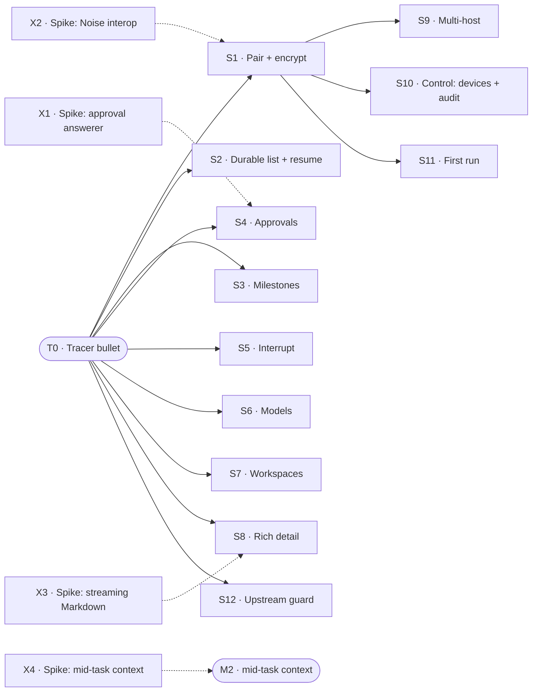

# PLAN

How we get from the Xcode template to M1, tracer-bullet style. Product intent: [STORY.md](STORY.md). Technical design: [ARCHITECTURE.md](ARCHITECTURE.md). This file is a working doc: when M1 exits, archive it to `.archive/YYYYMMDD/plan-m1.md` and write the next one.

## How to use this file

**Before you start work**
1. Read [AGENTS.md](AGENTS.md).
2. Check the §0 status table.
3. Read the slice you're picking up, including its Log.
4. Read `git log` since that slice's last Log entry.
5. Confirm the T0 demo still runs. If it doesn't, fixing it comes first.

**Before you stop**: append to the slice's Log what's done, what isn't, and the next step; commit on the slice's branch. Edit only your own slice's section (its fields, Done when, and Log). Never touch §0 or the §8 Plan log: parallel branches editing adjacent §0 rows conflict on merge. If §0 needs to change, say so in your Log and your report; the coordinating session updates it.

**Who writes this file**
- **§0 and the §8 Plan log** belong to the coordinating session, which edits them only on `main`. It updates them when a slice starts, is blocked, goes to review, or merges.
- **A slice's section** belongs to that slice's owner, on the slice's branch.
- **Subagents** hand results back; the owner records them in the Log.

**Merging a slice** (the user's rules: "Auto-merge when complete", then "Yes, switch" to "merge first, accept later")
- The coordinating session merges a slice branch into `main` without asking, once all three hold. It doesn't wait for `[human]` items.
  1. Every `[auto]` and `[ui]` item of the slice is ticked, and every evidence pointer resolves.
  2. Every `[ui]` item was rerun and passed by a review subagent that didn't take part in development.
  3. The pre-commit check passes.
- After the merge, §0 says:
  - `review` if the slice still has unticked `[human]` items. Each of those goes into §9 with the slice, the item, and the device or setup it needs, so the user can accept them in one sitting.
  - `done` if it has no `[human]` items.
- A slice in `review` becomes `done` once the user has ticked all its `[human]` items. If the user finds a problem while accepting, it's fixed forward on `main`, never by reverting the merge.
- A merged slice meets its dependents' **Needs**, even while it's still in `review`.
- Afterwards the coordinating session tells the user in a sentence or two what was merged and where the evidence is. If any condition fails, it doesn't merge, and tells the user what's missing.
- Its bookkeeping commits on `main` (updating §0, the Plan log, and §9) don't need asking either.
- Still the user's call, every time: ticking `[human]` items, confirming `Dxx` entries in ARCHITECTURE.md and dependencies (see "Default choices" below), any push or PR, and guard-file changes (which the user commits by hand). Changes to the rules in this section are shown to the user before they're committed, unless the user has already approved them.

**Session settings** (the user's rule: "指定 opus 5.5 medium"): the coordinating session starts every tracer, slice, and spike session with model `claude-opus-5-5` and effort `medium`.

**Default choices** (the user's rules: "决策先用默认方案：遇到选型时，会话按自己推荐的方案继续做，写进 ARCHITECTURE.md 时标成'provisional（暂定），待用户确认'", and for dependencies and downloads, "先全部放行，然后和 1 一样的解法")
- **Decisions**: at a toolchain or design choice, a session doesn't wait for the user. It goes ahead with its own recommendation and records it in ARCHITECTURE.md as a `Dxx` entry marked **provisional, pending user confirmation**, with the alternatives it considered.
- **Dependencies and downloads**: allowed without asking. Each is pinned (exact version, or commit plus checksum for downloads), recorded the same way as provisional, pending user confirmation, and named in the slice's Log.
- Each session lists its new provisional items in its report to the coordinating session. The coordinating session keeps them in §9 "Pending user confirmation" with slice, branch, and commit, so the user can review them all at once.
- A provisional item stays provisional until the user confirms it. When the user confirms or changes one, the session that owns it (or the coordinating session, on `main`) drops the marker or applies the change.
- Every session brief carries these two rules.

**Slice fields**, always in this order. Write "—" for an empty field; never drop one.
`Status · Needs · Branch` on one line, then **Why**, **Cuts**, **Demo**, **Done when**, **Not**, **Log**.
- **Status** is one of `todo` / `doing` / `blocked` / `review` / `done`. The slice owner sets it on the branch; the coordinating session brings §0 in line.
- **Log** is append-only and dated: done, not done, next step, and anything learned along the way. Technical decisions go into ARCHITECTURE.md as a `Dxx` entry; the Log just says "see Dxx".

**Done when items** are checkboxes: `- [ ] [tier] description — Evidence: …`
- **Tiers**
  - `[auto]`: unit or integration test against `FakeBridge`, `FakeDSH`, or golden fixtures. Evidence: `test:` pointers, green in CI or a script.
  - `[ui]`: verified in the Simulator, preferably by XCUITest (`test:`), otherwise by an agent driving it through `scripts/demo/<slice>.sh` (`cmd:`). Add a `shot:` as a snapshot for people. Before the slice is marked `done`, a review subagent that didn't take part in development reruns every `[ui]` item.
  - `[human]`: real device, camera, packet capture, subjective experience, or a decision only the user can judge. **Only the user ticks these.** An agent never does.
- **Edit rules**: you may only tick `[ ]` → `[x]` or add new items. Never delete, reword, re-tier, untick, or move an item. Agents add items unticked and tick them in a later edit. If an item truly has to change, explain the original text, the new text, and the reason to the user in the conversation first, and let the user make the edit.
- **Evidence** on a ticked item is one or more typed pointers separated by ` · `. Each one must resolve, otherwise check-plan fails; unknown types fail too.

  | Pointer | Resolves when |
  |---|---|
  | `test:<Name>` | the name appears in Swift/TS test sources (`Suite/name` = both parts in one file) |
  | `cmd:<path> [args]` | the repo-relative path exists and is executable, e.g. `cmd:scripts/demo/t0.sh` |
  | `commit:<hash>` | `git cat-file -e <hash>^{commit}` succeeds |
  | `shot:<path>` | the file exists under `evidence/<slice ID>/` |
  | `human:<YYYY-MM-DD> <device or note>` | `[human]` items only, e.g. `human:2026-11-20 iPhone 16, PR link …` |

  The real evidence is something re-runnable: a test or `scripts/demo/<slice>.sh`. Screenshots are only snapshots for people:
  - Scale them to about 1/3 size and save as compressed PNG, a few hundred KB each.
  - Commit them under `evidence/<slice ID>/`.
  - Recordings stay out of git. If one is really needed, the user attaches it to the PR and the item cites it as `human:` plus the PR link.
  - When M1 is archived, `evidence/` moves with this file to `.archive/YYYYMMDD/`.
- **Enforcement**: `scripts/check-plan` runs from the git pre-commit hook (`.githooks/`) and from a Claude Code PreToolUse hook (`.claude/settings.json`). Edits to the guard files themselves (`scripts/check-plan`, `.githooks/`, `.claude/hooks/`, `.claude/settings.json`) ask the user first, and only the user commits them. Never use `git commit --no-verify` or any other way around them.

## 0. Status

| ID | Status | Branch/PR | Updated | Next action |
|---|---|---|---|---|
| T0 | review | merged `84db2e8` | 2026-11-05 | User accepts 3 `[human]` items (§9) |
| X1 | doing | workflow `wf_219b7aa1-71c` → `claude/x1x4-spikes` | 2026-11-05 | Building with X4 in batch 1 |
| X2 | done | merged `e34a8bc` | 2026-11-05 | — (provisional D6 and deps in §9) |
| X3 | todo | — | — | Start any time (no deps) |
| X4 | doing | workflow `wf_219b7aa1-71c` → `claude/x1x4-spikes` | 2026-11-05 | Building with X1 in batch 1 |
| S1 | doing | workflow `wf_219b7aa1-71c` → `claude/s1-pair-encrypt` | 2026-11-05 | Building in batch 1 |
| S2 | doing | workflow `wf_219b7aa1-71c` → `claude/s2-durable-list` | 2026-11-05 | Building in batch 1 |
| S3 | doing | workflow `wf_219b7aa1-71c` → `claude/s3-milestones` | 2026-11-05 | Building in batch 1 |
| S4 | todo | — | 2026-11-05 | Wait for X1 (T0 merged) |
| S5 | todo | — | 2026-11-05 | Ready (T0 merged); after S1–S3 |
| S6 | todo | — | 2026-11-05 | Ready (T0 merged); after S1–S3 |
| S7 | todo | — | 2026-11-05 | Ready (T0 merged); after S1–S3 |
| S8 | todo | — | 2026-11-05 | Wait for X3 (T0 merged) |
| S9 | todo | — | — | Wait for S1 |
| S10 | todo | — | — | Wait for S1 |
| S11 | todo | — | — | Wait for S1 |
| S12 | todo | — | 2026-11-05 | Ready (T0 merged); after S1–S3 |

## 1. Approach

**Tracer bullet first.** Before any feature is built properly, fire one thin round trip through *every* layer of the real architecture: SwiftUI → `HostConnection` → `SecureChannel` → WebSocket → protobuf `Frame` → bridge plugin → DSH session → and back. It's thin but it's production code, not a throwaway prototype. Everything after it thickens that path.

**Then slices that are almost independent and stand alone.** Each slice after the tracer:

- is **vertical**: it touches protocol + bridge + app + tests, and has a demo you can do on its own;
- **depends on the tracer (T0) and nothing else**, unless a dependency is named explicitly (at most one, where possible);
- can be built, reviewed, merged, and dropped **in any order** relative to its siblings.

### How slices stay independent

| Rule | Mechanism |
|---|---|
| Own files | Each slice gets `protocol/<slice>.proto`, `ios/…/Features/<Slice>/`, `bridge/src/<slice>/`. Shared files (`frame.proto`, app root, plugin entry) only get a one-line registration. |
| No field-number collisions | `Request` / `Event` oneofs reserve **20 field numbers per slice** (T0: 1–19, S1: 20–39, S2: 40–59, …). Parallel branches never fight over tags. |
| Ship in any order | Each slice advertises a **capability string** in `Hello.capabilities` (e.g. `approvals.v1`). The app hides UI for capabilities the bridge lacks. This is the same mechanism that later handles bridge N / N-1. |
| Test alone | Fakes at every boundary: **`FakeBridge`** (Swift, in-process) for app tests and previews; **`FakeDSH`** (TS) for bridge tests. No slice needs a neighbor slice or a real DSH to pass CI. |
| Cross-language truth | `protocol/fixtures/` holds golden encoded frames. Swift and TS tests both decode/encode them, so the two sides can't drift. |
| Seams | When two slices meet (e.g. resume × approvals), **the slice that lands second owns the seam** and adds it to its Done when. |

**Done** for any slice = every Done when item ticked with evidence, merged to `main`, ARCHITECTURE.md updated if a decision changed (AGENTS.md: code is truth).

## 2. Map

Solid = must land first. Dotted = spike result must exist first (a written conclusion, not code). Spikes depend on nothing and can start today, in parallel with T0.

## 3. T0 · Tracer bullet

**Status** review · **Needs** — · **Branch** `claude/t0-tracer-513793` (merged `84db2e8`)

**Why**: prove every layer of the architecture end to end before building any feature. Type one sentence in the iOS Simulator; text streams back from a DSH agent running on the same Mac.

**Cuts**
- `ios/`: move the Xcode project here. One screen: text field, send button, streaming text. `@Observable` store, in-memory only. One `HostConnection` actor, address hardcoded to `127.0.0.1:<port>`. `SecureChannel` protocol with a single `PlaintextChannel` implementation that **refuses any non-loopback address**.
- `protocol/`: `frame.proto` with `Frame { oneof { Request, Response, Event } }`, `Hello { protocol_version, capabilities }`, `CreateTask { prompt }` → `TaskCreated { task_id }`, events `AssistantChunk { task_id, seq, text }`, `TaskEnded { task_id, status }`. Codegen script for Swift + TS. First golden fixtures.
- `bridge/`: Cordis plugin that opens its own WebSocket listener on loopback, speaks the frame protocol through the same plaintext channel, maps `CreateTask` to a DSH session + prompt (DSH's default model and a fixed cwd), and forwards assistant text.
- Tests: fixture round trip in Swift and TS; bridge test against `FakeDSH`; app store test against `FakeBridge`.
- Testability entry points, **debug builds only**:
  - launch arguments that inject `FakeBridge` and preset state;
  - accessibility identifiers on key controls;
  - a reserved `dshm://pair?…` deep link, so S1's pairing flow can be tested end to end in the Simulator without a camera.

**Demo**: in the Simulator, type a read-only prompt; the answer streams back from the real DSH on the same Mac.

**Done when**
- [x] [auto] Golden fixtures round-trip in both Swift and TS tests — Evidence: test:GoldenFixtures/fixturesRoundTrip · cmd:scripts/demo/t0.sh
- [x] [auto] Bridge `CreateTask` → session + prompt → `AssistantChunk` / `TaskEnded` passes against `FakeDSH` (CI) — Evidence: test:BridgeAgainstFakeDSH/createTaskStreamsChunksThenTaskEnded · test:BridgeAgainstFakeDSH/failedTurnEndsWithFailedStatus · cmd:scripts/demo/t0.sh
- [x] [auto] App store test streams a task to completion against `FakeBridge` — Evidence: test:TaskStoreTests/streamsTaskToCompletionAgainstFakeBridge · cmd:scripts/demo/t0.sh
- [x] [auto] `PlaintextChannel` refuses a non-loopback address — Evidence: test:PlaintextChannelTests/refusesNonLoopbackAddress · test:PlaintextChannelTests/connectionRefusesNonLoopbackBeforeOpeningTransport · test:PlaintextChannelBridge/refusesNonLoopbackAddress
- [x] [ui] Demo passes in the Simulator against a real DSH `v0.2.2-rc.1` (local acceptance; CI uses `FakeDSH`) — Evidence: test:T0DemoUITests/testDemoAgainstRealDSH · cmd:scripts/demo/t0.sh · shot:evidence/T0/t0-real-dsh-done.png
- [x] [ui] With the `FakeBridge` launch argument, an XCUITest runs the demo with no DSH, finding controls by accessibility identifier — Evidence: test:T0DemoUITests/testDemoWithFakeBridge · cmd:scripts/demo/t0.sh · shot:evidence/T0/t0-fakebridge-done.png
- [x] [auto] Debug build routes `dshm://pair?…` to a pairing entry point (a stub until S1) — Evidence: test:DebugEntryPointTests/routesPairDeepLink · test:T0DemoUITests/testPairDeepLinkOpensPairingStub · shot:evidence/T0/t0-pair-deeplink-stub.png
- [x] [auto] Release build contains none of the testability entry points (launch arguments, `FakeBridge`, `dshm://pair`) — Evidence: cmd:scripts/check-release-clean
- [ ] [human] Following `bridge/README.md` installs and enables the plugin in a DSH profile (answers ARCHITECTURE §8.2) — Evidence:
- [ ] [human] Toolchain choices (codegen tool, whether generated code is committed, bridge package manager, Swift package layout) recorded in ARCHITECTURE.md — Evidence:
- [ ] [human] Testability entry points (launch arguments, accessibility identifiers, `dshm://` deep link) recorded in ARCHITECTURE.md — Evidence:

**Not**: pairing, encryption, persistence, reconnect, milestones, approvals (DSH fails closed on any approval, which is fine; use read-only prompts), model or workspace choice, real device.

**Log**
- **2026-11-05 · start.**
  - Done:
    - Fast-forwarded the branch to local `main` (`10d4639`); it had been cut from `0bda405`, before PLAN.md and the guards. `origin/main` is still at `0bda405`.
    - Moved the Xcode project to `ios/` (`ios/dsh-mobile.xcodeproj`, `ios/dsh-mobile/`). It still builds for the iOS Simulator; the template's build settings (multiplatform, Swift 5 mode) are untouched for now.
    - Drafted `protocol/frame.proto`: `Frame { Request | Response | Event }`, `Hello` as the first request (answered with the bridge's `Hello`), `CreateTask` → `TaskCreated`, `AssistantChunk`, `TaskEnded`, plus a generic `Error` response. Field ranges per slice are written in its header.
  - Found: no DSH `v0.2.2-rc.1` install on this Mac (npm `next` = `0.2.2-rc.1`; `~/.dsh/profiles/web` exists but has only the default bundles; no `protoc`/`buf`). Prior art in `~/dsh-remote/spikes/host/SPIKE-S1.md`: a Cordis plugin bundle installed with `dsh plugin --profile web add <dir>`, DSH needs Node ≥ 24.9, and `@deepseek-ai/dsh-llm-mock-server` drives a DSH session without a model key.
  - Not done: everything else. Blocked on the user for the toolchain choices (codegen tool, committing generated code, bridge package manager, Swift package layout), the dependencies to add, and where the DSH install and profile should live.
  - Next: once the user answers, record the choices as a `Dxx` entry, add codegen + fixtures, then bridge + `FakeDSH`, then the app + `FakeBridge`.
- **2026-11-05 · built, to review.**
  - The user's answers were relayed by the coordinating session: use the recommended defaults and mark them provisional, approve every listed dependency and download, use the mock LLM (no API key), and tick the real-DSH `[ui]` item with the mock noted. Choices are recorded in D15 (toolchain) and D16 (testability entry points), both *provisional, pending user confirmation*.
  - Done (commits `28d1bda`, `b54c8d5`, `03cc202`, `f562e52`; history was rewritten to drop an accidental `ios/DSHKit/.build/` commit):
    - **Protocol**: `protocol/frame.proto`, buf config, `scripts/codegen` (`--check` for drift), 9 golden fixtures.
    - **Bridge**: `bridge/` with its own WebSocket listener, `src/dsh.ts` mapping a task onto one DSH session through in-process `ctx.workspaceController` / `ctx.sessionController` (no Peer needed), `FakeDSH`, `node:test` suite, README.
    - **App**: `ios/DSHKit` (`HostConnection` actor, `SecureChannel` / `PlaintextChannel`, `@Observable TaskStore`, `FakeBridge`), the one-screen app, and the D16 debug entry points. The project is now iOS-only, iOS 26.0, Swift 6.
    - **Verification**: XCUITests, `scripts/demo/t0.sh`, `scripts/check-release-clean` (it also confirms Debug *does* contain the markers), and screenshots in `evidence/T0/`.
  - **Real DSH**: the bridge runs inside DSH `0.2.2-rc.1` via `node scripts/dsh-up.mjs` (web 127.0.0.1:3281, bridge 127.0.0.1:47801, `DSH_HOME=~/.dshm/home`). The model is DSH's **mock LLM** (`@deepseek-ai/dsh-llm-mock-server`, fixed reply), not a real model. A demo with a real key waits for the user.
  - **Independent review**: a review subagent that took no part in development reran both `[ui]` items. It ran `scripts/demo/t0.sh` (exit 0, 4/4 UI tests) and the FakeBridge UI test alone (DSH session count 7 → 7). It decoded the DSH session log to confirm the app's prompt and reply live in a real DSH session, and confirmed the evidence pointers resolve. Doubts it raised:
    1. `runDemo` checks only that text appeared, not that it arrived in pieces. Incremental streaming is covered by `TaskStoreTests/streamsTaskToCompletionAgainstFakeBridge`.
    2. The FakeBridge "no DSH" claim rests on code plus the unchanged session count, not on a run with DSH stopped, because DSH is shared.
  - **Provisional, pending user confirmation**:
    - **Decisions**: D15 toolchain, D16 testability entry points (commit `03cc202`).
    - **Bridge dependencies** (`bridge/pnpm-lock.yaml`, `28d1bda`):
      - runtime: `@bufbuild/protobuf` 2.16.0, `ws` 8.22.1;
      - dev: `@bufbuild/buf` 1.75.0, `@bufbuild/protoc-gen-es` 2.16.0, `typescript` 7.0.2, `@types/node` 24.19.2, `@types/ws` 8.18.2;
      - pnpm 11.28.5 via corepack.
    - **Swift dependency**: `apple/swift-protobuf` 1.39.0, revision `3d537cb81aef272a03cb3be815439e9bf0eb3bd3` (`ios/DSHKit/Package.resolved`, `b54c8d5`).
    - **Downloads**:
      - npm `@deepseek-ai/dsh@0.2.2-rc.1` (`sha512-ijR9UEVYkG15Q/Q79JzvzLBzQOQfc63VLr9n6flpwHPhr5IKn2UxthnSoto/P9l7qGd7pPvI1Ra6TW7LH3oKpg==`) and `@deepseek-ai/dsh-llm-mock-server@0.2.2-rc.1` (`sha512-hxBNmQEGeibDdmdEtWv3Pmm/11omcnvWbyh6RULkasUQoNVfgppJbrBtres2EaqUjaEULIRuMFhdLZcX13zMhQ==`), installed into `~/.dshm/runtime`.
      - A shallow clone of swift-protobuf 1.39.0 in `~/.dshm/mirrors/swift-protobuf`. It seeds the SwiftPM cache because a full clone ran at about 50 KB/s.
    - **Local setup outside the repo**:
      - `~/.dshm/bin/pnpm`, a shim for `corepack pnpm@11.28.5`; Node 24's default corepack pnpm is broken here.
      - SwiftPM cache entry `~/Library/Caches/org.swift.swiftpm/repositories/swift-protobuf-88c150a7`, seeded from that clone.
    - **DSH location**: `~/.dshm` (`DSH_HOME=~/.dshm/home`). The user said `~/.dsh` may be cleared, but it was left untouched because `~/.dshm` was already set up. Recorded in `bridge/README.md`.
  - Not done: the three `[human]` items, which are the user's to tick. There is no CI yet, so the "(CI)" in the `FakeDSH` item is met by `scripts/demo/t0.sh --fake-only`.
  - Known gaps:
    - If DSH abandons an attempt and retries it, text deltas already forwarded are not retracted.
    - The bridge only logs if its port is taken.
    - A sheet presented from `onOpenURL` didn't show up in XCUITest's accessibility tree, so the pairing stub replaces the screen instead.
  - Next: the user reviews the provisional list, then ticks the `[human]` items (README install, D15, D16).

## 4. Spikes

Each spike ends in a short written conclusion (a working note, archived once acted on), plus throwaway code if needed. None of them blocks T0.

### X1 · Spike: approval answerer

**Status** todo · **Needs** — · **Branch** —

**Why**: can a plugin answerer own approvals for **all** agents? How does it order against web/desktop answerers, and does the web UI still see a held request? (ARCHITECTURE §8.1) Unblocks S4.

**Cuts**: minimal throwaway plugin + a release script.

**Demo**: —

**Done when**
- [ ] [auto] A minimal plugin parks one approval and a script releases it — Evidence:
- [ ] [human] Ordering versus web/desktop answerers, and web UI visibility, written down — Evidence:

**Not**: production code.

**Log**
- —

### X2 · Spike: Noise interop

**Status** done · **Needs** — · **Branch** `claude/x2-noise-b1b3cc` (merged `e34a8bc`)

**Why**: do a CryptoKit Swift Noise implementation and a TS `@noble/*` one interoperate? Which pattern (likely `IK` with the host static key from the QR)? (ARCHITECTURE §8.3) Unblocks S1.

**Cuts**: Swift and TS Noise implementations + test vector harness.

**Demo**: —

**Done when**
- [x] [auto] Swift and TS implementations both pass the official Noise test vectors — Evidence: test:NoiseVectorTests/officialVector · cmd:spikes/x2-noise/scripts/interop
- [x] [auto] Swift and TS complete a handshake against each other in a test — Evidence: test:InteropTests/swiftInitiatorTsResponder · test:InteropTests/tsInitiatorSwiftResponder · cmd:spikes/x2-noise/scripts/interop

**Not**: —

**Log**
- 2026-11-05: Done; status `review`. Conclusion in `spikes/x2-noise/README.md`.
  - **Interop:** yes. Swift (CryptoKit only, no SPM deps) and TS (`@noble/curves`, `@noble/ciphers`, `@noble/hashes` 2.4.0, user-approved) both pass 12 official vectors: IK, IKpsk1, IKpsk2, XX × ChaChaPoly/AESGCM × SHA256, from cacophony @18b7348 and snow @d00b360 (download user-approved; sha256-pinned; filtered subset committed). They cross-handshake in both directions over stdio pipes (no socket, no Simulator), with transport messages; wrong secret and wrong host key are rejected. `spikes/x2-noise/scripts/interop` runs it all.
  - **Recommendation:** pairing `Noise_IKpsk1_25519_ChaChaPoly_SHA256` (psk = the QR's one-time secret); reconnect `Noise_IK_25519_ChaChaPoly_SHA256`. Not `IKpsk2`: there a wrong secret passes the host's first read. Not `XX`: the QR already gives the host key.
  - **CryptoKit lacks** BLAKE2 (so SHA256) and any Noise state machine (about 390 lines, ours). HKDF, nonce layout and the tag split are small glue.
  - **For the coordinator:** §0 X2 → `review`. S1 should port the code, not depend on `spikes/`.
  - **Proposed** (user's call): refine ARCHITECTURE D6 with the concrete patterns and the prologue binding. Open question for S1: whether the Secure Enclave P-256 identity key is still needed in M1, since the IK static key already authenticates the device.
  - Next: S1 (after T0).
- 2026-11-05: Provisional dependencies and downloads, pending user confirmation. All are under `spikes/x2-noise/` only.
  - **npm** (`spikes/x2-noise/ts/package.json`, exact pins, installed with `--ignore-scripts`; commit 3f4d72e):
    - `@noble/curves@2.4.0` from npmjs.com; its only dependency is `@noble/hashes`.
    - `@noble/ciphers@2.4.0` from npmjs.com.
    - `@noble/hashes@2.4.0` from npmjs.com.
  - **Downloads** (gitignored raw files, sha256 in `vectors/SHA256SUMS`, filtered subset committed as `vectors/subset.json`; commit 3f4d72e):
    - `cacophony.txt` from github.com/haskell-cryptography/cacophony `vectors/cacophony.txt` @ `18b7348c54fd61fcd0c220298883de0d09c8364d`.
    - `snow.txt` from github.com/mcginty/snow `tests/vectors/snow.txt` @ `d00b360cc61a7fe519ce7539974dca4f36c4654a`.
  - **SPM:** none.
  - **Provisional decision:** ARCHITECTURE D6 now names the concrete Noise patterns and suite, marked "provisional — pending user review" (see the commit that adds this entry).

### X3 · Spike: streaming Markdown

**Status** todo · **Needs** — · **Branch** —

**Why**: which Markdown path survives incremental rendering of long streaming transcripts? (ARCHITECTURE §8.5) Unblocks S8.

**Cuts**: benchmark harness for 2–3 candidates.

**Demo**: —

**Done when**
- [ ] [human] Benchmark of 2–3 candidates on a 5k-line transcript on a real device — Evidence:
- [ ] [human] Choice recorded in ARCHITECTURE D10 — Evidence:

**Not**: production code.

**Log**
- —

### X4 · Spike: mid-task context

**Status** todo · **Needs** — · **Branch** —

**Why**: STORY principles 4 and 7. Can the bridge add a follow-up message or attachment to a DSH session that is still running? Is it queued for the next turn or injected immediately? How does an agent's open question to the user surface, as distinct from an approval request? (ARCHITECTURE §8.6) Unblocks the M2 mid-task context slice; doesn't block M1.

**Cuts**: throwaway plugin or script that sends a message into a running session and observes when the agent sees it.

**Demo**: —

**Done when**
- [ ] [auto] A script sends a message into a running session of a real DSH and records whether it is queued or injected — Evidence:
- [ ] [human] Queue-vs-inject behavior, attachment support, and how agent questions surface written down — Evidence:

**Not**: production code · any M1 slice.

**Log**
- —

## 5. M1 slices

Each slice needs only T0, unless "Needs" says otherwise.

### S1 · Pair + encrypt

**Status** todo · **Needs** T0, X2 · **Branch** —

**Why**: principle 6 (anyone can pair) and D6 (every transport is untrusted). This slice unlocks the real device.

**Cuts**: bridge shows a QR (terminal first, DSH UI later) with address(es), host static key, one-time secret · app scanner + `NoiseChannel: SecureChannel` · device identity key (Secure Enclave) + Noise static key (Keychain) · bridge device registry (store only, no UI).

**Demo**: a fresh iPhone scans the QR and runs the T0 demo over Wi-Fi or Tailscale. A packet capture shows only ciphertext.

**Done when**
- [ ] [auto] `PlaintextChannel` is debug-only and loopback-only — Evidence:
- [ ] [auto] A reused or expired pairing secret is rejected — Evidence:
- [ ] [ui] Pairing through the `dshm://pair?…` deep link in the Simulator, then the T0 demo over `NoiseChannel` against the local bridge — Evidence:
- [ ] [human] A fresh iPhone scans the QR and runs the T0 demo over Wi-Fi or Tailscale — Evidence:
- [ ] [human] A packet capture of that session shows only ciphertext — Evidence:

**Not**: QR inside the DSH UI (terminal first) · device registry UI (S10).

**Log**
- —

### S2 · Durable list + resume

**Status** todo · **Needs** T0 · **Branch** —

**Why**: principle 4 (unified list; nothing lost across disconnects), D9.

**Cuts**: bridge per-host monotonic `seq` + event log · `Resume { after_seq }` · `ListTasks` · app SwiftData models, unified task list (running / waiting on me / done), reconnect with backoff, refresh on foreground · offline host named explicitly (principle 3).
- Seams it owns if it lands second: replay of pending approvals (S4), cached milestones (S3).

**Demo**: start a task, kill the app, wait, reopen. The list and transcript are intact, and the gap is filled from the bridge.

**Done when**
- [ ] [auto] Bridge `Resume { after_seq }` returns exactly the events after `after_seq` — Evidence:
- [ ] [ui] Start a task, kill the app, wait, reopen: the list and transcript are intact and the gap is filled from the bridge — Evidence:
- [ ] [ui] With the host unreachable, the list names that host as offline — Evidence:

**Not**: background refresh (M1 refreshes on foreground; push is M2).

**Log**
- —

### S3 · Milestones

**Status** todo · **Needs** T0 · **Branch** —

**Why**: principle 4 (milestone summary by default, details on demand), D11.

**Cuts**: bridge mapper DSH `todos` / `plan` / `state` / errors → `MilestoneAdded` · app task card showing the current milestone, detail view showing the milestone timeline.

**Demo**: a multi-step prompt shows its todos ticking off on the card without opening the transcript.

**Done when**
- [ ] [auto] Mapper turns `FakeDSH` `todos` / `plan` / `state` / error projections into the expected `MilestoneAdded` events — Evidence:
- [ ] [ui] A multi-step prompt shows its todos ticking off on the card without opening the transcript — Evidence:
- [ ] [ui] The detail view shows the milestone timeline — Evidence:

**Not**: summarizing with a model (never; D11).

**Log**
- —

### S4 · Approvals (in-app, held)

**Status** todo · **Needs** T0, X1 · **Branch** —

**Why**: principle 5. Approvals pause and never default-allow. ARCHITECTURE §5.4.

**Cuts**: bridge answerer on `approval/request` that parks requests, joins by `callId` with the streamed tool call for a basic impact view (tool, command / files / args), times out → cancel + `ApprovalResolved(timeout)`, writes an audit record · `ApprovalPending`, `AnswerApproval`, `ApprovalResolved` · app approval card in the list and in the detail view.

**Demo**: prompt "delete `/tmp/x`". The phone shows the exact command, you deny it, and the task continues without running it. Repeat with the app closed: the request waits, and when you reopen the app it's there.

**Done when**
- [ ] [auto] A held request that times out is cancelled with `ApprovalResolved(timeout)`, never allowed — Evidence:
- [ ] [auto] Every answer writes an audit record (who, when, which device, what) — Evidence:
- [ ] [ui] Prompt "delete `/tmp/x`": the card shows the exact command, you deny it, and the task continues without running it — Evidence:
- [ ] [ui] With the app closed, the request waits; reopening the app shows it — Evidence:

**Not**: risk tiers, Face ID, push (M2).

**Log**
- —

### S5 · Interrupt

**Status** todo · **Needs** T0 · **Branch** —

**Why**: "随时打断" (interrupt at any time) in STORY.

**Cuts**: `Interrupt { task_id }` → DSH interrupt · app stop button in the detail view; task status `interrupted`.

**Demo**: interrupt a long-running task; it stops within a few seconds and the card says so.

**Done when**
- [ ] [auto] Bridge maps `Interrupt { task_id }` to a DSH interrupt and reports status `interrupted` (`FakeDSH`) — Evidence:
- [ ] [ui] Interrupt a long-running task: it stops within a few seconds and the card says so — Evidence:

**Not**: continuing an interrupted task with a new prompt in the same session (later, together with adding context mid-task).

**Log**
- —

### S6 · Models

**Status** todo · **Needs** T0 · **Branch** —

**Why**: principle 8. The host provides the list, names are shown as given, there's no silent substitution, and you can switch mid-task.

**Cuts**: `ModelCatalog` / `SelectModel` passthrough of `session/modelCatalog` / `session/selectModel` · composer model + effort picker defaulting to the host's default · mid-task switch in the detail view · explicit error when the chosen model is unavailable.

**Demo**: start on low effort, raise it mid-task, and see the switch recorded in the transcript.

**Done when**
- [ ] [auto] Catalog names and the default pass through unchanged from `session/modelCatalog` — Evidence:
- [ ] [auto] Choosing an unavailable model returns an explicit error; no other model is substituted — Evidence:
- [ ] [ui] Start on low effort, raise it mid-task, and see the switch recorded in the transcript — Evidence:

**Not**: renaming or regrouping models (principle 8).

**Log**
- —

### S7 · Workspaces

**Status** todo · **Needs** T0 · **Branch** —

**Why**: D12 (DSH sessions need a cwd).

**Cuts**: `ListWorkspaces` (per-host default + recents) · `CreateTask.workspace` · composer picker.

**Demo**: run the same prompt in two different repos and get correct, different answers.

**Done when**
- [ ] [auto] `CreateTask.workspace` becomes the DSH session cwd (`FakeDSH`) — Evidence:
- [ ] [ui] The same prompt run in two different repos gives correct, different answers — Evidence:

**Not**: inferring the workspace from the prompt.

**Log**
- —

### S8 · Rich detail

**Status** todo · **Needs** T0, X3 · **Branch** —

**Why**: D1 (native streaming detail), D13 (quick answers inline).

**Cuts**: native rendering of Markdown, code, diffs, and terminal output in the transcript, incremental while streaming · short tasks rendered inline as an answer, not as a task page.

**Demo**: a coding task's diff and test output read well on a phone. "Translate this sentence" just shows the answer.

**Done when**
- [ ] [ui] "Translate this sentence" just shows the answer inline, not a task page — Evidence:
- [ ] [human] A coding task's diff and test output read well on a phone — Evidence:

**Not**: WebView (D1).

**Log**
- —

### S9 · Multi-host

**Status** todo · **Needs** S1 · **Branch** —

**Why**: principles 1–3 (one phone, many hosts, all hosts treated the same, smart default).

**Cuts**: pair a second host · host attribute on tasks · composer host picker (default: last used; prompt-based guess later) · per-host `HostConnection` · "all hosts offline" names each machine.
- Seam: if S2 has landed, the unified list spans hosts.

**Demo**: two Macs, tasks from both in one list; take one offline and it's named.

**Done when**
- [ ] [ui] With two hosts (`FakeBridge` ×2), tasks from both appear in one list; one taken offline is named — Evidence:
- [ ] [human] Two real Macs, tasks from both in one list; take one offline and it's named — Evidence:

**Not**: prompt-based host guess (later).

**Log**
- —

### S10 · Control: devices + audit

**Status** todo · **Needs** S1 · **Branch** —

**Why**: principle 9.

**Cuts**: `ListDevices` / `RevokeDevice` · app host + device management screen · audit view (who, when, which device, what) for approvals and pairing.
- Seam: the audit view covers approvals if S4 has landed.

**Demo**: revoke the phone from a second device; its next connection is refused.

**Done when**
- [ ] [auto] Bridge refuses a connection from a revoked device — Evidence:
- [ ] [ui] Revoke a device from the management screen; its next connection is refused — Evidence:
- [ ] [ui] Audit view shows who, when, which device, and what for pairing events — Evidence:

**Not**: —

**Log**
- —

### S11 · First run

**Status** todo · **Needs** S1 · **Branch** —

**Why**: principle 6 (with no host paired, the app explains what it is and what's missing).

**Cuts**: empty state → pairing guide → first task suggestion.

**Demo**: someone who has never seen DSH gets from install to their first answer without help, given a DSH that's already running.

**Done when**
- [ ] [human] With no host paired, the app explains what it is and what's missing — Evidence:
- [ ] [human] Someone who has never seen DSH gets from install to their first answer without help, given a DSH that's already running — Evidence:

**Not**: installing DSH for the user (STORY non-goal).

**Log**
- —

### S12 · Upstream guard

**Status** todo · **Needs** T0 · **Branch** —

**Why**: ARCHITECTURE §8.4 (upstream churn).

**Cuts**: supported DSH version range pinned in the bridge and reported in `Hello` · CI: bridge tests against the pinned DSH and a non-blocking job against DSH `main`.

**Demo**: point the bridge at an unsupported DSH; the app shows "host needs bridge update" instead of breaking.

**Done when**
- [ ] [auto] Bridge reports the supported DSH range and an unsupported DSH in `Hello` — Evidence:
- [ ] [auto] CI runs bridge tests against the pinned DSH, plus a non-blocking job against DSH `main` — Evidence:
- [ ] [ui] Against an unsupported DSH, the app shows "host needs bridge update" instead of breaking — Evidence:

**Not**: blocking CI on DSH `main`.

**Log**
- —

## 6. M1 exit

From a real iPhone over Tailscale, against a home Mac. All items are human-only.

- [ ] [human] Pair by scanning a QR (S1) — Evidence:
- [ ] [human] "Fix the failing CI test in `<repo>`, open a PR", with workspace and model picked (S6, S7) — Evidence:
- [ ] [human] Watch milestones tick (S3); open the detail view and read the diff (S8) — Evidence:
- [ ] [human] Approve the `git push` from an approval card showing the exact command (S4) — Evidence:
- [ ] [human] Raise reasoning effort mid-task (S6). Kill the app, reopen, and find nothing lost (S2) — Evidence:
- [ ] [human] Get the PR link in the result — Evidence:

When all of these are ticked, archive this file and plan M2 the same way.

## 7. After M1 (coarse, re-slice when we get there)

| Milestone | Candidate slices | Gate |
|---|---|---|
| M2 | Push via `PushSender` → APNs · risk tiers + Face ID for the top tier · plan alignment + pre-authorization · pause timeout + re-confirm on resume · mid-task context: follow-up messages + answering agent questions (attachments with M3; continues S5's interrupted tasks) | Paid Apple account; X4 result |
| M3 | Quick Look + share-out · Share Extension + attachment upload · photos as context | Verify App Groups on the signing team first |
| M4 | Live Activities / Dynamic Island · voice entry · relay `Transport` | Relay design note |

## 8. Plan log

Append-only, dated. Changes to this file's format and to the checks that guard it.

- **2026-11-04 · format + checks.**
  - Done:
    - Baseline commit `71b367a`; format change in `08f64b9`.
    - Added `scripts/check-plan`, `.githooks/pre-commit` (`git config core.hooksPath .githooks`, repo-local), `.claude/settings.json` with `.claude/hooks/plan-guard` (Edit|Write|MultiEdit) and `.claude/hooks/git-guard` (Bash).
  - Verification. Samples were derived from `PLAN.md` with `sed` and checked three ways: `scripts/check-plan --new <sample> --agent`, staged + `git commit` (pre-commit), and live Edit calls in a Claude Code desktop session in bypass-permissions mode.
    1. Reword the T0 fixtures item → rejected: check-plan exit 1, commit refused. Live Edit with `ask`: the confirmation dialog appeared.
    2. Tick a `[human]` M1 exit item → rejected: check-plan `--agent` exit 1, live Edit denied. Pre-commit allows it on purpose, because the user ticks human items by hand.
    3. Tick the T0 fixtures item with empty evidence → rejected: check-plan exit 1, commit refused, live Edit blocked (tested under `deny`; under `ask` it goes to the same dialog as sample 1).
    4. Tick it with evidence → passes: check-plan exit 0, commit succeeded (then undone), live Edit applied (then restored).
    - Also: deleting an item → rejected.
    - git-guard denies `--no-verify`, `git commit -n`, `core.hooksPath` overrides or unset, and `CHECK_PLAN_ALLOW`. It allows `git commit -am`, `git push -n`, and `git config core.hooksPath .githooks`.
  - Finding: in bypass-permissions mode a PreToolUse `ask` **still shows the confirmation dialog**. Tested twice; both times the user saw the dialog and clicked allow, so the edit went through. plan-guard therefore keeps `ask` for non-human violations; ticking a `[human]` item is always `deny`. Hooks in `.claude/settings.json` took effect mid-session, with no restart.
  - Known gaps:
    - An agent editing PLAN.md through Bash (`sed`, `python`) skips plan-guard. Pre-commit still catches rewrites and empty evidence, but not a `[human]` tick, because it can't tell who made it.
    - The `CHECK_PLAN_ALLOW=1 git commit` escape hatch is for the user only. It's blocked for agents by git-guard, not by git.
  - Next: —
- **2026-11-04 · user review.**
  - The evidence marker is `Evidence:` only; check-plan no longer accepts the Chinese marker.
  - The user confirmed the derived Done when items for S4–S12, the tier choices, and the §1 Done definition.
  - Still open: the S5 **Not** TODO.
- **2026-11-04 · four guard gaps + evidence pointers** (gaps found by a re-test in another session; fixes approved by the user).
  - Done:
    1. **Guard files are guarded.** plan-guard returns `ask` for Edit/Write/MultiEdit on `scripts/check-plan`, `.githooks/*`, `.claude/hooks/*`, `.claude/settings.json`. `check-plan --staged`, and so pre-commit, fails when any of them is staged unless the user commits with `CHECK_PLAN_ALLOW=1`.
    2. **Evidence is typed pointers** (`test:` / `cmd:` / `commit:` / `shot:` / `human:`, joined by ` · `), each resolved by check-plan. The rules are in "How to use this file", including screenshots and recordings. `test:` reports clearly that there are no Swift/TS test sources yet.
    3. **No pre-ticked new items in `--agent` mode** (plan-guard): agents add unticked and tick in a later edit. Pre-commit still allows the user to add and tick at once.
    4. **git-guard parses commands** instead of regex-matching `core.hooksPath`. It denies setting the value to anything but `.githooks`, `--unset`/`--unset-all`/`unset`, removing or renaming the `core` section, `git -c`/`--config-env` overrides, and `GIT_CONFIG_*` mentioning hooksPath, including inside `sh -c "…"`. It allows `git config core.hooksPath`, `--get`, `--get-regexp`, `--list`, and `git config core.hooksPath; git status`.
  - Verification. Harness: `/tmp/dshm-guard-tests/plan-run.py` and `gg-run.py` (outside the repo, because git-guard blocks any shell command containing the guarded strings). Result: 0 failures.
    - check-plan `--agent` and plan-guard: the original samples 1–4 are unchanged (reword → ask, `[human]` tick → deny, empty evidence → ask, valid tick with `commit:08f64b9 · cmd:scripts/check-plan` → allow; delete → ask).
    - New samples, all blocked: `Evidence: done`, `test:NoSuchTest`, adding a ticked item (even with valid evidence), adding a ticked item with `trust me`, unknown pointer `url:`, `human:` on an `[auto]` item.
    - plan-guard on each of the four guard paths → ask; AGENTS.md and files outside the repo → allow.
    - Pre-commit (staged vs HEAD, sample commits undone): rewrite, empty, `done`, missing test, bad pointers, and staged `scripts/check-plan` → refused; valid tick, user `[human]` tick, and an added ticked item with valid evidence → accepted.
    - git-guard: 25 cases, including the read-only `hooksPath` queries.
    - Live, in bypass-permissions mode: an Edit of `scripts/check-plan` (`return 1` → `return 0`) showed the confirmation dialog. The user clicked allow, and the change was reverted immediately.
  - Known gaps:
    - Writing guard files through Bash (`sed`, `python`, `cp`) skips plan-guard. Only pre-commit catches it, and only at commit time.
    - plan-guard and check-plan each keep a copy of the PROTECTED list; keep them in sync.
    - `shot:` and `cmd:` resolve against the working tree, not the index.
  - Next: the user reviews and commits the guard changes by hand (`CHECK_PLAN_ALLOW=1 git commit …`, since guard files are staged).
- **2026-11-04 · S5 scope.**
  - The user committed the guard fixes as `057acb1`.
  - S5 stays "stop only". Continuing an interrupted task with a new prompt is out of S5; it's for later, together with adding context mid-task. This closes the S5 **Not** TODO.
- **2026-11-05 · mid-task context.**
  - STORY.md now covers adding context mid-task (`cc91a02`).
  - Added spike X4 (no deps, doesn't block M1; ARCHITECTURE §8.6) and an M2 candidate slice, gated on X4.
- **2026-11-05 · §0 ownership + auto-merge** (both approved by the user).
  - Several slice branches editing adjacent §0 rows would conflict on merge. From now on §0 and this Plan log are written only by the coordinating session, on `main`, when a slice starts, is blocked, goes to review, or merges.
  - Slice sessions edit only their own slice's section and its Log, on their own branch. "Before you stop" and "Who writes this file" in "How to use this file" say so; the Status field note now says the coordinating session brings §0 in line.
  - The user chose "Auto-merge when complete". The new "Merging a slice" rule: the coordinating session merges without asking once every Done when item is ticked with resolving evidence, every `[ui]` item was rerun by an independent reviewer, and pre-commit passes. It reports afterwards. Its bookkeeping commits for §0 and this log don't need asking either. Ticking `[human]` items, `Dxx` entries, any push or PR, and guard-file changes stay with the user.
  - No Done when item changed.
- **2026-11-05 · T0 and X2 started.**
  - Both run in their own sessions and worktrees, cut from `10d4639`: T0 on `claude/t0-tracer-513793`, X2 on `claude/x2-noise-b1b3cc`.
  - Ports (each worktree uses only its own bridge port; the real DSH and the Simulator are shared, so tests that hit them run one at a time):

    | Port | Owner | Use |
    |---|---|---|
    | 3080 | real DSH | DSH webserver (shared) |
    | 47800 | `main` | bridge, for demos on `main` after merges |
    | 47801 | T0 | bridge listener, app's loopback address |
    | 47802 | X2 | cross-handshake socket, if needed |

  - Next: start X1 + X4 as one session once T0's bridge runs inside DSH. Start X3 when the user has real-device time.
- **2026-11-05 · session settings** (approved by the user).
  - The user's rule is "指定 opus 5.5 medium": every tracer, slice, and spike session runs on model `claude-opus-5-5` at effort `medium`. "Session settings" in "How to use this file" says so.
  - T0 and X2 already ran `claude-opus-5-5`; their effort went from `high` to `medium`, starting with each session's next turn.
- **2026-11-05 · default choices** (the user's rules, relayed by the coordinating parent session while the user is out; the user replied "确认").
  - Decisions: sessions go ahead with their own recommendation and mark the `Dxx` entry provisional, pending user confirmation. Dependencies and downloads: allowed, pinned, marked the same way. "Default choices" in "How to use this file" says so. The "still the user's call" line under "Merging a slice" now says *confirming* `Dxx` entries and dependencies.
  - New §9 "Pending user confirmation": the coordinating session's list of every provisional item, for the user to review at once.
  - The user hasn't seen this diff yet. It was committed because the user is out and the rule text is theirs. It's listed in §9 for review.
  - No Done when item changed.
- **2026-11-05 · merge first, accept later** (the user approved this as "Yes, switch", relayed by the coordinating parent session).
  - It replaces the auto-merge condition. A slice merges once its `[auto]` and `[ui]` items are ticked with resolving evidence, `[ui]` items were rerun by an independent reviewer, and pre-commit passes. It no longer waits for `[human]` ticks.
  - After the merge, §0 says `review` while `[human]` items are open (each one listed in §9), or `done` if there are none. A merged slice meets its dependents' Needs, even in `review`. Problems found while the user accepts are fixed forward on `main`.
  - No Done when item changed.
- **2026-11-05 · X2 merged** as `e34a8bc`, status `done` (no `[human]` items).
  - Checked before the merge: both `[auto]` items ticked with resolving pointers; `spikes/x2-noise/scripts/interop` rerun by the coordinating session in X2's worktree; all Swift and TS vector and cross-handshake tests green. No `[ui]` items.
  - `.githooks/` has only `pre-commit`, which doesn't run on a merge commit, so `scripts/check-plan --base <pre-merge PLAN.md> --new PLAN.md` was run by hand: exit 0.
  - Result: pairing `Noise_IKpsk1_25519_ChaChaPoly_SHA256`, reconnect `Noise_IK_25519_ChaChaPoly_SHA256` (provisional D6, §9). S1 ports the code instead of depending on `spikes/`. Open question for S1: is the Secure Enclave P-256 identity key still needed in M1?
- **2026-11-05 · T0's bridge runs inside real DSH; X1 + X4 proposed.**
  - T0 reports a full round trip on its branch (`c245373`): client → `ws 127.0.0.1:47801` → `Hello` / `CreateTask` → DSH session → streamed text → `TaskEnded COMPLETED`. It uses DSH 0.2.2-rc.1 in `~/.dshm/runtime` with the mock model server and no API key. The shared install's details are in `scripts/dsh-up.mjs` on T0's branch.
  - That meets the start condition for X1 + X4. The app only starts sessions on the user's own words, so the session is a proposal card in the coordinating session, waiting for the user.
  - More ports, plus a separate `DSH_HOME` for each DSH instance:

    | Port | Owner | Use |
    |---|---|---|
    | 3281 | T0 | DSH web of T0's instance (`DSH_HOME=~/.dshm/home`) |
    | 3282 | X1 + X4 | DSH web of the spikes' instance (`DSH_HOME=~/.dshm/home-x1x4`) |
    | 47803–47809 | X1 + X4 | plugin listener, mock model server, release scripts |

  - T0's `c245373` committed about 28 MB of `ios/DSHKit/.build/`, which `89f76df` removes only at the tip. T0 was asked to drop it from its branch history before review.
- **2026-11-05 · T0 merged** as `84db2e8`, status `review` (3 `[human]` items open, listed in §9).
  - Checked before the merge:
    - All 6 `[auto]` and both `[ui]` items are ticked, with resolving pointers.
    - T0's independent review subagent reran both `[ui]` items (see T0's Log).
    - The coordinating session reran `scripts/demo/t0.sh` in T0's worktree: codegen check, bridge tests, 11 DSHKit tests, the bridge inside real DSH (mock LLM), and 4 XCUITests. All green, exit 0.
    - `scripts/check-plan --base <pre-merge PLAN.md> --new PLAN.md`: exit 0.
    - No `ios/DSHKit/.build/` objects are left in the branch history. The branch was rewritten, so the `c245373` cited in the entry above is now `28d1bda`.
  - T0's Needs are met for S1 (X2 done), S2, S3, S5, S6, S7, and S12. S4 still waits for X1, S8 for X3.
  - Next: propose sessions for S1, S2, S3, at most 3 at a time. The app starts each one only on the user's word.
- **2026-11-05 · S1, S2, S3 proposed** as sessions, waiting for the user to start them (along with X1 + X4). Each slice gets its own bridge port, DSH instance, and Simulator device, so the three can run tests in parallel. All of them use the shared DSH install in `~/.dshm/runtime` read-only.

    | Slice | Bridge port | DSH web | `DSH_HOME` | Simulator |
    |---|---|---|---|---|
    | S1 | 47810 | 3283 | `~/.dshm/home-s1` | `dshm-S1` |
    | S2 | 47811 | 3284 | `~/.dshm/home-s2` | `dshm-S2` |
    | S3 | 47812 | 3285 | `~/.dshm/home-s3` | `dshm-S3` |
- **2026-11-05 · execution moves from sessions to a workflow** (the user: "先用 workflow 跑一批").
  - Why: the app starts a new session only from the user's own words, so the S1–S3 and X1 + X4 cards sat unstarted while the user was out. A Workflow script started from the main session runs the slices as background agents instead; it doesn't need the user to start each one.
  - Batch 1 is `wf_219b7aa1-71c`: X1 + X4, S1, S2, S3, each in its own worktree and branch, with the ports, `DSH_HOME`s and Simulators from the entry above. Agents run on `claude-opus-5-5` at effort `medium`, the same as "Session settings". A slice with `[ui]` items is then rerun by a separate review agent that didn't build it. Merging, §0 and §9 stay with the coordinating side on `main`, which is now the main session; the rules in "Merging a slice" are unchanged.
  - The X1 + X4, S1, S2 and S3 session cards in the coordinating session are superseded; don't start them.

## 9. Pending user confirmation

Kept by the coordinating session on `main`. It lists provisional `Dxx` entries, dependencies, and downloads (see "Default choices"), rule commits the user hasn't seen, and open `[human]` items of merged slices with the device or setup each needs (see "Merging a slice"). The user reviews and accepts them all at once. A row leaves this table, with a Plan log line, when the user confirms or changes it.

| # | Slice | Kind | Item | Branch | Commit |
|---|---|---|---|---|---|
| 1 | — | rule | "Default choices" rule text and this section (the user approved the rules, not this wording) | `main` | see Plan log 2026-11-05 · default choices |
| 2 | X2 | dependency | npm `@noble/ciphers` 2.4.0, `@noble/curves` 2.4.0, `@noble/hashes` 2.4.0 (spike only, `spikes/x2-noise/ts/`) | `main` (merged `e34a8bc`) | `3f4d72e` |
| 3 | X2 | download | Noise test vectors: `cacophony.txt` (haskell-cryptography/cacophony @ `18b7348`) and `snow.txt` (mcginty/snow @ `d00b360`); sha256 in `spikes/x2-noise/vectors/SHA256SUMS`; a filtered subset is committed | `main` (merged `e34a8bc`) | `3f4d72e` |
| 4 | T0 | decision | ARCHITECTURE D15 (toolchain: buf + protoc-gen-es / swift-protobuf codegen, pnpm bridge, `ios/DSHKit` package layout) and D16 (debug-only testability entry points), *provisional* | `main` (merged `84db2e8`) | `03cc202` |
| 5 | X2 | decision | ARCHITECTURE D6 refined, *provisional*: pairing `Noise_IKpsk1_25519_ChaChaPoly_SHA256` (psk = the QR's one-time secret), reconnect `Noise_IK_25519_ChaChaPoly_SHA256`, mode + protocol version in the prologue, own Noise state machine on CryptoKit / `@noble/*` | `main` (merged `e34a8bc`) | `ce9ee4c` |
| 6 | T0 | dependency | Bridge (`bridge/pnpm-lock.yaml`): runtime `@bufbuild/protobuf` 2.16.0, `ws` 8.22.1; dev `@bufbuild/buf` 1.75.0, `@bufbuild/protoc-gen-es` 2.16.0, `typescript` 7.0.2, `@types/node` 24.19.2, `@types/ws` 8.18.2; pnpm 11.28.5 via corepack | `main` (merged `84db2e8`) | `28d1bda` |
| 7 | T0 | dependency | Swift: `apple/swift-protobuf` 1.39.0, revision `3d537cb` (`ios/DSHKit/Package.resolved`) | `main` (merged `84db2e8`) | `b54c8d5` |
| 8 | T0 | download | npm `@deepseek-ai/dsh@0.2.2-rc.1` and `@deepseek-ai/dsh-llm-mock-server@0.2.2-rc.1` in `~/.dshm/runtime` (sha512 in T0's Log); shallow swift-protobuf 1.39.0 clone in `~/.dshm/mirrors/swift-protobuf` | outside the repo | `71dd78c` (Log) |
| 9 | T0 | local setup | `~/.dshm/bin/pnpm` shim (corepack pnpm 11.28.5); SwiftPM cache entry seeded from the shallow clone; DSH location `~/.dshm` with `DSH_HOME=~/.dshm/home` (`~/.dsh` untouched) | outside the repo | `71dd78c` (Log) |
| 10 | T0 | `[human]` | "Following `bridge/README.md` installs and enables the plugin in a DSH profile". Needs: this Mac with DSH 0.2.2-rc.1 (`~/.dshm`), about 10 minutes | `main` | `84db2e8` |
| 11 | T0 | `[human]` | "Toolchain choices … recorded in ARCHITECTURE.md". Needs: reading D15 (confirms row 4) | `main` | `84db2e8` |
| 12 | T0 | `[human]` | "Testability entry points … recorded in ARCHITECTURE.md". Needs: reading D16 (confirms row 4) | `main` | `84db2e8` |
