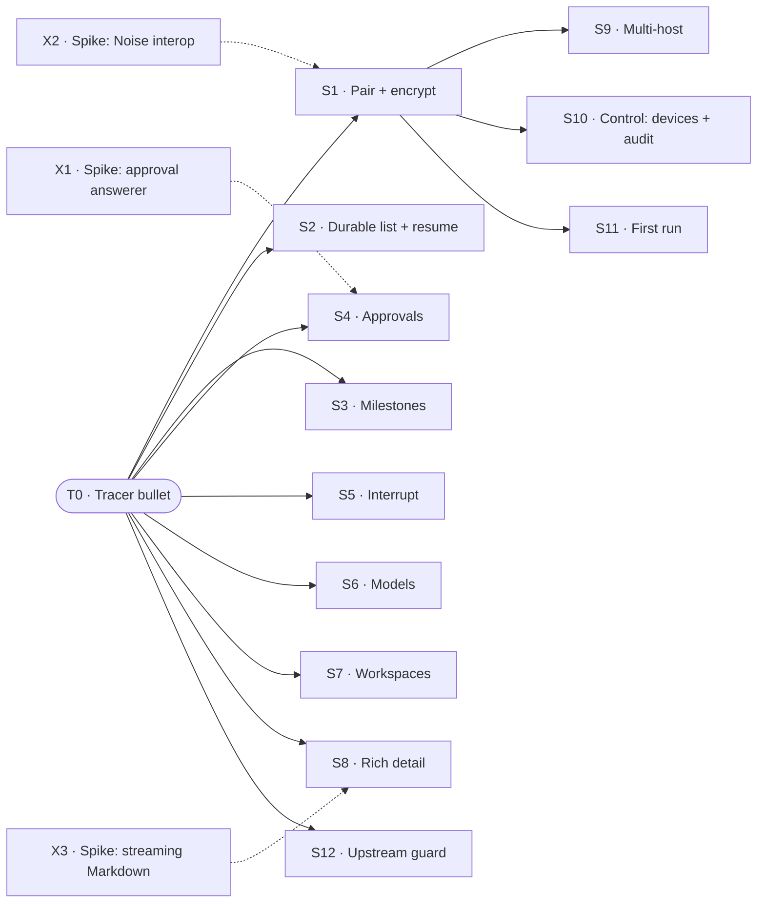

# PLAN

How we get from the Xcode template to M1, tracer-bullet style. Product intent: [STORY.md](STORY.md). Technical design: [ARCHITECTURE.md](ARCHITECTURE.md). This file is a working doc: when M1 exits, archive it to `.archive/YYYYMMDD/plan-m1.md` and write the next one.

## 1. Approach

**Tracer bullet first.** Before any feature is built properly, fire one thin round trip through *every* layer of the real architecture: SwiftUI → `HostConnection` → `SecureChannel` → WebSocket → protobuf `Frame` → bridge plugin → DSH session → and back. It's thin but it's production code, not a throwaway prototype. Everything after it thickens that path.

**Then slices that are almost independent and stand alone.** Each slice after the tracer:

- is **vertical**: it touches protocol + bridge + app + tests, and has a demo you can do on its own;
- **depends on the tracer (T0) and nothing else**, unless a dependency is named explicitly (at most one, where possible);
- can be built, reviewed, merged, and dropped **in any order** relative to its siblings.

### How slices stay independent

| Rule | Mechanism |
|---|---|
| Own files | Each slice gets `protocol/<slice>.proto`, `ios/…/Features/<Slice>/`, `bridge/src/<slice>/`. Shared files (`frame.proto`, app root, plugin entry) only get a one-line registration. |
| No field-number collisions | `Request` / `Event` oneofs reserve **20 field numbers per slice** (T0: 1–19, S1: 20–39, S2: 40–59, …). Parallel branches never fight over tags. |
| Ship in any order | Each slice advertises a **capability string** in `Hello.capabilities` (e.g. `approvals.v1`). The app hides UI for capabilities the bridge lacks. This is the same mechanism that later handles bridge N / N-1. |
| Test alone | Fakes at every boundary: **`FakeBridge`** (Swift, in-process) for app tests and previews; **`FakeDSH`** (TS) for bridge tests. No slice needs a neighbor slice or a real DSH to pass CI. |
| Cross-language truth | `protocol/fixtures/` holds golden encoded frames. Swift and TS tests both decode/encode them, so the two sides can't drift. |
| Seams | When two slices meet (e.g. resume × approvals), **the slice that lands second owns the seam** and lists it in its "Done when". |

**Done** for any slice = merged to `main`, demo passes on Simulator (and on device once S1 lands), tests green, ARCHITECTURE.md updated if a decision changed (AGENTS.md: code is truth).

## 2. Map

Solid = must land first. Dotted = spike result must exist first (a written conclusion, not code). Spikes depend on nothing and can start today, in parallel with T0.

## 3. T0 · Tracer bullet

> Type one sentence in the iOS Simulator; text streams back from a DSH agent running on the same Mac.

**Cuts through**
- `ios/`: move the Xcode project here. One screen: text field, send button, streaming text. `@Observable` store, in-memory only. One `HostConnection` actor, address hardcoded to `127.0.0.1:<port>`. `SecureChannel` protocol with a single `PlaintextChannel` implementation that **refuses any non-loopback address**.
- `protocol/`: `frame.proto` with `Frame { oneof { Request, Response, Event } }`, `Hello { protocol_version, capabilities }`, `CreateTask { prompt }` → `TaskCreated { task_id }`, events `AssistantChunk { task_id, seq, text }`, `TaskEnded { task_id, status }`. Codegen script for Swift + TS. First golden fixtures.
- `bridge/`: Cordis plugin that opens its own WebSocket listener on loopback, speaks the frame protocol through the same plaintext channel, maps `CreateTask` to a DSH session + prompt (DSH's default model and a fixed cwd), and forwards assistant text.
- Tests: fixture round trip in Swift and TS; bridge test against `FakeDSH`; app store test against `FakeBridge`.

**Done when**
- The demo above works against a real DSH `v0.2.2-rc.1`.
- Spike risk 2 (plugin listener + how a user installs the plugin) is answered and the install steps are written in `bridge/README.md`.
- Toolchain choices (codegen tool, whether generated code is committed, bridge package manager, Swift package layout) are recorded in ARCHITECTURE.md.

**Not in T0**: pairing, encryption, persistence, reconnect, milestones, approvals (DSH fails closed on any approval, which is fine; use read-only prompts), model or workspace choice, real device.

## 4. Spikes

Each spike ends in a short written conclusion (a working note, archived once acted on), plus throwaway code if needed. None of them blocks T0.

| | Question | Unblocks | Exit |
|---|---|---|---|
| **X1** | Can a plugin answerer own approvals for **all** agents? How does it order against web/desktop answerers, and does the web UI still see a held request? (ARCHITECTURE §8.1) | S4 | Minimal plugin that parks one approval and releases it from a script; ordering behavior written down. |
| **X2** | Do a CryptoKit Swift Noise implementation and a TS `@noble/*` one interoperate? Which pattern (likely `IK` with the host static key from the QR)? (§8.3) | S1 | Both pass the official Noise test vectors and complete a handshake against each other in a test. |
| **X3** | Which Markdown path survives incremental rendering of long streaming transcripts? (§8.5) | S8 | Benchmark of 2–3 candidates on a 5k-line transcript on a real device; choice recorded in ARCHITECTURE D10. |

## 5. M1 slices

Each slice needs only T0, unless "Needs" says otherwise.

### S1 · Pair + encrypt
- **Why**: principle 6 (anyone can pair) and D6 (every transport is untrusted). This slice unlocks the real device.
- **Cuts**: bridge shows a QR (terminal first, DSH UI later) with address(es), host static key, one-time secret · app scanner + `NoiseChannel: SecureChannel` · device identity key (Secure Enclave) + Noise static key (Keychain) · bridge device registry (store only, no UI).
- **Demo**: a fresh iPhone scans the QR and runs the T0 demo over Wi-Fi or Tailscale. A packet capture shows only ciphertext.
- **Done when**: `PlaintextChannel` is debug-only, loopback-only; a reused or expired pairing secret is rejected.
- **Needs**: T0, X2.

### S2 · Durable list + resume
- **Why**: principle 4 (unified list; nothing lost across disconnects), D9.
- **Cuts**: bridge per-host monotonic `seq` + event log · `Resume { after_seq }` · `ListTasks` · app SwiftData models, unified task list (running / waiting on me / done), reconnect with backoff, refresh on foreground · offline host named explicitly (principle 3).
- **Demo**: start a task, kill the app, wait, reopen. The list and transcript are intact, and the gap is filled from the bridge.
- **Seams it owns if it lands second**: replay of pending approvals (S4), cached milestones (S3).

### S3 · Milestones
- **Why**: principle 4 (milestone summary by default, details on demand), D11.
- **Cuts**: bridge mapper DSH `todos` / `plan` / `state` / errors → `MilestoneAdded` · app task card showing the current milestone, detail view showing the milestone timeline.
- **Demo**: a multi-step prompt shows its todos ticking off on the card without opening the transcript.
- **Not**: summarizing with a model (never; D11).

### S4 · Approvals (in-app, held)
- **Why**: principle 5. Approvals pause and never default-allow. ARCHITECTURE §5.4.
- **Cuts**: bridge answerer on `approval/request` that parks requests, joins by `callId` with the streamed tool call for a basic impact view (tool, command / files / args), times out → cancel + `ApprovalResolved(timeout)`, writes an audit record · `ApprovalPending`, `AnswerApproval`, `ApprovalResolved` · app approval card in the list and in the detail view.
- **Demo**: prompt "delete `/tmp/x`". The phone shows the exact command, you deny it, and the task continues without running it. Repeat with the app closed: the request waits, and when you reopen the app it's there.
- **Needs**: T0, X1.
- **Not**: risk tiers, Face ID, push (M2).

### S5 · Interrupt
- **Why**: "随时打断" (interrupt at any time) in STORY.
- **Cuts**: `Interrupt { task_id }` → DSH interrupt · app stop button in the detail view; task status `interrupted`.
- **Demo**: interrupt a long-running task; it stops within a few seconds and the card says so.

### S6 · Models
- **Why**: principle 8. The host provides the list, names are shown as given, there's no silent substitution, and you can switch mid-task.
- **Cuts**: `ModelCatalog` / `SelectModel` passthrough of `session/modelCatalog` / `session/selectModel` · composer model + effort picker defaulting to the host's default · mid-task switch in the detail view · explicit error when the chosen model is unavailable.
- **Demo**: start on low effort, raise it mid-task, and see the switch recorded in the transcript.

### S7 · Workspaces
- **Why**: D12 (DSH sessions need a cwd).
- **Cuts**: `ListWorkspaces` (per-host default + recents) · `CreateTask.workspace` · composer picker.
- **Demo**: run the same prompt in two different repos and get correct, different answers.
- **Not**: inferring the workspace from the prompt.

### S8 · Rich detail
- **Why**: D1 (native streaming detail), D13 (quick answers inline).
- **Cuts**: native rendering of Markdown, code, diffs, and terminal output in the transcript, incremental while streaming · short tasks rendered inline as an answer, not as a task page.
- **Demo**: a coding task's diff and test output read well on a phone. "Translate this sentence" just shows the answer.
- **Needs**: T0, X3.

### S9 · Multi-host
- **Why**: principles 1–3 (one phone, many hosts, all hosts treated the same, smart default).
- **Cuts**: pair a second host · host attribute on tasks · composer host picker (default: last used; prompt-based guess later) · per-host `HostConnection` · "all hosts offline" names each machine.
- **Demo**: two Macs, tasks from both in one list; take one offline and it's named.
- **Needs**: S1. **Seam**: if S2 has landed, the unified list spans hosts.

### S10 · Control: devices + audit
- **Why**: principle 9.
- **Cuts**: `ListDevices` / `RevokeDevice` · app host + device management screen · audit view (who, when, which device, what) for approvals and pairing.
- **Demo**: revoke the phone from a second device; its next connection is refused.
- **Needs**: S1. **Seam**: the audit view covers approvals if S4 has landed.

### S11 · First run
- **Why**: principle 6 (with no host paired, the app explains what it is and what's missing).
- **Cuts**: empty state → pairing guide → first task suggestion.
- **Demo**: someone who has never seen DSH gets from install to their first answer without help, given a DSH that's already running.
- **Needs**: S1.

### S12 · Upstream guard
- **Why**: ARCHITECTURE §8.4 (upstream churn).
- **Cuts**: supported DSH version range pinned in the bridge and reported in `Hello` · CI: bridge tests against the pinned DSH and a non-blocking job against DSH `main`.
- **Demo**: point the bridge at an unsupported DSH; the app shows "host needs bridge update" instead of breaking.

## 6. M1 exit

From a real iPhone over Tailscale, against a home Mac:

1. Pair by scanning a QR (S1).
2. "Fix the failing CI test in `<repo>`, open a PR", with workspace and model picked (S6, S7).
3. Watch milestones tick (S3); open the detail view and read the diff (S8).
4. Approve the `git push` from an approval card showing the exact command (S4).
5. Raise reasoning effort mid-task (S6). Kill the app, reopen, and find nothing lost (S2).
6. Get the PR link in the result.

When this passes, archive this file and plan M2 the same way.

## 7. After M1 (coarse, re-slice when we get there)

| Milestone | Candidate slices | Gate |
|---|---|---|
| M2 | Push via `PushSender` → APNs · risk tiers + Face ID for the top tier · plan alignment + pre-authorization · pause timeout + re-confirm on resume | Paid Apple account |
| M3 | Quick Look + share-out · Share Extension + attachment upload · photos as context | Verify App Groups on the signing team first |
| M4 | Live Activities / Dynamic Island · voice entry · relay `Transport` | Relay design note |
