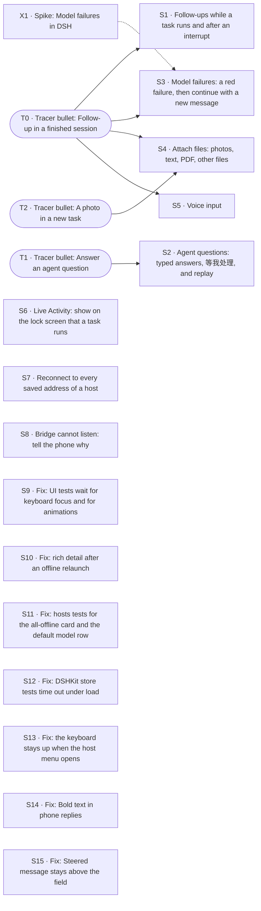

# PLAN · M2 · dsh-mobile第二阶段

M2 · dsh-mobile第二阶段. Product intent: [STORY.md](STORY.md). Technical design: [ARCHITECTURE.md](ARCHITECTURE.md). Process: [WORKFLOW.md](WORKFLOW.md).

This file exists only while this requirement is in progress. It serves this requirement only: ideas and work it does not do are GitHub issues (§7). When the exit (§6) passes, the user deletes this file and `evidence/`, and tags the commit; git keeps the history. `scripts/plan new` wrote this file; change it with `scripts/plan` (WORKFLOW.md §3.1).

## How to use this file

**Process rules** live in [WORKFLOW.md](WORKFLOW.md): set up a Mac, roles and ownership (who writes §0, §8, §9, and each slice section), start and stop a work session, the long-horizon run, resources for each slice, status titles, session settings, default choices, merging a slice, and what stays with the user. Read it before you pick up work. This section keeps only the format of this file and the rules for Done when items.

**Slice fields**, always in this order. Write "—" for an empty field; never drop one.
`Status · Needs · Branch` on one line, then **Why**, **Cuts**, **Demo**, **Done when**, **Not**, **Log**.
- **Status** is one of `todo` / `doing` / `blocked` / `review` / `done`. The slice owner sets it on the branch; the coordinating session brings §0 in line.
- **Log** is append-only and dated: done, not done, next step, and anything learned along the way. Technical decisions go into ARCHITECTURE.md as a `Dxx` entry; the Log just says "see Dxx".

**Done when items** are checkboxes: `- [ ] [tier] description — Evidence: …`
- **Tiers**
  - `[auto]`: unit or integration test against `FakeBridge`, `FakeDSH`, or golden fixtures. Evidence: `test:` pointers, green in CI or a script.
  - `[ui]`: verified in the Simulator, preferably by XCUITest (`test:`), otherwise by an agent driving it through `scripts/demo/<slice>.sh` (`cmd:`). Add a `shot:` as a snapshot for people. Before the slice is marked `done`, a review subagent that didn't take part in development reruns every `[ui]` item.
  - `[human]`: real device, camera, packet capture, subjective experience, or a decision only the user can judge. **Only the user ticks these.** An agent never does.
- **Edit rules**: you may only tick `[ ]` → `[x]` or add new items. Never delete, reword, re-tier, untick, or move an item. Agents add items unticked and tick them in a later edit. If an item truly has to change, explain the original text, the new text, and the reason to the user in the conversation first, and let the user make the edit.
- **Evidence** on a ticked item is one or more typed pointers separated by ` · `. Each one must resolve, otherwise check-plan fails; unknown types fail too.

  | Pointer | Resolves when |
  |---|---|
  | `test:<Name>` | the name appears in Swift/TS test sources (`Suite/name` = both parts in one file) |
  | `cmd:<path> [args]` | the repo-relative path exists and is executable, e.g. `cmd:scripts/demo/t0.sh` |
  | `commit:<hash>` | `git cat-file -e <hash>^{commit}` succeeds |
  | `shot:<path>` | the file exists under `evidence/<slice ID>/` |
  | `human:<YYYY-MM-DD> <device or note>` | `[human]` items only, e.g. `human:2026-11-20 iPhone 16, PR link …` |

  The real evidence is something re-runnable: a test or `scripts/demo/<slice>.sh`. Screenshots are only snapshots for people:
  - Scale them to about 1/3 size and save as compressed PNG, a few hundred KB each.
  - Commit them under `evidence/<slice ID>/`.
  - Recordings stay out of git. If one is really needed, the user attaches it to the PR and the item cites it as `human:` plus the PR link.
  - When the plan ends, `evidence/` is deleted with this file; git keeps both.
- **Enforcement**: `scripts/check-plan` runs from the git pre-commit hook (`.githooks/`) and from a Claude Code PreToolUse hook (`.claude/settings.json`). Edits to the guard files themselves (`scripts/check-plan`, `.githooks/`, `.claude/hooks/`, `.claude/settings.json`) ask the user first, and only the user commits them. Never use `git commit --no-verify` or any other way around them.

## 0. Status

| ID | Status | Branch/PR | Updated | Next action |
|---|---|---|---|---|
| T0 | done | merged `71577b2` | 2026-11-08 | — (provisional D89 in §9) |
| T1 | done | merged `8f55a72` | 2026-11-08 | — (provisional D92 in §9) |
| T2 | done | merged `1762164` | 2026-11-08 | — (provisional D95 in §9) |
| X1 | done | merged `9d4cb67` | 2026-11-08 | — (provisional D104 in §9) |
| S1 | done | merged `55300a7` | 2026-11-09 | — (provisional D101, D102 in §9) |
| S2 | done | merged `966be4b` | 2026-11-09 | — (provisional D113, D114 in §9) |
| S3 | done | merged `33e96ff` | 2026-11-09 | — (provisional D110 in §9) |
| S4 | done | merged `83c82ce` | 2026-11-09 | — (provisional D107, D108 in §9) |
| S5 | done | merged `5362e43` | 2026-11-09 | — (provisional D116, D117 in §9) |
| S6 | review | merged `b4d0a65` | 2026-11-09 | User accepts 1 `[human]` item (§9) |
| S7 | done | merged `1978046` | 2026-11-08 | — (provisional D98 in §9) |
| S8 | done | merged `b62405c` | 2026-11-09 | — (provisional D125 in §9) |
| S9 | done | merged `4a4dbf9` | 2026-11-09 | — (provisional D128, D129 in §9) |
| S10 | done | merged `f333abc` | 2026-11-09 | — |
| S11 | done | merged `87cd8da` | 2026-11-09 | — (provisional D134 in §9) |
| S12 | done | merged `2574d2f` | 2026-11-09 | — |
| S13 | done | merged `adedb03` | 2026-11-09 | — |
| S14 | todo | — | 2026-11-09 | Fix: Bold text in phone replies; start a fix session |
| S15 | todo | — | 2026-11-09 | Fix: Steered message stays above the field; start a fix session |

## 1. Approach

**Tracer bullet first.** Before any feature is built properly, fire one thin round trip through *every* layer that the requirement touches. It is thin, but it is production code, not a throwaway prototype. Everything after it thickens that path.

**Then slices that are almost independent and stand alone.** Each slice after the tracer:

- is **vertical**: it touches protocol + bridge + app + tests, and has a demo you can do on its own;
- **depends on the tracer and nothing else**, unless a dependency is named explicitly (at most one, where possible);
- can be built, reviewed, merged, and dropped **in any order** relative to its siblings.

### How slices stay independent

| Rule | Mechanism |
|---|---|
| Own files | Each slice gets its own feature files (`protocol/<feature>.proto`, `ios/…/Features/<Feature>/`, `bridge/src/<feature>/`), named after the feature, never after the slice ID: code outlives this plan. Shared files (`frame.proto`, app root, plugin entry) only get a one-line registration. |
| No field-number collisions | Each slice reserves a block of 20 field numbers in the `Request` / `Event` oneofs: the next free block after the highest number in `frame.proto`. Write the block in the slice's Cuts. |
| Ship in any order | Each slice advertises a **capability string** in `Hello.capabilities` (e.g. `approvals.v1`). The app hides UI for capabilities the bridge lacks. |
| Test alone | Fakes at every boundary: **`FakeBridge`** (Swift, in-process) for app tests and previews; **`FakeDSH`** (TS) for bridge tests. No slice needs a neighbor slice or a real DSH to pass CI. |
| Cross-language truth | `protocol/fixtures/` holds golden encoded frames. Swift and TS tests both decode/encode them, so the two sides can't drift. |
| Seams | When two slices meet, **the slice that lands second owns the seam** and adds it to its Done when. |

**Done** for any slice = every Done when item ticked with evidence, merged to `main`, ARCHITECTURE.md updated if a decision changed (AGENTS.md: code is truth).

Requirement-specific notes: —

## 2. Map

`scripts/plan` writes this map from the **Needs** of each tracer, spike and slice. Do not edit it.

## 3. Tracer bullets

A tracer is one thin round trip that one session can finish without running out of context: at most 3 Done when items (`scripts/plan` stops more). Prefer `[auto]` and `[ui]` items; use `[human]` only for what only a real device can show. If a tracer needs more, split it into more tracers.

### T0 · Tracer bullet: Follow-up in a finished session

**Status** review · **Needs** — · **Branch** —

**Why**: Part of #1. Today the phone sends one message per task and then takes no more input (user, 2026-11-08: "现在我只能发一条消息，然后就不给发了，不是连续的agent loop"). The thinnest round trip of a continuous conversation: one more message into the same DSH session after the task is done.

**Cuts**
- `protocol/conversation.proto`: `SendMessage { task_id, mode, text }` → `MessageAccepted`. Field block 360–379. Capability `conversation.v1`.
- Bridge `bridge/src/conversation/`: `sessionController.prompt` on the DSH session of the task (D18). The new turn streams under the same task ID (`AssistantChunk`, `TaskEnded`, the S2 host log).
- App: the session composer takes text when the task is completed and the host has `conversation.v1`. The user bubble and the reply go under the first answer on the same page. Without the capability, the composer stays as it is.
- ARCHITECTURE D18 amended; DESIGN 04 caption.

**Demo**: `scripts/demo/followup.sh` (feature name: `t0.sh` is the M1 baseline). Finish a task, send a follow-up from its page, see the second reply under the first, on the phone and in the same session on DSH web.

**Done when**
- [x] [auto] The bridge sends a `SendMessage` for a completed task into the same DSH session, and the new turn streams under the same task ID (`FakeDSH`) — Evidence: test:FollowUpAgainstFakeDSH/aFollowUpOnACompletedTaskStreamsTheNextTurnUnderTheSameTaskID · test:FollowUpAgainstFakeDSH/resumeReplaysTheWholeConversationInOrder · cmd:scripts/demo/followup.sh
- [x] [auto] DSHKit: a follow-up on a completed task adds the user message, sets the task to running, and adds the reply after the first answer; a reconnect replays the same transcript (`FakeBridge`) — Evidence: test:FollowUpTests/followUpOnACompletedTaskAddsTheMessageRunsAndAppendsTheReply · test:FollowUpTests/aReconnectReplaysTheSameTranscript · test:FollowUpTests/killAndReopenDuringTheFollowUpFillsTheGapOnce · cmd:scripts/demo/followup.sh
- [x] [ui] On a completed session page, send a follow-up: the reply streams into the same page, against real DSH with the mock model (`cmd:scripts/demo/followup.sh`) — Evidence: cmd:scripts/demo/followup.sh · test:FollowUpUITests/testFollowUpInAFinishedSessionAgainstRealDSH · shot:evidence/T0/followup-streaming.png · shot:evidence/T0/followup-done.png

**Not**: Follow-ups while the task runs, or after a failure or an interrupt (S1, S3). Attachments (T2). Agent questions (T1).

**Log**: —
- **2026-11-08 · built; all [auto]/[ui] ticked, review next.** Done: conversation.v1 (protocol/conversation.proto: SendMessage, MessageAccepted, UserMessage; Event/Request/Response 360). Bridge TaskHub.sendMessage + DshTasks.followUp prompt the task's DSH session with mode steer; the turn streams under the same task ID, chunk seq goes on, a logged UserMessage puts the bubble in place and Resume replays it. App: the session composer takes text on a completed task (TaskListStore.canFollowUp/sendFollowUp); the bubble and reply go under the first answer. Demo scripts/demo/followup.sh (real DSH Web + mock LLM; followup-host.mjs checks DSH has both messages in one session). See D89 (provisional) and the D18 amendment. No new dependencies. Learned: the page drew every journal user message as a top bubble, so the follow-up showed twice once the journal loaded; fixed (only the first prompt on top when the page uses the streamed transcript). The mock model at 60 ms/chunk ends a turn in about 1.4 s, so the UI test missed RUNNING; the demo host uses 400 ms/chunk. Flaky: under load (load average 100-190 with T1/T2 running) swift test can time out in S16CodingTaskTests and TaskListStoreTests waits (5 s), also on main; they pass alone. Not done (later slices): the milestone bar keeps the first turn's last step (完成) while a follow-up turn runs, because follow-up turns add no milestones; follow-ups while running or after a failure/stop (S1, S3); follow-ups in sessions from other clients. Next: reviewer runs scripts/review T0.

### T1 · Tracer bullet: Answer an agent question

**Status** review · **Needs** — · **Branch** —

**Why**: Part of #1. STORY §4 and §5: a question from the agent is a decision, like an approval. The task waits and the phone answers. The thinnest round trip: one question with options, answered with one tap (screen P1).

**Cuts**
- `protocol/questions.proto`: `QuestionPending` event, `AnswerQuestion` request → `QuestionResolved`. Field block 380–399. Capability `questions.v1`.
- Bridge `bridge/src/questions/`: a prepended answerer on `user-questions/request` holds the request and fans a copy out to the web; the first answer wins (D17, D18).
- App: the P1 card in the transcript with one chip per option. A tap answers; the card then shows the answer.
- DESIGN P1 tag: built.

**Demo**: `scripts/demo/questions.sh`: a task asks which of two templates to use; tap one; the task continues with that answer.

**Done when**
- [x] [auto] The bridge holds a `user-questions/request`, sends `QuestionPending` with the text and options of DSH, and answers DSH with the chosen option; an answer from the web withdraws the card (`FakeDSH`) — Evidence: test:Questions/bridgeHoldsQuestionSendsPendingAndAnswersDshWithTheChosenOption · test:Questions/answerFromTheWebWithdrawsTheCard · test:Questions/noOtherAnswererKeepsTheQuestionHeldAndInterruptCancelsIt
- [x] [ui] The P1 card shows the question and its options; a tap on an option answers it and the task continues, against real DSH with the mock model (`cmd:scripts/demo/questions.sh`) — Evidence: test:AgentQuestionUITests/testTapAnOptionAnswersAndTheTaskContinues · cmd:scripts/demo/questions.sh · shot:evidence/T1/questions-pending.png · shot:evidence/T1/questions-answered.png

**Not**: Typed and multi-select answers, 等我处理 and the drawer badge, replay after a reconnect (S2).

**Log**: —
- **2026-11-08 · Built; review PASS.** Done: questions.v1 end to end. protocol/questions.proto (QuestionPending, AnswerQuestion, QuestionResolved; fields 380–399). Bridge QuestionHolder: prepended user-questions/request answerer, holds for the phone, fans a copy out to DSH Web, first answer wins, no timeout, interrupt cancels; the ask_user_question tool row is hidden (the card replaces it). App: P1 card as a .question transcript row; a tap answers; the card then shows the answer. FakeDSH asks through a question waterfall (bridge/test/questions.test.ts). Demo scripts/demo/questions.sh on real DSH + mock model; shots in evidence/T1/. DESIGN P1 tag: M2 · 已有.
  Review: /tmp/dshm-review/T1-5012584.txt RESULT: PASS (full run). No flaky parts.
  Provisional: D92 (agent questions holder, wire, no timeout). No new dependencies.
  Notes for §8: (1) no script creates the dshm-<ID> simulator; T1 made dshm-T1 by hand (simctl create, iPhone 17 Pro, iOS 26.4). (2) scripts/review --resume cannot pass a test: pointer whose demo part it skips: the skipped part's output is not in the new log (T1-5012584 failed that way before the full run passed). (3) scripts/demo/t0.sh writes logs to a fixed /tmp/dshm-t0, so parallel slices overwrite each other's logs.
  Not done: typed and multi-select answers, 等我处理 and the drawer badge, pending questions in TaskSummary for replay after a trimmed log (slice Not).
  Next: coordinator merge.

### T2 · Tracer bullet: A photo in a new task

**Status** todo · **Needs** — · **Branch** —

**Why**: Part of #2. A file larger than one Noise message (65535 bytes, D21) must go to the host in parts and reach DSH as a prompt part. The thinnest round trip: one photo attached to a new task.

**Cuts**
- `protocol/attachments.proto`: `UploadBegin` / `UploadChunk` / `UploadEnd` → `UploadStaged { upload_id }`; `CreateTask` carries upload IDs. Field block 400–419. Capability `attachments.v1`.
- Bridge `bridge/src/attachments/`: put the parts together, check the size and the hash, stage the file through `ctx.fileUploads`, and give it to the first prompt as an image part (D18).
- App: a photo key on composer 01 (`PhotosPicker`), one thumbnail chip, upload before `CreateTask`. The user bubble shows the thumbnail.
- A new Dxx: part size, size limit, hash.

**Demo**: `scripts/demo/attachments.sh`: attach a photo, send a task; the DSH session has the image.

**Done when**
- [x] [auto] A file of several Noise messages arrives byte-identical, is staged through `fileUploads`, and goes into the first prompt as an image part; a wrong hash or a missing part is refused (`FakeDSH`, a golden fixture that the Swift and TS tests both read) — Evidence: test:Attachments/photoOfSeveralNoiseMessagesArrivesByteIdenticalAndEntersTheFirstPromptAsAnImage · test:Attachments/wrongHashIsRefusedAndNothingIsStaged · test:Attachments/missingPartIsRefused · test:Attachments/goldenPhotoSplitsIntoTheFixtureParts · test:AttachmentsTests/goldenPhotoSplitsIntoTheFixtureParts · test:AttachmentsTests/photoGoesUpInPartsBeforeTheTaskAndTheRowKeepsItsThumbnail · test:AttachmentsTests/wrongHashAndMissingPartAreRefused
- [x] [ui] Attach one photo on 01 and send: the user bubble shows its thumbnail and the DSH session has the image, against real DSH with the mock model (`cmd:scripts/demo/attachments.sh`) — Evidence: cmd:scripts/demo/attachments.sh · test:AttachmentsUITests/testAttachOnePhotoAndSend · shot:evidence/T2/attachments-composer.png · shot:evidence/T2/attachments-session.png

**Not**: Files that are not photos, more than one attachment, attachments in follow-ups (S4).

**Log**: —
- **2026-11-08 · Built; review PASS at 0752a3d.** Done: both items ticked. Protocol `protocol/attachments.proto` (UploadBegin/Chunk/End → UploadAck/UploadStaged, `CreateTask.upload_ids`; field block 400–402, one registration line per oneof in frame.proto: expect a one-line conflict with T0/T1 at merge). Bridge `bridge/src/attachments/staging.ts`: parts in order, size + SHA-256 checked, per-connection staging; `DshTasks.start` stages each photo with `fileUploads.uploadImageStream` and prompts `[text, {type:'file', receiptId}]`; `fileUploads` added to the plugin's `inject`. App: photo key (PhotosPicker) on 01, one chip, upload before CreateTask, thumbnail in the user bubble (`CachedTask.photoThumbnail`). Golden photo `protocol/fixtures/attachments/` (generated, 3 parts) read by TS and Swift tests; 7 golden frames added. Design board 01 + DESIGN.md updated.
  Review: `scripts/review T2` by a separate reviewer → RESULT: PASS, /tmp/dshm-review/T2-0752a3d.txt, no flaky parts.
  Provisional: D95 (part size 48 KiB, 20 MiB limit, SHA-256, JPEG ≤2048 px, per-connection staging). No new dependencies.
  Notes: the slice simulator dshm-T2 did not exist; I created it (iPhone 17 Pro, iOS 26.4). The first T0 baseline failed only because it raced with my proto edit; re-run passed. The picker's photo cells report "not hittable" to XCUITest; the test taps the cell centre and finds it by the locale-free id `PXGGridLayout-Info`. DSH session logs are multi-frame zstd; node's zstdDecompressSync reads one frame, so the check splits frames.
  Not done (out of scope): files that are not photos, more than one attachment, attachments in follow-ups. No §0 change needed.
- **2026-11-08 · Merged main twice (T1, T0); review PASS at 0f0bbc8, one flaky part.** Merged main into the branch twice at the coordinator's request: af1c314 (T1 agent questions) and 0f0bbc8 (T0 follow-ups). Kept both sides everywhere: questions.v1 (380–399, D92), conversation.v1 (360–379, D89) and attachments.v1 (400–419, D95); generated code regenerated with scripts/codegen; FakeDSH and FakeHost keep every side's recorders; the design board re-rendered from the merged board.html. Bridge tests 83 pass, swift test 108 pass. The review of af1c314 was stopped, unfinished, once main took T0.
  Review: full `scripts/review T2` by a separate reviewer at 0f0bbc8 → RESULT: PASS, /tmp/dshm-review/T2-0f0bbc8.txt.
  Flaky: attachments-ui passed on run 2 of 3. Run 1 failed at AttachmentsUITests.swift:23: the system photo picker (out of process) did not show its grid cell `PXGGridLayout-Info` within 15 s after the photo key was tapped. Run 2 passed, and the DSH session check found the photo. Likely cause: the picker is slow on its first open in a fresh app install. Not repaired in this round; a possible repair is a longer wait for the first grid cell.

## 4. Spikes

Each spike ends in a short written conclusion, plus throwaway code if needed. None of them blocks the tracer.

### X1 · Spike: Model failures in DSH

**Status** review · **Needs** — · **Branch** —

**Why**: For #4 (S3). What does DSH 0.2.2-rc.1 send when the model of a running task is unavailable, its key is not valid, or the account has no balance (DeepSeek answers 402 "Insufficient Balance")? Does DSH retry, pause, or end the turn, and with which text? Can the mock LLM of DSH, or a small fake provider, make each case for tests?

**Cuts**: A throwaway script in `spikes/model-failures/` against real DSH with a fake provider. The conclusion goes in its README. The events that it records become fixtures for the bridge test of S3.

**Demo**: —

**Done when**
- [x] [auto] A script runs one task against real DSH for each failure (model not found, key not valid, no balance, rate limit) and records the events and the text that DSH sends — Evidence: cmd:spikes/model-failures/run.sh · commit:5198f68
- [x] [auto] The README says for each failure whether DSH retries, pauses or ends the turn, and which text the phone can show; the recorded events are fixtures that S3 can replay — Evidence: commit:5198f68

**Not**: Production code.

**Log**: —
- **2026-11-08 · Spike done: model failures end the turn, rate limit retries first.** Done:
  - spikes/model-failures/run.sh runs one task against real DSH 0.2.2-rc.1 per failure, with a fake DeepSeek provider (fake-provider.mjs), and records every sessionController.follow frame into spikes/model-failures/fixtures/<case>.json (10 cases, incl. 3 from DSH's mock LLM).
  - Finding: DSH never pauses. Every failure ends the turn with turn/end reason {kind: error, error: {message, code, status}}: 404 → HTTP_404, 400 → INVALID_REQUEST, 401 → AUTH, 402 → QUOTA, at once. 429 → RATE_LIMIT after 5 retries in the same turn (llm/retry events, ~16 s; Retry-After is honored). An unlisted model is refused by selectModel (session/model-unavailable) before any turn. A new message after the failure runs turn 2 normally.
  - D104 (provisional, pending user confirmation): bridge forwards code + message; the app shows its own copy for AUTH and QUOTA, DSH's message otherwise.
  - No new dependencies.
  Not done: real DeepSeek wording (the bodies follow DeepSeek's documented error codes); failures mid-task; DeepSeek account sign-in route.
  Next: S3 copies the fixtures it replays into bridge/test/fixtures/model-failures/ and carries code to the app.

## 5. Slices

Each slice needs only the tracer, unless "Needs" says otherwise.

### S1 · Follow-ups while a task runs and after an interrupt

**Status** review · **Needs** T0 · **Branch** —

**Why**: Part of #1. STORY §7: "任务进行中也能补充：追加一句话…纠正方向，不必打断重来". The user, 2026-11-08: "参考codex、claude，用户发送后，先排队，但给定"立即发送"/steer的标识，用户点击后直接发送". This changes the default of D18 from steer to queue.

**Cuts**
- A follow-up sent while the task runs is queued by default (`SendMessage` mode `QUEUE`, the next turn). It shows as a queued message above the composer, as in the Codex and Claude apps, with a "立即发送" (steer) action and a remove action.
- "立即发送" moves it into the current turn (steer): it goes in at the next step. How (the queue-edit methods of `sessionController`, or remove and prompt again with `steer`; X4 did not try them) is a provisional Dxx. A queued message that the turn reaches by itself runs as the next turn.
- The queue survives a reconnect (the S2 replay or `sessionController.state().queue`). The transcript shows each follow-up where DSH takes it.
- The session composer is a text field while the stop key shows (screen 04). ARCHITECTURE D18 (default: queue, with send-now to steer) and the DESIGN 04 caption and board change with it.
- After an interrupt, a new message continues the same session (X1 card: "在原会话里接着说"). DESIGN X1 caption.

**Demo**: `scripts/demo/followup.sh --running`: while a task runs, send a follow-up; it waits as queued; tap 立即发送 on a second one; the next step answers it. Interrupt, then continue.

**Done when**
- [x] [auto] A follow-up on a running session is queued and runs as the next turn; send-now moves a queued message into the current turn at its next step; remove takes it out; the queue and the order stay the same after a reconnect (`FakeDSH`, `FakeBridge`) — Evidence: test:FollowUpQueueAgainstFakeDSH/aFollowUpWhileTheTaskRunsIsQueuedAndRunsAsTheNextTurn · test:FollowUpQueueAgainstFakeDSH/sendNowMovesAQueuedMessageIntoTheCurrentTurnAtItsNextStep · test:FollowUpQueueAgainstFakeDSH/removeTakesAQueuedMessageOut · test:FollowUpQueueAgainstFakeDSH/theQueueAndItsOrderStayTheSameAfterAReconnect · test:FollowUpQueueTests/aFollowUpWhileTheTaskRunsWaitsAndRunsAsTheNextTurn · test:FollowUpQueueTests/sendNowMovesAQueuedMessageIntoTheTurnAndRemoveTakesOneOut · test:FollowUpQueueTests/theQueueAndItsOrderStayTheSameAfterAReconnect
- [x] [ui] While a task runs, send a follow-up: it shows as queued above the composer and runs after the turn; tap 立即发送 on another one: the next step of the agent answers it, and the stop key stays (`cmd:scripts/demo/followup.sh`) — Evidence: cmd:scripts/demo/followup.sh --running · test:FollowUpQueueUITests/testFollowUpsWhileATaskRunsAgainstRealDSH · shot:evidence/S1/followup-queued.png · shot:evidence/S1/followup-steered.png · shot:evidence/S1/followup-queue-done.png
- [x] [ui] After an interrupt, send a new message in the same session: the task runs again and the interrupted card goes (`cmd:scripts/demo/followup.sh`) — Evidence: cmd:scripts/demo/followup.sh --running · test:FollowUpQueueUITests/testContinueAfterAnInterruptAgainstRealDSH · shot:evidence/S1/followup-interrupted.png · shot:evidence/S1/followup-continued.png

**Not**: Attachments in follow-ups (S4). A failed task (S3). Editing the text of a queued message.

**Log**: —
- **2026-11-09 · Built; review PASS at ff68333.** Done: all three items ticked. Protocol: conversation.v2 in protocol/conversation.proto (QueuedMessage event, EditQueue request, QueueEdited response). Field 361 is in the existing conversation block 360–379, not a new block of 20: one registration on each existing conversation line of frame.proto. Bridge: a follow-up while the task runs is a sessionController.prompt with mode queue. 立即发送 is updateQueue steer, and remove is updateQueue remove. One follow continues across queued turns (D102). A stop gives waiting messages back as RETURNED and removes them from DSH's queue. After a stop, a new message starts a new turn in the same DSH session. App: FollowUpQueueView above the composer. While the field has text, the send key replaces the stop key. Returned messages go back into the composer. After a continued stop or finish, the milestone bar says the current state (it said Interrupted before). Demo: scripts/demo/followup.sh --running, with a slow mock reply (1.5 s per chunk) so that a turn runs while the test types. The DSH host check reads each session and confirms the order: the message sent now is in turn 1, then the queued one runs as turn 2. Merged main once (T2, S7, X1); the conflicts were additive (start() takes images, then continues; capabilities list conversation.v2 and then attachments.v1); codegen ran, all tests pass. Learned: DSH 0.2.2-rc.1 keeps its queue after cancel; steer on an idle session gives session/steer-unavailable; DSH renames the session from the mock reply, so the page title changes after the first turn (DSH behaviour, not changed here). Flaky: one full swift test run timed out in S16CodingTaskTests under machine load; it passed 3 runs out of 3 by itself and in every later full run. The review had no FLAKY parts.
  Review: /tmp/dshm-review/S1-ff68333.txt RESULT: PASS (full run).
  Provisional: D101 (the queue protocol and UX; amends D18 to default QUEUE with send-now, amends D89), D102 (one follow across turns). No new dependencies. D103 is not used.

### S2 · Agent questions: typed answers, 等我处理, and replay

**Status** doing · **Needs** T1 · **Branch** —

**Why**: Closes #1 (with T0, T1 and S1). Screen P1: the user can also answer in the composer, and a question counts as "需要决策" in 等我处理, the drawer badge and the session marks, like an approval.

**Cuts**
- A typed answer from the composer ("回答 Agent…") and multi-select answers.
- The pending question is in the S2 summary and the replay (as D25 does for approvals), in 所有任务 under 等我处理, in the drawer badge, and in the amber milestone bar ("等你回答").
- An answer from another client withdraws the card. A held question times out to a refusal, as an approval does (D25).

**Demo**: `scripts/demo/questions.sh --all`.

**Done when**
- [x] [auto] A pending question is in the S2 summary and the replay and counts in 等我处理; a typed and a multi-select answer reach DSH as given (`FakeDSH`, `FakeBridge`) — Evidence: test:Questions/pendingQuestionIsInTheSummaryAndTheReplayAndWaitsOnUser · test:Questions/typedAndMultiSelectAnswersReachDshAsGiven · test:QuestionAnswersTests/aQuestionOnlyInTheSummaryComesBackAndStaysAfterARelaunch · test:QuestionAnswersTests/aPendingQuestionWaitsOnMeAndATypedAnswerReachesDshAsGiven · test:QuestionAnswersTests/aMultiSelectAnswerReachesDshAsGiven · test:QuestionAnswersTests/anAnswerFromAnotherClientWithdrawsTheCard · cmd:scripts/demo/questions.sh
- [x] [ui] Answer a question by typing in the composer: the card shows the answer and the task continues (`cmd:scripts/demo/questions.sh`) — Evidence: cmd:scripts/demo/questions.sh --all · test:AgentQuestionUITests/testTypeAnAnswerInTheComposer · shot:evidence/S2/questions-typed.png · shot:evidence/S2/questions-typed-answered.png
- [x] [ui] A pending question shows under 等我处理 in 所有任务 and in the drawer badge, and is still there after a relaunch (`cmd:scripts/demo/questions.sh`) — Evidence: cmd:scripts/demo/questions.sh --all · test:AgentQuestionUITests/testAWaitingQuestionIsUnderWaitingOnMeAcrossARelaunch · shot:evidence/S2/questions-waiting.png · shot:evidence/S2/questions-waiting-relaunched.png · shot:evidence/S2/questions-multi-answered.png

**Not**: Push for questions. Plan alignment and pre-authorization (#9).

**Log**: —
- **2026-11-09 · Built; review next.**
  - Done: typed answer from the composer ("回答 Agent…", AnswerQuestion with `custom`, never a follow-up); multi-select chips with 回答; `TaskSummary.pending_questions` (field 380) and WAITING_ON_USER, so 等我处理, the drawer badge and the amber drawer mark count a question; the card under 等我处理 in 所有任务 answers there too; 等你回答 in the milestone bar; a summary restores a card the log lost, and an ended task closes a stale one; an answer from another client withdraws the card (FakeBridge test). Bridge tests, DSHKit tests (QuestionAnswersTests), golden fixtures `questions_typed_answer_request`, `questions_waiting_task_upserted_event`, `scripts/demo/questions.sh --all` (3 UI tests on real DSH) all pass.
  - Timeout: kept D92's no-timeout and amended D92 (provisional) with the reasons: a question has no safe default (a made-up answer reaches the model as the user's choice); DSH's own opt-in timed mode returns *pending* at its deadline and never refuses; DSH Web waits too. The Cut's "times out to a refusal" is not done, by this decision.
  - New provisional decisions: D113 (typed and multi-select answers, composer rule), D114 (pending questions in the summary, 等我处理, bar). No new dependency.
  - Setup found: `~/.dshm/home-s2` was a stale M1 profile whose cordis.patch.yml pinned the bridge to 47811, so the T0 baseline failed ("bridge did not come up"). Moved it to /tmp/dshm-s2-stale-home; T0 then passed. Swift tests and SwiftPM fetches need the sandbox off (network).
  - Flaky (not this slice's tests, under load avg 75+): DSHKit FollowUpQueueTests/sendNowMovesAQueuedMessageIntoTheTurnAndRemoveTakesOneOut and S16CodingTaskTests/codingTaskHoldsAtThreeOfFiveAndStopsOnInterrupt failed in a full `swift test` and passed alone; they can fail `questions.sh` before the UI part.
  - Merged main twice (S4, S3): resolved SessionPage (attachments hide while answering), task-hub, ARCHITECTURE; regenerated code and board.
  - Next: the reviewer runs `scripts/review S2`.

### S3 · Model failures: a red failure, then continue with a new message

**Status** review · **Needs** T0, X1 · **Branch** —

**Why**: Closes #4. User, 2026-11-08: "模型失效，或者没token了，直接展示红色的失败文案，用户如果要继续做，他会去充值token，然后重新发消息触发任务继续执行". This replaces the pause into 等我处理 on screen X4: DESIGN X4 and STORY §8 change in the same commit.

**Cuts**
- Bridge: each failure that X1 found ends the task as failed with the text of DSH, and with a failure kind if the app needs one (field block 420–439 only if the protocol changes).
- App: the X1 failure card in red with that text. The composer continues the same session after a failure (T0).
- DESIGN X4 caption and tag; STORY §8 line on an unavailable model.

**Demo**: `scripts/demo/model-failures.sh`: a task on a provider with no balance fails in red with the reason; after the fake top-up, a new message in the same session continues it.

**Done when**
- [x] [auto] Each failure that X1 recorded ends the task as failed with the text of DSH, and no retry keeps it running (`FakeDSH` with the X1 fixtures) — Evidence: test:ModelFailuresAgainstFakeDSH/eachRecordedFailureEndsTheTaskAsFailedWithTheTextOfDSH · test:ModelFailuresAgainstFakeDSH/aNewMessageAfterEachRecordedFailureContinuesTheSameSession · test:ModelFailuresAgainstFakeDSH/aRateLimitThatClearsCompletesTheTask · test:ModelFailuresAgainstFakeDSH/aModelTheHostDoesNotListIsRefusedWithTheTextOfDSHAndNothingIsSwapped · test:ModelFailureTests/aNewMessageAfterTheFailureContinuesTheSameSession · cmd:scripts/demo/model-failures.sh
- [x] [ui] A task whose provider has no balance shows the red failure card with the reason; after the top-up, a new message in the same session continues it (`cmd:scripts/demo/model-failures.sh`) — Evidence: cmd:scripts/demo/model-failures.sh · test:ModelFailuresUITests/testNoBalanceFailsInRedThenANewMessageContinuesAgainstRealDSH · shot:evidence/S3/model-failure-red.png · shot:evidence/S3/model-failure-continued.png

**Not**: A top-up link. A model switch inside the failure card.

**Log**: —
- **2026-11-09 · Built: red failure, then continue with a new message.**
  - Done: the bridge forwards DSH's failure class (`failure_code`, field 420 on TaskEnded and TaskSummary) and DSH's message as it is; a failed phone task takes a follow-up, and that turn adds milestones. The app shows its own words for AUTH and QUOTA/ACCOUNT_QUOTA, DSH's text for other codes, the code as a tag, and a hint that a message continues the session. STORY §4 §8, DESIGN X1 X4 (X4 tag M2 · 已有), D89, D104 (amended), D110.
  - Evidence: `ModelFailuresAgainstFakeDSH` replays all ten X1 recordings (copied to `bridge/test/fixtures/model-failures/`); `ModelFailureTests` (DSHKit); `scripts/demo/model-failures.sh` passed twice against real DSH with a fake DeepSeek (`scripts/demo/fake-deepseek.mjs`), 402 until the top-up. No flaky part seen.
  - Provisional: D110 (new), D104 amendment (wire). No new dependencies.
  - Machine notes: GitHub was unreachable from this Mac (connection reset), so `swift build` could not clone swift-protobuf; I seeded `ios/DSHKit/.build` from the main checkout and `/tmp/dshm-s3-dd/SourcePackages` from `/tmp/dshm-T0-dd`. `~/.dshm/home-s3` held an M1 S3 profile that pinned the bridge to port 47812, so T0 could not start; I moved it to `~/.dshm/home-s3.stale-m1-2026-11-09`.
  - Not done: the spike folder `spikes/model-failures/` stays (its README says to delete it after this slice; the coordinator decides).
  - Next: the reviewer runs `scripts/review S3` on the head commit.
- **2026-11-09 · Merged main (follow-up queue); demo passes again.** Merged main with the follow-up queue. The bridge files of main were the base and the model-failure edits went on top. A follow-up after a failure now needs the new capability failures.v1, because a bridge from before this change refuses it. The tests of the queue that expected a refusal after a failure now expect a continue, or set a bridge without failures.v1. The replay in FakeDSH gives the live rpc id to the user message, so the queue logs no extra user message. Bridge tests: 105 of 105 pass. Swift tests: 122 pass. Under heavy machine load, some older timing tests failed (S16CodingTaskTests, NoiseResumeTests, FollowUpQueueTests, CachedMilestone). They pass alone and in a full run at normal load. The demo passed after the merge. The screenshots stay from the run before the merge, because the new continue shot has the iOS keyboard tip on top of the screen. Note for the coordinator: the profile ~/.dshm/home-s2 has port 47811 in cordis.patch.yml (a stale M1 setting), so the S2 DSH can take the bridge port of this slice. The stale profile ~/.dshm/home-s3 (port 47812) went to ~/.dshm/home-s3.stale-m1-2026-11-09.
- **2026-11-09 · Merged main (attachments).** Merged main with the attachments of the composer. Conflicts were in dsh.ts, task-hub.ts, TaskListStore.swift, fixtures.json, ARCHITECTURE.md, DESIGN.md and board.png; both sides are kept. A follow-up after a failure can carry attachments, as after a completed or stopped task (D107 amended), because canAttach follows canFollowUp. Regenerated the code and the fixtures (no change), and rendered the design again. Bridge tests: 109 of 109 pass. Swift tests: 125 pass. The review of d2ca8c2 passed before this merge (/tmp/dshm-review/S3-d2ca8c2.txt); a full review runs on the new head.

### S4 · Attach files: photos, text, PDF, other files

**Status** review · **Needs** T0, T2 · **Branch** —

**Why**: Closes #2. User, 2026-11-08: "这个要支持，不仅是照片，也可以是txt、pdf或其他文件，你参考claude、codex的交互".

**Cuts**
- A "+" menu on the composer, as in the Claude and Codex apps: photo library, camera, files (`fileImporter`).
- More than one attachment: chips with remove and upload progress. Images go as image parts, other files as file parts (D18: the model gets a saved-path note).
- Attachments in follow-ups (T0). A size limit, and errors on the chip. The user bubble shows the attachments, also after a replay.
- DESIGN: draw the attach menu and the chips (01, 04); STORY §7 and the DESIGN map row.

**Demo**: `scripts/demo/attachments.sh --all`.

**Done when**
- [x] [auto] Text, PDF and an unknown file type are staged and reach DSH as file parts with their names; more than one attachment keeps its order; a file over the limit is refused before the upload (`FakeDSH`, `FakeBridge`) — Evidence: test:Attachments/textPdfAndUnknownFilesReachDshAsFilePartsWithTheirNamesInOrder · test:Attachments/aFileOverTheLimitIsRefusedBeforeAnyPartAndNothingIsStaged · test:Attachments/stagingRefusesTooLargeAndTooMany · test:Attachments/aFollowUpTakesFilesIntoTheSameSessionAndItsUserMessageNamesThem · test:AttachmentsTests/filesOfAnyTypeGoUpInOrderAndOneRemovedStaysHome · test:AttachmentsTests/aFileOverTheLimitIsRefusedBeforeTheUpload · test:AttachmentsTests/aFollowUpCarriesFilesIntoTheSameTask · cmd:scripts/demo/attachments.sh
- [x] [ui] Attach a photo, a .txt and a .pdf on 01, remove one, and send: the bubble shows the other two and the DSH session has them (`cmd:scripts/demo/attachments.sh`) — Evidence: cmd:scripts/demo/attachments.sh --all · test:AttachmentsUITests/testAttachPhotoTextAndPDFRemoveOneAndSend · shot:evidence/S4/attachments-files-composer.png · shot:evidence/S4/attachments-files-session.png
- [x] [ui] Attach a file to a follow-up in a completed session: it reaches the same DSH session (`cmd:scripts/demo/attachments.sh`) — Evidence: cmd:scripts/demo/attachments.sh --all · test:AttachmentsUITests/testAttachFileToFollowUp · shot:evidence/S4/attachments-followup-composer.png · shot:evidence/S4/attachments-followup-session.png

**Not**: The Share Extension (#18). Artifacts back to the phone (#17).

**Log**: —
- **2026-11-09 · Built; review PASS at 1fc0d40.** Done: all three items ticked. Review: /tmp/dshm-review/S4-1fc0d40.txt (PASS, no flaky part).
  - Protocol: `AttachmentKind`, `AttachmentRef` (attachments.proto); `SendMessage.upload_ids` = 400, `UserMessage.attachments` = 400, `SessionMessage.attachments` = 400 (attachments block). `upload/media-type` gone; `upload/too-many` added. Two golden fixtures.
  - Bridge: any media type; images go through `uploadImageStream`, other files through `uploadStream` with their names; prompt order = add order; max 5 per message; follow-ups take `uploadIds`; the hub refuses files for a running task (a queued message carries text only); the journal's image/file blocks become `AttachmentRef`.
  - App: "+" menu (Photo Library, Camera, Files) on 01 and on the follow-up composer once the task is done; chips with remove, upload progress, amber error; a file over 20 MiB is refused before the upload; the user bubble shows thumbnails and file cards, also after a replay (`CachedTask.sentAttachments`, an old `photoThumbnail` reads as one image).
  - Demo: `scripts/demo/attachments.sh --all` seeds notes.txt and report.pdf into Files > On My iPhone, runs the two new UI tests, and checks the DSH sessions (`attachments-files-check.mjs`, shared reader `dsh-journal.mjs`).
  - Design: board 01 (menu and chips) and 06 (attachment in the bubble, "+" on the follow-up composer); STORY §7, DESIGN map row. Drawn on 06, not 04: the code attaches on a follow-up once the task is done (06); 04 is the running page, where S1's queue carries text only.
  - Merged main (S1) into the branch: start/followUp take both `continues` and `files`; codegen rerun; board re-rendered.
  - Decisions (provisional, pending user confirmation): D107 (files of any type, 5 per message, follow-ups once done, replay, upload at send), D108 (the "+" menu and chips; one item per menu use). D109 not used. Dependencies: none added.
  - Flaky notes: the system photo picker's first open after an install can take more than 15 s (wait raised to 30 s). The document picker opens on Recents, the Browse root, or the last folder; the test handles all three (the location cell is `DOC.sidebar.item.<name>`, label 我的iPhone without a space). `scripts/render-design` exits 2 when another worktree renders at the same time (headless Chrome); run it again when no other render runs.
  - Not done: multi-select in the pickers; attachments in a queued message while a task runs.

### S5 · Voice input

**Status** doing · **Needs** T0 · **Branch** —

**Why**: Closes #3. STORY §7: "语音下任务". Typing a task on a phone is slow.

**Cuts**
- A mic key on the composer (01 and the session page). On-device speech to text (Speech framework; provisional Dxx for the API) writes into the field while the user speaks. The user edits and taps send: nothing is sent without a tap.
- Permission denied: a line that tells how to turn it on.
- A fake transcriber for tests (a launch argument, as D16 does for the other fakes).
- DESIGN: draw the mic state on the composer.

**Demo**: `scripts/demo/voice.sh`.

**Done when**
- [x] [auto] Partial and final results replace the dictated range in the field and keep the typed text (fake transcriber) — Evidence: test:DictationTests/partialAndFinalResultsReplaceTheDictatedRangeAndKeepTheTypedText · test:DictationTests/revisedPartialsReplaceOnlyTheDictatedWordsInChinese · test:DictationTests/textTypedWhileSpeakingStaysAfterTheDictatedWords · test:DictationTests/editingTheDictatedWordsStopsDictationAndKeepsTheEdit · cmd:scripts/demo/voice.sh
- [x] [ui] Tap the mic, the fake transcriber says a task, the field fills, tap send: the task starts with that text (`cmd:scripts/demo/voice.sh`) — Evidence: cmd:scripts/demo/voice.sh · test:VoiceUITests/testDictateATaskThenAFollowUpAndSend · shot:evidence/S5/voice-listening.png · shot:evidence/S5/voice-composer.png · shot:evidence/S5/voice-followup.png · shot:evidence/S5/voice-followup-sent.png
- [x] [ui] With speech permission denied, the mic tells how to turn it on and the field does not change (`cmd:scripts/demo/voice.sh`) — Evidence: cmd:scripts/demo/voice.sh · test:VoiceUITests/testDeniedSpeechSaysHowToTurnItOnAndKeepsTheField · test:DictationTests/deniedPermissionLeavesTheFieldAsItWas · shot:evidence/S5/voice-denied.png

**Not**: Spoken replies. Sending without a tap. Transcription on the host.

**Log**: —
- **2026-11-09 · Built; all auto and ui items ticked; review next.** Done: mic key on composer 01 and on the session page's follow-up composer (`ios/dsh-mobile/Features/Voice/`, small hooks in `ComposerView` and `SessionComposer`). On-device speech to text with iOS 26 `SpeechAnalyzer` (`SpeechTranscriber`, else `DictationTranscriber`); `Transcriber` protocol, `Dictation` model and `DictationSplice` in DSHCore; `FakeTranscriber` in DSHTestSupport, chosen by `-DSHMFakeSpeech <phrase>|denied`. `-DSHMFakeScenario conversation` gives the FakeBridge session page its composer. Info.plist keys `NSMicrophoneUsageDescription` and `NSSpeechRecognitionUsageDescription` (only those lines in project.pbxproj). `scripts/check-release-clean` also checks `DSHMFakeSpeech` and `FakeTranscriber`: OK. Full DSHKit suite passes (129 tests).
  Decisions (provisional, pending user confirmation): D116 (speech API: SpeechAnalyzer; alternatives SFSpeechRecognizer on-device, server recognition, keyboard dictation only, host transcription), D117 (mic UX: tap toggle left of send, words replace the dictated range at the end of the field, send while listening sends the field as it is, denied line with Open Settings). D118 not used. No new dependency.
  Design: mic key drawn on 01, 04, 06, X1, X3; new screens V1 (listening) and V2 (permission off); DESIGN §7 row and known gaps updated. `scripts/render-design` default height 7500 → 9700, because the board was cut at the M2 row.
  Merged main (S3 model failures) at 48e4889: conflicts in ARCHITECTURE (D110 next to D116/D117), DESIGN (§7/§8 rows), board.png (re-rendered). A failed task now takes follow-ups, so X1 has the mic too.
  Notes: the permission-denied case uses the fake (`-DSHMFakeSpeech denied`), not `simctl privacy revoke`. The real Speech path is only compiled, not run: the simulator tests use the fake; a real-device check of dictation (Chinese and English) is for the user. No flaky part seen in 4 voice.sh runs. `scripts/render-design` exited 2 three times while another worktree rendered; the 4th try passed.
  Next: reviewer runs `scripts/review S5`.
- **2026-11-09 · Merged main again (S2 agent questions).** Review of 8d443b5 passed (`/tmp/dshm-review/S5-8d443b5.txt`, no flaky part). Then main moved (S2 merged). Merged main at 47d0c45: conflicts in `SessionPage.swift` (the session composer now also answers an agent question; the mic shows for a follow-up or an answer, and an answer stops dictation first), ARCHITECTURE (D113/D114 next to D116/D117), board.png (re-rendered; mic also on P1's composer). The app builds. Next: review again on the new head.

### S6 · Live Activity: show on the lock screen that a task runs

**Status** doing · **Needs** — · **Branch** —

**Why**: Closes #7. User, 2026-11-08: "dsh-mobile也做这个，这样我也能看到它在动". This moves the Live Activity of screen L from M4 to M2: DESIGN L and ARCHITECTURE §4 (Background) and §7 change with it.

**Cuts**
- A widget extension with an ActivityKit configuration: the lock screen view, and minimal Dynamic Island views.
- One activity for each running task: title, host, elapsed time (`Text(timerInterval:)`, so it ticks while the app is suspended), latest milestone. The app updates it on each milestone while it runs, and sets `staleDate`.
- It ends with done, failed, or waiting (an approval, or a question when `questions.v1` is there).
- No APNs: a local activity only (provisional Dxx).

**Demo**: `scripts/demo/live-activity.sh`.

**Done when**
- [x] [auto] The activity follows the task: it starts when the task runs, shows the latest step on each milestone, and ends with done, failed or waiting; one activity for each task, also after a relaunch (`FakeBridge`, a fake activity client) — Evidence: test:LiveActivityTests/followsTheTaskFromStartThroughEachMilestoneToDone · test:LiveActivityTests/endsAsFailedWhenTheTaskFails · test:LiveActivityTests/endsWhileTheTaskWaitsOnAnApprovalAndStartsAgainAfterTheAnswer · test:LiveActivityTests/endsWhileAnAgentQuestionWaits · test:LiveActivityTests/oneActivityForEachTaskAlsoAfterARelaunch · test:LiveActivityTests/aTaskThatLeftTheListLeavesNoActivity · cmd:scripts/demo/live-activity.sh
- [x] [ui] A running task shows its Live Activity on the Simulator lock screen with the title, the host, a ticking time and the latest step, and it ends as done (`cmd:scripts/demo/live-activity.sh`) — Evidence: cmd:scripts/demo/live-activity.sh · test:LiveActivityUITests/testRunningTaskShowsItsLiveActivityOnTheLockScreen · shot:evidence/S6/live-activity-running.png · shot:evidence/S6/live-activity-done.png
- [ ] [human] On a real iPhone signed with the free team, the app starts a Live Activity for a running task — Evidence:

**Not**: Push updates of the activity (no APNs).

**Log**: —
- **2026-11-09 · Built; review next.** Done: widget extension `LiveActivity` (lock screen view, minimal Dynamic Island views), `LiveActivities` in DSHCore (one local activity per running task: start, update on each milestone with a 15 min stale date, end on done / failed / stopped / approval / open question; taken over after a relaunch; removed when its task leaves the list), `ActivityKitClient` in the app, `DSHActivity` library shared with the extension. DESIGN L (tag M2), ARCHITECTURE D119–D121, §4 Background, §7, README roadmap, board re-rendered.
  Provisional: D119 (local activity only, no APNs; ends on waiting), D120 (data through the ActivityKit content state, no App Group; extension signed like the app, no entitlements), D121 (testability: `-DSHMLiveActivityProbe`, `-DSHMFakeScenario live-activity`, `FakeHost.emit`, lock via XCTest's private `pressLockButton`). No new dependency.
  Lock screen check: automated. The UI test locks the Simulator, wakes it, taps 允许 on the first "allow Live Activities" prompt, and reads the activity in SpringBoard's tree (`activity-content-view`): title, `host · step`, a time that changes; after unlock the task ends and the lock screen shows 已完成 with a stopped time.
  Seen: in the background the app closes the socket, so the lock screen keeps the last step while the time ticks (expected without APNs; staleDate marks it later). In the demo the done activity can show a shorter time than the running one read earlier: the task ended while the screen was locked.
  Flaky: one race in the approval test (the approval arrives before WAITING_ON_USER), repaired before the ticks. No other flaky part seen (demo passed 3 times).
  Not done: the [human] item (real iPhone, free team) is the user's. §0 change: none.
  Next: reviewer runs `scripts/review S6`.
- **2026-11-09 · Merged main; review PASS.** Merged main (S2 agent questions, S5 voice input) at 2cfe69c: conflicts in the decisions table, project.pbxproj (Info.plist keys), AppComposition and check-release-clean markers, each kept both sides; board re-rendered. D119 now names D114 (a waiting question makes the task WAITING_ON_USER; the open card still decides for an older bridge).
  Review: a reviewer that did not build the slice ran `scripts/review S6` on 2cfe69c: RESULT: PASS, no flaky part (/tmp/dshm-review/S6-2cfe69c.txt).
  Correction to the entry before: the full lock screen UI test passed 4 times in all (2 before the merge, 1 after, 1 in the review), not 3.
  Seen while waiting: another slice's load script (24 `yes` processes) made unrelated DSHKit timing tests fail; after it ended all 148 passed. Not a flaky part of this slice.
  Not done: the [human] item (real iPhone, free team). §0 change: none. Ready to merge.

### S7 · Reconnect to every saved address of a host

**Status** doing · **Needs** — · **Branch** —

**Why**: Closes #12. The user asked for this first after M1. A reconnect tries only the first saved address (`AppComposition` uses `host.addresses.first`), so a phone off the LAN does not try Tailscale. Changes D21 (e).

**Cuts**
- The host connection tries each saved address (in order, or raced: provisional Dxx), the address that worked last first, with a short timeout for each. On success it saves that address first.
- The hosts sheet (H) shows the address in use. All addresses fail: the host is offline, with the last error of each address.
- D21 (e) amended.

**Demo**: `scripts/demo/reconnect.sh`: a host saved with a dead first address and a live second address.

**Done when**
- [x] [auto] With the first address dead and the second live, a reconnect uses the second and saves it first; with all addresses dead, the host is offline with the error of each address (DSHKit, two fake hosts) — Evidence: test:ReconnectTests/deadFirstAddressFallsThroughToTheSecondAndIsSavedFirst · test:ReconnectTests/allAddressesDeadShowTheHostOfflineWithTheErrorOfEach · cmd:scripts/demo/reconnect.sh
- [x] [ui] A host paired with a dead first address shows online and takes a task (`cmd:scripts/demo/reconnect.sh`) — Evidence: cmd:scripts/demo/reconnect.sh · test:ReconnectUITests/testDeadFirstAddressFallsThroughToTheSecond · shot:evidence/S7/reconnect-online-via-second.png · shot:evidence/S7/reconnect-all-dead.png

**Not**: Finding new addresses (Bonjour). A relay.

**Log**: —
- **2026-11-08 · built; review next.** Done: HostConnection tries every saved address, the last working one first, 5 s for each; a new working address is saved first (PairedHostStore.update keeps the host's place). All dead: HostConnectionError.unreachable with the error of each address. Hosts sheet (H) shows the address in use, and offline the error of each address; board H updated. Pairing uses the same loop. See D98 (provisional, in order and not raced); D21 (e) amended. No new dependencies. Demo scripts/demo/reconnect.sh: pairs through a proxy that dies after one connection, then the app reconnects through the bridge and runs a task; then DSH stops and H shows both errors. Both UI parts and DSHKit passed on the first run (no flaky parts). After that run I fixed the demo's EXIT trap (it returned 1 after 'reconnect demo passed'); the review run checks it. Learned: the dshm-S7 simulator did not exist (created it by hand); the first T0 run failed on a GitHub fetch of swift-protobuf (network reset), the second passed. Next: a reviewer runs scripts/review S7.

### S8 · Bridge cannot listen: tell the phone why

**Status** doing · **Needs** — · **Branch** —

**Why**: Closes #15. When the bridge port is taken, `bridge/src/index.ts` only logs "failed to start", and the phone shows the host offline with no reason.

**Cuts**
- A bridge that cannot listen cannot answer the phone, so the reason comes from both sides (provisional Dxx):
- Bridge: a log line in the DSH log and the terminal names the port, the cause and the fix (which setting to change). DSH keeps running.
- App: tells apart "nothing listens" (connection refused), "another program listens on this port" (no dshm handshake) and "host not reachable" (timeout), and shows it on the host row (H) and on the offline card (X3).
- Field block 440–459 only if the protocol changes.

**Demo**: `scripts/demo/bridge-errors.sh`: another program holds the bridge port.

**Done when**
- [x] [auto] With the port taken, the bridge logs one line that names the port, the cause and the fix, and DSH keeps running (bridge test) — Evidence: test:ListenErrors/portTakenLogsOneLineWithPortCauseAndFixAndDshKeepsRunning · test:ListenErrors/eachCauseNamesItsFix · test:ListenErrors/anAddressThatIsNotOnThisComputerIsNamed · cmd:scripts/demo/bridge-errors.sh
- [x] [auto] DSHKit sorts a refused connection, another service on the port, and a timeout into three reasons (fake sockets) — Evidence: test:OfflineReasonsTests/refusedOtherProgramAndTimeoutAreThreeReasons · test:OfflineReasonsTests/aWebSocketThatIsNoBridgeIsAnotherProgram · test:OfflineReasonsTests/aTimeoutWithoutAnAcceptedProbeIsNotAnotherProgram · test:OfflineReasonsTests/realSocketsGiveTheThreeReasons · test:ReconnectTests/allAddressesDeadShowTheHostOfflineWithTheErrorOfEach
- [x] [ui] With another program on the bridge port, the hosts sheet says that another program uses the port, not only "offline" (`cmd:scripts/demo/bridge-errors.sh`) — Evidence: cmd:scripts/demo/bridge-errors.sh · test:OfflineReasonsUITests/testAnotherProgramOnTheBridgePort · test:OfflineReasonsUITests/testNothingListensOnTheBridgePort · shot:evidence/S8/bridge-errors-hosts-taken.png · shot:evidence/S8/bridge-errors-offline-card-taken.png · shot:evidence/S8/bridge-errors-hosts-nothing.png

**Not**: Moving to another port without the user.

**Log**: —
- **2026-11-09 · All items ticked; reviewer next.**
  - Done: bridge `describeListenError` (bridge/src/listen-error.ts): one line with address, cause (EADDRINUSE / EACCES / EADDRNOTAVAIL / other) and the setting to change, on stderr (tagged `[dsh-mobile-bridge]`) and to the Cordis logger; DSH keeps running. App: `AddressFailure.kind` (nothing listens / another program / not reachable), `TCPPortProbe` (Network.framework) after a timeout, `NoiseChannelError.notABridge`; H shows "address · reason (error)" plus a fix line, X3 the reason under each host and a "check DSH on the computer" hint when every computer answered. Demo scripts/demo/bridge-errors.sh (HTTP server holds the port; then the port is freed) passes; full bridge (115) and DSHKit (154) suites pass after merging main (S6, S12).
  - Provisional: D125 (ARCHITECTURE.md). No new dependency. No protocol change (field block 440–459 unused).
  - Finding for an issue: `dsh web` 0.2.2-rc.1 attaches no console exporter to the Cordis logger, so every bridge `logger.info` line is invisible, including "listening on" and the startup pairing QR that bridge/README.md says DSH's log prints. This slice sends only the listen error line to stderr too.
  - Flaky: none seen. One demo fix: the X3 card's own identifier `hosts.offlineCard` did not show in the accessibility tree; the UI test waits on `hosts.offlineCard.host` instead.
  - Next: reviewer runs `scripts/review S8` on the head commit.
- **2026-11-09 · Review 851a84c PASS with one flaky part; repaired.**
  - Review of 851a84c: RESULT: PASS (/tmp/dshm-review/S8-851a84c.txt). Flaky: `ui-bridge-errors-taken` passed on run 2 of 3.
  - Cause: the test read the row label a second time after its wait; the store retries in the background, and the row reads "connecting" for a moment on each try, so the second read missed the address. Repair (round 1 of 3): each UI check waits on one predicate with every part (value, reason, address, fix). A new review runs on the new head.

### S9 · Fix: UI tests wait for keyboard focus and for animations

**Status** review · **Needs** — · **Branch** —

**Why**: Closes #24 and #25. The user, 2026-11-08, for #22–#28: "这些看看还能不能复现，能的话就修复了". If a bug does not reproduce, the Log names the runs that show it, and the coordinator closes the issue with them.

**Cuts**
- One shared `send` helper that waits for `hasKeyboardFocus` (as the S18, S19 and S23 helpers do), used by the older UI tests.
- Find what makes a step wait 60 s for the app to idle (for example an animation that repeats), and stop it under UI tests or wait on an element instead.
- `scripts/demo/ui-health.sh` runs the tests that #24 and #25 name.

**Demo**: `scripts/demo/ui-health.sh`.

**Done when**
- [x] [ui] `S3MilestonesUITests/testTodosTickOffOnCardWithFakeBridge`, `S2DurableListUITests/testCachedMilestonesAfterKillAndReopenWithFakeBridge` and `T0DemoUITests/testDemoAgainstRealDSH` pass in the review run with no retry (`cmd:scripts/demo/ui-health.sh`) — Evidence: cmd:scripts/demo/ui-health.sh · test:S3MilestonesUITests/testTodosTickOffOnCardWithFakeBridge · test:S2DurableListUITests/testCachedMilestonesAfterKillAndReopenWithFakeBridge · test:T0DemoUITests/testDemoAgainstRealDSH
- [x] [ui] `S16SessionPageUITests/testMilestoneBarStaysAtTopWhileTranscriptScrolls` takes less than 120 s, and no step of the tests that #25 names waits 60 s for the app to idle (`cmd:scripts/demo/ui-health.sh`) — Evidence: cmd:scripts/demo/ui-health.sh · test:S16SessionPageUITests/testMilestoneBarStaysAtTopWhileTranscriptScrolls · test:S15AllTasksUITests · test:S19OutcomesUITests · test:S20PickersUITests

**Not**: Flaky tests that #24 and #25 do not name: record them in the Log.

**Log**: —
- **2026-11-09 · Built; ui-health passes; review pending.**
  - Changed (tests): one shared helper in `UITestSupport.swift`: `send(app, prompt, field:, send:)` and `type(_:into:)`. It taps, waits for `hasKeyboardFocus` (taps again once if needed), types, waits until the field holds the text, types again the keys that did not arrive, and waits until the send key is enabled. The S2, S3 and T0 tests (`runDemo`) use it, and also S7, S9 paired hosts, S15, S16, S17, S18, S19, S20, S21, S23, S26, S28, FollowUp, FollowUpQueue, ModelFailures, AgentQuestion and Attachments. The private copies in S18, S19 and S23 are gone. A recovery writes an activity "Recover: …" to the log.
  - Changed (app, Debug only): **D128** `-DSHMUIKitAnimations NO` calls `UIView.setAnimationsEnabled(false)`; S15, S16, S19 and S20 pass it (`noUIKitAnimations`). **D129** a Debug launch with any `-DSHM…` argument starts no Live Activities unless it passes `-DSHMLiveActivityProbe YES`, and ends the ones left at launch. Both provisional.
  - New demo `scripts/demo/ui-health.sh`: one part per #24 test and per #25 class; it removes the app before each part, prints the duration and the longest "Wait for … to idle" step of each test, and fails on a failed test, an idle wait of 60 s or more, "animations complete notification not received", or S16's scroll test at 120 s or more.
  - #25 cause: XCTAutomationSupport counts only UIKit view animations (`UIViewAnimationState` start/stop); a count that does not close makes every later step wait 60 s ("animations complete"). Spinners are not UIKit view animations (the fast runs have the same spinners). D128 takes UIKit view animations away under these tests. Not reproduced here: before the fix (old tests, `be18b2e`, run "before-1", log /tmp/dshm-s9-health-before-1.log) S16's scroll test took 69 s, the longest idle wait of all 12 tests was 5.2 s. After: S16 scroll test 57–60 s under load (runs 1–4), 35.6 s at run 5; longest idle wait ≤ 9.1 s in all runs.
  - #24: not reproduced. Before the fix the three tests passed (run before-1: 45 s, 83 s, 21 s). With the helper, 5 runs of `ui-health.sh` (1–5) passed all three, and no run logged a "Recover:" step. Run 5 on `9e20209` (main merged): all parts passed, log /tmp/dshm-s9-health-5.log.
  - Live Activity launch race (from S6 on main, also reported by S10): after a reinstall, liveactivitiesd opened the app in the background for a Live Activity left by an earlier run, and XCUITest drove that process without its launch arguments (loopback 127.0.0.1:47801, no FakeBridge). It failed the first test of a run 3 times (run 2: S15 and S20; s23.sh: S19). Fixed by D129 and the uninstall in `ui-health.sh`; not seen in runs 3–5 or s23.sh after.
  - S2 cached-milestones test: in run 3 a tap on the list row selected it but did not open the session (once). The test now taps again when the list still shows. Not seen again (runs 4–5).
  - Also passed on this branch: `scripts/demo/t0.sh`, `s23.sh` (S23, S19, S16, S14, T1, S18, S15), `s26.sh`, `s28.sh --no-s8`, `followup.sh`, `followup.sh --running`, `model-failures.sh`.
  - Not: flaky or failing tests that #24/#25 do not name (not repaired; for the coordinator): (1) `S20PickersUITests/testUnavailableModelKeepsApplyOffAndSelectsNothing` failed once by the Live Activity race (run 2), passed in 2 runs right after. (2) `S21HostsUITests` both tests failed in `s21.sh` before main's S11 fix (no `hosts.offlineCard` element; before any typed step) — S11 changed these tests since. (3) `S9PairedHostsUITests/testPairedDevicesAndInlineAnswersStayWithTheirHost` failed in `s9.sh`: the 所有任务 rows have the reply as title ("Hello from host 0."), not the prompt; the typed prompt was in the field and the task completed. (4) `S7WorkspaceUITests` failed at its first step in `s7.sh` (first test of the run, before D129: the launch race pattern). (5) `LiveActivityUITests` failed once in `live-activity.sh` on dshm-S9: the activity showed in the Dynamic Island, the lock screen did not show (the lock did not take). Not re-run (the app restart stopped questions.sh, attachments.sh, s7.sh, live-activity.sh).
  - Next: a reviewer runs `scripts/review S9` on the head commit; the three #24 parts must not be flaky.
- **2026-11-09 · Review PASS at c853d15.**
  - The first review at `956689a` said FAIL for every test: pointer, though every part passed: `ui-health.sh` wrote the xcodebuild output only to its part logs, and `scripts/review` looks for the pass lines in its own log. `ui-health.sh` now prints the pass lines too (`c853d15`).
  - `scripts/review S9` at `c853d15` (independent reviewer, full run): `RESULT: PASS`, no flaky part (`/tmp/dshm-review/S9-c853d15.txt`). S16 scroll test 37.7 s; longest idle wait of any test 3.7 s.
  - Provisional for §9: D128 (UIKit view animations off under `-DSHMUIKitAnimations NO`), D129 (Debug test launches start no Live Activities unless they ask; amends D119).

### S10 · Fix: rich detail after an offline relaunch

**Status** review · **Needs** — · **Branch** —

**Why**: Closes #22. The user, 2026-11-08, for #22–#28: "这些看看还能不能复现，能的话就修复了". If a bug does not reproduce, the Log names the runs that show it, and the coordinator closes the issue with them.

**Cuts**: `S8RichDetailUITests/testCachedRichDetailAfterRelaunch` finds no 所有任务 row after the relaunch; it also failed on main `9621fd2`. Find out whether the test or the app is wrong, and fix that. Remove the `--no-s8` workaround from `scripts/demo/s28.sh`.

**Demo**: `scripts/demo/rich-detail.sh`.

**Done when**
- [x] [ui] `S8RichDetailUITests/testCachedRichDetailAfterRelaunch` finds the 所有任务 row after an offline relaunch and passes in the review run with no retry, and `scripts/demo/s28.sh` has no `--no-s8` (`cmd:scripts/demo/rich-detail.sh`) — Evidence: test:S8RichDetailUITests/testCachedRichDetailAfterRelaunch · test:S8RichDetailUITests/testCodingReplyStreamsFences · test:S8RichDetailUITests/testTranslationCompletesInline · cmd:scripts/demo/rich-detail.sh

**Not**: —

**Log**: —
- **2026-11-09 · 2026-11-09 · #22 reproduced; the test was wrong, fixed; a second cause found (Live Activity launch race).**
  - #22 reproduced on d48c93f: scripts/demo/rich-detail.sh (then s8.sh code, test unchanged), 2026-11-09 05:36, and its --offline-only run at 05:47. testCachedRichDetailAfterRelaunch fails at the row wait (line 60). The cache is there: 所有任务 shows 4 rows, the coding one as '## Patch、完成、LAICHANGdeMacBook-Pro.local'.
  - Cause: the test, not the app. Since D50 (04a3d0e, 2026-11-07, before 9621fd2) a row shows DSH's session title, which DSH's mock model makes from the reply (first line '## Patch'), not the prompt the test looked for. The app does what D50 says, so no Dxx. Fix (2312307): find the row by 'patch' (case-insensitive), which the prompt and the title both have.
  - Second cause, new in M2 (S6 Live Activities): each part of the demo is its own xcodebuild run, which installs the app again. With a fresh Live Activity of the part before, liveactivitiesd opens the app in the background right then (simulator log: 'trusted open application request … from liveactivitiesd', 'Bootstrapping … with intent background'), and XCTest's launch takes that process, with no launch arguments: port 47801, no prompt, no reset. It failed testCodingReplyStreamsFences (2 of 3 runs) and the offline test. Fix (80a031a): the suite launches with a preset prompt each time; when the composer does not show it, it terminates the app and launches it again, and prints so in the part's log. In-test, not a part retry.
  - scripts/demo/s8.sh is now scripts/demo/rich-detail.sh: build once, test-without-building per part, S10 resources as defaults, own log dir (/tmp/dshm-rich-detail-<sim>), --offline-only. scripts/demo/s28.sh calls it and has no --no-s8.
  - Runs at 80a031a: rich-detail.sh 3 of 3 passed, no part failed (the launch guard acted in 4 of 9 launches: coding once, offline three times). t0.sh baseline passed on d48c93f.
  - For an issue: other demos with more than one xcodebuild run after a task (s28.sh's S28 → S17 parts, others) can meet the same race; the dshm-S9 simulator also showed app processes without arguments during these runs. A general fix (a shared launch check in UITestSupport, or no Live Activities under UI tests unless asked) is outside S10.

### S11 · Fix: hosts tests for the all-offline card and the default model row

**Status** review · **Needs** — · **Branch** —

**Why**: Closes #23 and #27. The user, 2026-11-08, for #22–#28: "这些看看还能不能复现，能的话就修复了". If a bug does not reproduce, the Log names the runs that show it, and the coordinator closes the issue with them.

**Cuts**
- #23: the card shows, but `hosts.offlineCard` is missing from the accessibility tree under `newSession.body`. Fix the identifier or the query.
- #27: `FakeHost` sends a model catalog, and a UI test checks the default model row of the hosts sheet.

**Demo**: `scripts/demo/hosts.sh`.

**Done when**
- [x] [ui] `testAllOfflineCardNamesEachHostAndGoesWhenOneIsBack` and `testHostsSheetShowsEachHostsState` find `hosts.offlineCard` and pass in the review run with no retry (`cmd:scripts/demo/hosts.sh`) — Evidence: cmd:scripts/demo/hosts.sh · test:S21HostsUITests/testAllOfflineCardNamesEachHostAndGoesWhenOneIsBack · test:S21HostsUITests/testHostsSheetShowsEachHostsState · test:OfflineReasonsUITests/testAnotherProgramOnTheBridgePort · shot:evidence/S11/s21-all-offline.png · shot:evidence/S11/s21-hosts-sheet.png
- [x] [ui] The hosts sheet shows the default model of the catalog that `FakeHost` sends, and a UI test checks it (`cmd:scripts/demo/hosts.sh`) — Evidence: cmd:scripts/demo/hosts.sh · test:S21HostsUITests/testHostsSheetShowsTheDefaultModelOfTheCatalog · test:HostsControlTests/allHostsOfflineOnlyWhenNoHostCanTakeATaskAndNotWhileOneComesBack · shot:evidence/S11/s21-hosts-default-model.png

**Not**: —

**Log**: —
- **2026-11-09 · #23 reproduced and fixed; #27 done; 3 clean demo runs.**
  - #23 reproduced on main e09651c (scripts/demo/hosts.sh, before the fix): both card tests failed at the card wait (S21HostsUITests.swift:75 and :111). The tree showed the card's lines and text directly under newSession.body, with no hosts.offlineCard. Cause: since 04a3d0e the card is the only accessible child of the newSession.body container, and SwiftUI drops the card's own container. Fix (D134, provisional): while the card shows, NewSessionBody is no accessibility container; the card is. The gestures stay. OfflineReasonsUITests waits on the card again.
  - The two #23 tests needed no text change: the card and row text of S7 and S8 still match their predicates.
  - #27: FakeHosts' MacBook-Pro sends FakePickers' catalog (models.v1, workspaces.v1). HostsControlTests checks the catalog; S21HostsUITests/testHostsSheetShowsTheDefaultModelOfTheCatalog checks the row label '默认 DeepSeek-V41-Flash'. The row truncates the name on the debug channel ('未加密（调试）' is longer than '端到端加密'); the label has it in full.
  - New demo scripts/demo/hosts.sh: HostsControlTests, S21HostsUITests, seams (S29 FakeHosts revoke tests, S2 offline card, T1 keyboard test on newSession.body, scripts/demo/bridge-errors.sh for S8).
  - Runs after the fix: hosts.sh 3 times, all parts passed with no retry, no flaky part.
  - Next: reviewer runs scripts/review S11.

### S12 · Fix: DSHKit store tests time out under load

**Status** review · **Needs** — · **Branch** —

**Why**: Closes #26. The user, 2026-11-08, for #22–#28: "这些看看还能不能复现，能的话就修复了". If a bug does not reproduce, the Log names the runs that show it, and the coordinator closes the issue with them.

**Cuts**: `MilestoneStoreTests/todosTickOffOnTheTimelineAgainstFakeBridge` polls for progress, and `S16CodingTaskTests/codingTaskHoldsAtThreeOfFiveAndStopsOnInterrupt` timed out after the `0575fe2` fix. Make both wait on store changes, with no polling and no fixed sleep.

**Demo**: `swift test` in `ios/DSHKit`.

**Done when**
- [x] [auto] `todosTickOffOnTheTimelineAgainstFakeBridge` and `codingTaskHoldsAtThreeOfFiveAndStopsOnInterrupt` wait on store changes with no polling or fixed sleep, and pass while the other DSHKit tests run in parallel — Evidence: test:MilestoneStoreTests/todosTickOffOnTheTimelineAgainstFakeBridge · test:S16CodingTaskTests/codingTaskHoldsAtThreeOfFiveAndStopsOnInterrupt · commit:850c9ad · commit:523b593

**Not**: —

**Log**: —
- **2026-11-09 · Store waits, no sleep loops.** Done: `waitForStore` (Tests/DSHKitTests/StoreWait.swift) waits with `withObservationTracking` on the stores and a 30 s deadline; no polling, no fixed sleep. The two named tests use it: `MilestoneStoreTests/todosTickOffOnTheTimelineAgainstFakeBridge` checks the progress steps on the timeline (the test's own looks can miss a step under load); `S16CodingTaskTests/codingTaskHoldsAtThreeOfFiveAndStopsOnInterrupt` drops its 200 ms sleep and checks that it ends interrupted with no closing milestone. Under load it took 15 s, so the old 5 s timeout failed it.
  Also fixed (same cause, test code only): every per-suite `waitUntil` now calls `waitForStore`; `FollowUpQueueTests/sendNowMovesAQueuedMessageIntoTheTurnAndRemoveTakesOneOut` and `FollowUpQueueTests/aFollowUpWhileTheTaskRunsWaitsAndRunsAsTheNextTurn` pause the first turn (`afterFirstChunk`) until the queue edits are in; `NoiseResumeTests/killAndReopenReconnectsOverNoiseAndResumesFromTheCursor`, `CachedMilestoneTests/milestonesSurviveKillAndReopenAndTheGapIsReplayed`, `TaskListStoreTests/killAndReopenKeepsTheListAndFillsTheGapFromTheBridge` and `FollowUpTests/killAndReopenDuringTheFollowUpFillsTheGapOnce` wait on the new `FakeHost.ended(_:count:)` and not a sleep; `NoiseResumeTests/droppedNoiseConnectionReconnectsAndReplaysOnlyTheGap` pauses the task until the drop (it failed twice in this run); `OutcomeFakeTests/aDoneTaskCountsItsStepsAndTheApprovalAnsweredOnTheWeb` (timed out at 10 s) and `S28TablesReplyTests/tablesPromptRepliesWithAWideTable` (inline 5 s loop) got the store wait too.
  Test seam (provisional, test support only): `FakeHost.ended(_:count:)` in DSHTestSupport returns when the host logged that many ends of a task. No product code changed.
  Remaining: two waits on fake-host state, which is not observable, still poll (`pollUntil`, 30 s): `TaskListStoreTests/reconnectsAfterTheConnectionDropsAndReplaysOnlyTheGap`, `RevokedHostTests` "an offline host is retried". Negative checks still use short sleeps ("nothing happens for a while") in `HostsControlTests` and `RevokedHostTests`; they cannot go red from load. `ReconnectTests` has a time bound (`< defaultAttemptTimeout + 2 s`) that heavy load could break. `sendWaitsFor` stays 2–5 s in suites that expect `send() == nil`.
  Runs (`swift test --parallel`, 133 tests): before the last two fixes at load 54–98, 1 of 3 passed (the NoiseResume drop race, OutcomeFake). After 850c9ad: 3 of 3 passed at load 9–12; with 24 `yes` processes plus a second concurrent `swift test` (load 64–593), 2 of 3 passed and the failure was `S28TablesReplyTests` (fixed in 523b593); the 2 concurrent second runs passed. On 523b593: one run with 24 `yes` processes (load 186–321) passed, the load was stopped right after; one more run at load ~200 (other slices) passed.

### S13 · Fix: the keyboard stays up when the host menu opens

**Status** review · **Needs** — · **Branch** —

**Why**: Closes #28. D67: the keyboard goes first before any action that is not typing. D67 puts the keyboard away on page changes, sheets and the drawer, but not for the host `Picker(.menu)` on the composer (`SessionPage.swift`, shown with 2 or more hosts).

**Cuts**: Put the keyboard away before the host `Picker(.menu)` (and each other menu on the composer) opens; test with 2 hosts. Amend D67 if the mechanism changes.

**Demo**: `scripts/demo/keyboard.sh`.

**Done when**
- [x] [ui] With the keyboard up on 01, open the host menu: the keyboard goes first, then the menu shows (`cmd:scripts/demo/keyboard.sh`) — Evidence: cmd:scripts/demo/keyboard.sh · test:KeyboardMenusUITests/testHostMenuPutsKeyboardAwayFirst · test:KeyboardMenusUITests/testAttachMenuPutsKeyboardAwayFirst · shot:evidence/S13/keyboard-host-menu.png · shot:evidence/S13/keyboard-attach-menu.png

**Not**: —

**Log**: —
- **2026-11-09 · Built; the item ticked, review next.** Done: #28 reproduced in the Simulator (iOS 26.4, two FakeBridge hosts): with the on-screen keyboard up on 01, the host menu and the "+" menu opened and the keyboard stayed (KeyboardMenusUITests failed on app.keyboards while the menu showed). Fix: .dismissesKeyboardBeforeMenu() (ios/dsh-mobile/Shell/KeyboardMenus.swift) adds a .menuActionTriggered action to the UIControl that SwiftUI draws for the menu; UIKit sends it just before the menu shows, so the keyboard goes first and the menu opens at the composer's place. It covers the composer's host menu and the "+" attach menu (on 01 and on the session page). The model and workspace keys open sheets (D67 covered them already); the mic key and the queued-message actions open no menu. Tried and dropped: a simultaneous TapGesture and onAppear in the menu items (never run), dismiss on touch down (the composer moves with the keyboard, the touch ends outside the key, the menu does not open). Test: -DSHMFakeScenario attachments gives the two multi fake hosts attachments.v1. Demo scripts/demo/keyboard.sh (KeyboardMenusUITests, then S24KeyboardDismissUITests as the seam) passed 3 times in a row. Provisional: the D67 amendment (mechanism and alternatives); DESIGN.md Navigation names the composer menus. No new dependencies. Seen, not fixed: with two hosts the host name in the composer's context line wraps to two lines ("Home / Mac") next to "Default workspace"; it was so before this change. Next: reviewer runs scripts/review S13.
- **2026-11-09 · Review PASS at 427d9a6.** Review: /tmp/dshm-review/S13-427d9a6.txt RESULT: PASS (full run, separate reviewer, no retry). No flaky parts. Provisional: D67 amendment (composer menus, .menuActionTriggered), commit 0298cc2. Next: the coordinator merges.

### S14 · Fix: Bold text in phone replies

**Status** todo · **Needs** — · **Branch** —

**Why**: The user reported a bug on 2026-11-09: User, 2026-11-09, real iPhone, reply to 今天周几: "手机端的回复，markdown渲染出错，字体没有加粗，web端展示正常。" The DSH reply text was: 今天是 **2026 年 11 月 9 日，星期一**。 (deepseek-flash, session 1e7315f3).

**Cuts**: Find the cause. Fix it. Add a test that fails without the fix.

**Demo**: —

**Done when**
- [ ] [auto] A test reproduces the reported bug and passes with the fix — Evidence:
- [ ] [human] The user no longer sees the bug — Evidence:

**Not**: Other changes. Report other bugs to the coordinator as new fix slices.

**Log**: —

### S15 · Fix: Steered message stays above the field

**Status** todo · **Needs** — · **Branch** —

**Why**: The user reported a bug on 2026-11-09: User, 2026-11-09, real iPhone: while 总结 dsh-mobile 所有文件 ran, the user sent 不用了 and tapped 立即发送: "不用了 没有出现在对话流，而是继续出现在对话框悬浮着". DSH did deliver it: the agent's reply starts 好的，停在汇总这里 (session 5eea5b1c). D101 says the app takes the message out of the queue and draws the bubble when DSH writes it into the session.

**Cuts**: Find the cause. Fix it. Add a test that fails without the fix.

**Demo**: —

**Done when**
- [ ] [auto] A test reproduces the reported bug and passes with the fix — Evidence:
- [ ] [human] The user no longer sees the bug — Evidence:

**Not**: Other changes. Report other bugs to the coordinator as new fix slices.

**Log**: —

## 6. Exit

From a real device. All items are human-only.

- [ ] [human] On a real iPhone over Tailscale: when a task is done, send a follow-up in the same session; the reply comes, and the same session on DSH web shows both messages (T0) — Evidence:
- [ ] [human] While a task runs on a real model, send a follow-up: it waits as queued and runs after the turn; tap 立即发送 on another one, and the agent takes it at its next step (S1) — Evidence:
- [ ] [human] A task on a real model asks a question; answer it once with an option and once by typing, and the task continues (T1, S2) — Evidence:
- [ ] [human] Take a photo with the camera and attach it together with a PDF from Files; the real model reads both (T2, S4) — Evidence:
- [ ] [human] Dictate a task in Chinese, correct it, and send it (S5) — Evidence:
- [ ] [human] Lock the phone while a task runs: the Live Activity shows the title, the host, a ticking time and the latest step, and it ends as done (S6) — Evidence:
- [ ] [human] Turn off Wi-Fi: the phone reconnects to the host over Tailscale with no new pairing (S7) — Evidence:
- [ ] [human] With a model key that has no balance, a task fails with a red reason; after a top-up, a new message in the same session continues it (S3) — Evidence:

## 7. Not in this plan

Ideas, follow-ups, and anything this plan does not do are GitHub issues: <https://github.com/laichang/dsh-mobile/issues>. Do not list them here.

## 8. Plan log

Append-only, dated.

- **2026-11-08 · Plan started.** M2 · dsh-mobile第二阶段.

- **2026-11-08 · Demo scripts are named after the feature.** Each tracer and slice of this plan writes its demo as `scripts/demo/<feature>.sh` (for example `followup.sh`), not `scripts/demo/<id>.sh`: `t0.sh` and `s1.sh`–`s31.sh` are the M1 demos, and `t0.sh` is the baseline of WORKFLOW §4.1. Each `[ui]` item cites its demo with a `cmd:` pointer, so `scripts/review` does not fall back to `scripts/demo/<id>.sh`. No open issue has the `upstream` label (the label does not exist yet), so this plan includes no upstream issue.

- **2026-11-08 · The upstream label exists; no open upstream issue.** The `upstream` label now exists (for the daily compatibility check, #21). No open issue has it, so this plan includes no upstream issue. This replaces the label note in the entry before.

- **2026-11-08 · Follow-ups while a task runs: queue first, send now to steer.** The user, 2026-11-08: "参考codex、claude，用户发送后，先排队，但给定"立即发送"/steer的标识，用户点击后直接发送". S1 and exit item 2 were rewritten before the first commit of this file. S1 amends D18 (default queue, with send-now to steer) and DESIGN 04.

- **2026-11-08 · Run started; heartbeat e8ffa347.** The user sent /run-plan. Keep-awake is on. Heartbeat: durable cron job e8ffa347 (7,27,47 * * * *, prompt "Heartbeat (WORKFLOW.md §5.5)."). First batch: T0, T1, T2 (the tracers unblock S1–S5). The working tree on main has local user changes (DEVELOPMENT_TEAM in project.pbxproj, Xcode reformat of 6 xcstrings files); the coordinator leaves them alone.

- **2026-11-08 · T0 assigned.** Branch `claude/t0-followup`, simulator `dshm-T0`, DSHM_HOME `~/.dshm/home-t0`, bridge 47810, web 3283; second host 47840/3313. Decision numbers D89–D91. `eval "$(scripts/slice-env T0)"` exports them.

- **2026-11-08 · T1 assigned.** Branch `claude/t1-questions`, simulator `dshm-T1`, DSHM_HOME `~/.dshm/home-t1`, bridge 47811, web 3284; second host 47841/3314. Decision numbers D92–D94. `eval "$(scripts/slice-env T1)"` exports them.

- **2026-11-08 · T2 assigned.** Branch `claude/t2-attachments`, simulator `dshm-T2`, DSHM_HOME `~/.dshm/home-t2`, bridge 47812, web 3285; second host 47842/3315. Decision numbers D95–D97. `eval "$(scripts/slice-env T2)"` exports them.

- **2026-11-08 · T1 merged.** Merged as `8f55a72`; `scripts/check-plan` on the merge commit passed. `scripts/review T1` at `5012584`: `RESULT: PASS`, no flaky part (`/tmp/dshm-review/T1-5012584.txt`). No open `[human]` items, so T1 is `done`. §9 rows 1 (D92).

- **2026-11-08 · T1 findings for the tooling.** From the T1 report (handled at the end of the plan as issues): (1) no script creates the dshm-<ID> simulator; the first T0 baseline failed with "did not boot" and the T1 owner made dshm-T1 by hand. (2) scripts/review --resume cannot pass a test: pointer whose demo part it skips (the skipped part's output is not in the new log); a bare test:<name> is read as a suite, so pointers need Suite/name. (3) scripts/demo/t0.sh writes its logs to a fixed /tmp/dshm-t0, so parallel baselines overwrite each other. No flaky part in the T1 review.

- **2026-11-08 · S7 assigned.** Branch `claude/s7-reconnect`, simulator `dshm-S7`, DSHM_HOME `~/.dshm/home-s7`, bridge 47811, web 3284; second host 47841/3314. Decision numbers D98–D100. `eval "$(scripts/slice-env S7)"` exports them.

- **2026-11-08 · T1 merged; S7 runs as a background agent.** T1 merged (review PASS on 5012584, T1-5012584.txt; head 91f12c8 only adds PLAN changes). D92 is in §9. S7 assigned. The app refused start_session in the heartbeat turn (the chain from the user turn ended), so S7 runs as a background agent in its own worktree (WORKFLOW §5.3 step 3).

- **2026-11-08 · T0 review PASS, but it conflicts with main.** T0 review PASS on 08e35d3 (T0-08e35d3.txt). git merge-tree shows conflicts with T1 on main in 12 files (frame.proto, generated code, HostConnection, ARCHITECTURE.md, ...). The coordinator does not change code, so it asked the T0 owner to merge main into claude/t0-followup, regenerate with scripts/codegen, and run a full scripts/review T0 again. T2 waits on its review run; it will need the same step after T0 merges.

- **2026-11-08 · T2 review PASS, but it conflicts with main.** T2 review PASS on 0752a3d (T2-0752a3d.txt; head 3ce48d2 adds only PLAN changes). It conflicts with T1 on main in 8 files (frame.proto, generated code, FakeBridge, ARCHITECTURE.md, ...). The T2 owner merges main now and reviews again; one more small merge follows after T0 lands.

- **2026-11-08 · T0 merged.** Merged as `71577b2`; `scripts/check-plan` on the merge commit passed. `scripts/review T0` at `7f6c6c1`: `RESULT: PASS`, no flaky part (`/tmp/dshm-review/T0-7f6c6c1.txt`). No open `[human]` items, so T0 is `done`. §9 rows 2 (D89).

- **2026-11-08 · S1 assigned.** Branch `claude/s1-followup-queue`, simulator `dshm-S1`, DSHM_HOME `~/.dshm/home-s1`, bridge 47810, web 3283; second host 47840/3313. Decision numbers D101–D103. `eval "$(scripts/slice-env S1)"` exports them.

- **2026-11-08 · T0 merged; S1 runs as a background agent.** T0 merged as 71577b2 (review PASS on 7f6c6c1 after the merge of main, T0-7f6c6c1.txt). D89 is in §9. To merge, the coordinator stashed the user's uncommitted Localizable.xcstrings (Xcode reformat); it did not apply cleanly after the merge, so it stays as stash@{0} for the user and the file on main is the merged version. T2 asked to merge main again. S1 assigned; the app refused start_session in this event turn, so S1 runs as a background agent in its own worktree (§5.3 step 3).

- **2026-11-08 · S7 merged.** Merged as `1978046`; `scripts/check-plan` on the merge commit passed. `scripts/review S7` at `90b3822`: `RESULT: PASS`, no flaky part (`/tmp/dshm-review/S7-90b3822.txt`). No open `[human]` items, so S7 is `done`. §9 rows 3 (D98).

- **2026-11-08 · X1 assigned.** Branch `claude/x1-model-failures`, simulator `dshm-X1`, DSHM_HOME `~/.dshm/home-x1`, bridge 47811, web 3284; second host 47841/3314. Decision numbers D104–D106. `eval "$(scripts/slice-env X1)"` exports them.

- **2026-11-08 · S7 merged; X1 runs as a background agent.** S7 merged as 1978046 (review PASS on 90b3822, S7-90b3822.txt, no flaky part). design/board.png conflicted (binary render); the coordinator rendered it again from the merged board.html with scripts/render-design in the merge commit (only board.png and screens/H.png changed). D98 in §9. The user's uncommitted Hosts.xcstrings (Xcode reformat) did not apply after the merge; it stays as a stash for the user. S7 findings for the tooling: no script creates dshm-<ID> (created by hand again); a reviewer that runs scripts/review in the background and waits on a monitor dies with the run (nohup + foreground wait works); the sandbox refuses eval "$(scripts/slice-env <ID>)". X1 assigned and runs as a background agent (§5.3 step 3).

- **2026-11-08 · T2 review PASS; one more merge of main after S7.** T2 review PASS on 0f0bbc8 (T2-0f0bbc8.txt), flaky: attachments-ui (the photo picker's first open) passed on run 2 of 3. S7 merged meanwhile, so T2 conflicts in ARCHITECTURE.md and the design renders. The S7 merge auto-merged HostConnection.swift and TaskListStore.swift with T0, untested on main; the T2 owner merges main, runs the bridge tests and swift test (which checks that combination), and reviews again. Next merges go one at a time: before a merge, the next slice takes main first.

- **2026-11-08 · T2 merged.** Merged as `1762164`; `scripts/check-plan` on the merge commit passed. `scripts/review T2` at `eb877f4`: `RESULT: PASS`, no flaky part (`/tmp/dshm-review/T2-eb877f4.txt`). No open `[human]` items, so T2 is `done`. §9 rows 4 (D95).

- **2026-11-08 · T2 merged.** T2 merged as 1762164 (review PASS on eb877f4, T2-eb877f4.txt, no flaky part; the earlier review on 0f0bbc8 had attachments-ui flaky, passed on run 2 of 3). Before the merge, T2 merged main with T0+T1+S7: bridge tests 83/83 and swift test 112/112 pass on that combination, so the auto-merged S7+T0 code on main builds and passes.

- **2026-11-08 · S4 assigned.** Branch `claude/s4-attach-files`, simulator `dshm-S4`, DSHM_HOME `~/.dshm/home-s4`, bridge 47812, web 3285; second host 47842/3315. Decision numbers D107–D109. `eval "$(scripts/slice-env S4)"` exports them.

- **2026-11-08 · S4 runs as a background agent.** S4 assigned (D107–D109) and started as a background agent in its own worktree (§5.3 step 3). Running: S1, X1, S4.

- **2026-11-08 · X1 merged.** Merged as `9d4cb67`; `scripts/check-plan` on the merge commit passed. No open `[human]` items, so X1 is `done`. §9 rows 5 (D104).

- **2026-11-08 · S3 assigned.** Branch `claude/s3-model-failures`, simulator `dshm-S3`, DSHM_HOME `~/.dshm/home-s3`, bridge 47811, web 3284; second host 47841/3314. Decision numbers D110–D112. `eval "$(scripts/slice-env S3)"` exports them.

- **2026-11-08 · X1 merged; S3 runs as a background agent.** X1 merged as 9d4cb67 (no [ui] items, so scripts/review X1 has nothing to run). Findings in spikes/model-failures/README.md: DSH never pauses on a model failure; every failure ends the turn with turn/end reason error {message, code, status} (rate limit after 5 retries in ~16 s); a new prompt after a failed turn continues the same session. D104 in §9. Not covered by the spike: real DeepSeek wording, failures mid-task, ACCOUNT_QUOTA. S3 assigned (D110–D112) and started as a background agent with the X1 findings in its brief.

- **2026-11-09 · S1 merged.** Merged as `55300a7`; `scripts/check-plan` on the merge commit passed. `scripts/review S1` at `ff68333`: `RESULT: PASS`, no flaky part (`/tmp/dshm-review/S1-ff68333.txt`). No open `[human]` items, so S1 is `done`. §9 rows 6, 7 (D101, D102).

- **2026-11-09 · S1 merged.** S1 merged as 55300a7 (review PASS on ff68333, S1-ff68333.txt, no flaky part; head 50558d6 adds only PLAN changes). Capability conversation.v2 (QueuedMessage, EditQueue/QueueEdited, field 361 in the conversation block). D18 amended (default queue, 立即发送 steers; D18 was user-confirmed, the amendment is provisional), D89 amended, D101 and D102 new: all in §9. Flaky outside the review: one full swift test run failed in S16CodingTaskTests under load (S12 covers it). S1 and S3 both touched the X1 caption and MilestoneBar.swift; S3 owns that seam when it lands.

- **2026-11-09 · S2 assigned.** Branch `claude/s2-questions-more`, simulator `dshm-S2`, DSHM_HOME `~/.dshm/home-s2`, bridge 47810, web 3283; second host 47840/3313. Decision numbers D113–D115. `eval "$(scripts/slice-env S2)"` exports them.

- **2026-11-09 · S2 runs as a background agent.** S2 assigned (D113–D115) and started as a background agent. Its brief names the conflict between the Cuts (a held question times out, as D25) and D92 (no timeout): the owner decides and records it in D92. Running: S2, S3, S4.

- **2026-11-09 · S4 merged.** Merged as `83c82ce`; `scripts/check-plan` on the merge commit passed. `scripts/review S4` at `1fc0d40`: `RESULT: PASS`, no flaky part (`/tmp/dshm-review/S4-1fc0d40.txt`). No open `[human]` items, so S4 is `done`. §9 rows 10, 11 (D107, D108).

- **2026-11-09 · S4 merged.** S4 merged as 83c82ce (review PASS on 1fc0d40, S4-1fc0d40.txt, no flaky part; head eda8f01 adds only PLAN changes). D107, D108 new; D95 and D18 amended: in §9. Differs from the Cuts: the '+' is drawn on 06 (a done task), not 04 (running), because a queued message carries text only; pickers add one item per use. Flaky in development: the photo picker's first open after an install can take more than 15 s (wait now 30 s); scripts/render-design exits 2 when two worktrees render at the same time. The user's uncommitted DEVELOPMENT_TEAM line in project.pbxproj was stashed for the merge and applied back cleanly.

- **2026-11-09 · S5 assigned.** Branch `claude/s5-voice`, simulator `dshm-S5`, DSHM_HOME `~/.dshm/home-s5`, bridge 47812, web 3285; second host 47842/3315. Decision numbers D116–D118. `eval "$(scripts/slice-env S5)"` exports them.

- **2026-11-09 · S5 runs as a background agent.** S5 assigned (D116–D118) and started as a background agent. S3 was told that S4 landed and to merge main before its handover if it conflicts. Running: S2, S3, S5.

- **2026-11-09 · S3 merged.** Merged as `33e96ff`; `scripts/check-plan` on the merge commit passed. `scripts/review S3` at `9f079fa`: `RESULT: PASS`, no flaky part (`/tmp/dshm-review/S3-9f079fa.txt`). No open `[human]` items, so S3 is `done`. §9 rows 14 (D110).

- **2026-11-09 · S3 merged; stale DSH homes from M1.** S3 merged as 33e96ff (review PASS on 9f079fa after the merge of main with S4, S3-9f079fa.txt; head 1612732 adds only PLAN changes). D110 new; D104 and D107 amended: in §9. spikes/model-failures/ stays (no code points at it); the user decides at the end. The user's uncommitted Outcomes.xcstrings (Xcode reformat) did not apply after the merge; it stays as a stash for the user. Environment findings (for issues at the end): ~/.dshm/home-<id> profiles from M1 survive with stale port pins (home-s2/cordis.patch.yml pins 47811, the port of another slice; home-s3 was pinned to 47812 and was moved aside to home-s3.stale-m1-2026-11-09); slice IDs repeat across plans, so scripts/slice-env --assign should start from an empty DSHM_HOME. No GitHub access for SwiftPM in the sandbox (package caches filled from local copies). The global pnpm points at a half-downloaded corepack pnpm 12.16.1; the pinned 11.28.5 works. Older swift timing tests (S16CodingTaskTests, NoiseResumeTests, FollowUpQueueTests, CachedMilestone) fail at load ~190 and pass at normal load (S12).

- **2026-11-09 · S6 assigned.** Branch `claude/s6-live-activity`, simulator `dshm-S6`, DSHM_HOME `~/.dshm/home-s6`, bridge 47811, web 3284; second host 47841/3314. Decision numbers D119–D121. `eval "$(scripts/slice-env S6)"` exports them.

- **2026-11-09 · S6 runs as a background agent.** S6 assigned (D119–D121) and started as a background agent; its brief asks for free-team signing (no App Group) and a pbxproj change limited to the new widget target. S2 was told about its stale home-s2 port pin. Running: S2, S5, S6.

- **2026-11-09 · S2 merged.** Merged as `966be4b`; `scripts/check-plan` on the merge commit passed. `scripts/review S2` at `03e231e`: `RESULT: PASS`, no flaky part (`/tmp/dshm-review/S2-03e231e.txt`). No open `[human]` items, so S2 is `done`. §9 rows 17, 18 (D113, D114).

- **2026-11-09 · S2 merged; the question timeout stays out.** S2 merged as 966be4b (review PASS on 03e231e, S2-03e231e.txt, no flaky part). D113, D114 new; D92 amended: in §9. Not done by decision: the Cut 'a held question times out to a refusal' (D92 keeps no timeout: a question has no safe default, DSH's own timed mode returns pending and never refuses, DSH Web waits) — the user confirms or changes this with D92. Flaky outside the review, at load 75+: FollowUpQueueTests/sendNowMovesAQueuedMessageIntoTheTurnAndRemoveTakesOneOut and S16CodingTaskTests/codingTaskHoldsAtThreeOfFiveAndStopsOnInterrupt (S12). The stale M1 home-s2 was moved to /tmp/dshm-s2-stale-home.

- **2026-11-09 · S12 assigned.** Branch `claude/s12-store-test-waits`, simulator `dshm-S12`, DSHM_HOME `~/.dshm/home-s12`, bridge 47810, web 3283; second host 47840/3313. Decision numbers D122–D124. `eval "$(scripts/slice-env S12)"` exports them.

- **2026-11-09 · S12 runs as a background agent.** S12 assigned (D122–D124) and started as a background agent, with the flaky DSHKit tests that this run saw under load. Running: S5, S6, S12.

- **2026-11-09 · S5 merged.** Merged as `5362e43`; `scripts/check-plan` on the merge commit passed. `scripts/review S5` at `bad4780`: `RESULT: PASS`, no flaky part (`/tmp/dshm-review/S5-bad4780.txt`). No open `[human]` items, so S5 is `done`. §9 rows 20, 21 (D116, D117).

- **2026-11-09 · S5 merged.** S5 merged as 5362e43 (review PASS on bad4780, S5-bad4780.txt, no flaky part in 4 demo runs and 2 reviews). D116 (SpeechAnalyzer), D117 (mic UX) in §9, and the render-design height change. Not verified by any test: the real Speech framework path (all simulator tests use the fake transcriber); the exit item for Chinese dictation on a real iPhone covers it. The user's DEVELOPMENT_TEAM line in project.pbxproj was stashed for the merge and applied back cleanly. render-design exits 2 while another worktree renders (3 retries).

- **2026-11-09 · S8 assigned.** Branch `claude/s8-bridge-listen-errors`, simulator `dshm-S8`, DSHM_HOME `~/.dshm/home-s8`, bridge 47812, web 3285; second host 47842/3315. Decision numbers D125–D127. `eval "$(scripts/slice-env S8)"` exports them.

- **2026-11-09 · S8 runs as a background agent.** S8 assigned (D125–D127) and started as a background agent. Running: S6, S8, S12. S11 (hosts tests) waits for S8, which also changes the hosts row.

- **2026-11-09 · S12 merged.** Merged as `2574d2f`; `scripts/check-plan` on the merge commit passed. No open `[human]` items, so S12 is `done`.

- **2026-11-09 · S12 merged.** S12 merged as 2574d2f (only an [auto] item, so scripts/review has no UI part; test code and test support only). A new waitForStore helper waits on @Observable store changes with a 30 s deadline; every per-suite waitUntil uses it. Also fixed: the FollowUpQueue, NoiseResume, CachedMilestone, OutcomeFake and S28TablesReply flakes that slices saw under load. Runs: swift test --parallel (133 tests) passed at load 186–321 with 24 yes processes and at ~200 without. Left (in the S12 Log): two pollUntil waits on fake-host counters, short 'nothing happens' sleeps in HostsControl/RevokedHost, and a time bound in ReconnectTests that very heavy load could break. Closes #26 when the plan ends.

- **2026-11-09 · S9 assigned.** Branch `claude/s9-ui-test-waits`, simulator `dshm-S9`, DSHM_HOME `~/.dshm/home-s9`, bridge 47810, web 3283; second host 47840/3313. Decision numbers D128–D130. `eval "$(scripts/slice-env S9)"` exports them.

- **2026-11-09 · S9 runs as a background agent.** S9 assigned (D128–D130) and started as a background agent. Running: S6, S8, S9.

- **2026-11-09 · S6 merged.** Merged as `b4d0a65`; `scripts/check-plan` on the merge commit passed. `scripts/review S6` at `2cfe69c`: `RESULT: PASS`, no flaky part (`/tmp/dshm-review/S6-2cfe69c.txt`). 1 open `[human]` item, so S6 is `review`. §9 rows 23, 24, 25, 26 (D119, D120, D121).

- **2026-11-09 · S6 merged; its [human] item waits.** S6 merged as b4d0a65 (review PASS on 2cfe69c, S6-2cfe69c.txt, no flaky part; head cefa4f9 adds only PLAN changes). D119 (local Live Activity, no APNs), D120 (content state, no App Group, free-team signing), D121 (testability) in §9, and its open [human] item (a real iPhone with the free team). For that check: the new LiveActivity target's DEVELOPMENT_TEAM is the committed R9JF9M64R9 (pbxproj lines ~553, ~581); the user's local edit only changes the app's Debug config to WRY6N9DPBK, so the widget target may need the same team on the user's Mac. The user's local pbxproj edit was stashed for the merge and applied back cleanly. Known limit: in the background the lock screen keeps the last step (time still ticks; '未更新' after 15 min).

- **2026-11-09 · S10 assigned.** Branch `claude/s10-offline-rich-detail`, simulator `dshm-S10`, DSHM_HOME `~/.dshm/home-s10`, bridge 47811, web 3284; second host 47841/3314. Decision numbers D131–D133. `eval "$(scripts/slice-env S10)"` exports them.

- **2026-11-09 · S10 runs as a background agent.** S10 assigned (D131–D133) and started as a background agent. Running: S8, S9, S10. Left: S11 (after S8), S13.

- **2026-11-09 · S8 merged.** Merged as `b62405c`; `scripts/check-plan` on the merge commit passed. `scripts/review S8` at `4cc5909`: `RESULT: PASS`, no flaky part (`/tmp/dshm-review/S8-4cc5909.txt`). No open `[human]` items, so S8 is `done`. §9 rows 27 (D125).

- **2026-11-09 · S8 merged.** S8 merged as b62405c (review PASS on 4cc5909, S8-4cc5909.txt, no flaky part). Earlier review on 851a84c: ui-bridge-errors-taken was flaky (passed on run 2 of 3: the host row reads 'connecting' for a moment on each retry); fixed in 4cc5909 with one wait for every part of the row. D125 in §9 (amends D98). Finding for an issue: dsh web 0.2.2-rc.1 never prints the bridge's logger lines, so 'listening on' and the startup pairing QR that bridge/README.md promises in DSH's log do not show; only the listen-error line now also goes to stderr.

- **2026-11-09 · S11 assigned.** Branch `claude/s11-hosts-tests`, simulator `dshm-S11`, DSHM_HOME `~/.dshm/home-s11`, bridge 47812, web 3285; second host 47842/3315. Decision numbers D134–D136. `eval "$(scripts/slice-env S11)"` exports them.

- **2026-11-09 · S11 runs as a background agent.** S11 assigned (D134–D136) and started as a background agent, after S8 (hosts row and offline card) merged. Running: S9, S10, S11. Left: S13.

- **2026-11-09 · S10 merged.** Merged as `f333abc`; `scripts/check-plan` on the merge commit passed. `scripts/review S10` at `676ce30`: `RESULT: PASS`, no flaky part (`/tmp/dshm-review/S10-676ce30.txt`). No open `[human]` items, so S10 is `done`.

- **2026-11-09 · S10 merged; Live Activity launch race in UI demos.** S10 merged as f333abc (review PASS on 676ce30, S10-676ce30.txt, no flaky part, no retry). #22 reproduced on d48c93f: the test looked for the prompt, but since D50 a row shows DSH's session title (the mock model titles it '## Patch'); the test now matches 'patch'. No app change. s8.sh renamed to rich-detail.sh; s28.sh has no --no-s8. New, cross-cutting: since S6, liveactivitiesd opens the app in the background right after a reinstall when the part before left a recent Live Activity, and XCTest attaches to that process without launch arguments (seen in S10, and on dshm-S9). S10 guards its own launches (preset prompt check, relaunch); a shared fix (a launch check in UITestSupport, or no Live Activities under UI tests unless a test asks) is passed to S9 or becomes an issue.

- **2026-11-09 · S13 assigned.** Branch `claude/s13-keyboard-host-menu`, simulator `dshm-S13`, DSHM_HOME `~/.dshm/home-s13`, bridge 47811, web 3284; second host 47841/3314. Decision numbers D137–D139. `eval "$(scripts/slice-env S13)"` exports them.

- **2026-11-09 · S13 runs as a background agent; all slices started.** S13 assigned (D137–D139) and started as a background agent. Every slice of the plan is now started or merged. Running: S9, S11, S13.

- **2026-11-09 · S11 merged.** Merged as `87cd8da`; `scripts/check-plan` on the merge commit passed. `scripts/review S11` at `12ffe5c`: `RESULT: PASS`, no flaky part (`/tmp/dshm-review/S11-12ffe5c.txt`). No open `[human]` items, so S11 is `done`. §9 rows 29 (D134).

- **2026-11-09 · S11 merged.** S11 merged as 87cd8da (review PASS on 12ffe5c, S11-12ffe5c.txt, no flaky part). #23 reproduced on e09651c: since 04a3d0e the newSession.body container swallowed the card's own container on iOS 26; while the card shows, the card is now the container (D134, amends D59, in §9). #27: FakeHosts' MacBook-Pro now sends the FakePickers catalog; a UI test checks the default model row. Note for the user: with the debug channel label the model name is cut off on screen ('默认 DeepSeek-V…'); the accessibility label is full.

- **2026-11-09 · S13 merged.** Merged as `adedb03`; `scripts/check-plan` on the merge commit passed. `scripts/review S13` at `427d9a6`: `RESULT: PASS`, no flaky part (`/tmp/dshm-review/S13-427d9a6.txt`). No open `[human]` items, so S13 is `done`.

- **2026-11-09 · S13 merged.** S13 merged as adedb03 (review PASS on 427d9a6, S13-427d9a6.txt, no flaky part; head 8b7e3c2 adds only PLAN changes). #28 reproduced on iOS 26.4 with two fake hosts, for the host menu and the '+' attach menu. D67 amendment in §9. Seen, not fixed (for an issue): with two hosts the host name in the composer's 'host · workspace' line wraps onto two lines next to 'Default workspace'.

- **2026-11-09 · Interruption: app restart stopped S9; resumed.** About 09:30 the Claude app restarted. It stopped the S9 background agent and its shells (no completion record). scripts/status at 10:17: S9 clean at 4db6f66 (7 commits, no ticks, no review), nothing running, no simulator booted. The coordinator resumed the S9 agent with a recovery brief: merge main if needed, run ui-health.sh again, tick, full review by a separate reviewer. Heartbeat e8ffa347 survived the restart. From now on the coordinator follows the user's rule in issue #37: a slice owner ends at built; a later fix or merge of main goes to a new agent.

- **2026-11-09 · S9 merged.** Merged as `4a4dbf9`; `scripts/check-plan` on the merge commit passed. `scripts/review S9` at `c853d15`: `RESULT: PASS`, no flaky part (`/tmp/dshm-review/S9-c853d15.txt`). No open `[human]` items, so S9 is `done`. §9 rows 31, 32 (D128, D129). Review PASS at c853d15 (independent reviewer). #24 and #25 did not reproduce; the fixes address the causes found (shared focus helper, D128, D129). Not run to the end on the branch (app restart): questions.sh --all, attachments.sh --all, s7.sh, live-activity.sh.

- **2026-11-09 · All slices merged; heartbeat stopped.** S9 merged (4a4dbf9). No slice is todo, doing or blocked. §9 rows 33 and 34 are duplicates of rows 31 and 32 (D128, D129): the coordinator ran scripts/plan pending after 'merged' had already added them. Confirm 31/32 and ignore 33/34. Finding for an issue: scripts/plan pending does not refuse a row that is already in §9. Open at plan end: §9 provisional items, S6's [human] item, the §6 exit [human] items, the issues to open. Not run to the end on S9's branch (app restart): questions.sh --all, attachments.sh --all, s7.sh, live-activity.sh; their tests now use the shared typing helper. The coordinator stopped the heartbeat e8ffa347.

## 9. Pending user confirmation

Kept by the coordinating session on `main`. It lists provisional `Dxx` entries, dependencies, downloads, and open `[human]` items that wait for the user (WORKFLOW.md §9).

| # | Slice | Kind | Item | Branch | Commit |
|---|---|---|---|---|---|
| 1 | T1 | decision | ARCHITECTURE D92, *provisional*: Agent questions (screen P1, extends D18) | `claude/t1-questions` | merged `8f55a72` |
| 2 | T0 | decision | ARCHITECTURE D89, *provisional*: A follow-up message continues the task (screen 04) | `claude/t0-followup` | merged `71577b2` |
| 3 | S7 | decision | ARCHITECTURE D98, *provisional*: A reconnect tries every saved address of the host, one at a time, the last working one first (amends D21 e) | `claude/s7-reconnect` | merged `1978046` |
| 4 | T2 | decision | ARCHITECTURE D95, *provisional*: Attachments: one photo in a new task, sent in parts | `claude/t2-attachments` | merged `1762164` |
| 5 | X1 | decision | ARCHITECTURE D104, *provisional*: A model failure ends the task as failed; the phone shows text chosen by the failure code | `claude/x1-model-failures` | merged `9d4cb67` |
| 6 | S1 | decision | ARCHITECTURE D101, *provisional*: Follow-ups while a task runs, and after a stop (screens 04, X1; amends D18, D89) | `claude/s1-followup-queue` | merged `55300a7` |
| 7 | S1 | decision | ARCHITECTURE D102, *provisional*: One follow across turns (bridge, extends D89) | `claude/s1-followup-queue` | merged `55300a7` |
| 8 | S1 | decision | D18 amended: default QUEUE for a follow-up while a task runs, 立即发送 steers (D18 itself was user-confirmed) | `claude/s1-followup-queue` | `7c1a8cd` |
| 9 | S1 | decision | D89 amended: a follow-up can be sent while the task runs and after a stop | `claude/s1-followup-queue` | `7c1a8cd` |
| 10 | S4 | decision | ARCHITECTURE D107, *provisional*: Attachments: files of any type, more than one, also in a follow-up (amends D95, D18, D89) | `claude/s4-attach-files` | merged `83c82ce` |
| 11 | S4 | decision | ARCHITECTURE D108, *provisional*: The "+" menu and the attachment chips (screens 01, 06) | `claude/s4-attach-files` | merged `83c82ce` |
| 12 | S4 | decision | D95 amended: attachments of any type (not only photos) | `claude/s4-attach-files` | `da00e84` |
| 13 | S4 | decision | D18 amended: file parts reach DSH by name; attachments only once a task is done, not in a queued message | `claude/s4-attach-files` | `d2904bb` |
| 14 | S3 | decision | ARCHITECTURE D110, *provisional*: A new message continues a task after a model failure (screens X1, X4) | `claude/s3-model-failures` | merged `33e96ff` |
| 15 | S3 | decision | D104 amended: failure_code (field 420) on TaskEnded and TaskSummary, message without the 'error: ' prefix, capability failures.v1 | `claude/s3-model-failures` | `0c66430` |
| 16 | S3 | decision | D107 amended: a follow-up after a failure can carry attachments | `claude/s3-model-failures` | `8822d67` |
| 17 | S2 | decision | ARCHITECTURE D113, *provisional*: A typed answer and multi-select answers (screen P1, amends D92) | `claude/s2-questions-more` | merged `966be4b` |
| 18 | S2 | decision | ARCHITECTURE D114, *provisional*: A waiting question needs a decision, as an approval does (STORY §4, screens P1, 03, 02; extends D25, D92) | `claude/s2-questions-more` | merged `966be4b` |
| 19 | S2 | decision | D92 amended: a question keeps no timeout (the Cut asked for a timeout to a refusal, as D25); DSH timed mode closes the card as not answered | `claude/s2-questions-more` | `b3f148d` |
| 20 | S5 | decision | ARCHITECTURE D116, *provisional*: Voice input: on-device speech to text with iOS 26's `SpeechAnalyzer` | `claude/s5-voice` | merged `5362e43` |
| 21 | S5 | decision | ARCHITECTURE D117, *provisional*: The mic key and where the words go (screens 01, 06, V1, V2) | `claude/s5-voice` | merged `5362e43` |
| 22 | S5 | tooling | scripts/render-design renders the board 9700 px tall (was 7500): board.png was cut off at the M2 row | `claude/s5-voice` | `7846a92` |
| 23 | S6 | decision | ARCHITECTURE D119, *provisional*: The Live Activity of a running task, local only (screen L) | `claude/s6-live-activity` | merged `b4d0a65` |
| 24 | S6 | decision | ARCHITECTURE D120, *provisional*: The data path and the signing of the widget extension | `claude/s6-live-activity` | merged `b4d0a65` |
| 25 | S6 | decision | ARCHITECTURE D121, *provisional*: Testability of the Live Activity (extends D16) | `claude/s6-live-activity` | merged `b4d0a65` |
| 26 | S6 | `[human]` | On a real iPhone signed with the free team, the app starts a Live Activity for a running task | `main` | `b4d0a65` |
| 27 | S8 | decision | ARCHITECTURE D125, *provisional*: A bridge that cannot listen: the reason comes from both sides (screens H, X3; amends D98) | `claude/s8-bridge-listen-errors` | merged `b62405c` |
| 28 | S8 | decision | D98 amended by D125: a TCP check after a timeout raises the most a dead address can cost from 5 s to 6 s | `claude/s8-bridge-listen-errors` | `ffb2589` |
| 29 | S11 | decision | ARCHITECTURE D134, *provisional*: The all-offline card keeps its own accessibility container (screen X3; amends D59) | `claude/s11-hosts-tests` | merged `87cd8da` |
| 30 | S13 | decision | D67 amended: .dismissesKeyboardBeforeMenu() hooks UIKit's menuActionTriggered behind the host Picker(.menu) and the attach menu (relies on SwiftUI internals; KeyboardMenusUITests catches a regression) | `claude/s13-keyboard-host-menu` | `0298cc2` |
| 31 | S9 | decision | ARCHITECTURE D128, *provisional*: UI tests turn off UIKit view animations | `claude/s9-ui-test-waits` | merged `4a4dbf9` |
| 32 | S9 | decision | ARCHITECTURE D129, *provisional*: Debug test launches start no Live Activities unless they ask | `claude/s9-ui-test-waits` | merged `4a4dbf9` |
| 33 | S9 | decision | D128 | `main` | — |
| 34 | S9 | decision | D129 | `main` | — |
