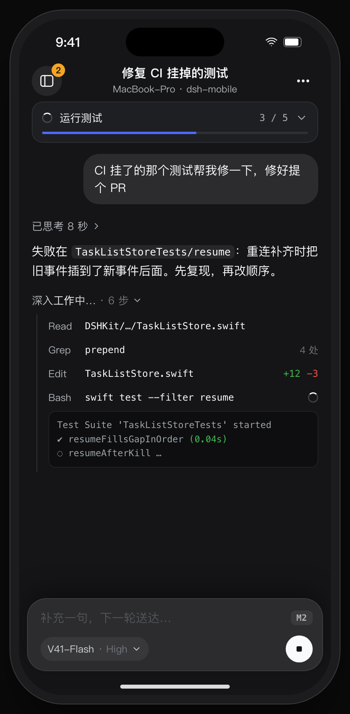
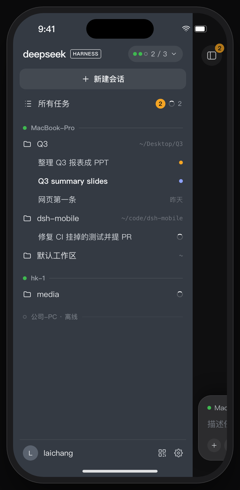
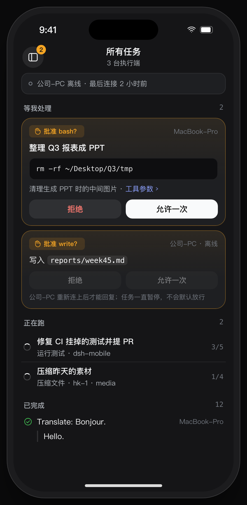
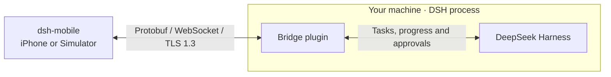

<div align="center">

# dsh-mobile

**DeepSeek Harness mobile client**

The native iOS client for [DeepSeek Harness](https://github.com/deepseek-ai/deepseek-harness) (DSH).
Dispatch tasks, watch progress, approve risky actions, and get results back from every machine you run DSH on.

[](#quick-start)
[](ios/)
[](bridge/)
[](protocol/)
[](#security)
[](#license)

English · [简体中文](README.zh-CN.md)

<br/>

<table>
  <tr>
    <td align="center"><br/><sub>Live progress as milestones</sub></td>
    <td align="center"><br/><sub>Every host, workspace, session</sub></td>
    <td align="center"><br/><sub>Tasks across all hosts</sub></td>
  </tr>
</table>

<sub>Screen designs from <a href="design/screens/">design/screens</a>.</sub>

</div>

---

## Features

- 📱 **One entry point.** The app opens on a blank session, ready to type. Quick questions come back inline; long jobs turn into trackable tasks.
- 🖥️ **Many hosts, treated the same.** Pair the home Mac, the office PC and a server. The drawer groups sessions by host › workspace, the way the desktop sidebar does.
- 🔄 **Same session everywhere.** Sessions started in the DSH Web UI or desktop app show up on the phone, and new replies stream in live.
- 🧭 **Milestones, not log spam.** Progress maps straight from DSH's own todos, plan and state events. No hidden summarizer model.
- ✋ **Approvals that say what they do.** The exact command, path or arguments, plus the agent's reason. Phone, Web and desktop all see the same request; the first answer wins.
- 🛑 **Never allowed by default.** No answer means the task stays paused, even when your phone is offline.
- 🧠 **Your model, your choice.** Pick the model and reasoning effort per task from the list that host offers, and switch mid-task. Names are shown exactly as the provider gives them.
- 📂 **Workspace picker.** The host's default, recent workspaces, or any absolute path on that host.
- ⏹️ **Interrupt any time.**
- 📴 **Survives bad networks.** A per-host event log with resume cursors: kill the app, lose Wi-Fi, reopen, and you see exactly what you missed. Nothing is lost.
- 🔐 **End-to-end encrypted.** Pair once by QR. Each connection uses TLS 1.3 with a pinned host key, on the LAN or over Tailscale alike. No relay and no server of ours: the phone talks straight to your hosts.
- 💬 **Talk to a running task.** Follow-up messages wait for the next turn or go in now; answer the agent's questions from a card or the composer; attach photos and files; dictate on the device.
- 🔒 **Live Activity.** Each running task ticks on the lock screen (local only, no push).
- 🧾 **Devices and audit.** See every paired device, revoke a lost phone, and review who approved what, when, from which device.

## Architecture



## Quick start

Both the Simulator and the iPhone connect to your own DSH installation. Start with a host that can already run tasks using your configured model. The bridge supports DSH `0.2.2-rc.1` and requires Node ≥ 24.9, pnpm and an OpenSSL-compatible command-line tool.

On the **machine running DSH**, build the bridge from the repository root and add it to the profile you use. This example uses the `web` profile.

```sh
pnpm --dir bridge install
pnpm --dir bridge build
dsh plugin --profile web add "$PWD/bridge"
```

Restart DSH with that profile (`dsh web`). Open another terminal on the same host, use the same `DSH_HOME`, and generate a pairing code from the repository root.

```sh
node bridge/lib/scripts/pair.js
```

The terminal prints a QR code and a pairing link. Each code is valid for 10 minutes and can be used once. Run the command again to pair a second device. For a custom port or state directory, see the [bridge installation guide](bridge/README.md).

### Connection options

Before pairing, check the `Addresses:` line in the host terminal. The app tries those addresses in order. The bridge uses TCP port `47801` by default.

- **Local network.** Connect the iPhone to the same LAN as the host. The host can use Ethernet. Make sure the phone can reach the listed LAN address and port, for example `192.168.1.20:47801`.
- **Remote access to a home or office host.** Connect the host and iPhone to the same Tailscale network and allow the phone to reach the bridge port. With Tailscale active on the host, start or restart DSH and generate a fresh pairing code. Once the host’s Tailscale address appears in the list, the phone can pair and connect over cellular or another Wi-Fi network.
- **Direct public access.** If the host has a public IPv4 address on its own network interface, check that it appears in the list. Allow the client to reach the bridge port through the host firewall and any cloud security group. If the public IP belongs to a router or cloud NAT, port forwarding alone leaves that address out of the pairing code and TLS certificate. Use the Tailscale option above for that setup.

### Simulator

1. On your Mac, open `ios/dsh-mobile.xcodeproj` in Xcode 26. Select the `dsh-mobile` scheme and an iOS 26 simulator, then press ⌘R.
2. Copy the link below the QR code in the terminal. On the app’s welcome screen, tap **Paste a pairing link**, paste the link and confirm pairing.
3. Send a task such as “List the files in the current workspace.” Check that the app displays the result from your DSH host.

### Physical iPhone

1. On your iPhone running iOS 26, use one of the connection options above to reach your DSH host.
2. On your Mac, create `ios/Config/Signing.local.xcconfig`. Replace the example values with your Apple development team ID and bundle ID prefix.

   ```xcconfig
   DEVELOPMENT_TEAM = ABCDE12345
   DSHM_BUNDLE_ID_PREFIX = com.example
   ```

3. Open `ios/dsh-mobile.xcodeproj` in Xcode 26. Select the `dsh-mobile` scheme and your connected iPhone, then press ⌘R to install and run the app.
4. From the app’s welcome screen, scan the QR code in the host terminal and confirm pairing. Send a task and check that the result from your DSH host appears on the iPhone.

## Security

- **Pinned TLS 1.3.** The QR identifies the host by the SHA-256 digest of its P-256 public key. The phone validates certificate dates and the address before enrollment or reconnect.
- **Single-use, short-lived pairing codes.** A QR burns on first use and expires after 10 minutes, so a leaked screenshot is worth little.
- **Per-device keys and revocation.** The device bearer stays in the Keychain on this device only, never synced. Revoking a device closes its sockets at once and rejects reconnects.
- **Fail closed.** Approvals that nobody answers are never allowed; a timeout rejects.

## Contributing

Issues and PRs are welcome, especially TLS reviews, real-device testing, and bridge support for new DSH releases.

By submitting a contribution, you agree that the maintainer may license it under the project license and under separate commercial licenses.

Before writing code, read [AGENTS.md](AGENTS.md) (it applies to humans too): the code is the source of truth, and STORY, the screens and ARCHITECTURE change together with it. Product and UX changes should follow the principles in [STORY.md](STORY.md).

## License

[PolyForm Noncommercial 1.0.0](LICENSE). Free for personal use, study, research, hobby projects and noncommercial organizations. **Commercial use needs the author's permission:** [open an issue](https://github.com/laichang/dsh-mobile/issues) to ask.

dsh-mobile is an independent community project. It is not affiliated with or endorsed by DeepSeek.
