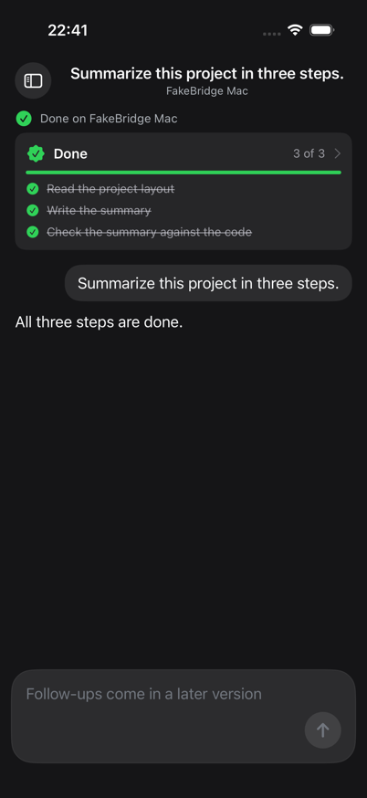
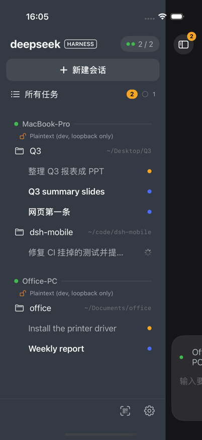
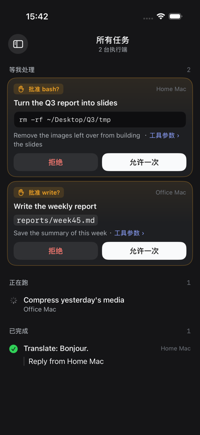
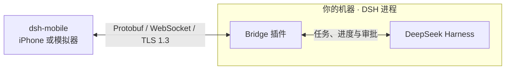

<div align="center">

# dsh-mobile

**DeepSeek Harness 手机端**

[DeepSeek Harness](https://github.com/deepseek-ai/deepseek-harness)（DSH）的原生 iOS 客户端。
在手机上给每一台装了 DSH 的机器下任务、看进度、批准高危操作、拿回结果。

[](#快速开始)
[](ios/)
[](bridge/)
[](protocol/)
[](#安全)
[](#许可证)

[English](README.md) · 简体中文

<br/>

<table>
  <tr>
    <td align="center"><br/><sub>里程碑级的实时进度</sub></td>
    <td align="center"><br/><sub>所有执行端、工作区、会话</sub></td>
    <td align="center"><br/><sub>说清楚影响的审批</sub></td>
  </tr>
</table>

<sub>App 在 iOS 模拟器中的真实截图，由各功能的演示脚本生成。</sub>

</div>

---

## 功能

- 📱 **一个入口**：打开 App 就是一个空白的新会话，输入框就绪。快的直接给答案，慢的自动变成可跟踪的任务。
- 🖥️ **多台执行端一视同仁**：家里的 Mac、公司的电脑、云服务器都能配对。抽屉按 执行端 › 工作区 › 会话 分组，和桌面端侧栏一致。
- 🔄 **跨客户端同一个会话**：在 DSH Web 端或桌面端发起的会话，手机上也能找到，新回复实时同步。
- 🧭 **里程碑而不是刷屏日志**：进度直接映射自 DSH 自己的 todos、plan、state 事件，没有隐藏的总结模型。
- ✋ **审批说清楚影响**：具体哪条命令、哪个路径、什么参数，以及 Agent 的理由。手机、Web、桌面看到的是同一个审批，谁先回答算谁的。
- 🛑 **绝不默认放行**：没人回答，任务就一直暂停，手机离线也一样。
- 🧠 **模型由你选**：每个任务都能选模型和推理强度，可选范围由执行端提供，中途也能切换。各家模型怎么命名就怎么显示。
- 📂 **工作区选择**：执行端的默认工作区、最近用过的工作区，或该机器上任意一个绝对路径。
- ⏹️ **随时打断**。
- 📴 **不怕断网**：每台执行端有一条带续传游标的事件日志。杀掉 App、断开 Wi-Fi、再打开，错过的内容一条不少地补回来。
- 🔐 **端到端加密**：扫一次二维码完成配对，此后每次连接都经 TLS 1.3 加密并核对主机密钥，局域网、Tailscale 一视同仁。没有中转服务器，也没有我们自己的服务器：手机直连你的执行端。
- 💬 **任务进行中也能说话**：追加的消息排到下一轮，或者立即发送；在卡片或输入框里回答 Agent 的提问；带照片和文件；在手机上本地语音输入。
- 🔒 **实时活动**：每个正在跑的任务在锁屏上计时（只在本机更新，不用推送）。
- 🧾 **设备与审计**：查看所有已配对设备，手机丢了随时吊销；谁、什么时候、在哪台设备上批准了什么，都有记录。

## 架构图



## 快速开始

两种方式都使用你已配置好模型、能运行任务的 DSH。目前 Bridge 支持 DSH `0.2.2-rc.1`。先在 **DSH 所在机器**的仓库根目录运行以下命令（需要 Node ≥ 24.9、pnpm 和 OpenSSL 兼容的命令行工具）。这里以 `web` profile 为例：

```sh
pnpm --dir bridge install
pnpm --dir bridge build
dsh plugin --profile web add "$PWD/bridge"
```

回到运行 DSH 的终端，按 Ctrl+C，再运行原来的启动命令（本例为 `dsh web`）。保持 DSH 运行，在这台电脑上另开终端，进入 dsh-mobile 项目目录（里面有 `bridge` 文件夹），运行：

```sh
node bridge/lib/scripts/pair.js
```

终端会显示二维码和配对链接。每个码限用一次，10 分钟内有效。模拟器和真机分别配对时，再运行一次命令即可。如果你启动 DSH 时指定过数据目录（例如 `DSH_HOME=/work/dsh dsh web`），发码时也用那个目录（`DSH_HOME=/work/dsh node bridge/lib/scripts/pair.js`）。默认安装可以直接使用上面的命令。自定义端口或状态目录见 [Bridge 安装说明](bridge/README.md)。

### 连接方式

配对前，先看主机终端输出的 `Addresses:`。App 会依次尝试这些地址。默认端口是 Bridge 的 TCP `47801`。

- **局域网**：iPhone 连到主机所在的局域网（主机也可以用网线），确保手机能访问列表中的内网地址和端口，例如 `192.168.1.20:47801`。
- **从外网访问家里或公司的主机**：在主机和 iPhone 上启用 Tailscale，加入同一网络，并允许手机访问 Bridge 端口。先连好主机上的 Tailscale，再启动或重启 DSH，生成新配对码。确认地址列表里有主机的 Tailscale 地址后，即可通过蜂窝网络或其他 Wi-Fi 配对和使用。
- **公网直连**：如果主机网卡直接持有公网 IPv4 地址，确认该地址出现在列表里，并在主机防火墙及适用的云安全组中允许客户端访问 Bridge 端口。如果公网 IP 只在路由器或云 NAT 上，仅做端口转发不会把这个公网地址加入配对码和 TLS 证书；这种情况下可使用上面的 Tailscale 方式。

### 模拟器

1. 在 Mac 上用 Xcode 26 打开 `ios/dsh-mobile.xcodeproj`，选择 `dsh-mobile` 和一台 iOS 26 模拟器，按 ⌘R 运行。
2. 复制终端中二维码下方的链接，在 App 欢迎页选择「粘贴配对链接」，确认配对。
3. 发送一条任务，例如「列出当前工作区的文件名」。看到 DSH 返回的结果，即可确认连接成功。

### 真机

1. 在运行 iOS 26 的 iPhone 上，按上面的连接方式接入 DSH 主机所在的网络或使用公网直连。
2. 在 Mac 上新建 `ios/Config/Signing.local.xcconfig`，把示例值换成自己的 Apple 开发团队 ID 和 Bundle ID 前缀：

   ```xcconfig
   DEVELOPMENT_TEAM = ABCDE12345
   DSHM_BUNDLE_ID_PREFIX = com.example
   ```

3. 在 Xcode 26 中打开 `ios/dsh-mobile.xcodeproj`，选择 `dsh-mobile` 和已连接的 iPhone，按 ⌘R 安装并运行。
4. 在 App 欢迎页扫描主机终端里的二维码，确认配对。发送一条任务，在 iPhone 上查看这台 DSH 主机返回的结果。

## 安全

- **TLS 1.3 与主机身份校验**：二维码携带主机 P-256 公钥的 SHA-256 指纹。手机在注册和重连时校验证书有效期、用途、地址和公钥。
- **一次性、短时效的配对码**：二维码首次使用即作废，10 分钟后过期，截图泄露也没多大用。
- **每台设备独立凭据，可吊销**：手机的设备凭据只存在本机 Keychain，不同步、不备份。吊销设备会立即断开它的连接并拒绝重连。
- **失败即关闭**：没人回答的审批永远不会放行，超时即拒绝。

## 参与贡献

欢迎提 Issue 和 PR，尤其是 TLS 审阅、真机测试，以及让 bridge 支持新的 DSH 版本。

提交贡献即表示你同意维护者可以按本项目许可证、以及单独的商业许可证授权你的贡献。

写代码之前请先读 [AGENTS.md](AGENTS.md)（对人同样适用）：代码是唯一的事实来源，STORY、画面、ARCHITECTURE 要和代码一起改。产品和交互上的改动请遵循 [STORY.md](STORY.md) 里的原则。

## 许可证

[PolyForm Noncommercial 1.0.0](LICENSE)。个人使用、学习、研究、业余项目和非营利组织均可免费使用。**商业使用须经作者同意**，请[提 Issue](https://github.com/laichang/dsh-mobile/issues) 联系。

dsh-mobile 是独立的社区项目，与 DeepSeek 官方无隶属或背书关系。
